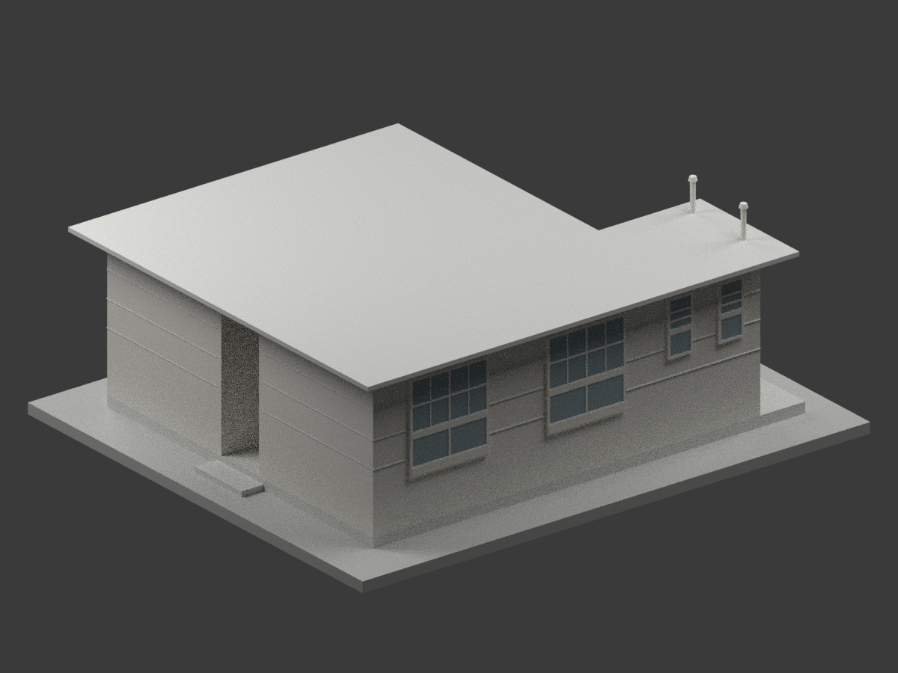
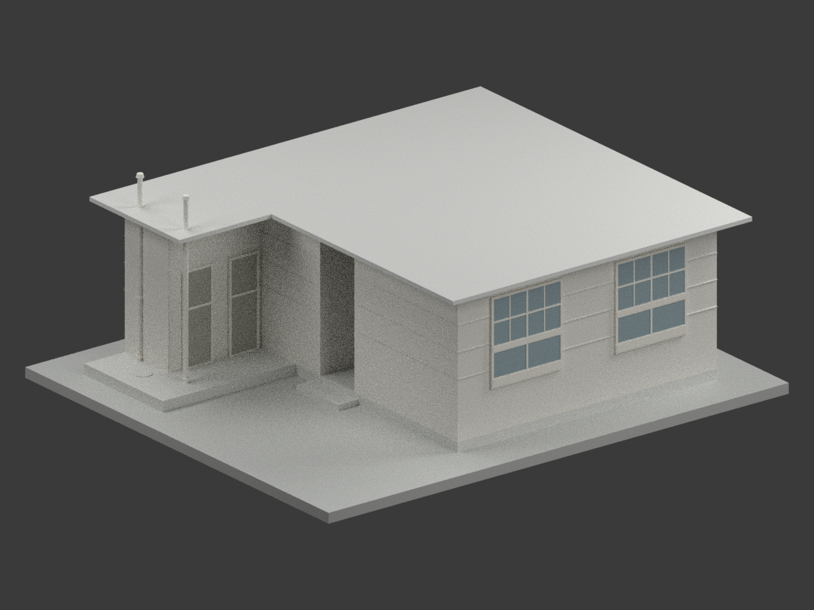
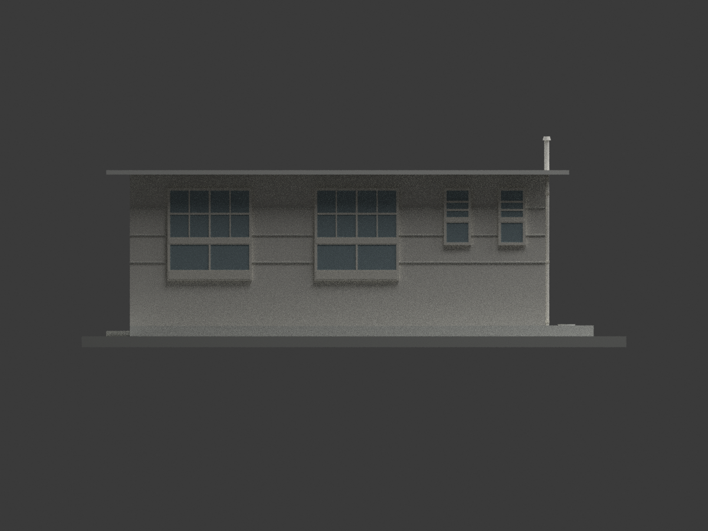
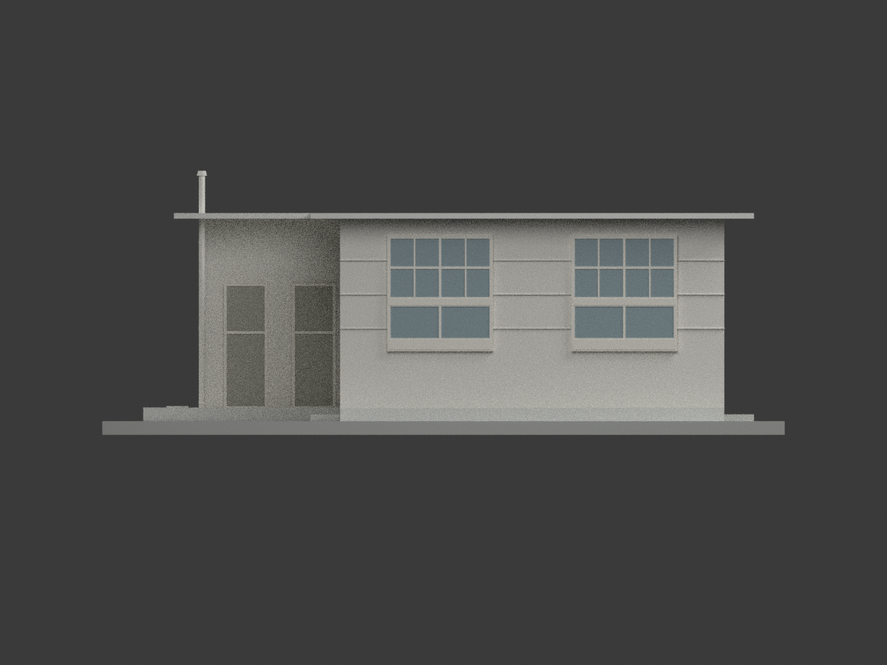
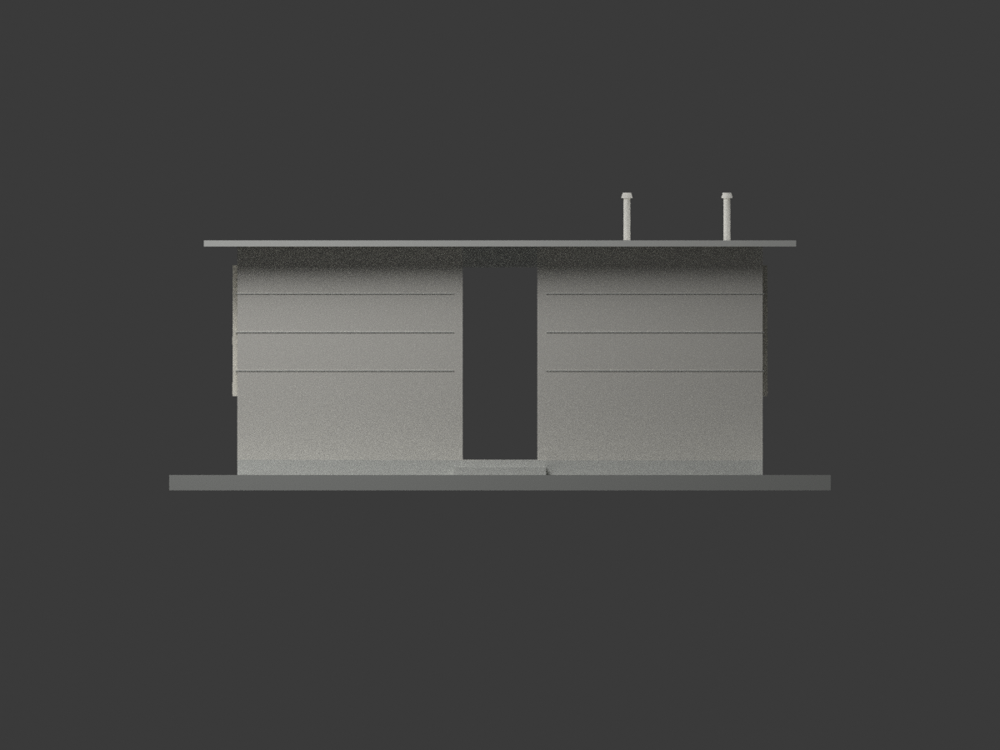
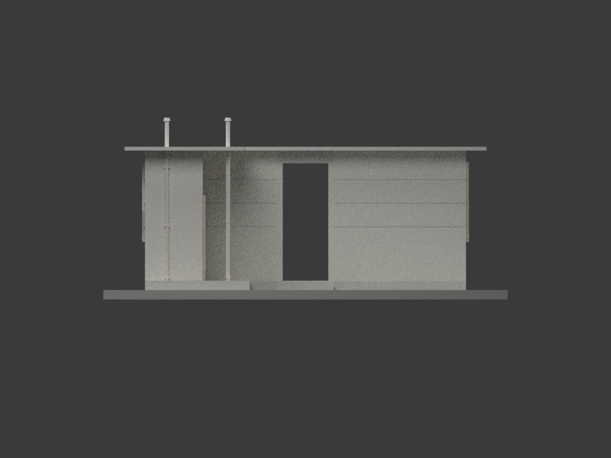
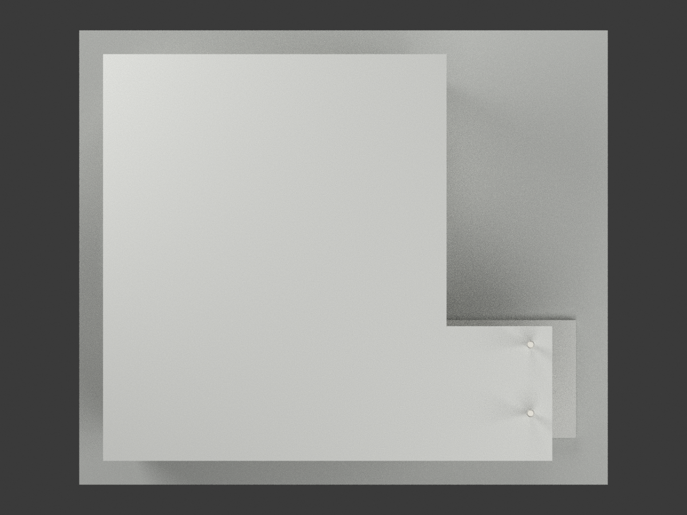
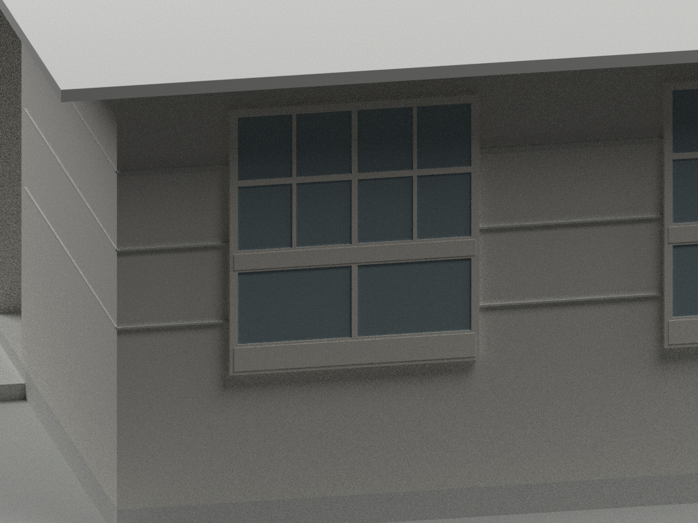
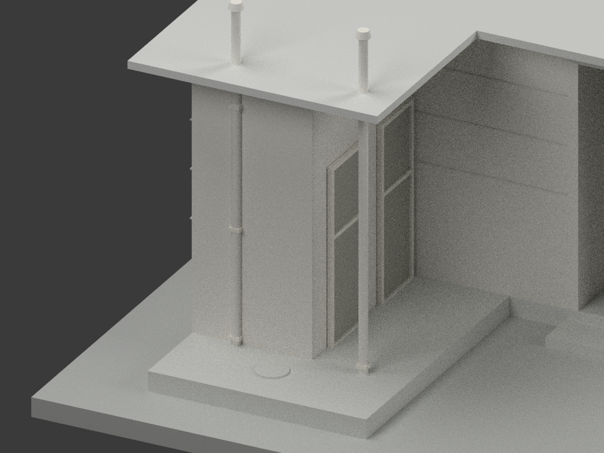

# 國立鳳山高級商工職業學校｜單身宿舍未定年原設計

## 模型實際渲染

| 視角一 | 視角二 | 視角三 |
|---|---|---|
|  斜視 |  另一側斜視 |  圖面下側立面 |
|  圖面上側立面 |  走廊入口端 |  服務翼端 |
|  屋頂 |  窗型細節 |  服務翼細節 |

這是陳仁和的「省立高雄商業職業學校鳳山分部新建單身宿舍工程設計圖」之外觀重建。**設計年代、是否按圖興建及現存狀況未確認，不是現況或竣工測繪模型。** 典藏號 CCRH12623005，與另案獨立廁所 CCRH12623009 不同。

圖面沒有可靠的方位控制。程式與圖檔使用的 north／south／east／west 只是模型座標標籤，不代表實際地理方位。

## 模型與下載

- [STL](model.stl)：毫米、1:50；單一水密相連外觀模型。
- [3MF](model.3mf)：同一網格、毫米與中性材質分區。
- [Blender 場景](scene.blend)：實際渲染場景。
- [建模程式](build_model.py)、[渲染程式](render_model.py)、[3MF 匯出](export_3mf.py)、[格式檢查](validate_model.py)、[場景核對](verify_scene.py)：可重現工具。
- 保留四間宿舍的外部量體、中央開放走廊、兩間服務空間、L 形薄屋頂、檐下前廊、窗與服務門、外部槽蓋及兩支圖示管件。

## 尺度與圖面解讀

| 控制項目 | 模型採用值與依據 |
|---|---|
| 主棟軸網 | 5.40 × 6.60 m：兩個 2.70 m 柱間；深度 2.70 + 1.20 + 2.70 m |
| 軸長 740 cm | 5.40 m 主棟加兩個 1 m 服務間，**不是含外槽的全部長度** |
| 最後 100 cm | x7.40–8.40 m 為外部槽／檢查設施，不建成第三間房，也不把屋頂延長到槽外緣 |
| 服務間及前廊 | 兩間封閉空間約 y0–1 m；門外約 y1–2 m 為覆簷前廊。屋頂內凹角以天花平面比例解讀，非另有完整屋頂尺寸鏈 |
| 高度 | GL 0、地坪 +0.20 m、梁底 +2.70 m、屋頂上緣 +3.05 m |
| 薄屋面 | 詳圖 6 cm 板加 2 cm 上層，模型厚 8 cm；不把 35 cm 梁深畫成全屋厚板 |
| 屋簷 | 主棟及外側按圖 55 cm 外挑；服務前廊北緣依屋頂輪廓圖讀至約 y2 m，不再機械外加 55 cm |
| W1 | 寬 1.50 m；窗臺下框約地坪上 85 cm，即 GL +1.05 m，組件上緣至梁底約 GL +2.70 m；保留上部兩行小格、下部一行大格及左右雙扇，框臺分界簡化 |
| W3 | 寬 45 cm，組件下部約地坪上 1.50 m，即 GL +1.70 m；上百葉／中料／下窗格以簡化分格表達 |
| 服務門 | D2 寬 60 cm、扇高 180 cm，地坪 +0.20 m，門扇頂 +2.00 m；不套用主房 D1 的 200 cm |
| 走廊兩端 | 平面與立面未畫門扇，採開放通道；不是兩扇實門 |

外管的位置、直徑、管帽及超出屋頂的高度沒有可靠尺寸標示，按立面圖形估讀。外槽只表示露出地面的槽蓋與簡化檢查口，不重建地下槽體、管路與衛生設備。牆面水平分縫依立面節奏作淺浮雕，不是施工接縫定位圖。

## 製造與準確性限制

1. 這是外觀展示模型。四間房及兩服務間採封閉背襯，不提供可用室內、家具、內門、梁筋或地下基礎；中央走廊保持通透。
2. 中性牆、混凝土、窗框與窗面顏色為可辨識材質解讀，**沒有原建築實景校色依據**。不補造校徽、字牌或未知現代設備。
3. 窗框、百葉與門板有簡化；最細分格採原尺寸等效 24–50 mm 的浮雕，並非所有原構件實際斷面。部分構件在 1:50 下僅約 0.48 mm，切片時可能消失。
4. 添加 200 × 172 mm 展示底座，非基地邊界或真實地形。屋頂懸挑、走廊跨距與管件可能需要支撐；水密／格式 QA 不等於可直接適用所有印表機。**未實體試印。**
5. 屋頂內凹角、管件及框臺分界屬明列圖讀或展示處理，不宣稱毫米級實測精度。

## 來源與權利

- [國立臺灣博物館／文化部建築典藏：CCRH12623005 原設計圖](https://collections.culture.tw/docomomo_collectionsweb/Collection?GID=MYMRMPM4)
- 設計者：陳仁和。典藏原圖標示 CC BY-NC，詮釋文字標示 CC BY，版本未另確認。原圖與私人參考資料不包含在公開模型包內。
- 自行建模程式、生成網格與渲染另行區分，不把整包概括列為僅限非商業，也不保證任何利用均可無限制商用。再利用應保留設計者及來源並確認適用權利。

## 重建與檢查

Python 依賴：numpy、trimesh、manifold3d，重建檢查使用的版本列於 [requirements.txt](requirements.txt)。依序執行 build_model.py、export_3mf.py、validate_model.py；使用 Blender 4.3 執行 render_model.py 和 verify_scene.py。所有程式以自身所在目錄為工作輸出位置。

最終交付的 SHA256SUMS 限定模型、程式、圖片與檢查紀錄版本；原圖不隨包發布。幾何、格式、場景重開、獨立重建及來源視覺檢查各有獨立 QA 紀錄，不能以其中一項代替實體試印。
