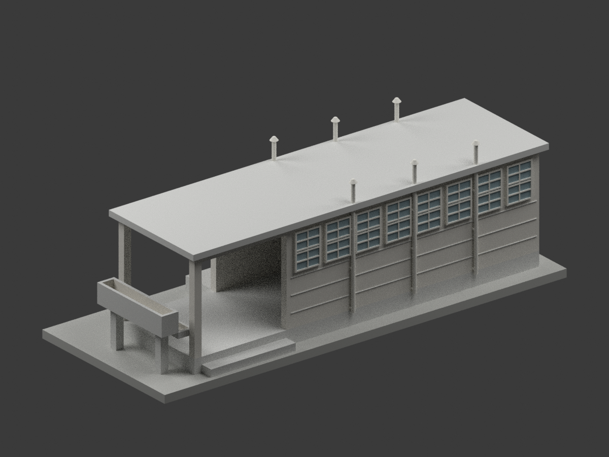
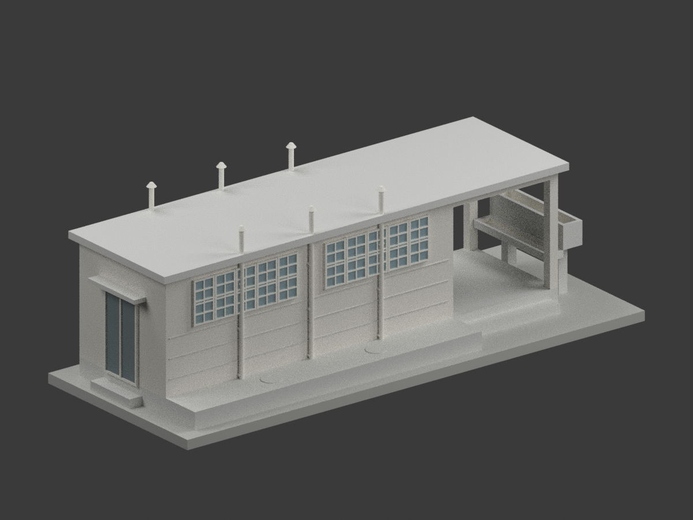
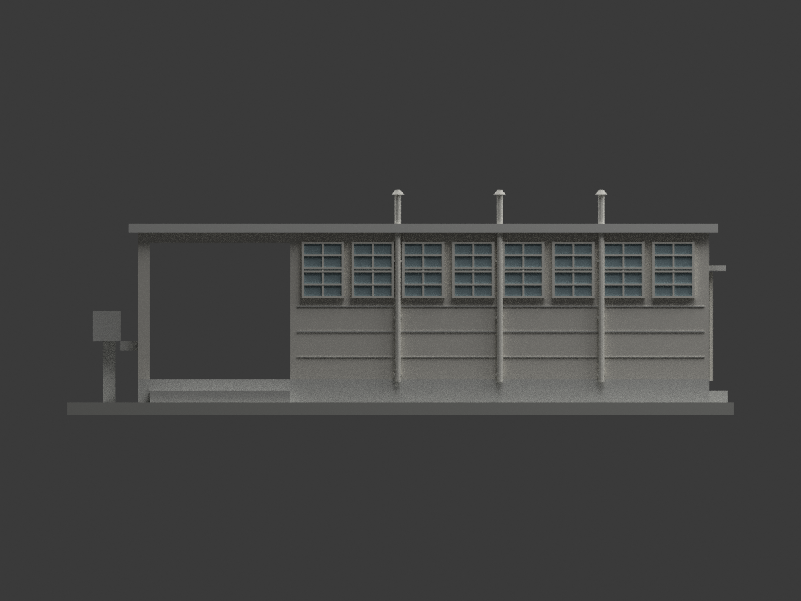
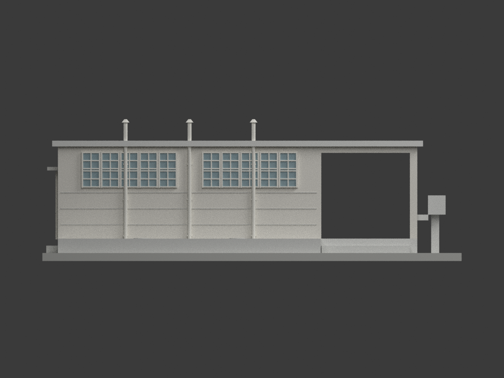
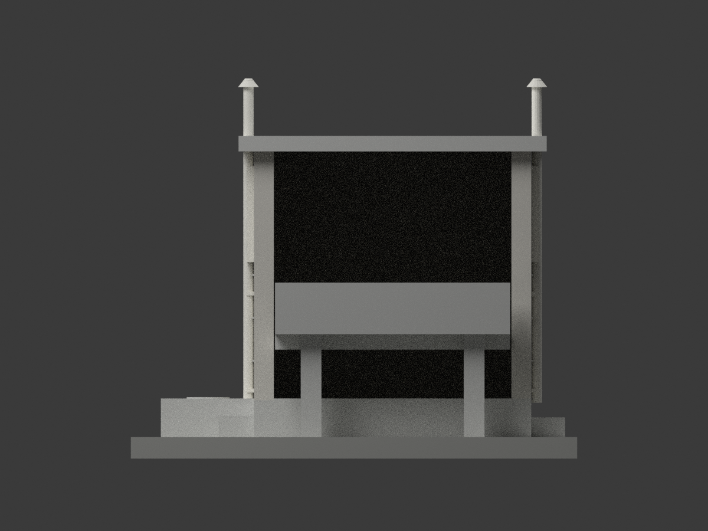
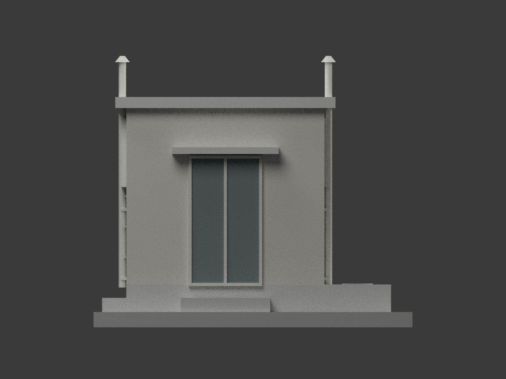
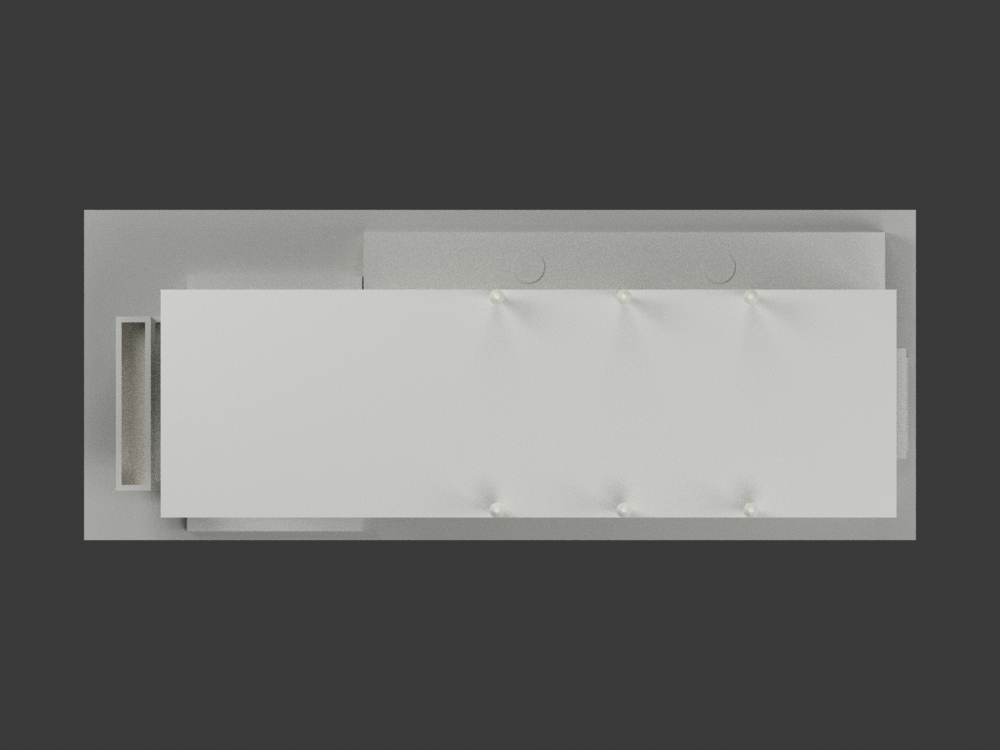

# 鳳山分校廁所新建工程：未定年原設計模型

依國立臺灣博物館典藏 **CCRH12623009**、陳仁和建築師事務所《省立高雄商業職業學校鳳山分校廁所新建工程設計圖》製作。

**這是歷史原設計圖版，不是現況測繪、竣工復原或實施證明。原圖未讀得設計日期，不能以學校改制年份推定。** 歷史題名與今日鳳山商工的校史關係，不表示此小棟仍然存在。

## 範圍與尺度

- 同張原圖具平面、屋頂、排氣平面、四向立面及剖詳；建築軸線長 3+8=11m、深 3m，牆厚約 23cm。外牆與簷口尺寸不等於軸距。
- GL 為地面：地坪 +0.45m、屋頂頂 +3.51m；屋頂邊厚 18cm。西端入口灣開放，東端入口採有背板凹面表現。
- 南面8扇W2；北面兩組各5扇W1；兩長邊各3支排氣管，共6支。西端GL1.80m儲水槽及GL1.20m洗槽、北側外露化糞池蓋台保留；地下槽體、管路及室內衛生器具不建。
- 模型 **1:75**，毫米單位，含底座約174.67×69.33×59.07mm。來源 1m 對應模型 13.333mm。底座為方便展示的新增構件，非原設計建築。

## 明示估算與簡化

排氣管位置與帽頂高、屋簷外伸、窗底高程及個別門窗定位含圖面比例判讀；東踏步寬145.5cm不是門淨寬，門葉約1.15m、雨庇約1.74m僅由立面比例估讀；控制檔區分明標與推估。中性材料色不代表歷史塗色。窗門採不透明背板及凸框，不是真玻璃。排氣管實心化、窗框加厚，細構造與材料接縫簡化；屋面依原圖平面，不推定未標示的排水微坡。

本模型未試印。簷口、雨庇、盆槽與入口灣可能需要切片支撐；細框、排氣帽與桿件可能受製程限制，不承諾免支撐或任何印表機一次成功。

## 預覽

|  |  |  |
| :---: | :---: | :---: |
|  |  |  |
| 入口側透視 | 另一側透視 | 南向 |
|  |  |  |
| 北向 | 西向 | 東向 |
|  |  |  |
| 屋頂 |  |  |

## 重建與來源

`python build_model.py` 產出 STL、網格與幾何檢查；`python export_3mf.py` 輸出毫米3MF；`blender -b -P render_model.py` 產生實際模型影像與原生scene.blend。依requirements安裝Python依賴。來源原圖不隨模型包嵌入。

[官方典藏原頁](https://collections.culture.tw/docomomo_collectionsweb/Collection?GID=MKMEMGMLM2)。原圖作者為陳仁和／陳仁和建築師事務所，典藏為國立臺灣博物館。原圖像頁標示 CC BY-NC（版本未明示）；原圖像授權與模型權利分開，不自動概括套用為整包模型僅限非商業。本包保留設計者與來源，不宣稱取得不限用途商用權利。檢查報告中的幾何合格不等於史料全尺寸精確、權利核准或列印保證。

## 下載與重建檔案

[單色 STL](model.stl) · [彩色 3MF](model.3mf) · [可編輯 Blender 場景](scene.blend) · [建模程式](build_model.py) · [渲染程式](render_model.py) · [3MF 匯出程式](export_3mf.py) · [重建依賴](requirements.txt)
