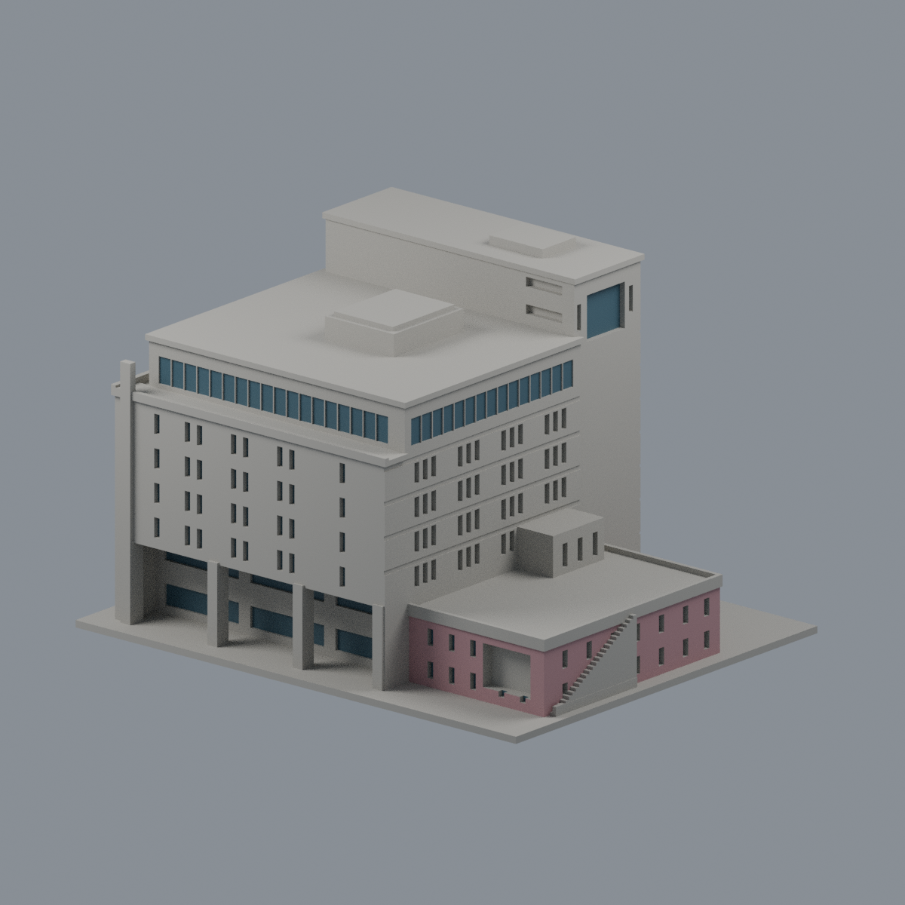
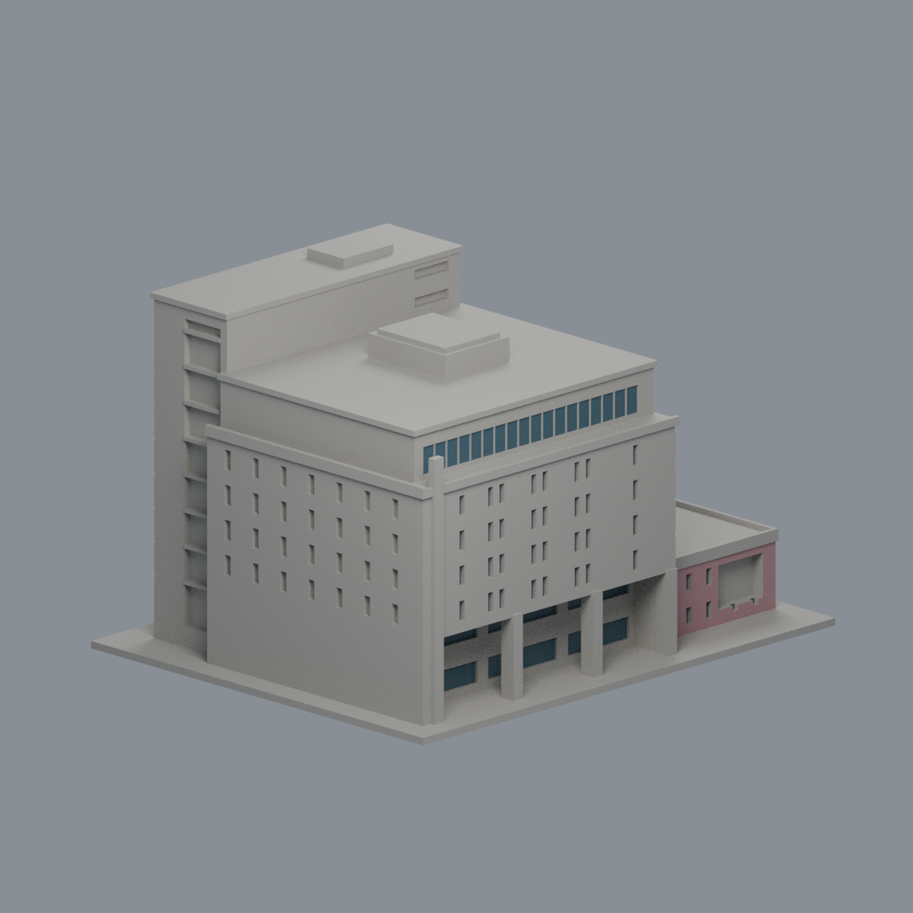
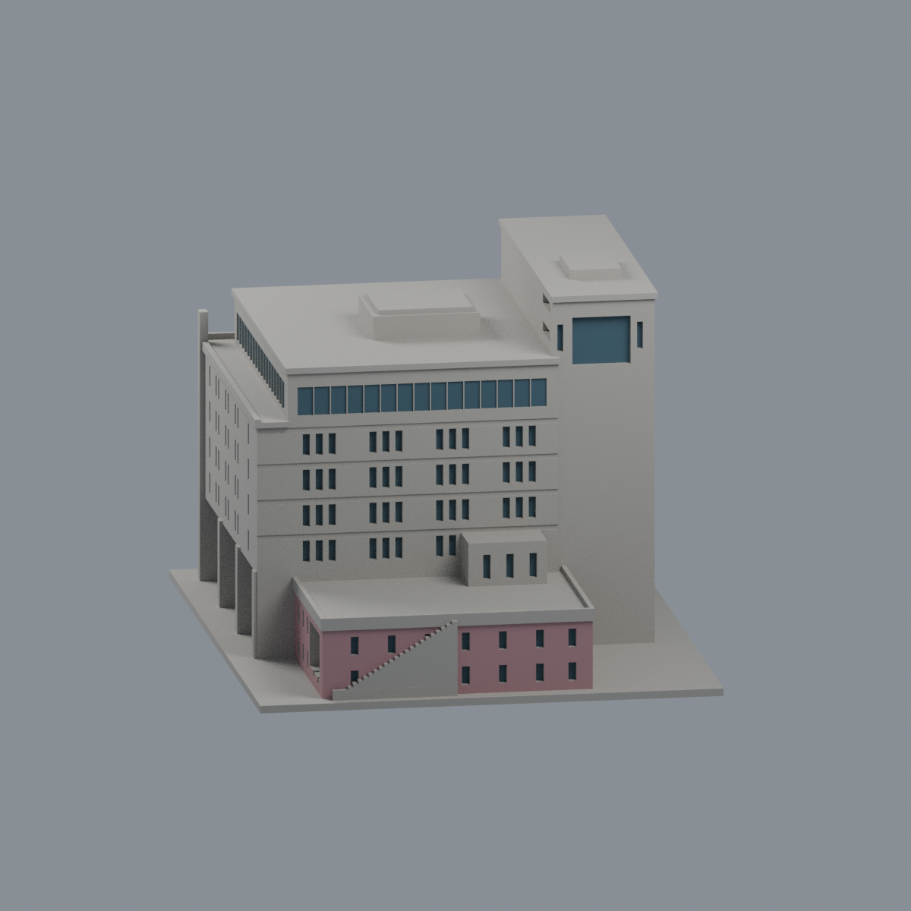
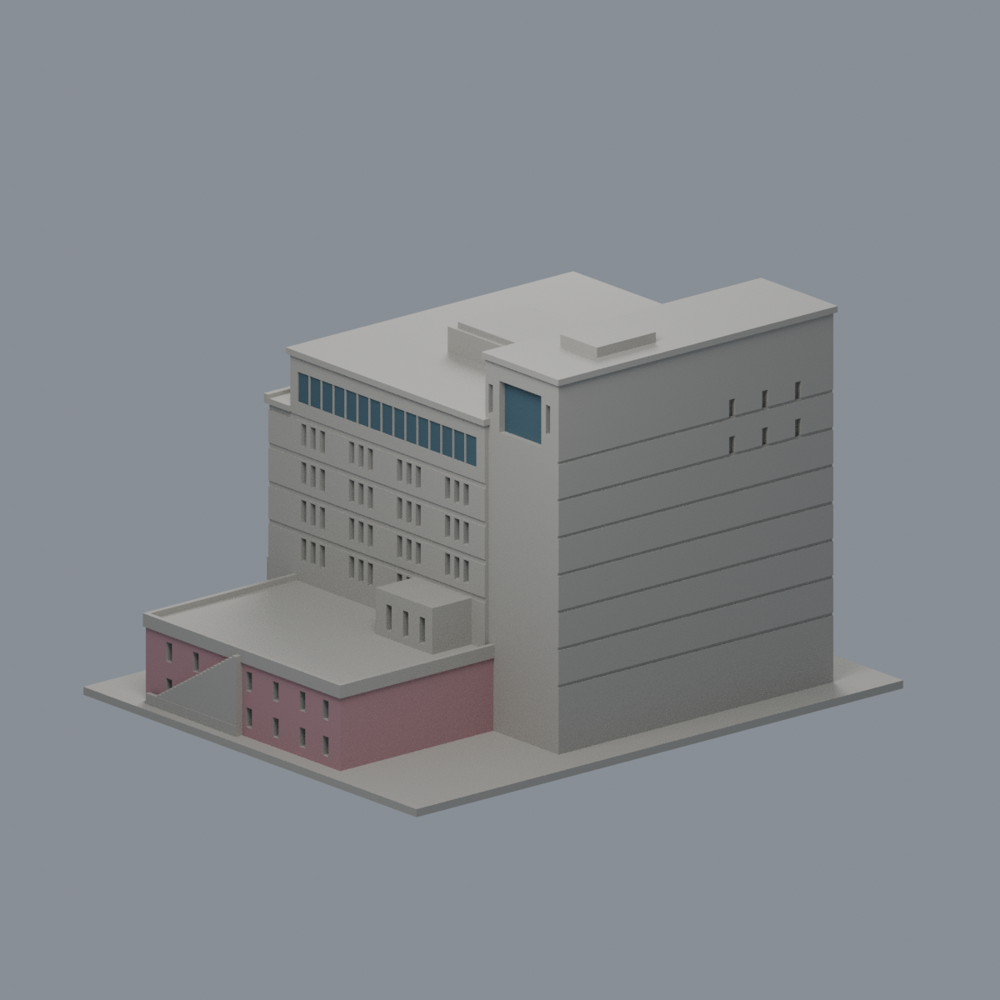
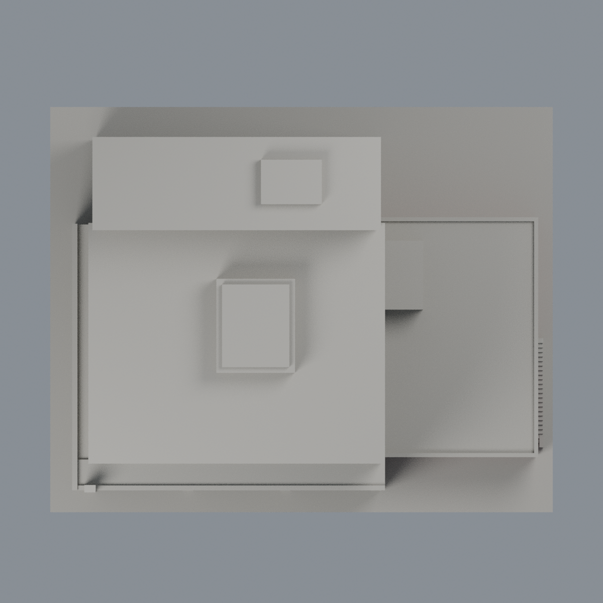

# 大仁科技大學｜校本部｜行政圖資大樓 A

## 模型預覽

| 新版模型預覽 | 新版模型預覽 | 新版模型預覽 |
| :---: | :---: | :---: |
|  |  |  |
|  |  |  |

## 本次獨立東低翼北牆有限延色

本次僅將原東側低翼北面兩個完整原三角 [3452,3453]，由未確認材質 0 延用同一低翼既有粉紅材質 1。原 162 粉紅面、288 玻璃面、其餘 4094 面的材料與理由、全部原色盤 bytes 保留。現 3644 未確認、164 粉紅、288 玻璃面；4096 面／2046 點、原 STL bytes、座標、三角面序及繞向全部不變。

有限域以原局部單位表示：y=10.2、x=17.5…37、z=0…7.5，法線 +Y，比例 150/62 mm/單位，底座偏移 z=2 mm。兩面合為完整矩形與完整共面連通域，四角／所有頂點及整條共用邊均經獨立二審；解析面積 19.5×7.5×(150/62)² 約 856.0419 mm²，原 float32 座標誤差容差 0.0002 mm²。東端整條高度鄰接原粉紅面 3484；上界止於原屋頂 union 的 z=7.5，不延至低翼名義盒高 7.7。

本次屬「同一獨立低翼不透明外牆」的材料延續推論，並非照片直接證明北面全牆粉紅。校方歷史 admin02／admin03 照片可見東／南低翼粉紅，主高樓有白／粉混帶，因此推論限定低翼，完全不跨入主高樓、頂面、女兒牆、玻璃、窗揭面、底座或其他牆。原北牆為簡化空白代理；保留其幾何不代表認證實景沒有窗門，亦不新增假窗。早期僅因未完成同構件對應而暫停的初篩 HOLD 原檔不改，兩次新獨審只重新確認這兩面的有限域與同構件關係，並非全棟或全背面開放改色。

主要來源為大仁科技大學校方歷史頁 https://www.tajen.edu.tw/p/406-1000-25606,r729.php?Lang=zh-tw 。admin02 可見日期 2001-08-12，原記錄 EXIF 時刻與白天照片不一致且時區未知；admin03 拍攝日期未知。本次未把歷史影像當 2026 現況，未做色卡校準；私人來源圖不加入公開包。

原模型製造風險、簡化、短段與切片問題及歷史 QA 全保留；本次 strict 3MF／封閉流形／精確交換 PASS 不是實體試印、全域壁厚或支撐保證。root 的原 STL、OBJ、scene、生成器、預覽與校驗檔不動。新彩色版本位於 appearance；歷史 appearance/qa、舊 source 程式、rebuild-source.zip、SHA256SUMS、SOURCES 原樣保留，仍描述原 450 色面版本。palette 內歷史 scope 也不改，現版延色範圍以本段及 appearance/qa-continuous-lowwing 為準。

新 mesh-data.npz、face-materials.json、tajen-admin-library-appearance.3mf、scene.blend 與十張 previews 經精確交換與 Blender 獨立材質／頂點改存重開、原 scene 重渲染核對。新 QA 在 appearance/qa-continuous-lowwing，當前 hashes 在 CONTINUATION-SHA256SUMS；兩份獨審原樣納入。以 python appearance/source/build_continuous_lowwing.py 重建，verify_continuous_exchange.py 驗證；Blender 執行 render_continuous_lowwing.py 與 verify_continuous_scene.py。新 rebuild-continuous-source.zip 隔離精確重建與 strict 交換驗證。此為本地準備，不能解讀為已上傳。

本輪全部原物件屬性與完整材質定義皆保留，僅 2 個指定面的材質指派延伸；原 palette scope 保留歷史文字，現行範圍以本節為準。舊校驗表與 QA 保留歷史 bytes，根 PUBLIC-MODEL-SHA256SUMS 與 appearance/CONTINUATION-SHA256SUMS 為現行校驗。

## 前版說明與保留限制

狀態：外觀有界近似已核；作者幾何與重現檢查完成。39個局部損失樣本與獨立加密2331短首段的具體限定證據已由主審接受；原作者7點/1054筆結果仍保留。

## 來源與形體
原創 Python 參數實體；[來源清單](sources.json)。官方 A 棟包含行政與圖書館，公開用途證明 10F 存在；B2 地下不完整建模，沒有把十層均分。2001 三面照片配合 2016／2024 正射及 2024 西北街景。排除 C 活動中心、能源中心與臨時施工網。

北紅窄屋片較高、南紅大屋片較低。主紅頂約36×29m、北片35×11m屬正射投影，目讀與視差不確定，非牆基地籍測繪。名義南頂31.8m、北頂38.45m、設備最高39.5m；照片試配總高界32–42m，不是官方測高或統計置信區間。黑色中央頂區建為封閉凸設備體，沒有挖天井。

南柱廊採含端柱4粗柱／3大跨，右內柱受樹遮，屬有界推估。原STL 9條前後射線證實5.0–5.35m凹深；後牆兩排玻璃間保留寬實樓板帶。上玻璃連續淺分格與東白水平帶按可見節奏近似，框粗細未逐窗測繪。北未知窗陣省略；有限頂窗及遮擋處比例為推估。東外梯用落地實階與背接厚護邊，省略金屬細欄，未包含完整基地景觀。

## 檔案與重現
[STL](model.stl) · [Blender](scene.blend) · [原創源](build_model.py) · [參數](parameters.json) · [全檢查](run_all_checks.py) · [QA](QA.md)

成品含底150.000×120.968×97.565mm，底2mm，毫米單位。9張預覽全部由交付STL實際匯入單灰渲染；不是色塊代替幾何。source重建STL與9PNG逐byte對應；保存Blend原有向幾何精確一致。

環境：Python及requirements.txt所列版本；外部Blender4.3.2、g++ C++17。模型目錄執行 `python run_all_checks.py` 可重跑；`--bind-existing` 僅檢現有報告與檔案綁定，不冒稱重新執行。

## 列印限制與局部例外
0.2mm逐層原Polygon侵蝕／開運算不消失、不分裂；這不是噴嘴路徑或試印保證。西南端飾帶39截面損失1.87321599–2.04675525%，完整矩形caliper 2.17742157×3.38709641mm。0.41mm真矩形角鄰域外損失最大0.00970057454mm²（原截面0.13153077%），非零，不能稱全部純四角。原法向與到底連續根另驗。

1054短首弦保留原normal、first-solid及後air：東水平帶186筆最低0.48387146mm；南／東上玻璃淺分格476／392筆最低0.29032135mm。它們是源定義背接浮雕，另方向實體根最低88.039356／51.537935／43.872485mm；不能拿背根長度覆蓋原短首弦，也不能宣稱全域壁厚。全部原28672密點四近面控制符合預期。

未試印；柱廊、窗凹與簷底可能需支撐，切片方向及材料會改變結果。不可任意縮小或據此保證無支撐列印。已接受具體限定例外，但未經實體試印。

## 其餘實際STL視圖

front-low（歷史檔案留存，不作本頁預覽） · rear-low（歷史檔案留存，不作本頁預覽） · top（歷史檔案留存，不作本頁預覽） · east（歷史檔案留存，不作本頁預覽） · west（歷史檔案留存，不作本頁預覽） · north-elevation（歷史檔案留存，不作本頁預覽） · south-elevation（歷史檔案留存，不作本頁預覽）

## 南北立面預覽修正

原南／北立面相機未對準不對稱底座中心，裁到東低翼與外梯。此overlay僅將兩相機x移至19.354837mm，保持幾何及其他7張圖不變。兩立面全部2046原STL頂點含底座入框；新渲染腳本重建9PNG逐byte通過。原freeze保留供SHA鏈追溯。

[獨立精確數字、非角損及背接／沿面限定](independent-review.md)。不代表全域壁厚或免支撐保證。

## 歷史限域外觀層

[三材質3MF、可編輯Blend與五視角預覽](appearance/README.md)：僅162面東低翼粉外皮及288面南／東暗窗背，其餘3646面中性；主南粉牆因跨白帶整片不染。原39局部損失、1054作者短段與2331密樣短段等製造限制不變，非全樓全彩或2026現況復原。

