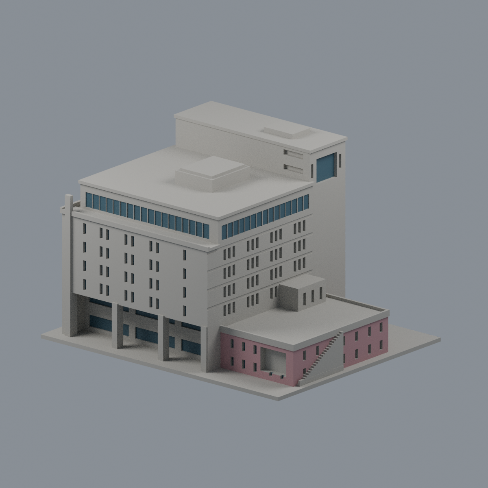
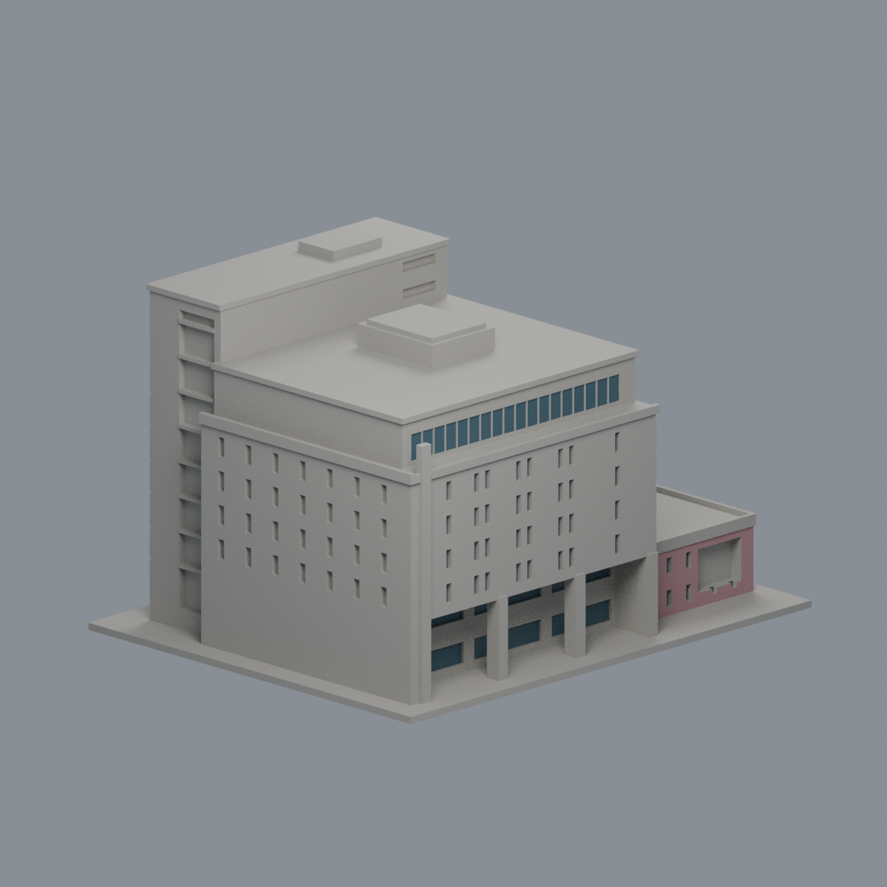
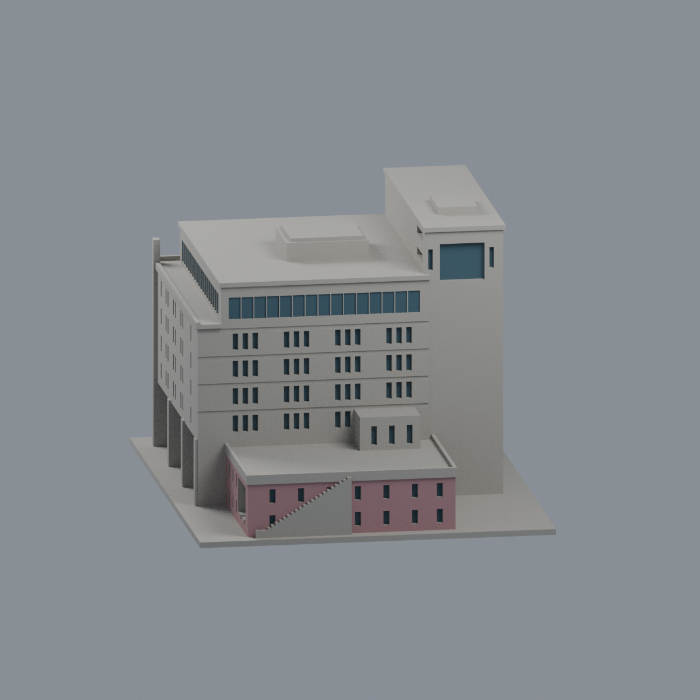
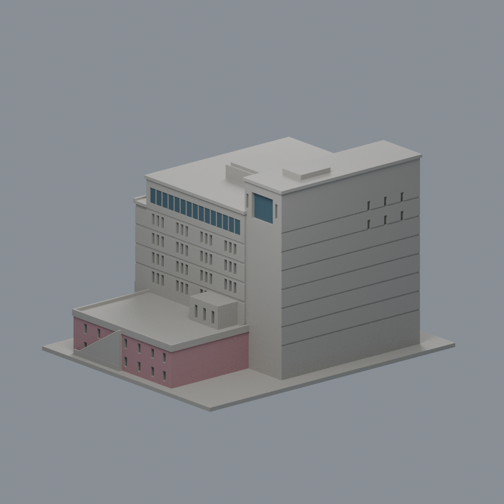
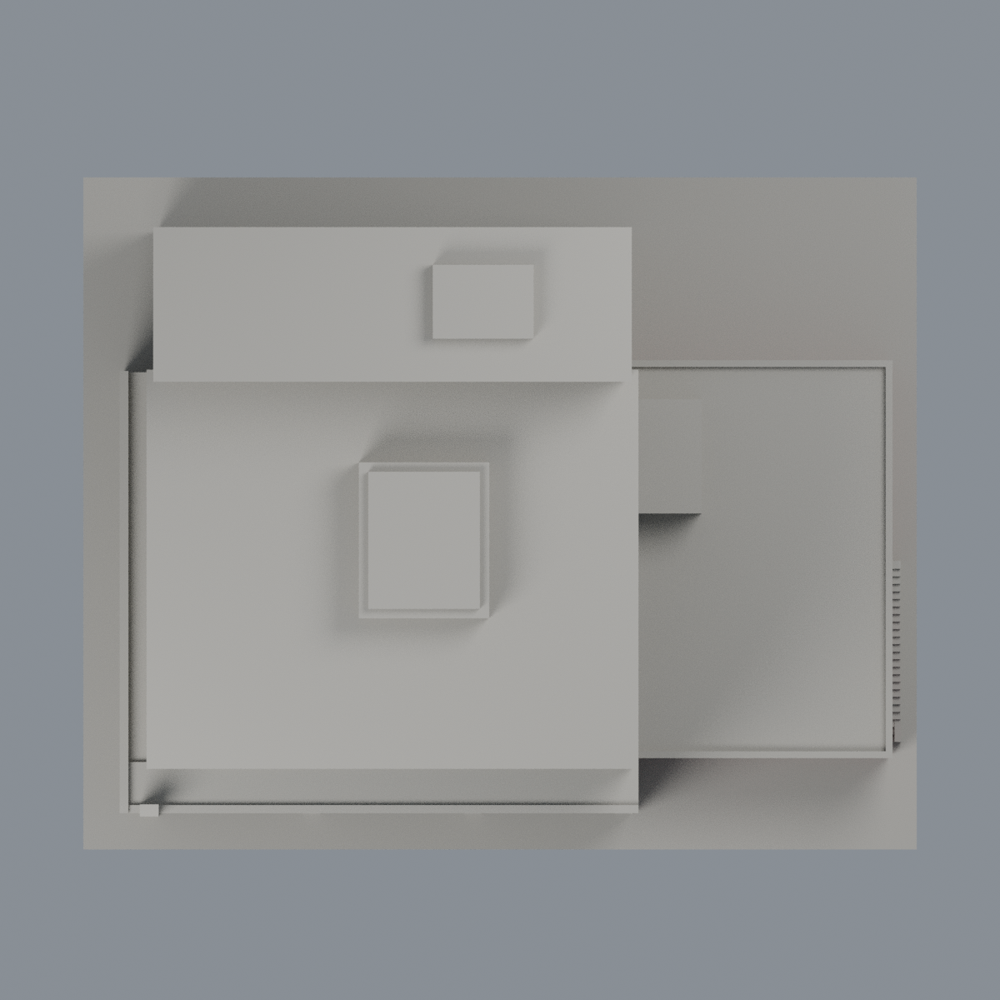

# 大仁科技大學 A行政圖資大樓：歷史限域外觀層

| 模型預覽 | 模型預覽 | 模型預覽 |
| :---: | :---: | :---: |
| 正面  | 左面  | 右面  |
| 背面  | 頂面  |  |

## 本次獨立東低翼北牆有限延色

本次僅將原東側低翼北面兩個完整原三角 [3452,3453]，由未確認材質 0 延用同一低翼既有粉紅材質 1。原 162 粉紅面、288 玻璃面、其餘 4094 面的材料與理由、全部原色盤 bytes 保留。現 3644 未確認、164 粉紅、288 玻璃面；4096 面／2046 點、原 STL bytes、座標、三角面序及繞向全部不變。

有限域以原局部單位表示：y=10.2、x=17.5…37、z=0…7.5，法線 +Y，比例 150/62 mm/單位，底座偏移 z=2 mm。兩面合為完整矩形與完整共面連通域，四角／所有頂點及整條共用邊均經獨立二審；解析面積 19.5×7.5×(150/62)² 約 856.0419 mm²，原 float32 座標誤差容差 0.0002 mm²。東端整條高度鄰接原粉紅面 3484；上界止於原屋頂 union 的 z=7.5，不延至低翼名義盒高 7.7。

本次屬「同一獨立低翼不透明外牆」的材料延續推論，並非照片直接證明北面全牆粉紅。校方歷史 admin02／admin03 照片可見東／南低翼粉紅，主高樓有白／粉混帶，因此推論限定低翼，完全不跨入主高樓、頂面、女兒牆、玻璃、窗揭面、底座或其他牆。原北牆為簡化空白代理；保留其幾何不代表認證實景沒有窗門，亦不新增假窗。早期僅因未完成同構件對應而暫停的初篩 HOLD 原檔不改，兩次新獨審只重新確認這兩面的有限域與同構件關係，並非全棟或全背面開放改色。

主要來源為大仁科技大學校方歷史頁 https://www.tajen.edu.tw/p/406-1000-25606,r729.php?Lang=zh-tw 。admin02 可見日期 2001-08-12，原記錄 EXIF 時刻與白天照片不一致且時區未知；admin03 拍攝日期未知。本次未把歷史影像當 2026 現況，未做色卡校準；私人來源圖不加入公開包。

原模型製造風險、簡化、短段與切片問題及歷史 QA 全保留；本次 strict 3MF／封閉流形／精確交換 PASS 不是實體試印、全域壁厚或支撐保證。root 的原 STL、OBJ、scene、生成器、預覽與校驗檔不動。新彩色版本位於 appearance；歷史 appearance/qa、舊 source 程式、rebuild-source.zip、SHA256SUMS、SOURCES 原樣保留，仍描述原 450 色面版本。palette 內歷史 scope 也不改，現版延色範圍以本段及 qa-continuous-lowwing 為準。

新 mesh-data.npz、face-materials.json、tajen-admin-library-appearance.3mf、scene.blend 與十張 previews 經精確交換與 Blender 獨立材質／頂點改存重開、原 scene 重渲染核對。新 QA 在 qa-continuous-lowwing，當前 hashes 在 CONTINUATION-SHA256SUMS；兩份獨審原樣納入。以 python appearance/source/build_continuous_lowwing.py 重建，verify_continuous_exchange.py 驗證；Blender 執行 render_continuous_lowwing.py 與 verify_continuous_scene.py。新 rebuild-continuous-source.zip 隔離精確重建與 strict 交換驗證。此為本地準備，不能解讀為已上傳。

本輪全部原物件屬性與完整材質定義皆保留，僅 2 個指定面的材質指派延伸；原 palette scope 保留歷史文字，現行範圍以本節為準。舊校驗表與 QA 保留歷史 bytes，根 PUBLIC-MODEL-SHA256SUMS 與 appearance/CONTINUATION-SHA256SUMS 為現行校驗。

## 前版說明與保留限制

既有模型的局部材質改善，新增模型套數為零；不是整樓全彩復原，也不是2026現況調查。

- [三材質3MF](tajen-admin-library-appearance.3mf) · [可編輯Blender](scene.blend) · [材質表](palette.json) · [逐面對照](face-materials.json)
- [正面](previews/front.png) · [左面](previews/left.png) · [右面](previews/right.png) · [背面](previews/rear.png) · [頂面](previews/top.png)
- [來源與年代](SOURCES.md) · [授權說明](LICENSE-NOTICE.md) · [重建原始碼包](rebuild-source.zip)

4096個原三角面保留座標與面序，原STL bytes完全不動。僅官方照片支持的東低翼連續粉色外皮162面／1420.309600平方毫米，以及南／東實有凹入暗窗背288面／3082.914176平方毫米；合計450面／4503.223776平方毫米，其餘3646面維持中性。147有限群組全部三頂點須在同一有限平面及邊界內，實際叉積法向吻合；逐組驗證canonical原面序，4個原本無面的群組維持0面。不以中心點選取、切面、重三角化或新增玻璃。

主南立面粉牆因原三角形跨越實景下白帶，整片維持中性，避免非實景的三角斜色縫。東高牆灰白帶、屋頂、後方、未確認西面、框／凹口側壁、深低翼大凹口背面及底座皆中性。不是前景C活動中心；不把C的筒頂當成A屋頂。粉牆與暗窗背均是不透明展示代理，色彩未校色，不代表精確RGB、廠商色號或真實透明光學。

## 原始幾何與製造警示完整保留
原模型是照片近似，不是完整圖面測繪。北方未知窗省略、屋頂尺度高度不確定、柱廊粗略且部分推測。本次配色不修復原幾何或製造限制。原39局部截面損失、1054作者短首段樣本、2331獨立密樣短首段仍然存在；長支撐根不能抹去短首段，非角點損失不為零。南／東窗淺浮雕與東帶最小尺度限制保留。原QA.md早期pending與independent-review.md後續serial402接受屬不同歷史階段，不能改寫成這次無條件全通過。本輪未重跑完整壁厚、自交、切片器或實體試印，交換材質／拓撲檢查不等於製造保證。

## 重建與交換驗證
appearance上層保留原model.stl，安裝source/requirements.txt；執行 `python source/build_appearance.py`、`python source/verify_exchange.py`，再用Blender執行 `source/render_appearance.py` 與 `source/verify_scene.py`。固定Cycles CPU種子生成完整五圖，PNG移除時間metadata。乾淨重建比較3MF、map、palette及五圖bytes；Blend比較真頂點與材質語義，不宣稱Blend二進位一致。兩格式皆實際編輯材質存讀，Blend另實際編輯頂點存讀並從交付檔reopen render核對。
