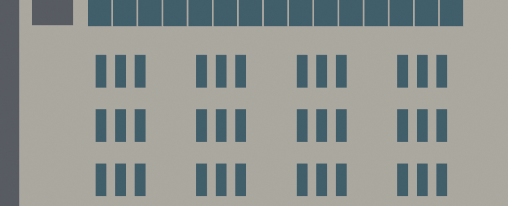
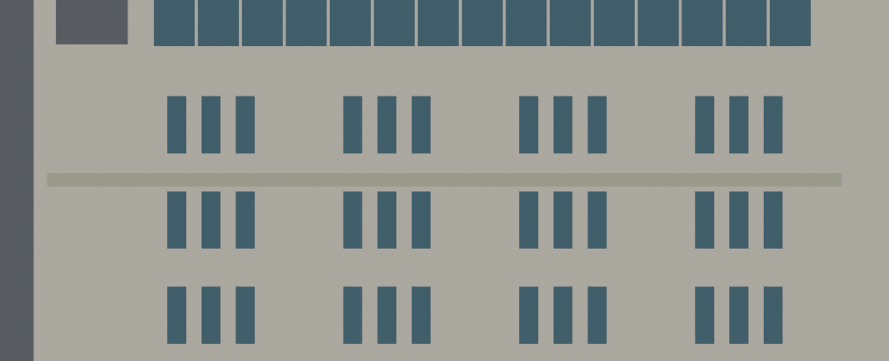

# 大仁科技大學行政圖資大樓 A｜東側一條灰色橫帶

這是既有模型的獨立局部外觀版本，不替換原檔、原圖、校級代表圖或套件數。只在東側中上段原淺凹橫帶槽背朝外的垂直面補入暖灰（名義色 `#99998C`），限定原三角 1673、1676（零起算，約 104.627148 mm²）。原三材質、其餘 4,094 面、2,046 個頂點、面序、繞向、尺度和 STL bytes 不變。

## 下載與對照

- [逐面材色 3MF](model-colored.3mf) · [可編修 Blender](scene.blend) · [原無色 STL](../model.stl)
- [有限域、來源與原版 SHA-256](domain.json) · [驗證](verification.json) · [再現報告](reproduction-QA.json) · [校驗](SHA256SUMS)

| 原中性色 | 局部補色後 |
| --- | --- |
|  |  |

兩圖都是同角度原網格渲染，不含來源放樣或照片。不是全棟代表圖。

## 來源與限制

[校方歷史照片集](https://www.tajen.edu.tw/p/406-1000-25606,r729.php?Lang=zh-tw) 的 admin02（畫面日期 2001-08-12；EXIF 時區不明且時刻與日光不同）可辨東側窗列間的深一階灰帶，與正南粉紅面不同。另一張東斜照 admin03 只核對灰帶和低翼的位置，拍攝日不明且不取逆光顏色。名義色不是校色、2026 現況或材料規格；局部端點按同一帶延續近似，不宣稱逐點實測。只適用原模型一條既成面域：(x=17.86) m、(y=-23ldots9.5) m、(z=20.75ldots21.30) m。其他三帶、北棟、玻璃、窄回折面、粉紅低翼與模型近似的凹槽深度都不改。原露出、尺度、薄件、製造及未試印限制保留；不附外部照片。

## 重建

以此目錄為工作目錄，基準檔使用 [domain.json](domain.json) 鎖定的原版。在舊 GitHub 提交 `243d4a05afe6861022c4875354b5c0b77c2926f9` 的同模型目錄可取得原始公開輸入。

```sh
python rebuild_exchange.py ../appearance/tajen-admin-library-appearance.3mf
blender -b -t 4 --python-exit-code 1 ../appearance/scene.blend --python apply_band.py -- --qa-renders
```

獨立重建核對 3MF、兩圖及實際 Blender 場景內容；重存的 Blender 容器 bytes 可因內部標識不同。父目錄目前 `PUBLIC-MODEL-SHA256SUMS` 與 `appearance/CONTINUATION-SHA256SUMS` 只校驗各自列出的既有項目；兩份較舊的 `SHA256SUMS.txt` 對後來更新前的歷史檔案有效，早於這次的既有差異保持原樣。此獨立子目錄自行校驗。
