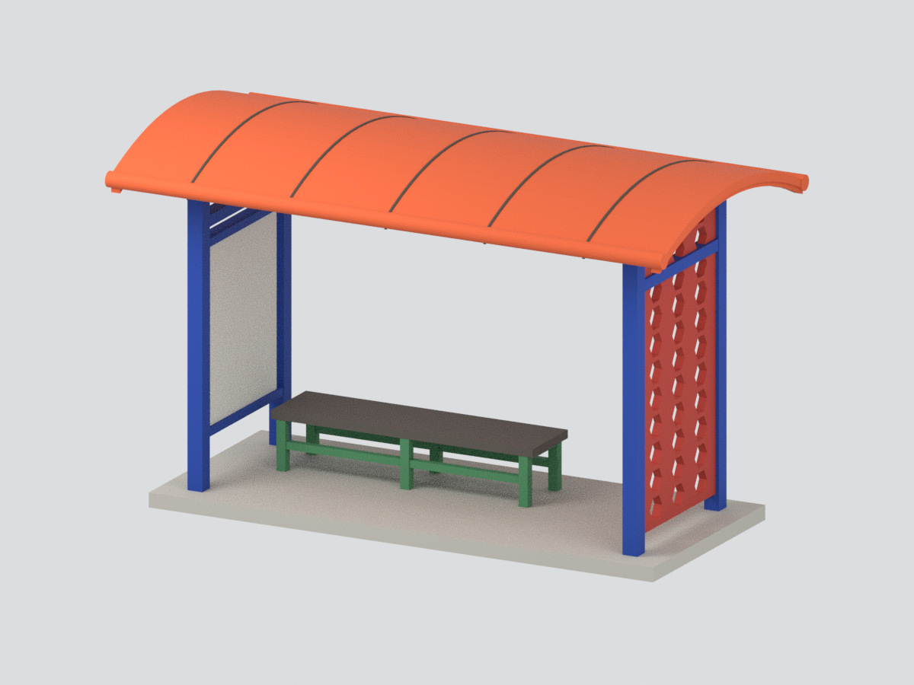
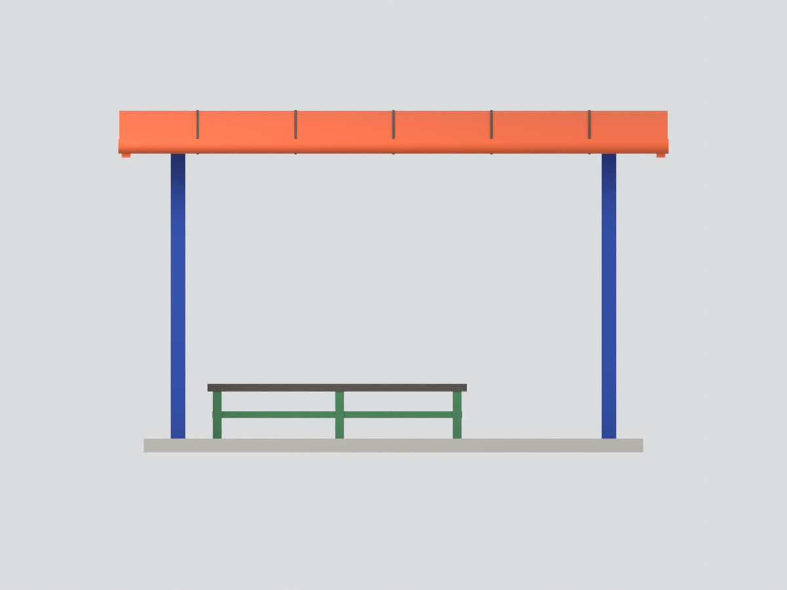
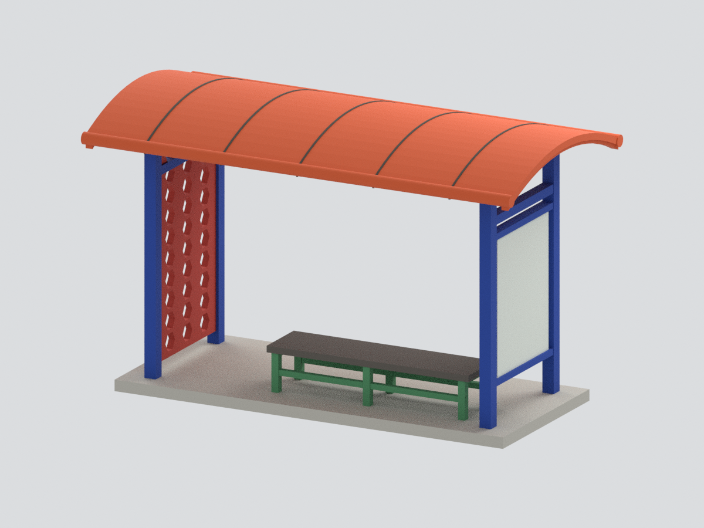
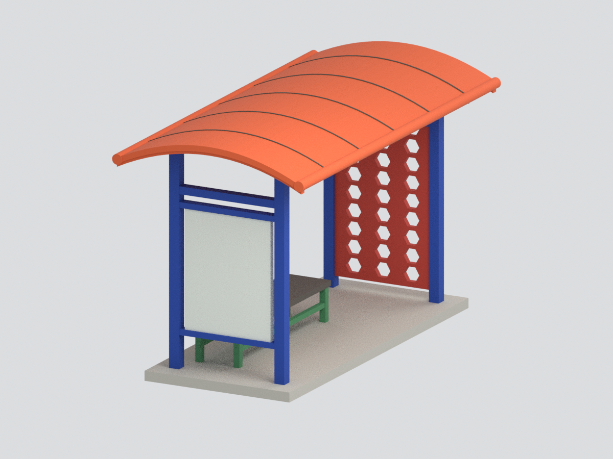
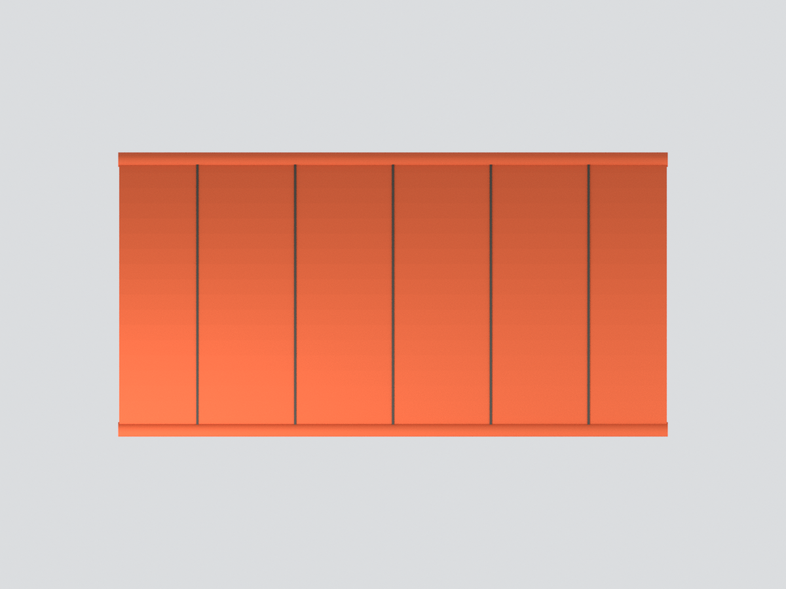
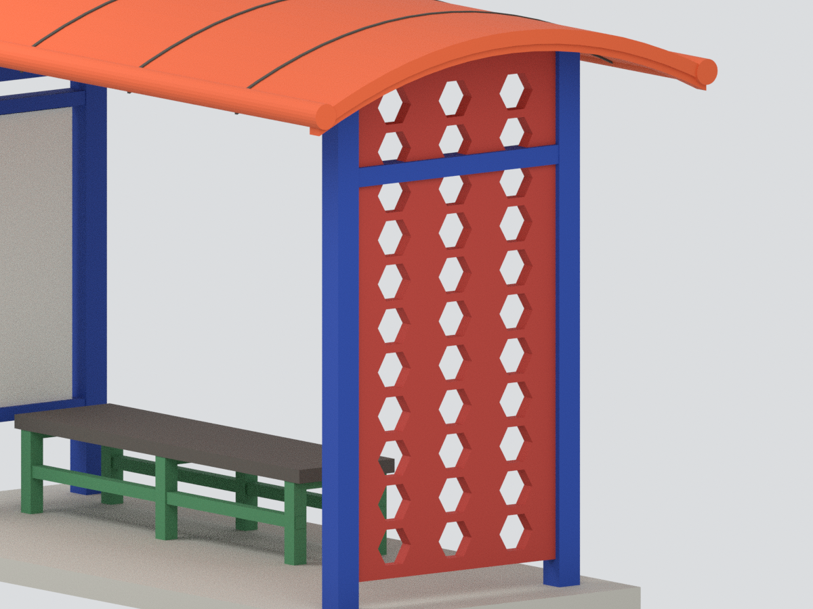

# 修平科技大學 校門候車亭｜主要亭體彩色模型

依修平官方校園相簿正面及近斜面實景照建模：橘色短向淺弧頂、四藍柱、左側無字資訊板、右側紅色六角穿孔板、綠架深色長凳及簡化頂燈。

## 模型預覽

|  |  |  |
| :---: | :---: | :---: |
|  主視角 |  正面 |  背面 |
|  左側 |  俯視 |  右側孔板局部，非全體 |

以上均為同一套彩色模型渲染；前五張為全景，最後一張為孔板細節。展示用無失真 WebP，點圖可開啟完整 WebP。[展示圖來源與驗證](display-proof.json)。

## 明確範圍
- 完整主要亭體，不含獨立外燈、公車站牌、校門牆、植栽及道路排水設施。
- **右側孔內未知填料省略，並非現況全空孔。** 六角辨識保留，孔數、孔徑及間距為名義簡化，不是逐孔測繪。
- 橘色頂板用不透明有厚度實體代替實照半透明覆材；淺弧、黑分縫和包邊近似，非材料/施工復原。左板及燈不造文字。
- 支撐底盤為連通與展示用，非精確地坪。相片拍攝日期未查證；不宣稱目前樣貌完全未變。尺寸、顏色按照片近似，非測量與色彩校準。

## 檔案與驗證
`model.stl`、8色 `model.3mf`、含隱藏可編輯原始元件的 `scene.blend`、可重建網格的 `build_model.py`。約 157.36 × 81.48 × 97.94 mm。

14項幾何/格式檢查、全新目錄精確重建、Blend等值、五全景一局部構圖及渲染雜湊檢查，各有QA紀錄；不構成實際試印保證。

可用含 Pillow 的 Python 執行 `python verify_render_bindings.py`，核對 WebP 檔案、尺寸、解碼後像素與原渲染紀錄。需比對重新渲染時，先將 `mesh-data.npz`、`editable-parts.json`、`construction-parts.json` 複製到空白暫存目錄，使用 Blender 4.3.2 執行 `blender --disable-autoexec -b --factory-startup -P render_model.py -- --out <暫存目錄>`，再執行 `python verify_render_bindings.py --scratch-png-dir <暫存目錄>/previews`。不需將生成的 PNG 放回儲存庫。

[舊版 PNG 與驗收原檔](https://github.com/hplin50643/taiwan-buildings-3d/tree/61e1b50daa09f45a2a65e8ce167aef8e6909e833/%E5%A4%A7%E5%B0%88%E6%A0%A1%E9%99%A2/%E4%BF%AE%E5%B9%B3%E7%A7%91%E6%8A%80%E5%A4%A7%E5%AD%B8/%E6%A0%A1%E6%9C%AC%E9%83%A8/buildings/hust-campus-bus-shelter)保留在固定提交；現行校驗不再要求工作目錄有這些 PNG。

[來源與限制](SOURCES.md)。包內不含原始照片或人物影像。
