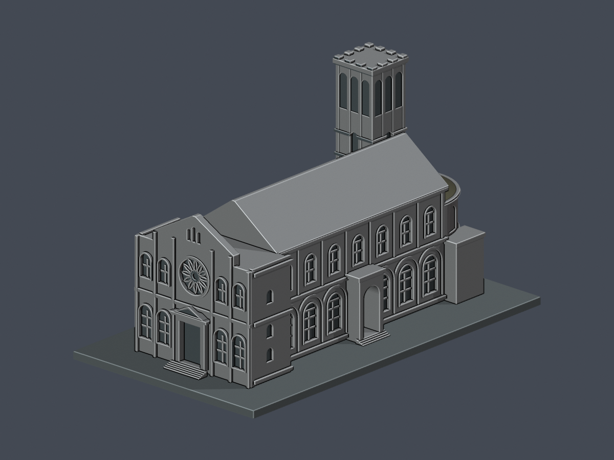
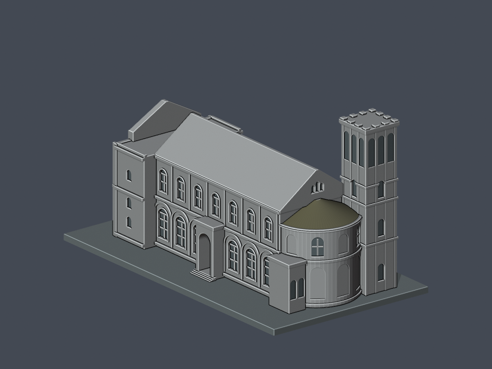
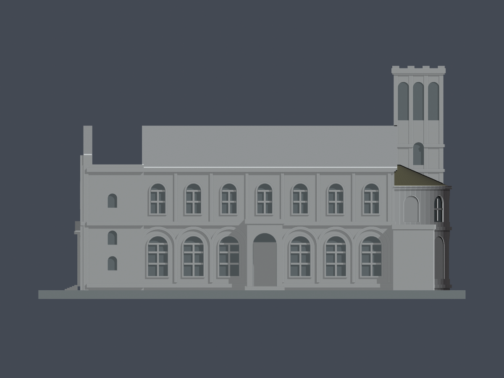
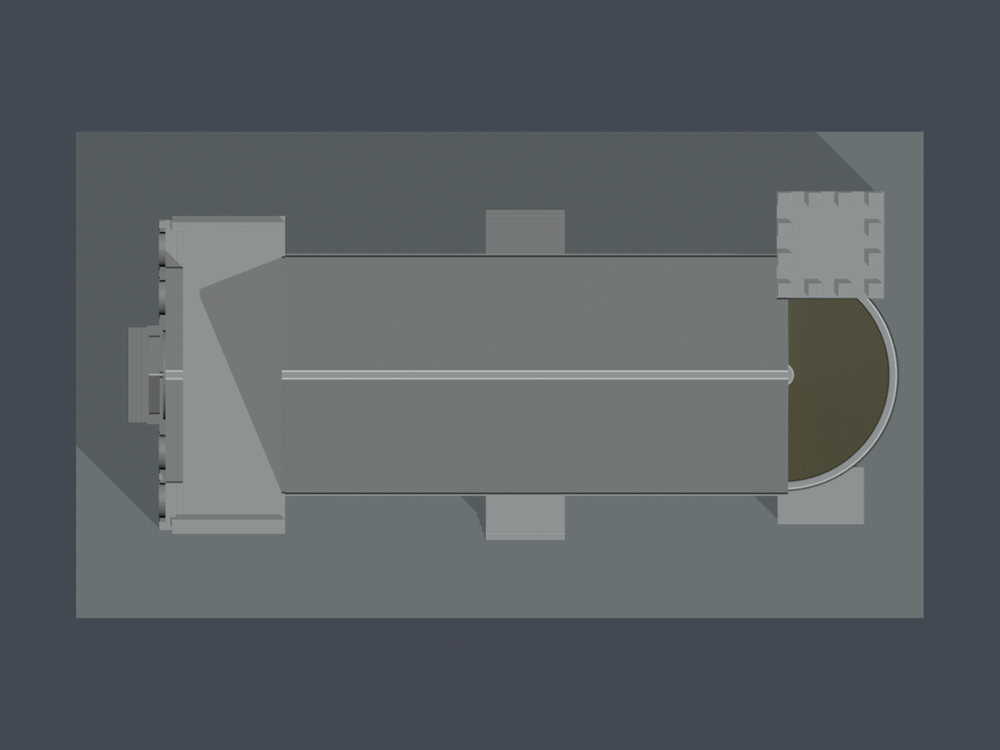
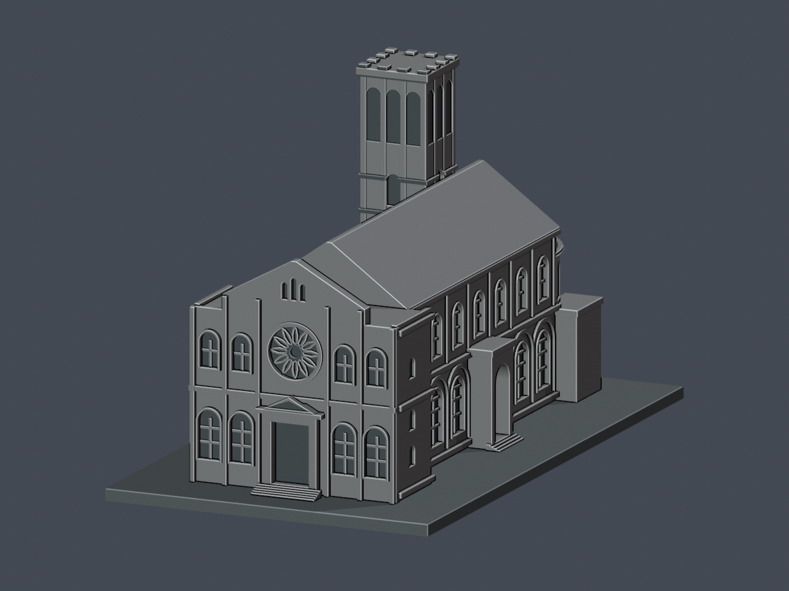
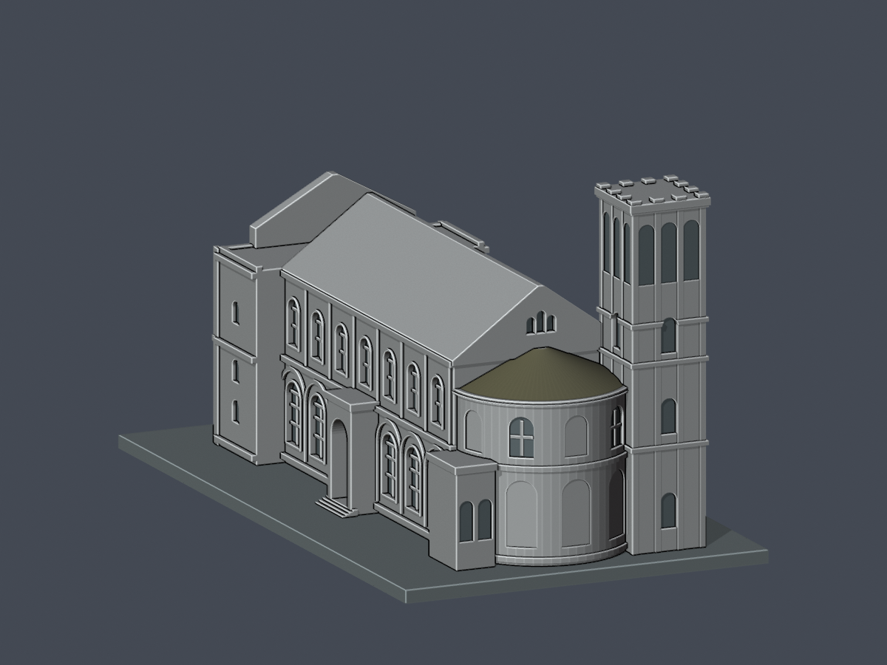

# 台灣基督長老教會南神神學院｜禮拜堂

## 2026-11-18 限定補色版

東側聖壇主連通錐坡的 109 個原三角，修復前銅色代理。本次不增加套數、不改原始 STL 幾何，未補部位不代表實景材色。未實體試印。

[彩色 3MF](model-colored.3mf) · [可編輯 Blend](scene.blend) · [原 STL](model.stl) · [本版 3MF 相容性查核](3MF-COMPATIBILITY-QA.json) · [原建模與場景查核（歷史）](independent-verification.json) · [現行交付清單](COLOR-RELEASE-MANIFEST.json) · [2026-11-18 原始清單](https://github.com/hplin50643/taiwan-buildings-3d/blob/f257624210cd5a5e2f7a64cb72f6e766d1f9357c/%E5%A4%A7%E5%B0%88%E6%A0%A1%E9%99%A2/%E5%8F%B0%E7%81%A3%E5%9F%BA%E7%9D%A3%E9%95%B7%E8%80%81%E6%95%99%E6%9C%83%E5%8D%97%E7%A5%9E%E7%A5%9E%E5%AD%B8%E9%99%A2/%E6%A0%A1%E6%9C%AC%E9%83%A8/buildings/ttcs-chapel-1957/COLOR-RELEASE-MANIFEST.json) · [展示圖來源與驗證](display-proof.json) · [SHA256SUMS](SHA256SUMS)

| 現版模型預覽 | 現版模型預覽 | 現版模型預覽 |
| :---: | :---: | :---: |
|  前斜視／正面 |  後斜視 |  立面 |
|  頂視 |  左側 |  右側 |

3MF 交付版僅補一個物件預設材質索引，嚴格 SDK 可讀取並在私有副本改色存回重開；原逐面色值、網格、Blender 與預覽不變。[公開相容化程式](source/normalize_3mf_compat.py)可重做此格式步驟。舊查核僅為建模檔案歷史，本版嚴格互通以新版相容性查核為準。

首頁、學校與校區的代表圖也使用這個限定補色版。上表展示為全解析度無失真 WebP，點圖可開啟同一張 WebP。現行校驗逐張核對 WebP 檔案 SHA-256、尺寸及解碼 RGBA 像素 SHA-256；像素與[固定版本的六張原始 PNG](https://github.com/hplin50643/taiwan-buildings-3d/tree/61e1b50daa09f45a2a65e8ce167aef8e6909e833/%E5%A4%A7%E5%B0%88%E6%A0%A1%E9%99%A2/%E5%8F%B0%E7%81%A3%E5%9F%BA%E7%9D%A3%E9%95%B7%E8%80%81%E6%95%99%E6%9C%83%E5%8D%97%E7%A5%9E%E7%A5%9E%E5%AD%B8%E9%99%A2/%E6%A0%A1%E6%9C%AC%E9%83%A8/buildings/ttcs-chapel-1957/previews)逐位元一致，不代表 PNG 和 WebP 的檔案位元或編碼中繼資料相同。舊版預覽和簽核資料保留在[固定歷史版本](https://github.com/hplin50643/taiwan-buildings-3d/tree/4761855138f5a951a6268cf67030d7a9e3e2ed60/%E5%8F%B0%E7%81%A3%E5%9F%BA%E7%9D%A3%E9%95%B7%E8%80%81%E6%95%99%E6%9C%83%E5%8D%97%E7%A5%9E%E7%A5%9E%E5%AD%B8%E9%99%A2/%E6%A0%A1%E6%9C%AC%E9%83%A8/buildings/ttcs-chapel-1957)，不是現行版本的展示。

可先執行 `sha256sum -c SHA256SUMS` 核對交付檔；如需逐像素核對，安裝 Pillow 後執行 `python verify_chapel_previews.py`。不必下載 PNG。640px 首頁縮圖不作逐像素校驗。

## 有限補色
僅東側聖壇半圓錐的主連通斜坡109三角面，552.924278 mm²，0→新增材質3，未校準銅色代理 `#8D8968`。原錐坡候選200面另外89+2面是斷開的下部小唇緣，全部排除；不擴到簷口、圓筒牆、頂部平面、鐘塔、主教堂屋頂及其他構件。

這是修復前資料所示外觀的跨時期代理，不是1957初始銅瓦顏色，亦非2026現況。舊照片、出版年及媒體檔名不代表精確拍攝日。銅瓦材族與斜坡色族有來源支持，但色值未量測，不仿真氧化斑駁、接縫或金屬反射；『圓頂』來源用語不改模型原半圓錐形。

## 保留
原STL位元不變，11757頂點／23514三角面；原三個顯示材保留，僅新主坡材質及109面指派。其餘暖色、凹面與底座色原本只是預覽對比色，不是新證實實際材料。原孤立Material設fake-user避免另存丟失，原相機、world等保持。

`scene.blend`可編輯；`model-colored.3mf`與原STL幾何面序相同，四種表面材料不等於分割可列印分色實體。`model.stl`本身沒有顏色；基底無OBJ，本次不新增。`face-colors.json`、`domain.json`、`palette.json`記錄面域與材料。六視圖在previews，原屋頂與其他構件不改。完整新重建程式與原基底私存於備份。

私人來源照片與PDF不隨公開候選包散布；公開來源資訊見continuation-sources.json，原模型限制見original-model-notes.md。原文件歷史驗收記載不等於本版發布批准。未重跑原層檢/薄特徵程序，因STL未變而沿用原幾何，不將材質驗證冒充新增製造驗收；未做GUI切片、實體試印或支撐驗證。

## 新版檢核限制
獨立驗證確認原相機、world、原顯示材質及其他可安全讀取持久設定保留。Blender4.3.2讀取UV Sculpt懸空工具指標會崩潰，因此該子域排除；執行期依賴圖及session欄位也排除，不宣稱完整檔案位元一致。詳見independent-verification.json。

## 原模型範圍與幾何限制

1957建物、修復前外觀的來源限定近似。僅禮拜堂自身西前廳、長堂、東半圓聖壇、北側鐘塔及附房，不含本館、西校舍或整個校園。現法定學校與歷史台南神學院同址承接關係，不另計第二校；亦不推定本件校舍為獨占產權。

[STL](model.stl) · [可編輯Blend網格](scene.blend) · [參數源碼](build_model.py) · [來源](sources.json) · [尺度證據](dimensional-evidence.json) · [QA](qa-summary.json) · [原面ray](architectural-ray-check.json) · [每構件loss](feature-loss-locations.json)

## 來源與尺度界限

官方簡介記2017年6月22日教育部准予設立「台灣基督長老教會南神神學院」，現址東門路一段117號。官方edu校圖及校園生活頁直接介紹禮拜堂，不能將宗教團體歷史名稱另算另一所學校。

2015、2018非施工正射，校方2021修復分解圖、2024通訊第6頁南立面，以及修復前多面照片交叉支持：西端RC平頂前部及較高玫瑰山牆、後段較窄雙坡長堂、東半圓聖壇與矩形高塔。**西前廳中央平頂範圍是跨年影像和修復圖的有界解讀，不僅憑明暗宣稱完全確證，更非測繪平面。** 原圖屋頂受高物視差、樹蔭及鄰翼投影影響。

工作比例約1:250，即最終模型4毫米代表估算1公尺。採主高體整長27公尺、西前廳5公尺、後堂22公尺；前廳寬13.5公尺、長堂牆寬10.125公尺、屋面寬10.5公尺。以上不是官方尺寸，不能解讀為牆基實測。採納界限：整體24–28公尺、西段3.5–5.5公尺、主坡21–24公尺、前寬12–14公尺、長堂牆寬9–10.5公尺；不同區間不能把各自上限直接相加。屋脊約14.45公尺、鐘塔約19.7公尺由無尺南立面比例推算，非官方標高。

- 2018坡面四角約原圖(812,936)、(975,941)、(974,1001)、(811,1006)，選點±5–8像素；影像約0.1374公尺／像素，只有屋面投影尺度。
- PHOTO2020服務實際水印2018；PHOTO2015影像水印2015。PHOTO2／PHOTO2025傳回的2023綠棚是修復保護設施，未當永久平頂。
- OSM矩形東移，未使用其四角或26.8×11.8公尺定案。西白塊不直接加總為實測前廳深度。
- 拆解軸測的抬高層板不是高度尺。2024圖與較早照片不保證同年測繪；模型不宣稱2024完工現況。

## 形體與可列印簡化

含底座150 × 86 × 約81.8毫米，底厚3毫米，底座朝下。中央三格高山牆與兩側較低肩部、西RC前廳、後長堂雙坡分開處理；屋頂未套單一全長大三角。

西玫瑰窗、三連拱通風孔、南北七上窗／六下窗加中門廊、聖壇盲拱與可見兩上窗皆保留。玫瑰窗和窗梃融合背板，不是獨立細線。小百葉、簷口齒飾、排水管、欄杆及內部隔間簡化；室內填實，不是室內測繪模型。

下列均是**最終模型毫米**：
- 西山牆向內加1.3毫米背板，外立面輪廓保留；三拱實際凹口後背法向至少1.7毫米，間壁法向3.1毫米。三拱開口寬簡化為1.5毫米、相鄰表面分隔0.9毫米，避免開口間的薄前條。
- 西山牆尖端局部截0.4毫米至z60.8，實際頂平面寬1.44762毫米、厚3.1毫米；未整面降高，這是列印調整而非建築原貌尺寸。原STL向下實根通至底座。
- 鐘塔高窗改為約0.35毫米淺凹厚背刻痕；12個頂柱僅頂端加寬至2.4 × 2.4毫米並嵌入塔帽。不是保留不可解析薄角再改篩檢門檻。
- 西RC平台實際z46.3，後堂脊z60.8；原STL向下ray驗證為兩個不同屋頂區。東半圓屋面為淺半錐，不做半球。

## 數位QA與特定角損

[原網格驗證](validation.json)、[0.2毫米逐層](layer-opening-check.json)、[逐原Polygon](layer-component-check.json)、[逐構件loss定位](feature-loss-locations.json)、[原面法向與根接](architectural-ray-check.json)完整保留。

原STL只合併完全相同座標作拓撲分析，不repair、不吞invalid；單殼、水密、每邊兩面、vertex-link單環。0.2毫米層距、z偏移0.071，每個原Polygon在0.4毫米erosion及opening後零消失、零分裂。獨立源碼重建STL SHA、保存Blend實際網格、7張actual-STL PNG bytes一致。

**需明示的特定角損：共52個跨層樣本，不是52根柱。** 西山牆頂4個矩形截面樣本，另鐘塔12個2.4毫米頂柱共48個截面樣本；最大opening損失2.3984834%，保留97.6015166%，全部落在原矩形四角0.41毫米鄰域內。其他原Polygon loss均不超過1%。

原STL逐樣本ray：西山牆厚至少3.1毫米、採樣處寬至少1.91447毫米，向下實根到底、向上接60.8毫米短平頂；塔頂柱X/Y至少2.39999毫米，向下有連續實根／塔帽、向上81.8毫米。此特定角損已獨立重現並獲主審接受；不是其他薄皮、全域壁厚或篩檢閾值的例外。

門廊、窗框、聖壇簷口可能需要支撐。數位QA不是全域最小壁厚證明，不是Cura/Prusa工具路徑或實體試印，不能保證免支撐或任意縮小可印。

## 原幾何重建方式

以下是原幾何與原預覽流程，並非現行補色版的渲染重建。請在[原始交付的固定提交](https://github.com/hplin50643/taiwan-buildings-3d/tree/eb11c9b6bcf33cf61d8582797d4ee2018aadb745/%E5%8F%B0%E7%81%A3%E5%9F%BA%E7%9D%A3%E9%95%B7%E8%80%81%E6%95%99%E6%9C%83%E5%8D%97%E7%A5%9E%E7%A5%9E%E5%AD%B8%E9%99%A2/%E6%A0%A1%E6%9C%AC%E9%83%A8/buildings/ttcs-chapel-1957)另外取得完整原始包，在該版本的獨立工作目錄執行。歷史驗證器會逐位元比對當時的七張 PNG；不要對現行補色版工作目錄執行這個歷史配方，也不要覆寫現行彩色場景。

使用 [requirements.txt](requirements.txt) 與Blender4.3.2，依序執行 `python build_model.py`、`blender -b -t 4 -P render_preview.py`、`python run_all_checks.py`。任何invalid或非零exit都須修源重新全檢，不能repair後沿用舊報告。

原照片／PDF只作核對，未隨本包重新散布。未建模本館、西校舍、宿舍、圖書館與其他校園設施，本件不代表全校完成。

獨立原STL補充：409層585個原Polygon侵蝕與opening後皆保留單核心，零分裂或消失。52個跨層警告樣本分為西山牆4個與12個塔帽頂柱48個，並非52根柱；最大構件損失2.398483410724%、保留97.601516589276%，共有4個整層超過1%，整層最大2.398478080761%。原矩形四角0.41mm鄰域外最高9.4042e−16mm²，移除共線細分點後同0.41mm真轉角區外最高1.012525e−15mm²；兩者在1e−12mm²比較容差內屬數值殘差，不冒稱絕對零。52指定樣本原三角面法向最小2.3999996mm，原STL上下射線證實底根連到z0及對應頂面。
三拱背板67個原面探點最小1.7mm、兩間壁3.1mm；局部截0.4mm後的實際頂平面寬1.44761908mm、厚3.1mm，頂下指定點向下連續到底座。這些都是指定位置模型尺度，不能當全域最小壁厚或建築實測。跨年來源與西RC前廳範圍仍屬有界推估；門廊、窗框、簷口及細頂柱須評估支撐和拆除，不得任意縮小，未實體試印。
