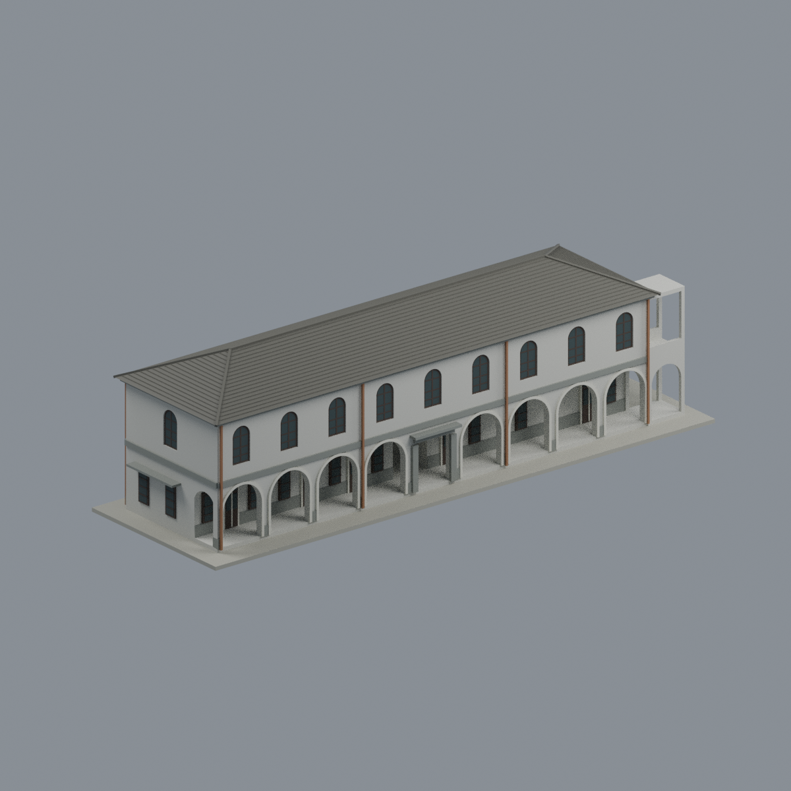
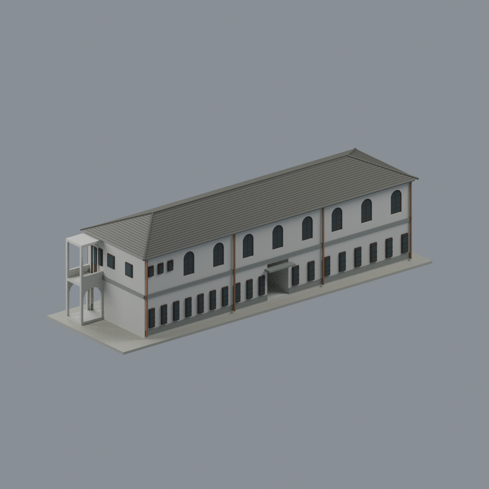
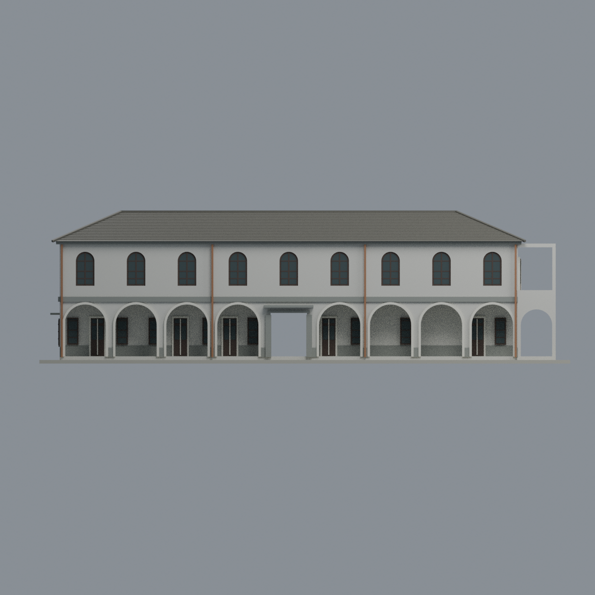
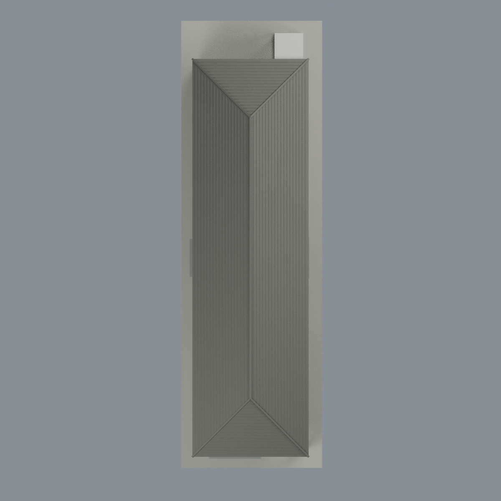
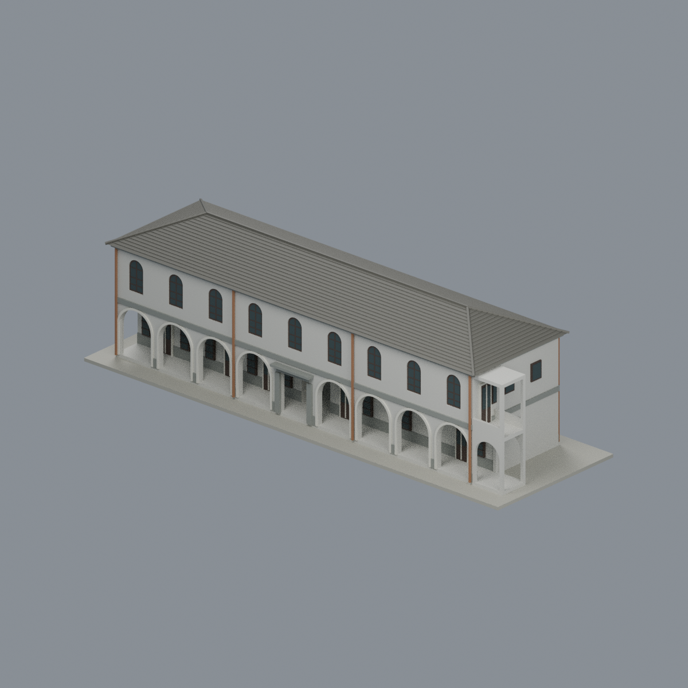
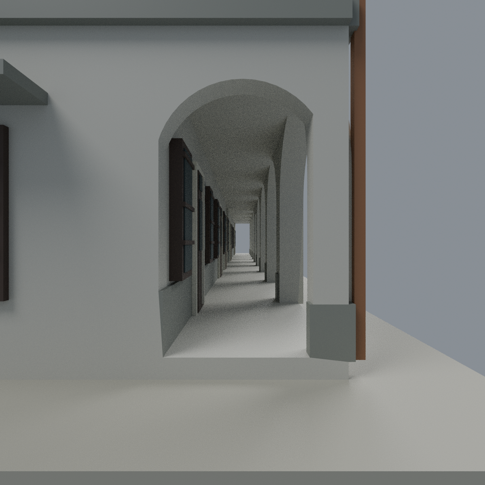
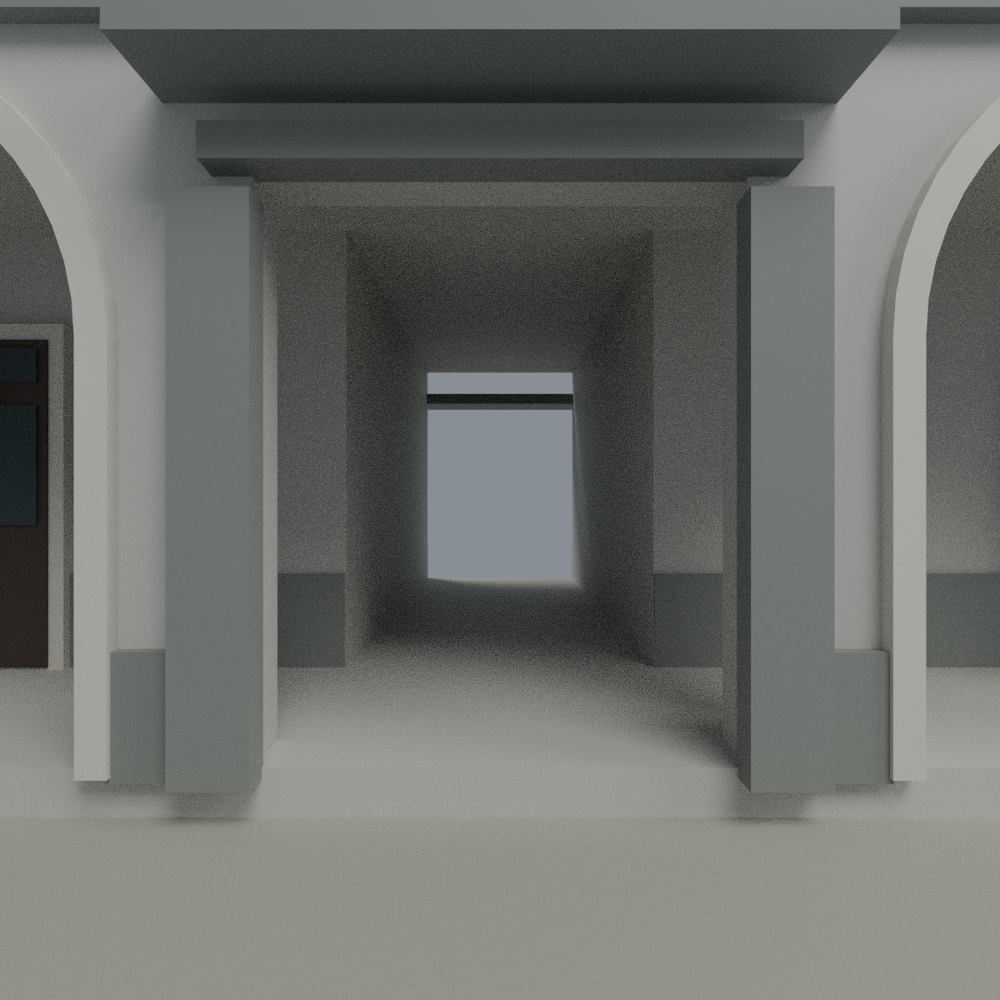

# 西校舍（1957，2025修復後外觀近似）

## 模型預覽

|  |  |  |
| :---: | :---: | :---: |
|  正面斜視 |  背面斜視 |  東立面 |
|  頂視 |  左斜視 |  |

台灣基督長老教會南神神學院／校本部。完整兩層長條西校舍：單長脊四坡灰水泥瓦頂、東一樓4拱＋中央平頂門廊＋4拱、中央東西真貫通、南廊端真拱口；北一跨短穿廊止於本館接縫，末端為**開放展示截斷，不是假外牆**。東上9大拱窗，西上8大拱窗＋北端3小矩窗，西下一排矩窗與中央出口，非鏡像正面。廊後牆依來源為南3門5窗／北2門3窗，深灰底帶分段不堵中央；北2F接本體有D2門與旁窗代理，室內省略。

採2024–2025完成修復影像與正式圖紙；2026原拍僅補接口，不稱2026全棟現況或竣工測繪。**不含本館、禮拜堂、噴泉、花園、雕塑、高樓或車棚**；連接段不另計一棟。

[彩色可編輯Blend](scene.blend) · [八材質3MF](model.3mf) · [無色STL](model.stl) · [來源](SOURCES.md) · [驗證](QA.md) · [授權](LICENSE.txt)

含薄展示底約63.25×200.75×57.982毫米，16462三角，單一封閉表面。玻璃在全部格式均為深色不透明微型實體；可改材質，但STL本身沒有顏色/透明度。室內簡化實體不影響東廊、中央通道、南廊口或北接段的真空間。尺寸/窗格/瓦數/設備細節非測繪；展示基底不是真地形。

**尚未實體試印，非免支撐。**拱廊、接口梁板、小雨庇與簷下需要按機器與方向規劃支撐。窗格約0.33mm、落水管約0.715mm、瓦紋約0.303mm；205個水平截層含0.8mm侵蝕檢查不存活小島，如實保留，不代表整體最小壁厚認證。

重建依賴見 [工具版本](qa/toolchain.json)，預覽驗證另外需要 Pillow。`python verify_webp.py` 可核對五張外觀圖的 WebP 檔案、尺寸與解碼 RGBA。用 `python rebuild.py --output /尚未建立的外部暫存目錄` 可在儲存庫外重建，並核對暫存 PNG 的歷史 SHA256 以及與現行 WebP 一致的像素。上方均為同版模型渲染，點圖可開啟完整 WebP。[舊版外觀 PNG 與驗證](https://github.com/hplin50643/taiwan-buildings-3d/tree/bff881da942d3051f97dab980feb69d9f60087fd/%E5%A4%A7%E5%B0%88%E6%A0%A1%E9%99%A2/%E5%8F%B0%E7%81%A3%E5%9F%BA%E7%9D%A3%E9%95%B7%E8%80%81%E6%95%99%E6%9C%83%E5%8D%97%E7%A5%9E%E7%A5%9E%E5%AD%B8%E9%99%A2/%E6%A0%A1%E6%9C%AC%E9%83%A8/buildings/ttcs-west-school-1957)仍保留於固定版本。下方兩張通道圖是技術 QA，保留原 PNG。

## 無切網格的通道補充視圖

|  |  |  |
| :---: | :---: | :---: |
|  從南廊口看長廊 |  中央東西貫通門廊 |  |

補充圖只改相機，不切網格、不隱藏牆或改材質。[核對展示圖與模型版本](display-proof.json)。

## 導航

[校本部模型](../../README.md) · [南神神學院模型](../../../README.md) · [儲存庫首頁](../../../../../README.md)
