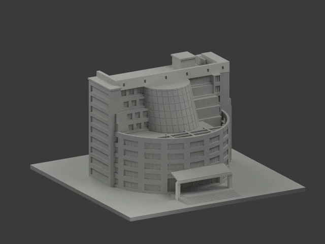
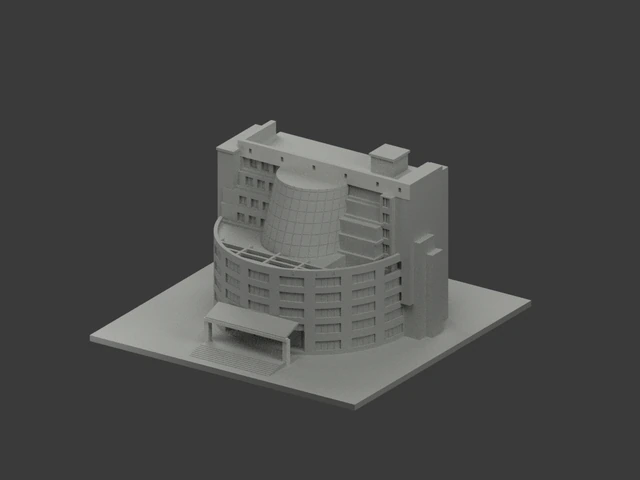
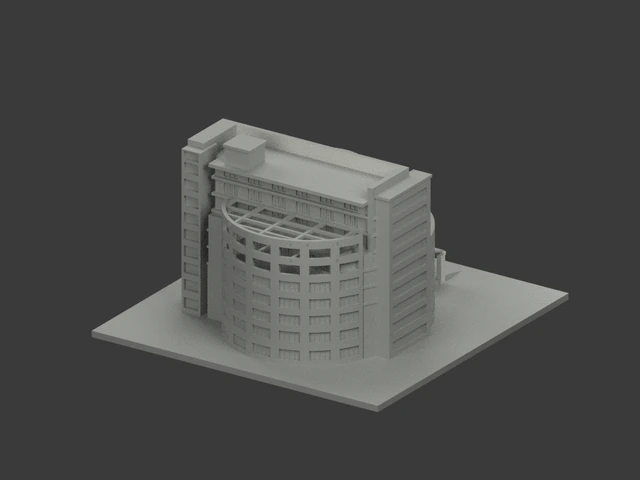

# 嘉南藥理大學｜王趁紀念圖書館 L 棟

## 模型預覽

|  |  |  |
| :---: | :---: | :---: |
| 首頁代表視角 | 校級圖冊視角 | 背側 |

[彩色 3MF](appearance.3mf) · [Blender 場景](scene.blend) · [原 STL（不含色）](model.stl) · [校驗版本](CHECKSUM-SCOPE.md) · [渲染證明](render-proof.json)

## 材色與模型界線

現行版同一原模型 65,686 三角面及 32,643 頂點。保留原南高牆正面與入口框架共 139 灰白面，僅推估同一南高牆背向垂直面 5 片沿用原灰白代理，合為 144 面；其餘 65,542 面未知中性。不是整棟後牆補白，未新增幾何、窗、照片、文字或材質。只包含 L 棟，不含相鄰 Q 棟。原 STL、造型、座標、尺寸與包數不變。

[校方相簿](https://libcvod.cnu.edu.tw/)支持同一南牆灰白色族，照片未見的背向面為同構件推估，不是直接照片證明、逐面色票或現況調查。[本次選面與限制](qa-continuous-highwall/source-scope.json) · [幾何保留驗證](qa-continuous-highwall/preservation.json)。未以舊五材分類預覽冒充實景材質。原 459 層警示、方向性短弦、728 接點及 v1 HOLD 歷史與 v2 限定例外不變，沒有重認證全域壁厚、切片或試印。

## 重現與歷史

現行 STL、3MF 與 Blender 可獨立使用。[原重建來源 ZIP](rebuild-continuous-source.zip) 含必要幾何及程式，不含參考照片。可在新暫存目錄解壓，執行 `python continuous-highwall-source/build_continuous.py`；色版交換檢查用 `verify_exchange.py`，原 Blender 驗證及 PNG 渲染只在重建暫存目錄使用。現行 [WebP 渲染腳本](render_current.py) 會讀取新場景而不保存變更，首頁取用[固定舊相機參數](homepage-camera.json)。

[歷史版本原清冊](https://github.com/hplin50643/taiwan-buildings-3d/blob/a9223a4c3f4880ffa6dae63b8faf06092d629b5f/%E5%98%89%E5%8D%97%E8%97%A5%E7%90%86%E5%A4%A7%E5%AD%B8/%E6%A0%A1%E6%9C%AC%E9%83%A8/buildings/cnu-wang-chen-library/CONTINUATION-SHA256SUMS)、[舊五材原版](https://github.com/hplin50643/taiwan-buildings-3d/blob/a9223a4c3f4880ffa6dae63b8faf06092d629b5f/%E5%98%89%E5%8D%97%E8%97%A5%E7%90%86%E5%A4%A7%E5%AD%B8/%E6%A0%A1%E6%9C%AC%E9%83%A8/buildings/cnu-wang-chen-library/original-classification-version/README.md)、[舊交換資料](https://github.com/hplin50643/taiwan-buildings-3d/blob/a9223a4c3f4880ffa6dae63b8faf06092d629b5f/%E5%98%89%E5%8D%97%E8%97%A5%E7%90%86%E5%A4%A7%E5%AD%B8/%E6%A0%A1%E6%9C%AC%E9%83%A8/buildings/cnu-wang-chen-library/interchange/README.md)與[前次模型說明](https://github.com/hplin50643/taiwan-buildings-3d/blob/a9223a4c3f4880ffa6dae63b8faf06092d629b5f/%E5%98%89%E5%8D%97%E8%97%A5%E7%90%86%E5%A4%A7%E5%AD%B8/%E6%A0%A1%E6%9C%AC%E9%83%A8/buildings/cnu-wang-chen-library/README.md)僅供歷史查核，原作者資料及校驗位元保留在固定 Git 提交，不用舊表驗現行圖冊。[舊製造驗證程式](https://github.com/hplin50643/taiwan-buildings-3d/blob/a9223a4c3f4880ffa6dae63b8faf06092d629b5f/%E5%98%89%E5%8D%97%E8%97%A5%E7%90%86%E5%A4%A7%E5%AD%B8/%E6%A0%A1%E6%9C%AC%E9%83%A8/buildings/cnu-wang-chen-library/original-classification-version/validate_model.py)需在同一歷史子包內執行，不能套到目前的 WebP 圖冊。
