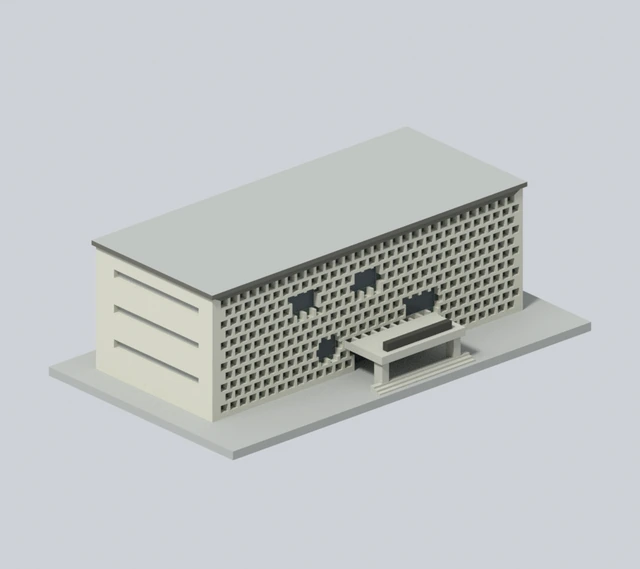
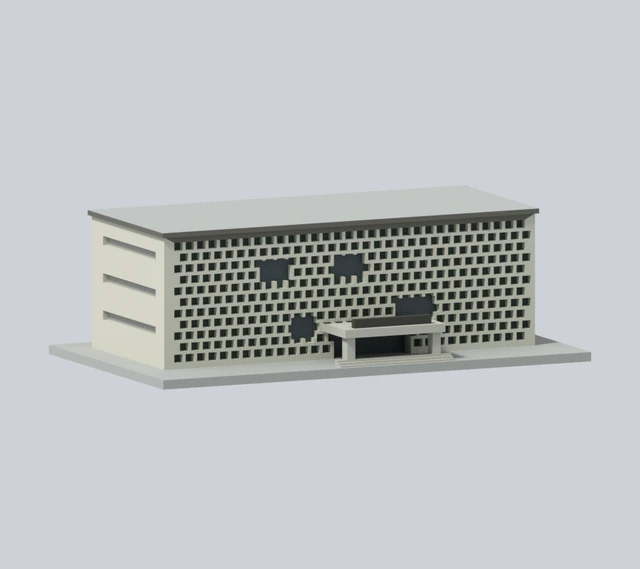
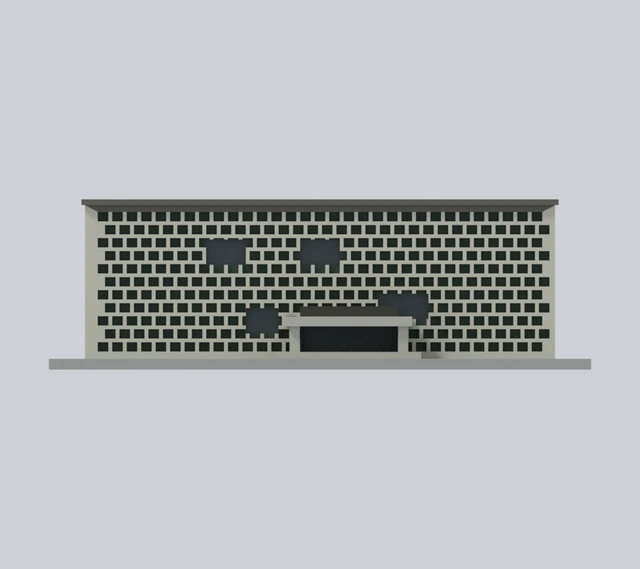
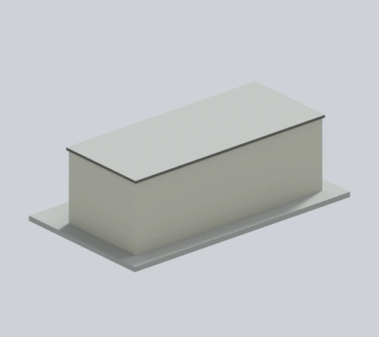
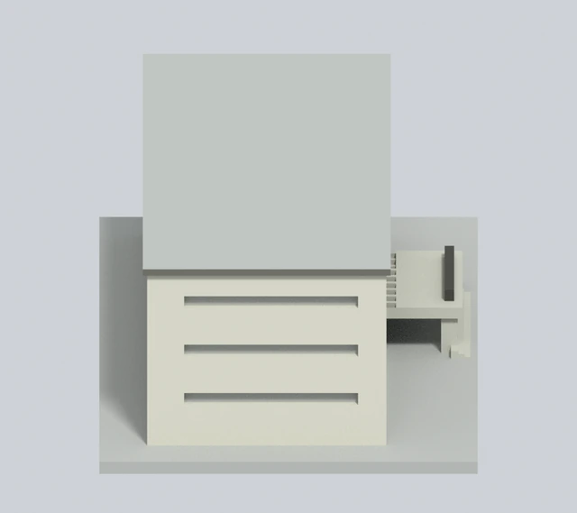
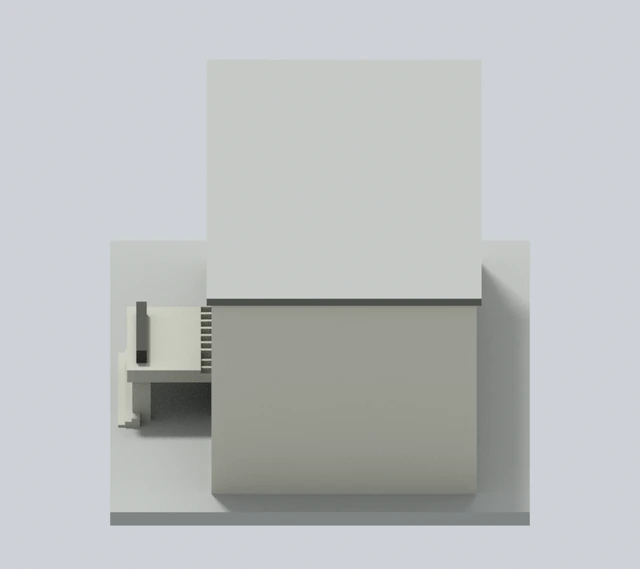
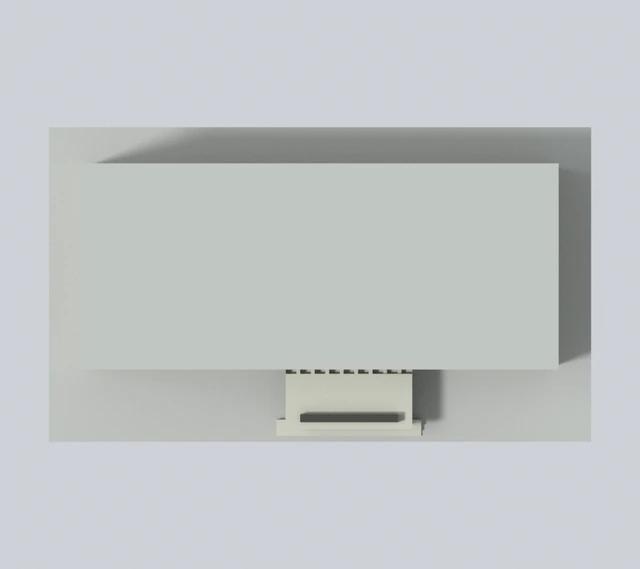

# 國立中央大學行政大樓｜150 mm 外觀模型

## 模型預覽

| 模型預覽 | 模型預覽 | 模型預覽 |
| :---: | :---: | :---: |
|  彩色斜前 |  彩色近來源角度 |  彩色正面 |
|  彩色背面（牆色為延伸推估） |  彩色左側 |  彩色右側 |
|  彩色俯視（屋頂保留中性色） | &nbsp; | &nbsp; |

點縮圖可開啟無失真原尺寸 WebP。七個視角均核對現行彩色模型；側背外牆延續色為推估；未確認的凹帶背板與屋頂保留中性色。

[舊版 v2 同相機配色審核](appearance-review-v2/comparison.png)只供歷史對照，不是上方 v3 的現行展示。

原三張中性幾何驗證圖、原 STL／scene.blend 及尺寸不改；校級與校區選圖保留斜前角度。原 STL 不帶色。照片日期未知，不代表2026現況。詳[配色來源、勘誤及重建](APPEARANCE.md)。

此為公開外觀資料研究模型，非測繪、施工或正式切片檔。每棟獨立縮尺，含底座最長150 mm，不能直接當作同一比例校園拼圖。本檔尺寸約 150 × 87 × 47.1 mm。

## 保留的識別特徵
- 橫長四層量體、错位方形遮陽格陣
- 非均勻大窗穿插與前方突出入口雨庇
- 左右入口支柱、前階及左側水平帶

## 證據與簡化
- 主要照片為正面與斜正面，深度及側後量體為概略估計，後面素面。
- 樹木遮住兩端部分立面；格孔節奏保留但數目和尺寸非測繪。
- 照片遠處總圖書館不是行政樓屋頂設施，未合併進此模型。

全部來源及照片/設計圖區分見 sources.json。來源原照片與PDF不隨模型發布；新增對照圖只有模型渲染，不含來源照片。照片年代不同，不聲稱完整2026現況。

## 檔案與重建
- model.stl：單一連通列印實體，單位毫米
- scene.blend：由交付STL匯入的可編輯網格（不是參數化BIM）；預覽材質只供展示
- build_model.py：可攜參數化量體來源，無需來源照片即可重建
- previews/front.png、rear.png、elevation.png：從實際STL渲染，不是設計效果圖；名稱為相機視角，非精確方位

使用 Python 3.12，依 requirements.txt 準備相依套件，Blender 4.3.2。

    python build_model.py
    blender -b -t 2 -P render_preview.py
    python validate_model.py
    python check_layers.py
    python check_thin_features.py

## 幾何檢查及列印限制
原始STL法線與繞序一致、水密、每邊兩面、頂點鏈單環、單連通表面、無分離內腔殼、正體積、乾淨重建同SHA-256、已存Blender/STL三角幾何一致，詳 validation.json（passed=True）。

0.2 mm幾何截面共 236 層，全部閉合=True。另以1 mm間距檢查0.8 mm XY形態開運算薄特徵，0 層損失面積超過1%；尖角也會被計入，見 thin-feature-check.json。這不是全域壁厚保證，也不是正式切片或試印。

底座平放。入口雨庇與格孔上緣需評估支撐。建議先以0.4 mm噴嘴、0.2 mm層高在實際切片軟體檢查外壁、橋接、支撐可移除性與底板附著，再決定列印設定。小窗框、曲面尖端與薄簷口可能不完整重現；不得將幾何通過寫成「免支撐、保證可印」。

SHA256SUMS含可發布檔案雜湊。尚未實體試印。此為全校持續研究中的一件，不代表全校完成。

## 檔案下載與驗證

[彩色 3MF](appearance.3mf) · [彩色 Blender](appearance.blend) · [中性 STL](model.stl) · [中性 Blender](scene.blend) · [Python 來源](build_model.py) · [完整驗證](validation.json) · [來源](sources.json) · [渲染對照](display/render-proof.json) · [展示校驗](display/SHA256SUMS)

上方七視角由現行 v3 彩色模型渲染。背側形狀為簡化，牆色僅為延伸推估，不代表同視角實景。相機視角不是精確地理方位。

## 截面數值方法修訂與補查

本發布包已直接採用canonical-edge-v2薄篩工具與結果，固定共邊插值方向，要求節點度數2、閉環及各Polygon有效，再做1 mm間距的0.8 mm XY開運算。舊版可能因共邊端點分開計算後取整而漏環，不能沿用舊面積值。這項修正不改STL、Blender或重建來源；真實薄特徵警示照常保留。

另以0.2 mm間距逐層補查閉環及Polygon有效性，共 236 層通過，見[有效性報告](contour-validity-check.json)與[可攜檢查程式](check_contour_validity.py)。這項較密補查沒有做薄篩開運算；薄篩採樣間距仍是1 mm。兩者都不是正式切片、試印或全域壁厚保證。

## 門廊及入口過樑底完整原域一致化 v3
選取 z=12 朝下門廊/入口過樑底18面完整連通共面域，其中17面原材2保持，僅5308由中性0延用原門廊灰米材2。原依面中心y門檻遺留入口頂半片斜三角；同平面鄰片已材2且原網格無材料界。本次不僅挑外挑門廊範圍，也明示包含y至-18的入口內緣。照片支持外門廊淺色，內緣為同構件家族推估，不是陰影內逐點照片證實。其餘5499面、7材值、geometry/transform不變；所有原v2側背推估及工程限制保留，不新增構件或新切界。
本輪重新讀官方無障礙地圖，其case AdmiB現為「行政大樓 Administrative Building」，並綁定原照片；舊appearance-sources中英文誤植說明為歷史快照，不能作現況錯標。本輪保留舊文件不改，以上新核對優先。照片日期未明，不稱現況重建或實體試印。
7張原生900×800視圖/相機/渲染設定保留；原STL/scene/previews與舊 v1/v2 審核保持原位元組。v3 原始 PNG 與當時報告可在[固定版本](https://github.com/hplin50643/taiwan-buildings-3d/tree/8adae23dcd3a221b585a5c865789f2e0a32d20b0/%E5%A4%A7%E5%B0%88%E6%A0%A1%E9%99%A2/%E5%9C%8B%E7%AB%8B%E4%B8%AD%E5%A4%AE%E5%A4%A7%E5%AD%B8/%E6%A0%A1%E6%9C%AC%E9%83%A8/buildings/ncu-administration)查閱。本次源審快照 ENTRY-SOFFIT-SOURCE-QA.json，最終獨審 ENTRY-SOFFIT-INDEPENDENT-QA.json；照片私用不隨模型發布。
