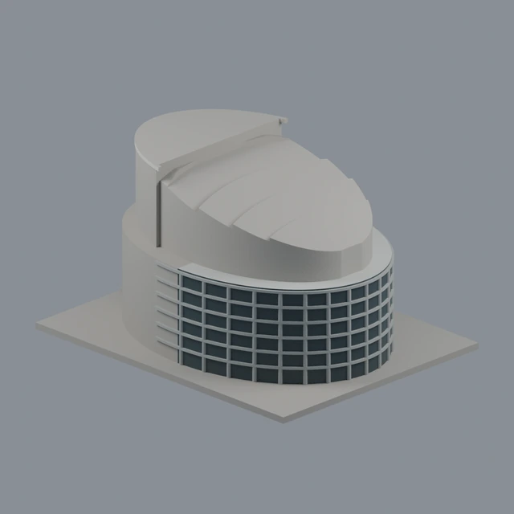
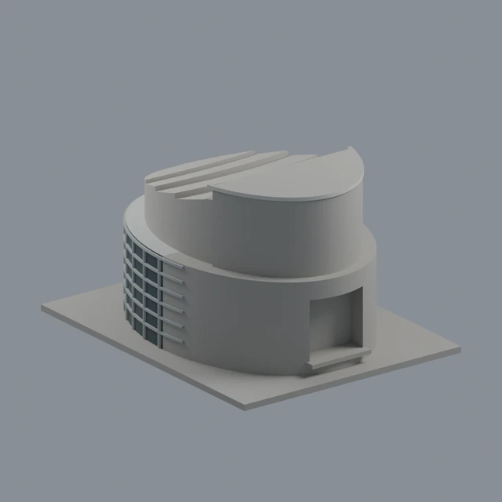
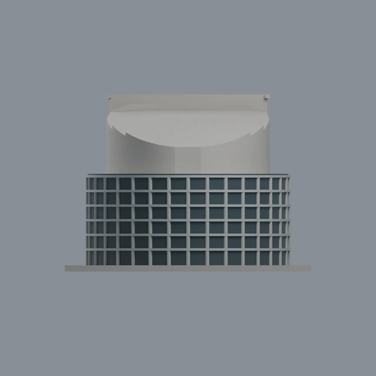
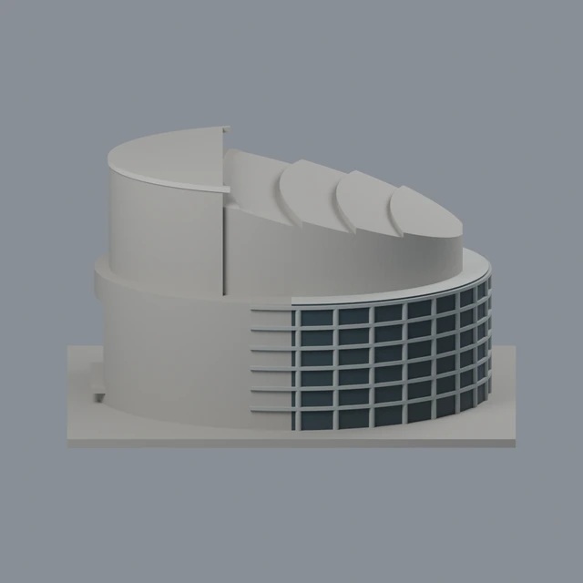
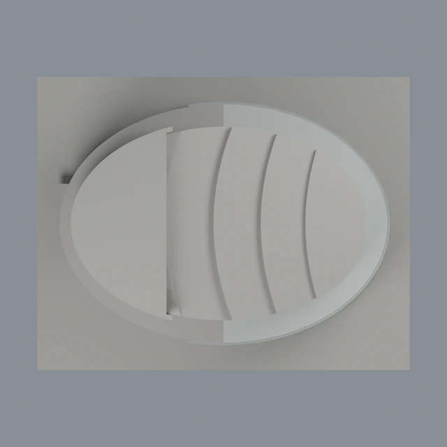

# 國立中央大學大禮堂｜150 mm 外觀模型

## 2026-11-17 同一道頂緣外弧連續補色（目前版）

原負y側58面已配灰白 `#CDCEC5`；本次沿同一連續頂緣外弧，為正y側58個原三角面補相同灰白，外弧共116面。這是**同構件連續材質推估**，不是新取得另一側實景或色彩校準證據。選面只在原144邊形外側平面、z83至84.8毫米範圍；內側、頂／底面、端面與整片主牆皆不擴色。

原STL、9,614面座標與面序完全保留；其餘9,556面材質不變。材質面數依序2262、1056、6028、152、116。[交換驗證](appearance/qa/continuous-rim-verification.json) · [29個外側平面獨立覆蓋檢查](appearance/qa/continuous-rim-support.json) · [本版來源](appearance/continuous-rim-source.zip)。彩色鋁板拼片仍缺幾何邊界，不整面亂塗。 [場景回讀](appearance/qa/continuous-rim-scene.json) · [重建一致性](appearance/qa/continuous-rim-rebuild.json) · [本版五視圖記錄](appearance/qa/continuous-rim-render-manifest.json) · [視覺檢查](appearance/qa/continuous-rim-visual-review.json)

重建：`python appearance/source/build_continuous_rim.py`，`blender -b -t 2 -P appearance/source/render_continuous_rim.py`。獨立支承面檢查另需Shapely。下方舊版範圍／QA為歷史記錄；本次不宣稱重做歷史層檢或實體列印。

## 模型預覽

五個角度皆是 2026-11-17 頂緣外弧連續補色版。點圖可開啟全尺寸無失真 WebP。

| 模型預覽 | 模型預覽 | 模型預覽 |
| :---: | :---: | :---: |
|  |  |  |
| 前廳斜視 | 後舞台斜視 | 前廳立面 |
|  |  |  |
| 側視 | 頂視 |  |

[渲染與校驗紀錄](display/README.md) · [縮圖校驗](display/thumbnail-proof.json)

## 前廳玻璃與框體有限配色（2026-10-22，歷史範圍）

[現行配色、來源與限制](appearance/README.md) · [表面色3MF](appearance/ncu-auditorium-appearance.3mf) · [可編輯Blender](appearance/scene.blend)

僅原前廳玻璃、銀灰框柱及明確前廳屋面配色；上部彩色鋁板缺拼片材料邊界、後牆混界保持中性，不是整棟精準彩色。原STL bytes、9,614三角面、幾何與歷史QA不變，不增模型套數。3MF為單網格表面色，非分色封閉實體或切片/G-code；原薄處與支撐限制保留，未實體試印。第三方照片不分發。

此為公開外觀資料研究模型，非測繪、施工或正式切片檔。每棟獨立縮尺，含底座最長150 mm，不能直接當作同一比例校園拼圖。本檔尺寸約 150 × 118 × 84.8 mm。

## 保留的識別特徵
- 橢圓量體、逐層退落的弧形屋頂
- 較高後舞台弧牆與外部舞台凹口
- 低層弧形前廳及水平玻璃幕牆框條

## 證據與簡化
- 屋頂以可列印曲面和弧形分段近似，非原建築曲面測量。
- 彩色鋁板紋理、屋頂機電、內部聲學構造省略。
- 與教研樓之跨棟空橋不納入獨立建物模型，交界採簡化實體。

全部來源及照片/設計圖區分見 sources.json。來源原照片、PDF、內部對照圖不隨模型發布。照片年代不同，不聲稱完整2026現況。

## 檔案與重建
- model.stl：單一連通列印實體，單位毫米
- scene.blend：由交付STL匯入的可編輯網格（不是參數化BIM）；預覽材質只供展示
- build_model.py：可攜參數化量體來源，無需來源照片即可重建
- previews/front.png、rear.png、elevation.png：從實際STL渲染，不是設計效果圖；名稱為相機視角，非精確方位

使用 Python 3.12，依 requirements.txt 準備相依套件，Blender 4.3.2。

    python build_model.py
    blender -b -t 2 -P render_preview.py
    python validate_model.py
    python check_layers.py
    python check_thin_features.py

## 幾何檢查及列印限制
原始STL法線與繞序一致、水密、每邊兩面、頂點鏈單環、單連通表面、無分離內腔殼、正體積、乾淨重建同SHA-256、已存Blender/STL三角幾何一致，詳 validation.json（passed=True）。

0.2 mm幾何截面共 424 層，全部閉合=True。另以1 mm間距檢查0.8 mm XY形態開運算薄特徵，0 層損失面積超過1%；尖角也會被計入，見 thin-feature-check.json。這不是全域壁厚保證，也不是正式切片或試印。

底座平放。後舞台凹口頂部、幕牆橫框與屋頂局部小簷口請切片檢查支撐。建議先以0.4 mm噴嘴、0.2 mm層高在實際切片軟體檢查外壁、橋接、支撐可移除性與底板附著，再決定列印設定。小窗框、曲面尖端與薄簷口可能不完整重現；不得將幾何通過寫成「免支撐、保證可印」。

SHA256SUMS含可發布檔案雜湊。尚未實體試印。此為全校持續研究中的一件，不代表全校完成。

## 檔案下載與實際模型預覽

[STL](model.stl) · [可編輯 Blender](scene.blend) · [Python 來源](build_model.py) · [完整驗證](validation.json) · [來源](sources.json)

以上皆由交付STL渲染；rear所示未知背側簡化，不代表有同視角實景佐證。相機視角不是精確地理方位。

## 截面數值方法修訂與補查

本發布包已直接採用canonical-edge-v2薄篩工具與結果，固定共邊插值方向，要求節點度數2、閉環及各Polygon有效，再做1 mm間距的0.8 mm XY開運算。舊版可能因共邊端點分開計算後取整而漏環，不能沿用舊面積值。這項修正不改STL、Blender或重建來源；真實薄特徵警示照常保留。

另以0.2 mm間距逐層補查閉環及Polygon有效性，共 424 層通過，見[有效性報告](contour-validity-check.json)與[可攜檢查程式](check_contour_validity.py)。這項較密補查沒有做薄篩開運算；薄篩採樣間距仍是1 mm。兩者都不是正式切片、試印或全域壁厚保證。
