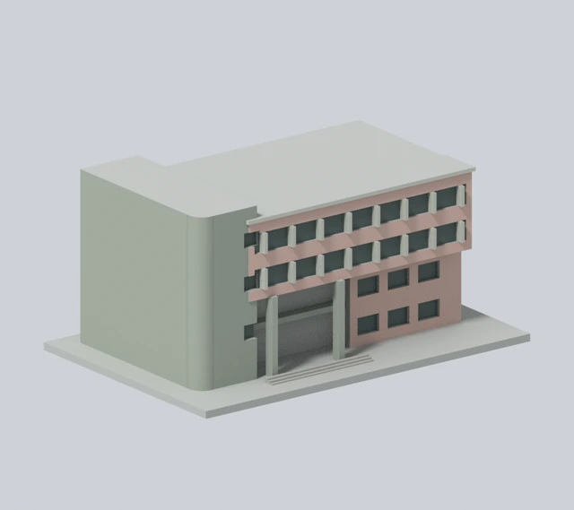
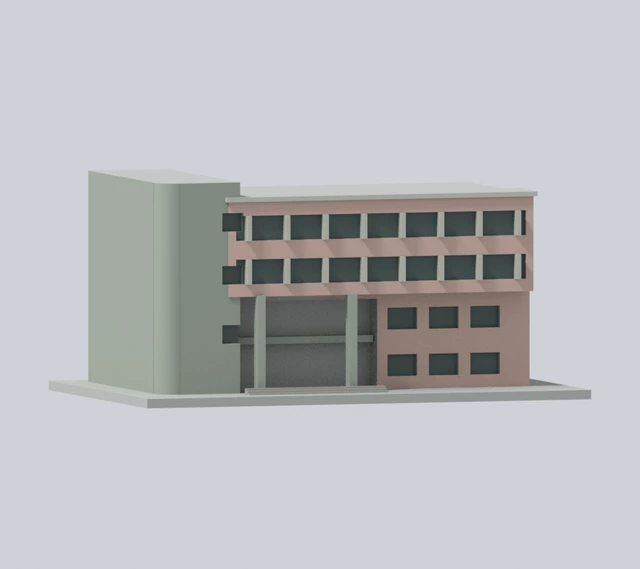
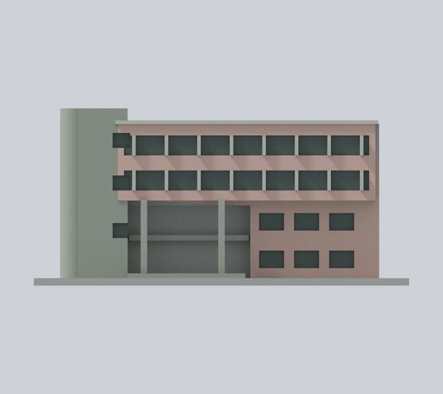
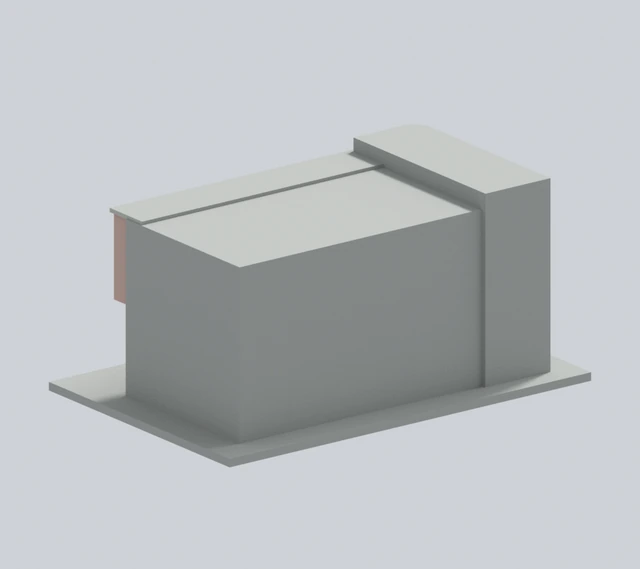
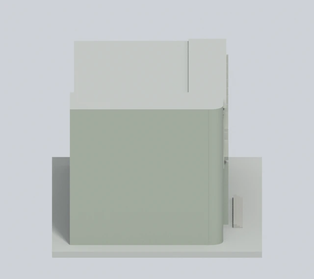
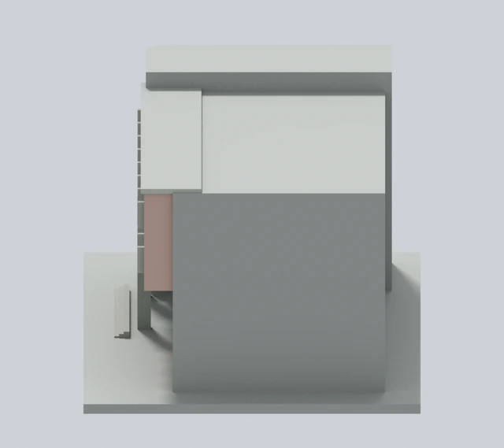
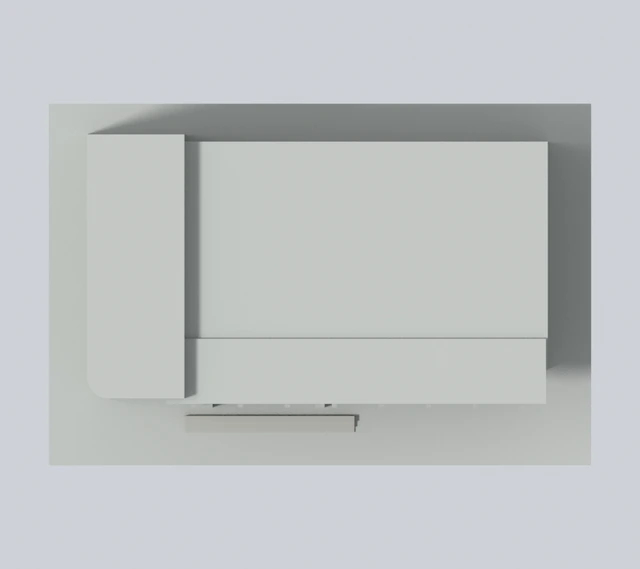

# 國立中央大學綜教館｜150 mm 外觀模型

## 模型預覽

### 照片近似彩色預覽

依校方校友通訊綜教館外照：灰綠圓角梯核、淡鮭粉灰前翼、灰綠入口柱、淺灰既有框與暗灰綠窗背。現行彩色版僅對原中性梯核外側／圓角前緣、懸出前翼短回折與薄簷側緣延伸同構件材料，屬近似推定；未知主體側後／屋頂中性。官方照片已證實內院紅磚與粉灰外翼分區，但原模型後深度為實心簡化塊，缺少對應內院幾何，因此不能把大背面認作實測外牆或全部改成任一顏色。這是限域補色，不是全館外觀補色完成。

| 模型預覽 | 模型預覽 | 模型預覽 |
| :---: | :---: | :---: |
|  彩色斜前 |  彩色近來源角度 |  彩色正面 |
|  彩色背面（簡化中性） |  彩色左側 |  彩色右側 |
|  彩色俯視（屋頂保留中性色） | &nbsp; | &nbsp; |

點縮圖可開啟無失真原尺寸 WebP。七個視角均核對現行彩色模型；未知側後與屋頂保持中性。

審核用的[同相機原新對照](appearance-review-v2/comparison.png)；對照圖左為原版、右為本次限域補色，圖片內沒有文字。

原三張中性幾何驗證圖、STL／OBJ／scene.blend、尺寸與首頁代表圖均不改；校級及校區展示保留原角度。照片日期未知，不稱1985原始塗裝或2026現況；詳[配色證據與限制](APPEARANCE.md)。

此為公開外觀資料研究模型，非測繪、施工或正式切片檔。每棟獨立縮尺，含底座最長150 mm，不能直接當作同一比例校園拼圖。本檔尺寸約 150 × 100 × 70.8 mm。

## 保留的識別特徵
- 左側平整樓梯核心及圓角外緣
- 上層懸出教學翼、雙高柱入口與內縮廊道
- 長向橫帶窗、入口階梯與高低屋面

## 證據與簡化
- 校方與Commons為不同斜正面，主要入口輪廓可核；右端部分被樹遮，背面與全深度未確定。
- 無證據的後部窗孔不複製正面；樓梯核心圓角半徑與主體尺寸目測。
- 窗格、柱距、細簷及廊道比例粗化，空調、單車、招牌等省略。
- Commons2013照片與未知拍年的校方照不等於2026完整現況。

全部來源及照片/設計圖區分見 sources.json。來源原照片、PDF、內部對照圖不隨模型發布。照片年代不同，不聲稱完整2026現況。

## 檔案與重建
- model.stl：單一連通列印實體，單位毫米
- scene.blend：由交付STL匯入的可編輯網格（不是參數化BIM）；預覽材質只供展示
- build_model.py：可攜參數化量體來源，無需來源照片即可重建
- previews/front.png、rear.png、elevation.png：從實際STL渲染，不是設計效果圖；名稱為相機視角，非精確方位

使用 Python 3.12，依 requirements.txt 準備相依套件，Blender 4.3.2。

    python build_model.py
    blender -b -t 2 -P render_preview.py
    python validate_model.py
    python check_layers.py
    python check_thin_features.py

## 幾何檢查及列印限制
原始STL法線與繞序一致、水密、每邊兩面、頂點鏈單環、單連通表面、無分離內腔殼、正體積、乾淨重建同SHA-256、已存Blender/STL三角幾何一致，詳 validation.json（passed=True）。

0.2 mm幾何截面共 354 層，全部閉合=True。另以1 mm間距檢查0.8 mm XY形態開運算薄特徵，0 層損失面積超過1%；尖角也會被計入，見 thin-feature-check.json。這不是全域壁厚保證，也不是正式切片或試印。

底座平放。懸出入口上板、雙層廊道與窗框上緣需評估局部支撐。建議先以0.4 mm噴嘴、0.2 mm層高在實際切片軟體檢查外壁、橋接、支撐可移除性與底板附著，再決定列印設定。小窗框、曲面尖端與薄簷口可能不完整重現；不得將幾何通過寫成「免支撐、保證可印」。

SHA256SUMS含可發布檔案雜湊。尚未實體試印。此為全校持續研究中的一件，不代表全校完成。

## 檔案下載與驗證

[彩色 3MF](appearance.3mf) · [彩色 Blender](appearance.blend) · [中性 STL](model.stl) · [中性 Blender](scene.blend) · [Python 來源](build_model.py) · [完整驗證](validation.json) · [來源](sources.json) · [渲染對照](display/render-proof.json) · [展示校驗](display/SHA256SUMS)

以上展示為交付彩色外觀模型的渲染；rear所示未知背側簡化，不代表有同視角實景佐證。相機視角不是精確地理方位。

## 截面數值方法修訂與補查

本發布包已直接採用canonical-edge-v2薄篩工具與結果，固定共邊插值方向，要求節點度數2、閉環及各Polygon有效，再做1 mm間距的0.8 mm XY開運算。舊版可能因共邊端點分開計算後取整而漏環，不能沿用舊面積值。這項修正不改STL、Blender或重建來源；真實薄特徵警示照常保留。

另以0.2 mm間距逐層補查閉環及Polygon有效性，共 354 層通過，見[有效性報告](contour-validity-check.json)與[可攜檢查程式](check_contour_validity.py)。這項較密補查沒有做薄篩開運算；薄篩採樣間距仍是1 mm。兩者都不是正式切片、試印或全域壁厚保證。
