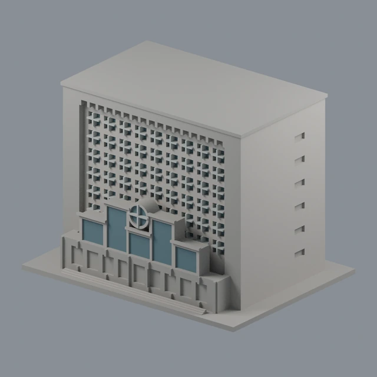
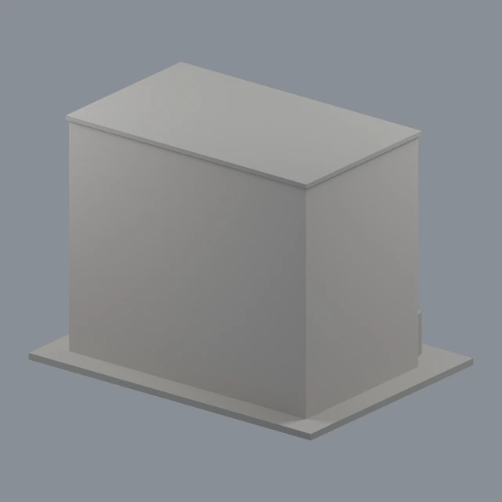
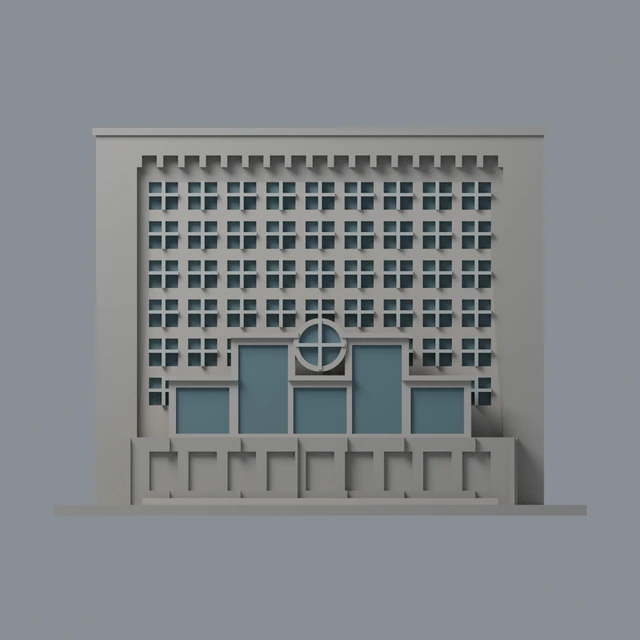
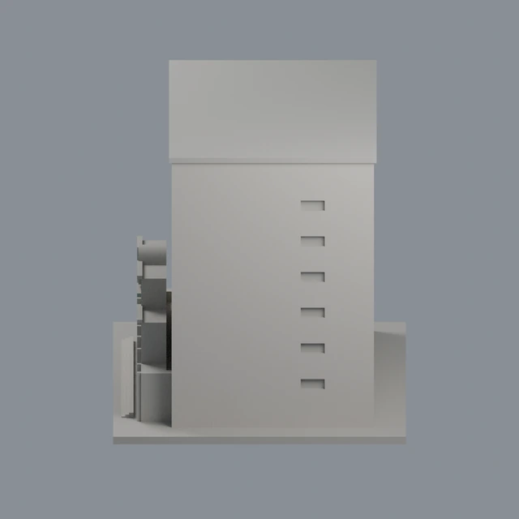
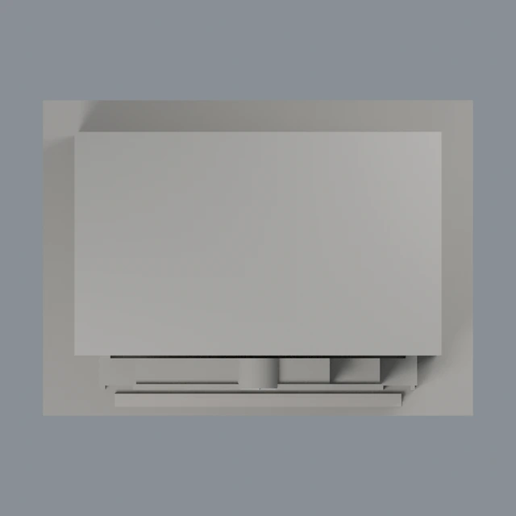

# 中央大學總圖書館｜現行模型 WebP 預覽

現行版延伸主體側／背外牆既有淡暖灰，42 面屬同材質連續性推估，未將混合窗槽、屋頂或簷口一併著色。這次只換展示格式，沒有新增補色、變更幾何或實體試印。五個畫面以同一版 3MF 按原鏡位重新渲染核對。

[原模型說明與限制](../README.md) · [外觀材質說明](../appearance/README.md) · [彩色 3MF](../appearance/ncu-main-library-appearance.3mf) · [可編輯 Blender](../appearance/scene.blend) · [中性 STL](../model.stl) · [現行工程校驗](../PUBLIC-MODEL-SHA256SUMS) · [渲染對照](render-proof.json) · [展示校驗](SHA256SUMS)

| 模型預覽 | 模型預覽 | 模型預覽 |
| :---: | :---: | :---: |
|  正面斜視 |  背側斜視 |  正立面 |
|  側視 |  俯視 |  |

[原 PNG 與舊校驗固定版本](https://github.com/hplin50643/taiwan-buildings-3d/tree/3056d5d3f0f18eb44e82fc3fb8efc3adda610b6c/%E5%A4%A7%E5%B0%88%E6%A0%A1%E9%99%A2/%E5%9C%8B%E7%AB%8B%E4%B8%AD%E5%A4%AE%E5%A4%A7%E5%AD%B8/%E6%A0%A1%E6%9C%AC%E9%83%A8/buildings/ncu-main-library) · [WebP 像素與校驗對照](archive-png.json)
