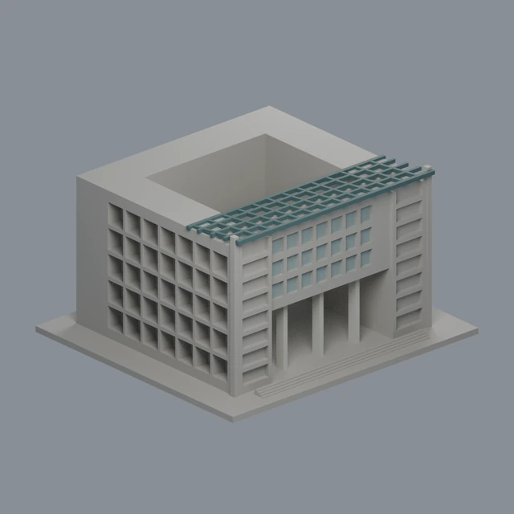
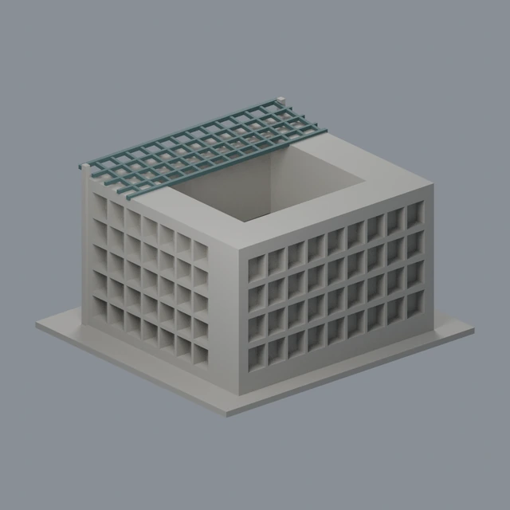
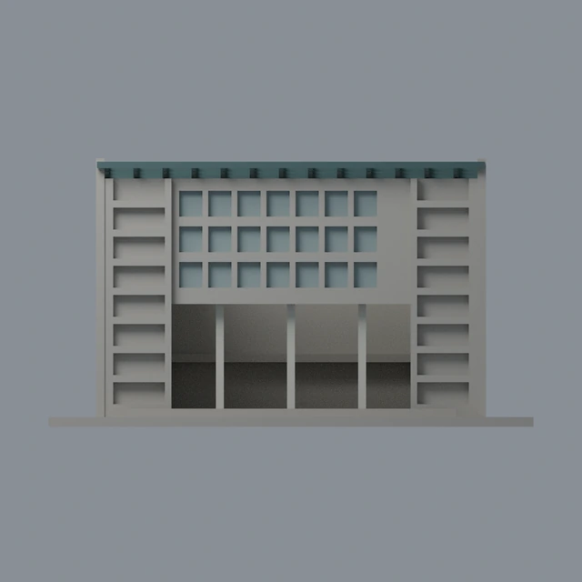
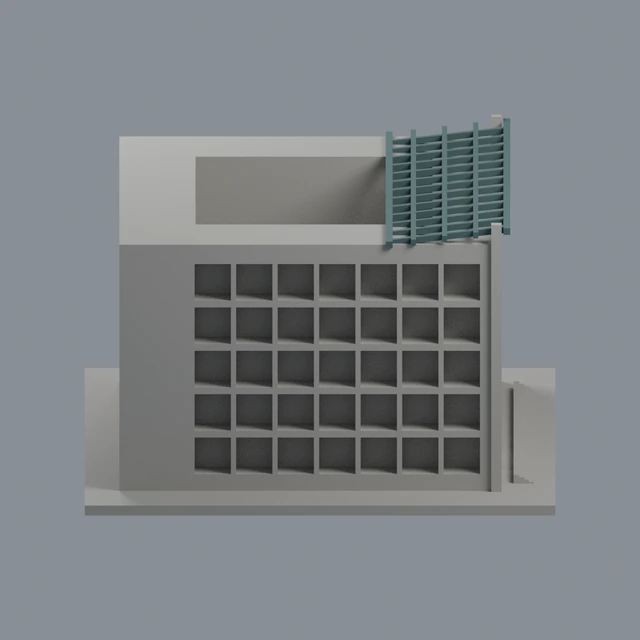
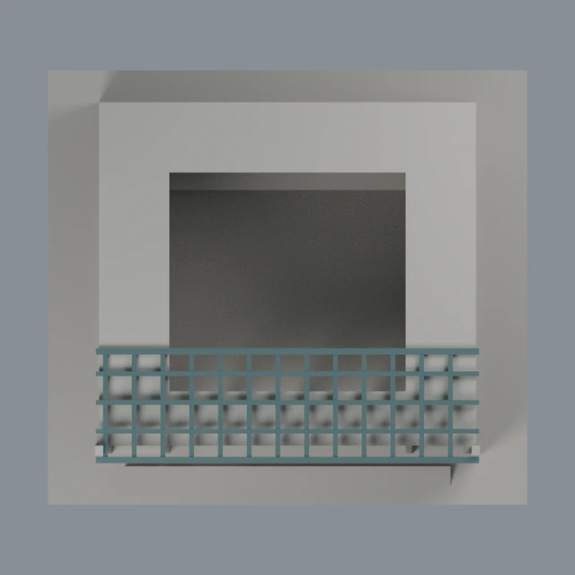

# 國立中央大學國鼎光電大樓｜150 mm 外觀模型

## 2026-11-17 中央柱體連續補色

已把三根中央柱正面的淡灰色延伸到同一柱體的側面與背面，新增18面，屬連續材質推估而非側後照片實證。其餘幾何與材質不變，詳[目前補色說明與驗證](appearance/README.md)。

## 模型預覽

| 模型預覽 | 模型預覽 | 模型預覽 |
| :---: | :---: | :---: |
|  正面斜視 |  背側斜視 |  正立面 |
|  側視 |  俯視 |  |

## 歷史初版：格棚與中央窗背限域配色（2026-10-22）

[配色五視角、來源與限制](appearance/README.md) · [表面色3MF](appearance/ncu-optoelectronics-appearance.3mf) · [可編輯Blender](appearance/scene.blend)

此為國鼎光電大樓，不是國鼎圖書資料館。以下為2026-10-22初版範圍及面數；目前另有三根中央柱共24面淡灰（本輪新增側背18面），中性剩2,578面，詳外觀層說明。

初版僅1494個原格棚完整梁面深灰綠、21中央凹窗42個背面淡灰藍；2602面保持中性，側後深凹遮陽格不當成全玻璃，不補玻璃頂板。玻璃是不透明實體背襯代理，非真透明幕牆。依2010–2011歷史實照及攝影日未知的官方PDF圖限域近似，不代表完整2026現況。原STL bytes、4138三角面、幾何與歷史QA不變，不增套數。3MF為單網格表面色，非分色封閉體、切片或G-code；原z=82.071 mm薄篩警示與支撐/橋接限制保留，未實體試印；第三方照片不分發。

此為公開外觀資料研究模型，非測繪、施工或正式切片檔。每棟獨立縮尺，含底座最長150 mm，不能直接當作同一比例校園拼圖。本檔尺寸約 150 × 136 × 83 mm。

## 保留的識別特徵
- 回字形中庭量體與前方大挑空入口
- 深凹外遮陽格、架高前翼與細長支柱
- 向前突出的斜向格構頂棚、前階與內廊

## 證據與簡化
- 中庭存在由台達基金會著作摘錄確認，但院落、翼厚及總深度比例是實照目測，不是設計圖量測。
- 後側格陣只由轉角照支持，完整背立面孔數與未可見內院面簡化。
- 玻璃以實體背襯凹格表示；頂棚/柱/格條加厚，內部階梯、管線及機電省略。
- 承造商合併兩棟作品頁標7F，光電棟由官方防災表與台達著作均為5層，未把合案7F套入光電棟。

全部來源及照片/設計圖區分見 sources.json。來源原照片、PDF、內部對照圖不隨模型發布。照片年代不同，不聲稱完整2026現況。

## 檔案與重建
- model.stl：單一連通列印實體，單位毫米
- scene.blend：由交付STL匯入的可編輯網格（不是參數化BIM）；預覽材質只供展示
- build_model.py：可攜參數化量體來源，無需來源照片即可重建
- 現行彩色 WebP 為交付模型實際渲染；原中性預覽只作工程留存。名稱是相機視角，非精確方位。

使用 Python 3.12，依 requirements.txt 準備相依套件，Blender 4.3.2。

    python build_model.py
    blender -b -t 2 -P render_preview.py
    python validate_model.py
    python check_layers.py
    python check_thin_features.py

## 幾何檢查及列印限制
原始STL法線與繞序一致、水密、每邊兩面、頂點鏈單環、單連通表面、無分離內腔殼、正體積、乾淨重建同SHA-256、已存Blender/STL三角幾何一致，詳 validation.json（passed=True）。

0.2 mm幾何截面共 415 層，全部閉合=True。另以1 mm間距檢查0.8 mm XY形態開運算薄特徵，1 層損失面積超過1%；尖角也會被計入，見 thin-feature-check.json。這不是全域壁厚保證，也不是正式切片或試印。

底座平放。大入口跨越量體、斜格棚與內廊需要支撐/橋接檢查，格棚支撐移除尤須留意。建議先以0.4 mm噴嘴、0.2 mm層高在實際切片軟體檢查外壁、橋接、支撐可移除性與底板附著，再決定列印設定。小窗框、曲面尖端與薄簷口可能不完整重現；不得將幾何通過寫成「免支撐、保證可印」。

[現行工程校驗](SHA256SUMS)列出現行工程與展示檔案。尚未實體試印。此為全校持續研究中的一件，不代表全校完成。

## 原建築設計者
吳瑞榮建築師事務所，依承造商工程實績。

薄特徵警示人工檢視：z=82.071 mm僅餘兩根2.6×3 mm門框頂端，0.4 mm半徑形態開運算將角部圓化，共损失0.2763 mm²（1.77%）；警示保留，不等於發現小於0.8 mm薄壁，也不替代正式切片。

## 檔案下載與實際模型預覽

[STL](model.stl) · [可編輯 Blender](scene.blend) · [Python 來源](build_model.py) · [完整驗證](validation.json) · [來源](sources.json)

以上皆由交付STL渲染；rear所示未知背側簡化，不代表有同視角實景佐證。相機視角不是精確地理方位。

## 截面數值方法修訂與補查

本發布包已直接採用canonical-edge-v2薄篩工具與結果，固定共邊插值方向，要求節點度數2、閉環及各Polygon有效，再做1 mm間距的0.8 mm XY開運算。舊版可能因共邊端點分開計算後取整而漏環，不能沿用舊面積值。這項修正不改STL、Blender或重建來源；真實薄特徵警示照常保留。

另以0.2 mm間距逐層補查閉環及Polygon有效性，共 415 層通過，見[有效性報告](contour-validity-check.json)與[可攜檢查程式](check_contour_validity.py)。這項較密補查沒有做薄篩開運算；薄篩採樣間距仍是1 mm。兩者都不是正式切片、試印或全域壁厚保證。

現行五個彩色視角使用可放大的無失真 WebP。原彩色 PNG 與相同內容的 README 副本可到[固定歷史版本](https://github.com/hplin50643/taiwan-buildings-3d/tree/3056d5d3f0f18eb44e82fc3fb8efc3adda610b6c/%E5%A4%A7%E5%B0%88%E6%A0%A1%E9%99%A2/%E5%9C%8B%E7%AB%8B%E4%B8%AD%E5%A4%AE%E5%A4%A7%E5%AD%B8/%E6%A0%A1%E6%9C%AC%E9%83%A8/buildings/ncu-optoelectronics)查閱；歷史雜湊表是原版本的紀錄，不用於現行檔案。重做原 PNG 時請在獨立工作副本執行。

**現行校驗：**在本資料夾執行 `sha256sum -c SHA256SUMS`；展示檔另可於 `display/` 執行 `sha256sum -c SHA256SUMS`。其他舊雜湊清冊僅作歷史紀錄，請搭配上方固定歷史版本與各次 QA 記錄查閱。
