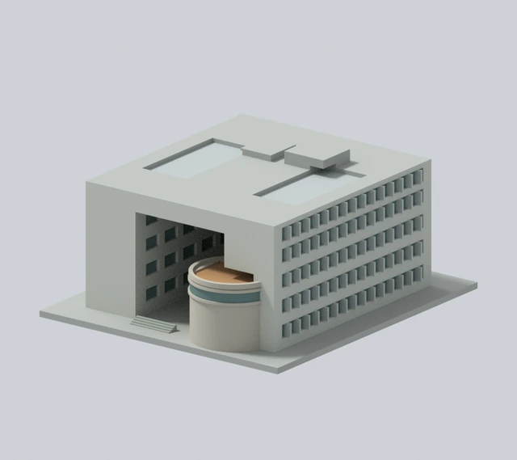
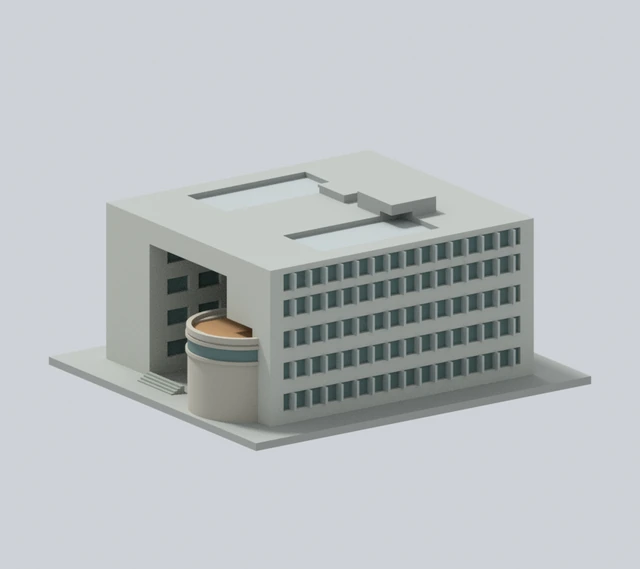
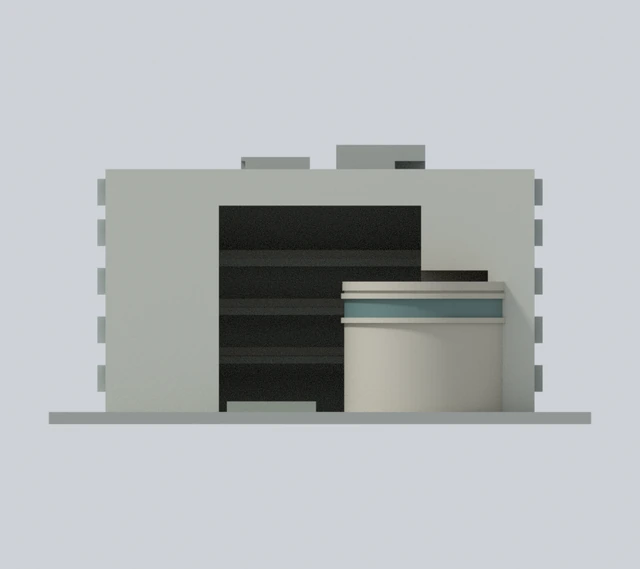
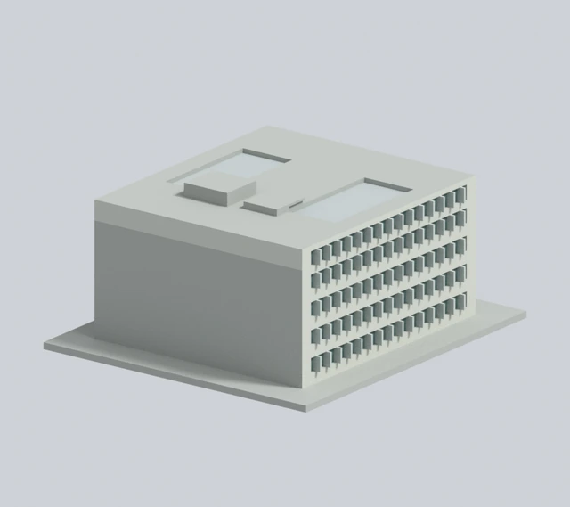
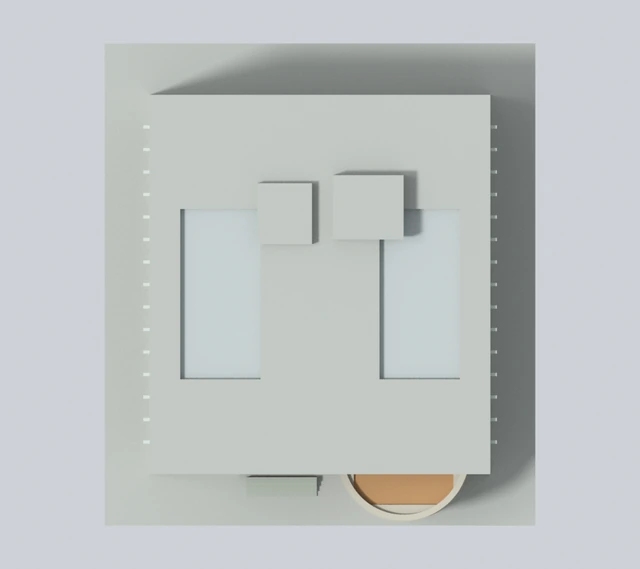
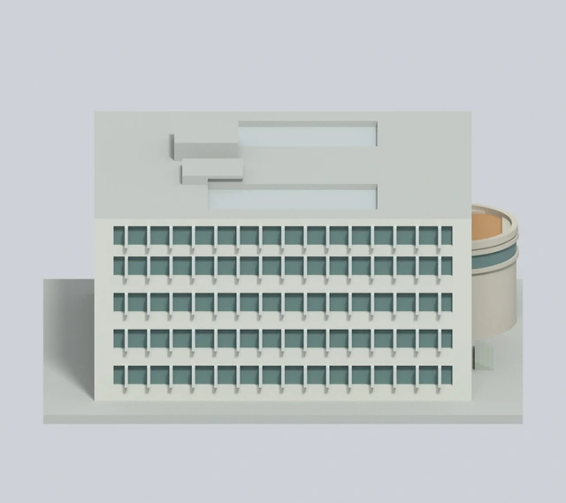
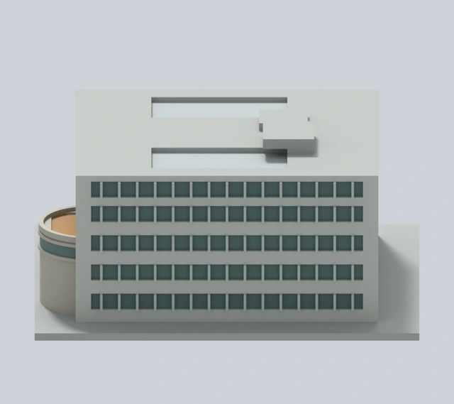

# 國立中央大學教學研究綜合大樓｜模型預覽

[回模型與下載](../README.md) · [WebP 和原圖校驗](preview-evidence.json)

| 模型預覽 | 模型預覽 | 模型預覽 |
| :---: | :---: | :---: |
|  正面斜視 |  右外側斜視 |  正面 |
|  背面斜視 |  俯視 |  左側 |
|  右側 |  |  |

點擊看無失真全圖。這是現行補色模型的重繪，不是實景照片；限制見[模型說明](../APPEARANCE.md)。
