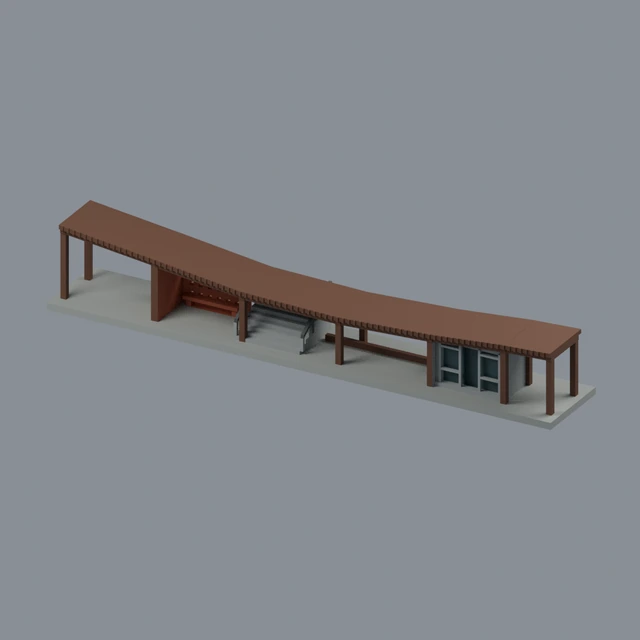
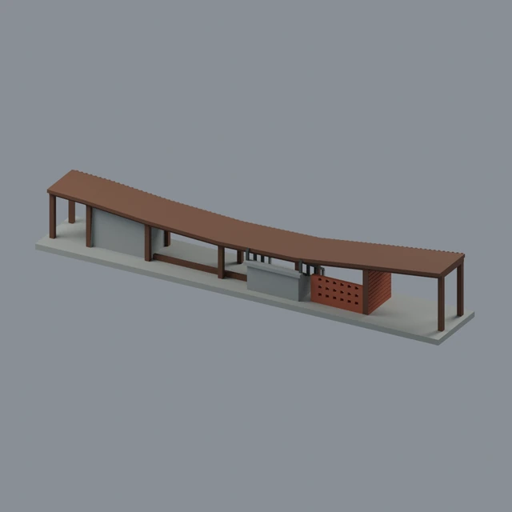
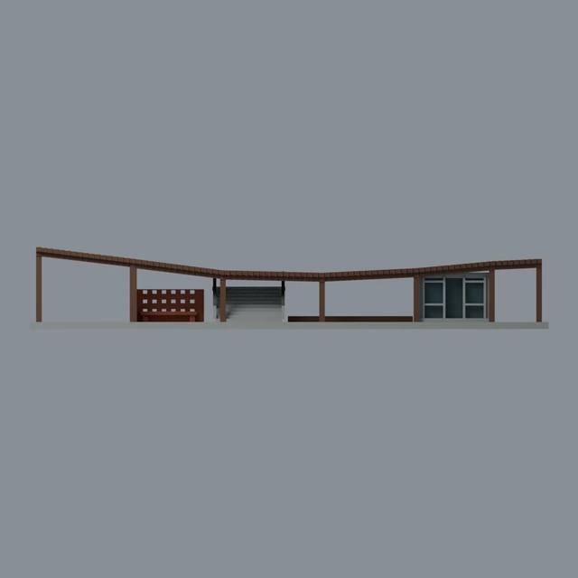
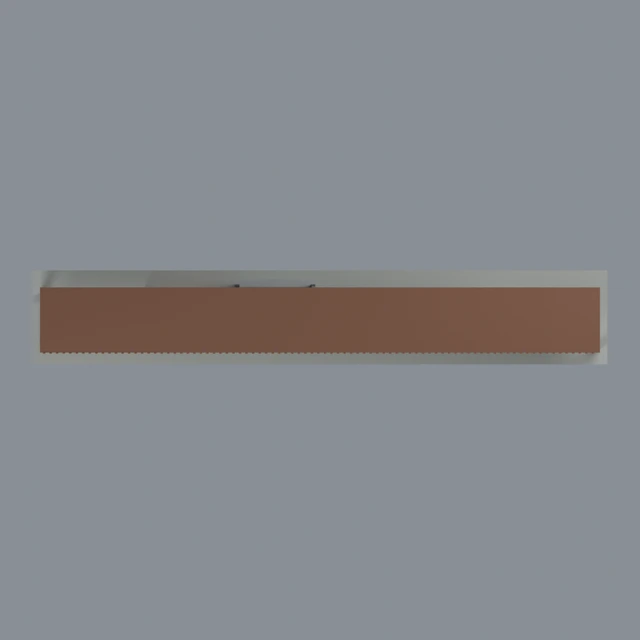
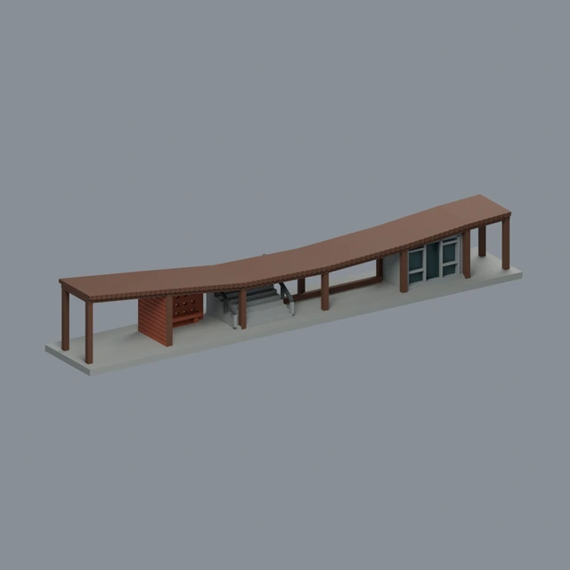

# 國立中央大學聽松台｜街側入口與候車棚外觀近似

## 模型預覽

五張圖使用 640 px WebP 縮圖，可點選全尺寸無失真 WebP。[圖檔及重繪校驗](qa/preview-webp.json) · [縮圖校驗](previews/thumbnail-proof.json)

| [](previews/front.webp) | [](previews/rear.webp) | [](previews/elevation.webp) |
| :---: | :---: | :---: |
| 實際模型街側斜視 | 截斷後側 | 街側正立面 |
| [](previews/top.webp) | [](previews/left_oblique.webp) |  |
| 俯視 | 左斜視 |  |

**限定街側長棚、紅磚候車區、單一寬階梯、ATM 門面及最右開放框跨；不是完整聽松台、觀景平台或機車停車場。** 依 2020 年官方實景擬合，未測繪，也不宣稱反映 2026 現況。

## 可編輯檔與五張真實網格圖
- [Blender 場景](scene.blend) · [彩色 3MF](model.3mf) · [STL](model.stl)
- [生成器](build_model.py) · [渲染器](render_model.py) · [六種命名材質](palette.json)
- [街側斜視](previews/front.webp) · [截斷後側](previews/rear.webp) · [街側正立面](previews/elevation.webp) · [俯視](previews/top.webp) · [左斜視](previews/left_oblique.webp)
- [來源與取捨](SOURCES.md) · [QA 與列印限制](QA.md)

保留不對稱「左端較高→長段中低→右端緩升」棚頂，暖咖啡色柱梁、淺浮雕直條封邊、左側紅磚實牆／穿孔回牆及座椅、緊接磚區的唯一寬梯、灰色 ATM 框與暗色凹入門面、最右開放跨。階梯不是整體正中央；遠端背景舊警衛建物不是 ATM 上層，沒有併入。

尺寸 **220 × 36 × 34.8 mm**，含 3 mm 人工展示底板。全部尺寸與七組柱列、十階、棚深為照片比例及穩固化近似，非實物精確數量／縮尺。棚厚 1.8 mm，主柱 2.4 mm，扶手 1.4 mm；磚縫有背板，穿孔為簡化規律陣列，未逐磚考證。淺封邊凸紋厚度僅 0.55 mm，保留薄件警示。

後側只保留小段樓梯平台，保守截斷；沒有虛構完整停車樓板、觀景平台、後立面或隱藏結構。ATM 門面凹入但後方實心，並非室內／機器重建。省略商標、校名字體、站牌、設備、道路與樹木。原始照片不隨包提供，也未作貼圖；材質色是展示近似，不是現場色樣或列印料槽設定。

## 重建與驗證
```sh
python -m pip install -r requirements.txt Pillow==13.0.0
python verify_package.py
blender -b -t 4 --python-exit-code 1 --python verify_render.py
python rebuild.py --output ../clean-rebuild --blender blender --threads 4
```
依 requirements.txt 安裝幾何環境；交換驗證另需 lib3mf。若 SDK 與幾何 Python 分開，設 BUILD_PYTHON 指定幾何環境。CPU Cycles seed 0／48 samples；跨 Blender 版本及平台不保證位元組相同。

**未做實體列印，不保證免支撐或直接可印。** 全域與局部薄截面失敗均保留，沒有為通過檢查而忽略它們。長棚底面、磚孔、扶手有懸垂／橋接，220 mm 底板有翹曲風險；須依設備、材料、線寬、層高、方向、支撐與黏床條件另行切片試印。

### 展示圖與校驗

點縮圖可開啟全尺寸無失真 WebP。重建只在隔離目錄暫存 PNG；公開原始模型和既有 QA 不變。[現行 WebP 與像素校驗](qa/preview-webp.json) · [原始 PNG、歷史校驗與進階測試步驟](https://github.com/hplin50643/taiwan-buildings-3d/tree/5dce8f6364ee02e12ac4c3633c74e57499d770d4/%E5%A4%A7%E5%B0%88%E6%A0%A1%E9%99%A2/%E5%9C%8B%E7%AB%8B%E4%B8%AD%E5%A4%AE%E5%A4%A7%E5%AD%B8/%E6%A0%A1%E6%9C%AC%E9%83%A8/buildings/ncu-ting-song-streetfront-canopy)。

[校級歷史發布校驗表](https://github.com/hplin50643/taiwan-buildings-3d/blob/5dce8f6364ee02e12ac4c3633c74e57499d770d4/%E5%A4%A7%E5%B0%88%E6%A0%A1%E9%99%A2/%E5%9C%8B%E7%AB%8B%E4%B8%AD%E5%A4%AE%E5%A4%A7%E5%AD%B8/SHA256SUMS_TINGSONG_FRONTAGE_20261021.txt)對應轉換前的 PNG 檔案；現行檔請核對本包 SHA256SUMS。
