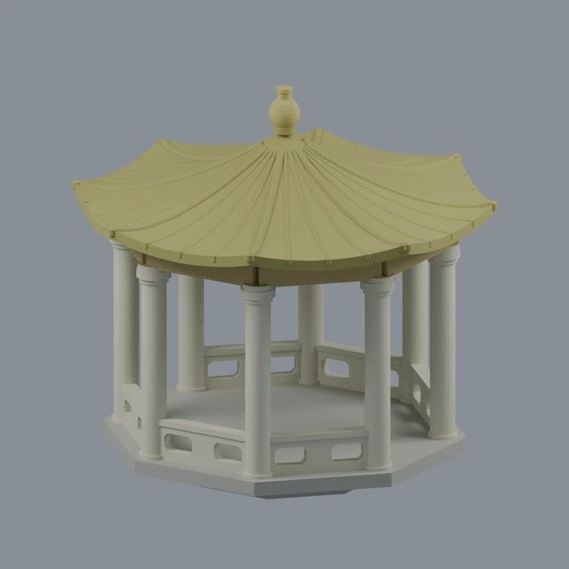
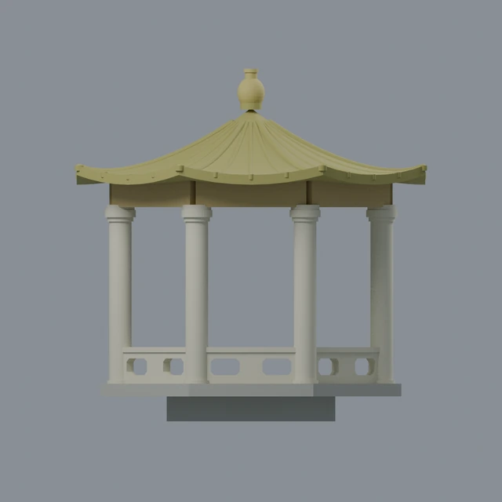
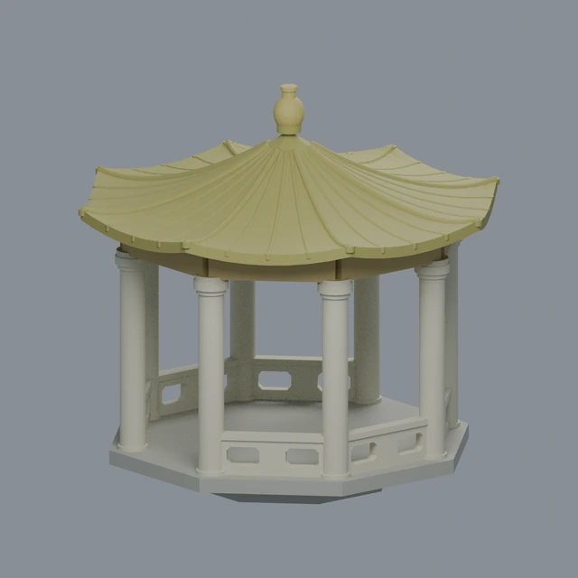
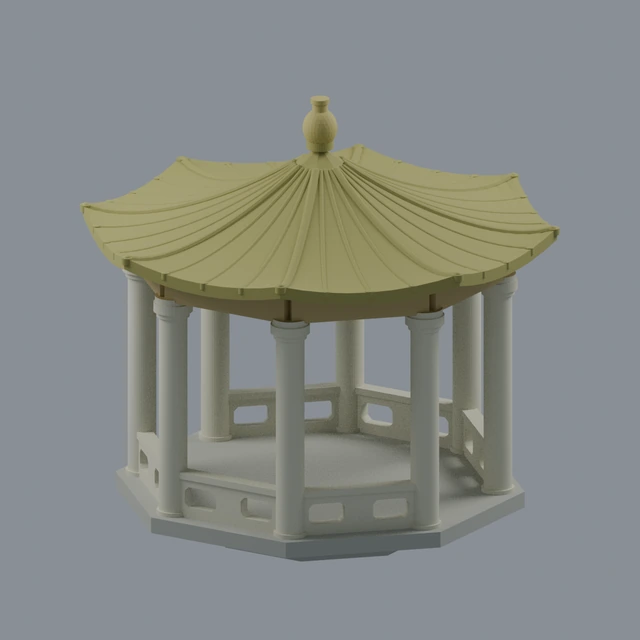
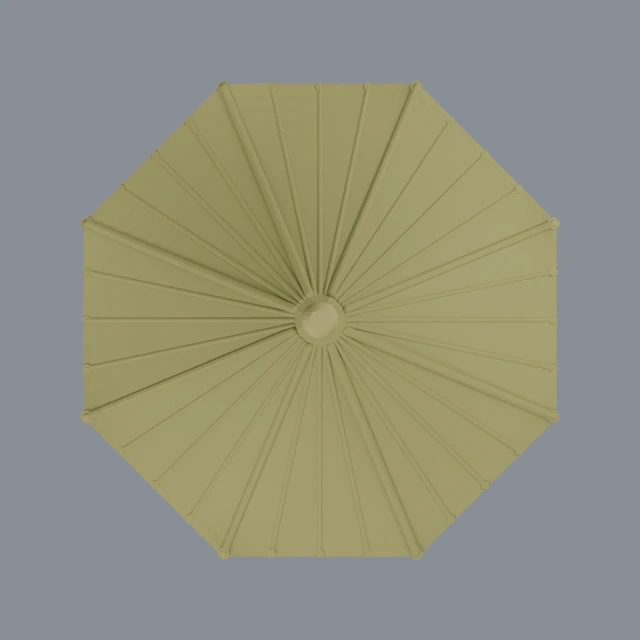

# 國立中山大學橋上涼亭

## 模型預覽

| 模型預覽 | 模型預覽 | 模型預覽 |
| :---: | :---: | :---: |
| [](previews/front-full.webp)<br>正面 | [](previews/elevation-full.webp)<br>正立面 | [](previews/left_oblique-full.webp)<br>左前斜視 |
| [](previews/rear-full.webp)<br>推定背側 | [](previews/top-full.webp)<br>推定頂面 |   |

**官方多角度照片的全亭外觀近似；八柱／八面為推定，不是測繪復原。** 照片 3、4 各可辨約七根真柱；第八柱與隱藏面依遮擋及規則環圈推估，並非八根都逐一可見。照片中的棕櫚樹幹沒有當成柱子。


- [可編輯彩色 Blender](scene.blend) · [彩色 3MF](model.3mf) · [單色 STL](model.stl)
- [來源及界線](SOURCES.md) · [QA 與列印限制](QA.md) · [參數生成器](build_model.py)

## 範圍與尺度
完整亭體及直接承載平台：粗圓柱、環形梁、黃綠曲面屋頂、附著式瓦脊、加粗頂飾、六段真正穿孔欄板，保留相對的兩個橋側入口。**不包含長橋、池塘、園林及被遮擋的桌椅。** 下方短實心八角支撐為展示用的近似延續，不代表量測過的水下基礎。

外包尺寸約 **115.97 × 115.97 × 115.90 mm**；這是自訂展示毫米，不是實體建物比例尺。圓柱直徑 7.4 mm、欄板厚 3.3 mm、屋頂垂直殼厚 3.2 mm。屋頂角對角名義寬 124 mm，與沿 X/Y 的包圍盒不同。

四張官方照片均親自檢視，**拍攝與發布日期未明**；2026-10-21 只是下載／製作日期，不代表已確認 2026 建物現況。未觀測後柱、屋面細節及內部梁架採規則簡化。屋瓦數、曲率、柱距、欄孔尺寸與位置均為照片近似。原有回紋以赭色帶簡化，未重製題字、符號與微小紋飾；頂飾、瓦端、柱頭均作粗化連接，並非雕塑複製。

## 使用
Blender 是可直接改頂點與逐面材質的單一連通網格。3MF 保留展示色，不是多噴頭列印設定；STL 不含色。五張圖均由交付模型實際渲染，並非生成式照片。

```sh
python -m pip install -r requirements.txt
python build_model.py
python qa_model.py
PYTHONDONTWRITEBYTECODE=1 python check_features.py
python -m pip install Pillow==13.0.0
python export_display_webp.py
python -B verify_package.py
```

預覽表使用輕量 WebP；點圖可開啟原 1200 × 1200 尺寸的 RGBA 無損 WebP。四張既有輕量圖及圖鑑代表圖保留原位和內容。原始 PNG 見[轉換前固定版本](https://github.com/hplin50643/taiwan-buildings-3d/tree/ac2397f5930233dc2ad2de8b7eb5d7326ed8ab49/%E5%A4%A7%E5%B0%88%E6%A0%A1%E9%99%A2/%E5%9C%8B%E7%AB%8B%E4%B8%AD%E5%B1%B1%E5%A4%A7%E5%AD%B8/%E8%A5%BF%E5%AD%90%E7%81%A3%E6%A0%A1%E5%8D%80/buildings/nsysu-bridge-pavilion)；也可用 `python export_display_webp.py --archive-png-dir /path/outside/package` 重現原 PNG 並校驗 SHA-256。匯出程式在暫存重繪，不覆蓋交付場景；要另存重建場景可加 `--scene-output /path/outside/package/scene.blend`。

**未實際列印，也不宣稱免支撐或可直接量產。** 大屋頂下表面、跨柱梁、欄孔上緣、曲簷及頂飾仍須切片支撐／方向評估。頂點拓樸通過不等於無薄件或結構強度保證。
