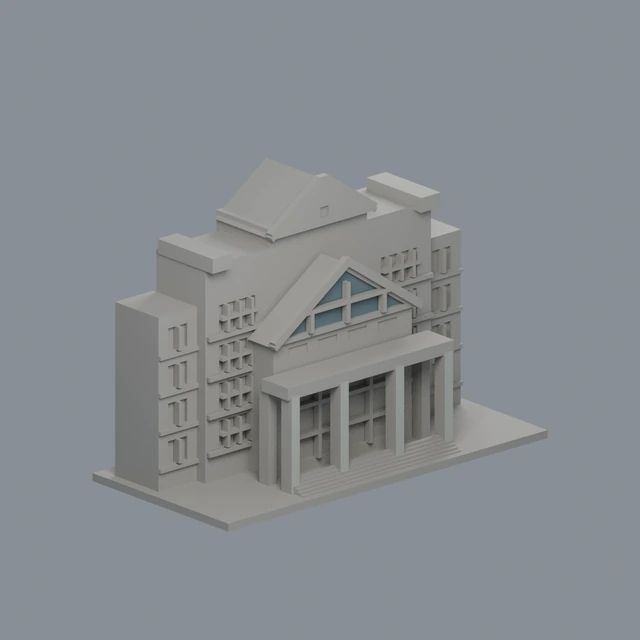
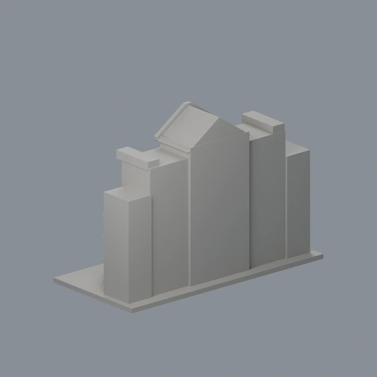
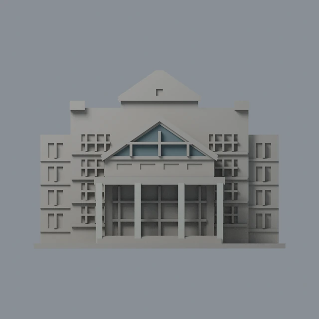
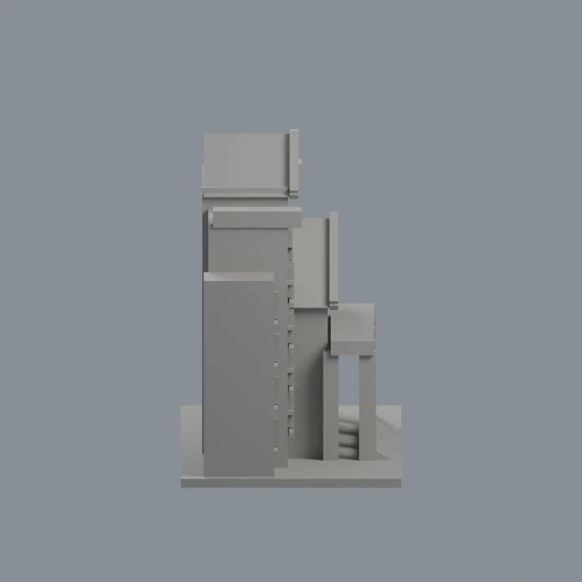
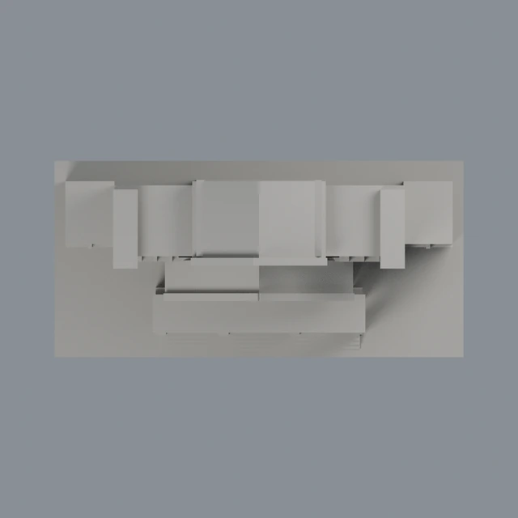

# 大禮堂前門廊段

## 模型預覽

| 模型預覽 | 模型預覽 | 模型預覽 |
| :---: | :---: | :---: |
|  正面斜視 |  模型背視（局部截面） |  正立面 |
|  側面 |  頂視 |  |

現版 3,522 面包含三角玻璃 1 面、四根正面柱的灰色代理 12 面及中性 3,509 面。只建前門廊段。

## 早期配色依據（2026-10-22）

[五視角、來源與限制](appearance/README.md) · [彩色3MF](appearance/ccu-auditorium-front-section-appearance.3mf) · [可編輯Blender](appearance/scene.blend)

只將原face725完整532mm²三角玻璃背板指定灰藍不透明proxy，其餘3521面中性；前方三竪框與橫框另有面，維持中性。這仍是前門廊段，不是完整大禮堂。磚牆混灰帶、其他窗/屋頂/截斷背面不擴塗，中性不代表實物灰色。官方頁未載日期；原JPEG EXIF正前2003:08:09 17:18:21、側照2003:10:25 12:17:24（無offset、時鐘未獨核），不是2026現貌。側照不含所選三角玻璃，不當其側背補證。原3522面座標/面序/STL與歷史QA不變、不增套；非分色封閉體或G-code，未實體試印，照片不分發。

國立中正大學・民雄校本部｜公開實拍外觀近似模型｜單位：毫米（mm）。

正立面（歷史檔案留存，不作本頁預覽） · 上視圖（歷史檔案留存，不作本頁預覽）

## 模型範圍

只包含正立面、重疊山牆、兩側前段量體、前方柱廊與階梯；未製作後方大禮堂完整座席廳量體。

保留兩組山牆、上方細通風孔、前山牆內凹窗面、四根前柱形成的深門廊、主要窗組與前階梯。

官方三張照片僅能支持正面與部分迴廊。背面為模型範圍截斷的實心封面，不能解讀成大禮堂實際背立面；未以正面鏡像填造後館。未查到本批可直接核對的完整背立面實拍。

## 來源年代與限制

導覽照片攝影日期未載明；頁面讀取日不是攝影日，沒有宣稱為2026實況。

[官方建物介紹](https://ccu-navigation.ccu.edu.tw/p/426-1253-4.php?Lang=zh-tw)。完整原始網址、實際查看的照片及支持特徵請見 [sources.json](sources.json)。第三方原照片和 PDF 不隨模型再散布。

## 下載與重建

- [model.stl](model.stl)：含底座 150.00 × 72.00 × 106.20 mm，最大尺寸 150 mm，各建物獨立比例，不是校園統一比例尺。
- [scene.blend](scene.blend)：匯入實際交付 STL 的可編修三角網格；場景單位毫米。
- [build_model.py](build_model.py)：獨立參數與布林幾何建構來源，無外部網格或照片依賴。
- [requirements.txt](requirements.txt)：Python 3.12 套件版本；另需 Blender 4.3.2+。
- [SHA256SUMS](SHA256SUMS)：逐檔雜湊。

重建：先安裝 requirements.txt，執行 python build_model.py，再執行 blender -b -t 2 -P render_preview.py。渲染器讀取 model.stl，預覽不是另一份外觀替身。

## 列印與數位檢查

底座朝下、毫米匯入切片器。柱廊梁下與山牆簷口可能需要支撐。最高山牆尖端截平約1.08mm，消除極細懸出線尖，保留雙山牆輪廓。 請自行在 Cura／PrusaSlicer 等確認支撐、跨橋與工具路徑；沒有實體試印，也沒有實際切片器驗證，不能保證無支撐列印或保證成功。

- [validation.json](validation.json)：原始二進位 STL 面法向／繞序、每邊兩面、頂點 link 單環、單一連通表面、正體積、底座與尺寸；獨立重建 STL SHA 及 saved Blend 幾何一致。
- [contour-validity-check.json](contour-validity-check.json)：起點 z=0.071 mm、間距 0.2 mm，共 531 層；每節點 degree 2、個別閉合輪廓及組合 Polygon valid，失敗即中止、不修補吞錯。
- [layer-check.json](layer-check.json)：同間距閉合及向下表面篩檢。
- [thin-feature-check.json](thin-feature-check.json)：canonical shared-edge thin-v2，z=0.071 mm 起、1 mm 間距、0.8 mm參考寬度 morphology opening；最大面積損失 1.342%，高於1%為 2 層。此值也包含尖角，不是全模型最小壁厚或實際擠出測試。

重跑 python validate_model.py、python check_layers.py、python check_contour_validity.py、python check_thin_features.py。每支程序均需 exit 0；輪廓檢查禁止使用 buffer(0) 修補輸入問題。

模型為建物外觀研究縮景，並非施工、結構、無障礙或防災分析模型。

原彩色 PNG、舊校驗及重繪紀錄可從[固定歷史版本](https://github.com/hplin50643/taiwan-buildings-3d/tree/7a0e66036ecc5a3cf45780ee73a25ddbf975de7e/%E5%A4%A7%E5%B0%88%E6%A0%A1%E9%99%A2/%E5%9C%8B%E7%AB%8B%E4%B8%AD%E6%AD%A3%E5%A4%A7%E5%AD%B8/%E6%B0%91%E9%9B%84%E6%A0%A1%E6%9C%AC%E9%83%A8/buildings/ccu-auditorium-front-section)追溯。現行大圖用[像素對照表](display/archive-png.json)校驗：`python display/verify_webp.py`（需 Pillow）。若需重繪，在獨立目錄執行現行外觀渲染；用 `--replay-root /path/to/replay` 比對尺寸及解碼像素，不把中間 PNG 放回現行庫。
