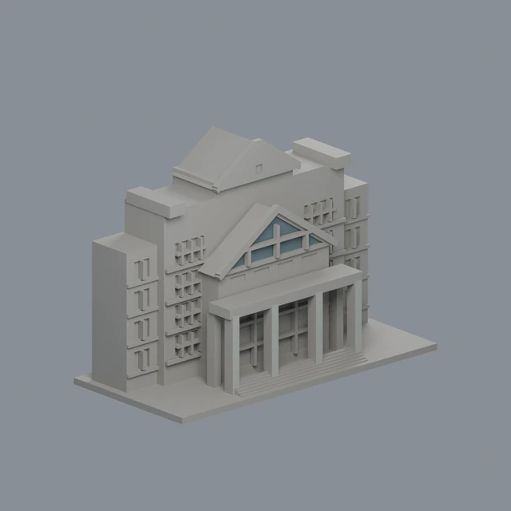
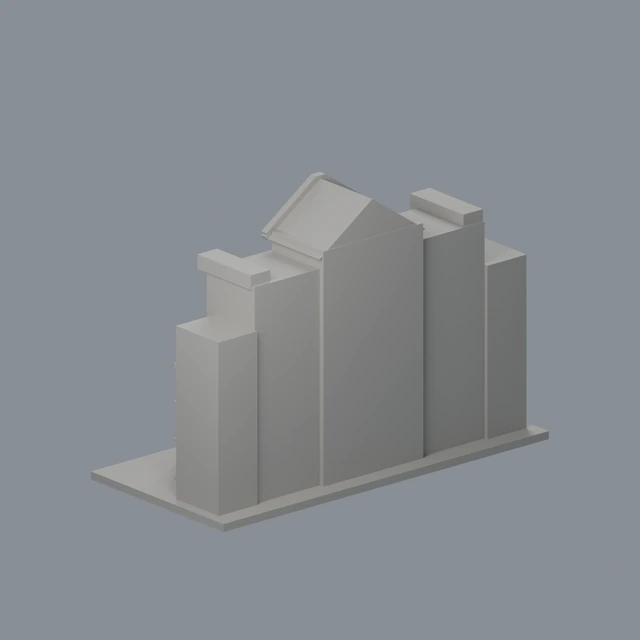
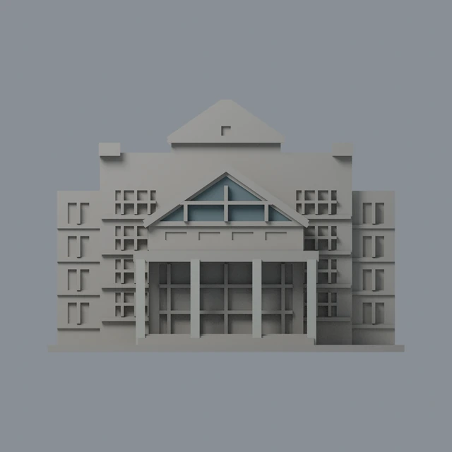
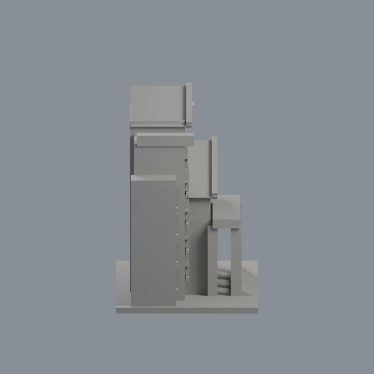
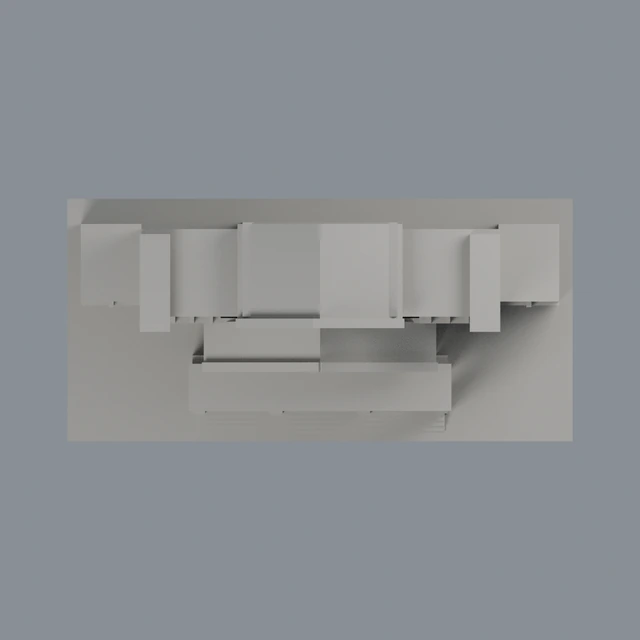

# 國立中正大學大禮堂前門廊段｜現版五視角

## 模型預覽

| 模型預覽 | 模型預覽 | 模型預覽 |
| :---: | :---: | :---: |
|  正面斜視 |  模型背視（局部截面） |  正立面 |
|  側面 |  頂視 |  |

由現版三材質 Blender 依原相機重繪，大圖為無損 WebP。沿用既有四根前柱的正面限域配色，未新增材質；本件只包含前門廊段，並非完整大禮堂或現況紀錄。

[現版 Blender](../appearance/scene.blend) · [現版彩色 3MF](../appearance/ccu-auditorium-front-section-appearance.3mf) · [原 STL](../model.stl) · [模型及技術資料](../README.md) · [原外觀證據](../appearance/README.md) · [渲染證據](render-proof.json) · [展示校驗](SHA256SUMS)

原彩色 PNG、舊校驗及重繪紀錄可從[固定歷史版本](https://github.com/hplin50643/taiwan-buildings-3d/tree/7a0e66036ecc5a3cf45780ee73a25ddbf975de7e/%E5%A4%A7%E5%B0%88%E6%A0%A1%E9%99%A2/%E5%9C%8B%E7%AB%8B%E4%B8%AD%E6%AD%A3%E5%A4%A7%E5%AD%B8/%E6%B0%91%E9%9B%84%E6%A0%A1%E6%9C%AC%E9%83%A8/buildings/ccu-auditorium-front-section)追溯。現行大圖用[像素對照表](archive-png.json)校驗：`python display/verify_webp.py`（需 Pillow）。若需重繪，在獨立目錄執行現行外觀渲染；用 `--replay-root /path/to/replay` 比對尺寸及解碼像素，不把中間 PNG 放回現行庫。
