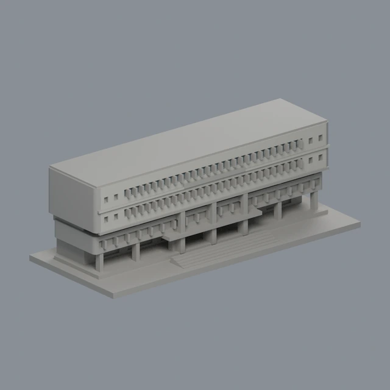
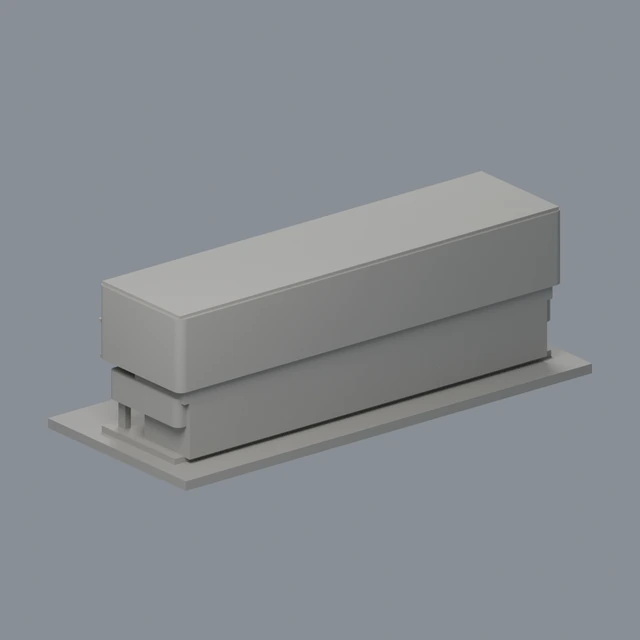
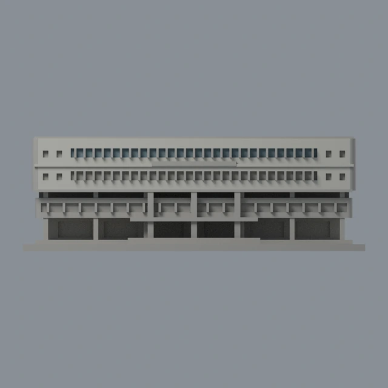
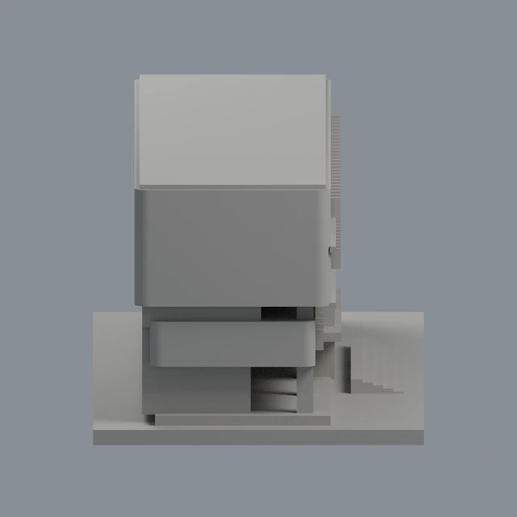
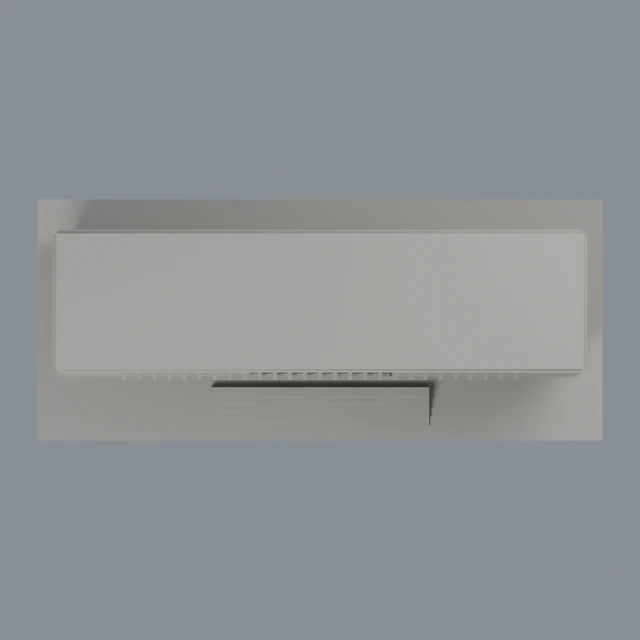

# 惠蓀堂西向前棟段｜國立中興大學

## 模型預覽

| 模型預覽 | 模型預覽 | 模型預覽 |
| :---: | :---: | :---: |
|  正面斜視 |  模型背視（局部截面） |  正立面 |
|  側面 |  頂視 |  |

現版 3,422 面包含正面磁磚 286 面、上排玻璃 2 面及中性 3,134 面。只建西向前棟段。

## 早期配色依據（2026-10-22）

[五視角、來源與限制](appearance/README.md) · [彩色3MF](appearance/nchu-huisun-front-appearance.3mf) · [可編輯Blender](appearance/scene.blend)

僅280完整平直正面磁磚面指定乳白米灰、2上排玻璃背面指定灰藍不透明代理，其餘3140面中性。下排右端格柵混材未分面，不整條染玻璃；框、圓角側背、屋頂與人工截面中性。仍是西向前棟段，不是完整惠蓀堂。官方館訊2022.06刊、兩原照EXIF Original/Digitized/DateTime均2018-09-21；原幾何依2021/2024照片，跨年資料非2026現貌。未校準目視近似，不是精確測色或材料鑑定。原3422面座標/面序/STL與歷史QA不變、不增套；非分色封閉體或G-code，未實體試印，照片不分發。

校本部公開外觀近似模型，局部建築段。含底座尺寸 150.00 × 64.00 × 50.20 mm，最長150mm。各件獨立縮放，不能直接組成等比例校園。

正投影（歷史檔案留存，不作本頁預覽） / 頂面與退縮區（歷史檔案留存，不作本頁預覽）

## 保留特徵與範圍
上層長條量體及圓角、兩層連續帶窗、兩端成對小方窗、下層退縮帶與開放柱廊、中央較厚入口柱及階梯。

僅1993年重建第二代惠蓀堂的西向前棟；不包含後方演藝廳、後立面、主廳屋頂與太陽能設備。長邊轉角半徑、窗梃數量及前棟进深均為視覺近似，後側是模型截斷面。

僅以公開建築外觀自建，並非測繪復刻；未使用他人3D網格或室內房間配置。未宣稱全館、全校完成。

## 來源與年代
[實拍 1](https://commons.wikimedia.org/wiki/File:Hui-Sun_Auditorium_front_view_at_GJ24_20210109.jpg) / [實拍 2](https://commons.wikimedia.org/wiki/File:Hui-Sun_Memorial_Hall%2C_NCHU%2C_Taichung%2C_Aug_2024.jpg)。其他校方來源及每項支持特徵見 [sources.json](sources.json)。只依照片年代還原可見部分，不宣稱2026完整現況。原照片不随本模型重新散布。攝影日、相簿更新日、活動日期明確區分；未以效果圖代替已建實景。

## 檔案與數位檢查
- [model.stl](model.stl)：毫米制單一實體
- [scene.blend](scene.blend)：由交付STL匯入的可編輯網格；[build_model.py](build_model.py) 是參數重建來源
- [validation.json](validation.json)：原STL法向/繞序、正體積、水密、每邊兩面、vertex-link單環、單一連通表面、獨立重建SHA和Blend三角形幾何一致
- [valid-sections.json](valid-sections.json)：251個0.2mm層距斷面，起始z=0.071mm，每個輪廓及組合Polygon均閉合有效，未修補invalid
- [layer-check.json](layer-check.json)：閉合輪廓與向下表面數值
- [thin-feature-check.json](thin-feature-check.json)：0.8mm參考寬度形態opening輔助篩查，1.0mm層距、z=0.071mm；最大面積損失比例0.000774，無超過1%的取樣層

## 列印限制
底板朝下；可從0.4mm噴嘴、0.2mm層高開始檢查。獨立矩形柱至少2.1mm寬，窗梃採1.0mm實體；水平深凹、入口雨遮、上層懸挑均需切片器支撐與可拆性檢查。

以上是數位幾何QA，並非真正切片器工具路徑或實體試印；不能保證可印或免支撐。0.8mm形態篩查不是全面最小壁厚或橋接能力證明。縮小模型會改變所有細節厚度，應重新檢查。

## 重建與驗證
Python 3.12依 [requirements.txt](requirements.txt) 安裝依賴，執行 build_model.py。以Blender背景模式執行 render_preview.py，產生實際STL預覽和scene.blend。依序執行 validate_model.py、check_layers.py、check_valid_sections.py、thin_canonical_v2.py；各程式退出碼都應為0，validation.json全部checks需為true。任何失敗都停止發布。

STL SHA-256：1c1f9fb58f6b71307ff3e74644ffebacdcb408c8743ab65700286ffdea7060e0

[校區圖鑑](../../README.md) / [學校入口](../../../README.md)

原彩色 PNG、舊校驗及重繪紀錄可從[固定歷史版本](https://github.com/hplin50643/taiwan-buildings-3d/tree/7a0e66036ecc5a3cf45780ee73a25ddbf975de7e/%E5%A4%A7%E5%B0%88%E6%A0%A1%E9%99%A2/%E5%9C%8B%E7%AB%8B%E4%B8%AD%E8%88%88%E5%A4%A7%E5%AD%B8/%E6%A0%A1%E6%9C%AC%E9%83%A8/buildings/nchu-huisun-front)追溯。現行大圖用[像素對照表](display/archive-png.json)校驗：`python display/verify_webp.py`（需 Pillow）。若需重繪，在獨立目錄執行現行外觀渲染；用 `--replay-root /path/to/replay` 比對尺寸及解碼像素，不把中間 PNG 放回現行庫。
