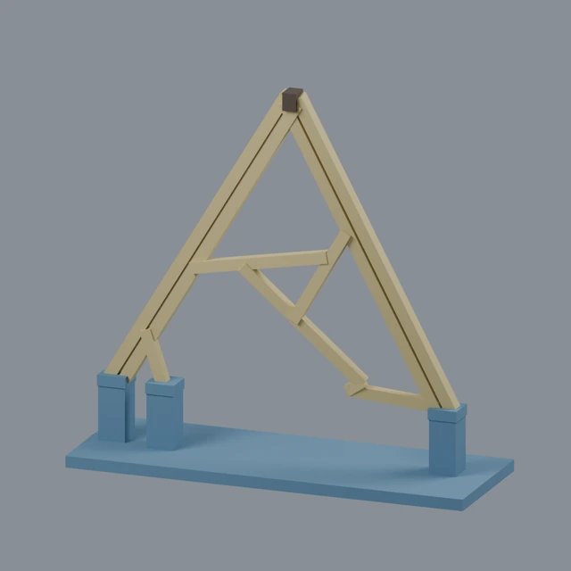
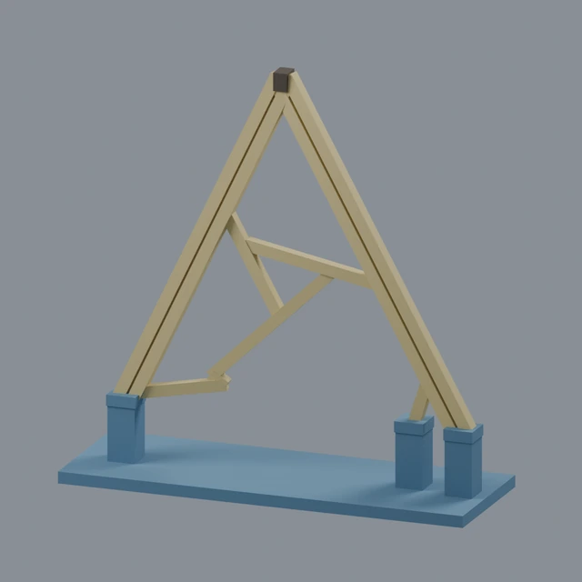
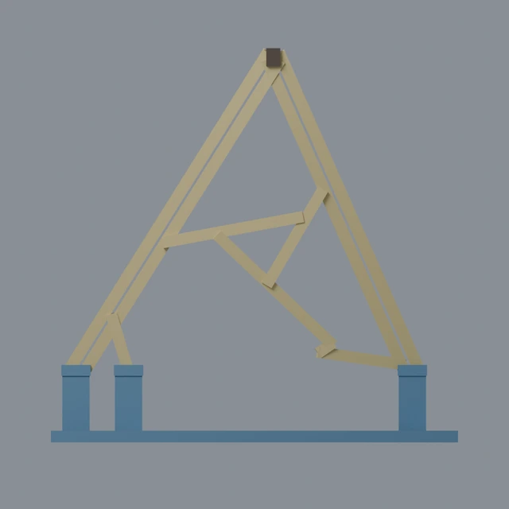
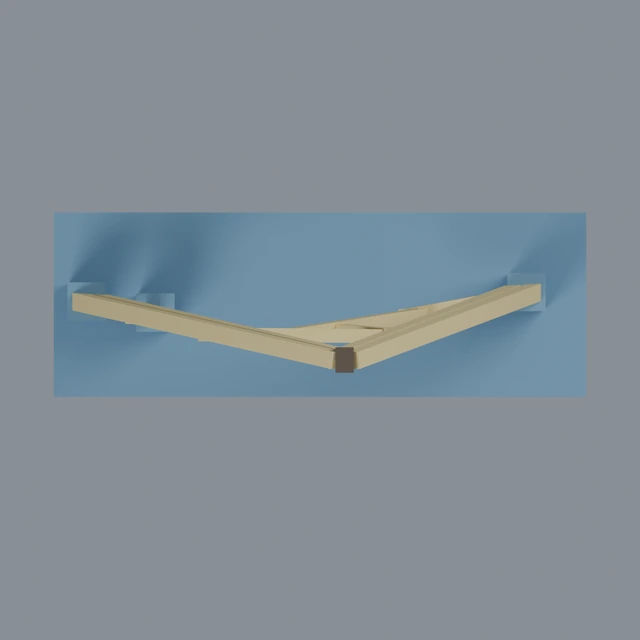
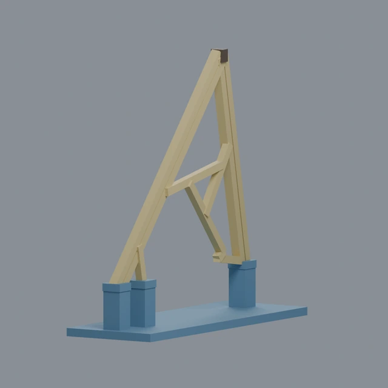

# 國立成功大學｜光復校區｜波簷高尖峰上部木格片段（2021）

## 模型預覽

<a name="五個真實網格視圖"></a>

| [](previews/front.webp) | [](previews/rear.webp) | [](previews/elevation.webp) |
| :---: | :---: | :---: |
| 正斜視 | 背斜視 | 投影正視 |
| [](previews/top.webp) | [](previews/left_oblique.webp) |  |
| 俯視（淺深度估計） | 左斜視 |  |

> **有界木格片段，不是完整亭，也不是完整雙曲面。** 藍色底座、立柱與帽蓋全部是截斷展示支架，不是現場基礎或實際腳座。


以成大官方及創作者第一方照片為依據，只保留最高尖峰上部可辨認的雙邊木條、第一橫木、偏置 Y 字節點、右下短折線與左下截斷木條。照片可辨認三個腳座，但不足以證明總數；**本模型不建任何現場腳座，不補第四腳，不重建第二曲面或下部密集交接。** 木格為真正開孔，沒有加實心屋面。

## 下載與編輯
- [彩色可編輯 Blender 場景](scene.blend)（材質、網格可編輯）
- [彩色 3MF](model.3mf)（逐面展示材質，不等於多料印表機配置）
- [單色 STL](model.stl)
- [參數生成程式](build_model.py)、[展示色盤](palette.json)
- [來源](SOURCES.md)、[驗證與限制](QA.md)、[完整檔案雜湊](SHA256SUMS)

## 範圍及重要限制
- 直接由斜視照片中可見上部線段估計投影輪廓；**相片投影描線不是正立面測繪**，沒有實物量測尺寸或精確比例。
- 三張完整來源照片只有兩個視向；wave1 與 wave3 在同一側，不能當三個獨立方向。
- 外邊界採並列矩形木條及可見接縫，內部保留不規則偏置連接；木條寬厚、接縫、節點搭接及淺彎曲深度均簡化／估計，不能當施工榫接或雙曲面數學重建。
- 深色尖峰接頭僅示意可見連接，不推定螺栓數、板厚或工程設計；無木紋貼圖、廣告牌、周圍建築、景觀基座或植物。
- 藍色三處截斷支承是模型專用，不代表現場有三腳。底座寬 104 mm 為展示選擇，不是現場比例尺。
- STL 已封閉且單一連通，但**薄截面檢查未全過**；斜木、接頭、0.6 mm 雙木條縫及上尖端仍需自行評估支撐、朝向及加工。未實際切片、列印或結構測試，不承諾可直接列印或免支撐。

上述五圖由交付網格渲染，沒有以來源照片或概念示意圖冒充模型。照片投影正視僅為模型觀看角度，不代表實物測繪正立面。模型及原創程式 CC0；第三方照片不隨包分發。

## 重建

用 Blender 4.3.2 與 `requirements.txt` 所列套件重建。輸出路徑須在模型目錄外且尚未存在，避免覆寫發布檔案。個別分析入口為 `qa_model.py`、`check_features.py`；`verify_scene.py` 和 `verify_exchange.py` 分別用於場景及交換格式核對。

```bash
python -m pip install -r requirements.txt Pillow==13.0.0
python verify_package.py
blender -b --threads 4 --python-exit-code 19 --python verify_render.py
python rebuild.py --output ../new-clean-rebuild --blender blender --threads 4
```

五張展示圖使用 640 px WebP 縮圖，可點圖開啟全尺寸無失真 WebP。[縮圖校驗](previews/thumbnail-proof.json)。重建只在暫存目錄產生 PNG 中間檔，核對解碼 RGBA 像素及尺寸後輸出並校驗 WebP。原模型和既有 QA 報告不變，原始 PNG 和當時的校驗記錄仍可在固定提交查閱。[現行 WebP 校驗](qa/preview-webp.json) · [原始 PNG 與歷史 QA](https://github.com/hplin50643/taiwan-buildings-3d/tree/336ce1843e6e4435f93ed1a5df7cc26434fb9596/%E5%A4%A7%E5%B0%88%E6%A0%A1%E9%99%A2/%E5%9C%8B%E7%AB%8B%E6%88%90%E5%8A%9F%E5%A4%A7%E5%AD%B8/%E5%85%89%E5%BE%A9%E6%A0%A1%E5%8D%80/buildings/ncku-wave-eaves-apex-fragment-2021)。 · [歷史外觀審核所用的 README](https://github.com/hplin50643/taiwan-buildings-3d/blob/56a69d1b4af24b58c4b8cf3ad1c7caf862f57e4b/%E5%9C%8B%E7%AB%8B%E6%88%90%E5%8A%9F%E5%A4%A7%E5%AD%B8/%E5%85%89%E5%BE%A9%E6%A0%A1%E5%8D%80/buildings/ncku-wave-eaves-apex-fragment-2021/README.md)。
