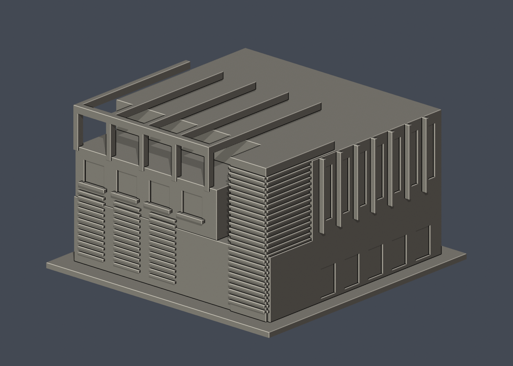
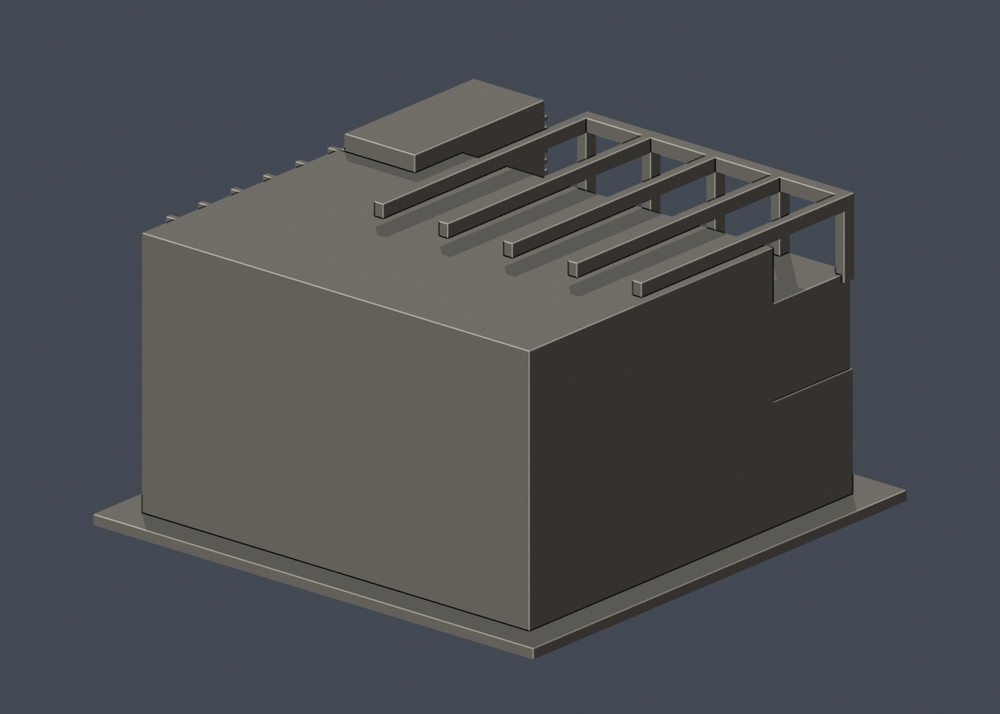
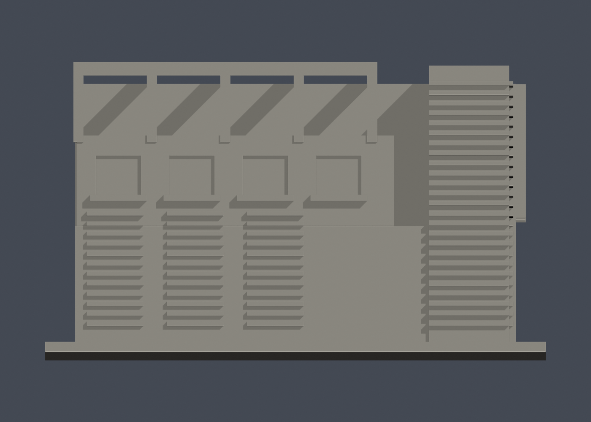

# 國立成功大學｜游泳池暨球類場館

## 模型預覽

| 模型預覽 | 模型預覽 | 模型預覽 |
| :---: | :---: | :---: |
|  正面 |  背面 |  立面圖 |

第十二批；勝利校區。校方GIS G015，財產校碼R1A-69-0。尺寸約 150 × 150 × 87 mm，含底座最長邊150 mm，各件獨立比例。

## 建模範圍與近似

只做2018落成的G015獨立場館外殼；不含旁邊室外游泳池、看臺、周遭宿舍或附屬設備。兩張GIS實拍共同辨識前方開放高框架、全高轉角百葉面、長側深直立遮陽片與低層開口。GIS第三張q37601是效果圖，與實拍有差異，排除不用。細百葉以約3 mm間距、1.25 mm高的實體橫條加粗表現，非原根數；未知背面留素面、屋頂平面簡化，屋頂設備不建模。

只建公開外觀，不包含室內、設備、安全配置。厚窗框、窗凹口、遮陽構件和小屋簷均為適應迷你比例的概化；不是文資修復或工程測繪資料。預覽方位為方便看到主要立面的相機角度，不代表地理正南/正北。

## 列印與支撐

上方開放框架的跨梁、凸出陽臺和側遮陽片下方需要特別檢視支撐，長跨梁不保證直接橋接成功；建議切片後分區配置支撐。

未實體試印，未切片驗證。0.8 mm薄特徵篩查只作水平幾何輔助，不是全部壁厚或噴嘴路徑分析；尖角面積損失不直接等於列印失敗，數值低也不能保證成功。

## 來源

- [校方公共GIS名稱、外觀照片及建物外框](https://nckumap.ncku.edu.tw/map.php)：僅公開外觀與外部輪廓；不採室內/樓層/設備圖層。地圖原圖不公開轉載。
- [校方財產清冊2026-01-30](https://prop-oga.ncku.edu.tw/var/file/59/1059/img/4743/218075103.pdf)：勝利校區、校碼R1A-69-0名稱對照；財產筆數非獨立建物棟數。
- [校方建物名稱與背景](https://web.ncku.edu.tw/p/404-1000-186245.php)：名稱、校區或同一棟範圍核對；不使用內部配置。
- [已檢視像素的校方實拍](https://db.nckumap.ncku.edu.tw/nckugis/public/uploadfiles.htm?action=listImg&q=38128)：公開可見建築外觀；原照片不納入公開套件。
- [已檢視像素的校方實拍](https://db.nckumap.ncku.edu.tw/nckugis/public/uploadfiles.htm?action=listImg&q=38127)：公開可見建築外觀；原照片不納入公開套件。
- [排除的效果圖](https://db.nckumap.ncku.edu.tw/nckugis/public/uploadfiles.htm?action=listImg&q=37601)：非竣工實拍；不作本模型外形依據。

## 檔案與重建

- [模型 STL](model.stl)、[可編輯 Blender](scene.blend)
- [正面 WebP](previews/front.webp)、[背面 WebP](previews/rear.webp)、[立面圖](previews/elevation.webp)，均從實際 STL 產生；WebP 解碼後的 RGBA 像素與原始 PNG 完全相同
- `pip install -r requirements.txt` 後執行 `python build_model.py`
- 在工作副本安裝 Pillow 13.0.0（libwebp 1.6.0），以 Blender 4.3.2 執行 `python export_display_webp.py`，從交付 STL 在暫存目錄重繪三張無損 WebP；不覆寫已交付的 Blender 場景。需另外重建場景，可加 `--scene-output /path/outside/package/scene.blend`。
- 原始 PNG 見[轉換前的固定版本](https://github.com/hplin50643/taiwan-buildings-3d/tree/b117ccd7cf1388c2cb32bf9c26919b0f632bb5d6/%E5%A4%A7%E5%B0%88%E6%A0%A1%E9%99%A2/%E5%9C%8B%E7%AB%8B%E6%88%90%E5%8A%9F%E5%A4%A7%E5%AD%B8/%E5%8B%9D%E5%88%A9%E6%A0%A1%E5%8D%80/buildings/swimming-ball-sports-building)；也可用 `--archive-png-dir /path/outside/package` 重建原 PNG 至專案外，並逐張驗證歷史 SHA-256。本件現行交付以[第十二批校驗清單](../../../SHA256SUMS_BATCH12.txt)中「勝利校區/buildings/swimming-ball-sports-building/」的 18 筆條目驗證。
- `python validate_model.py` 重驗原始 STL 法線、邊/頂點流形、封閉、單一連通表面、無額外內部空腔殼、正體積、乾淨重建雜湊與 Blender 幾何一致性
- `python validate_sections.py` 執行固定共同邊方向0.2 mm截面閉合檢查；拒絕不閉合／退化輪廓
- `python check_thin.py` 執行每1 mm取樣、0.8 mm形態開運算薄特徵輔助篩查
- [原始驗證](validation.json)、[截面結果](cross_sections.json)、[薄特徵結果](thin-feature-check.json)、[結構化來源](sources.json)

任一原始驗證false或程式非零退出碼，整批均不可封版；沒有窮盡自交檢測或實體列印保證。原始參考照片與地圖只供內部核對，不放公開包。
