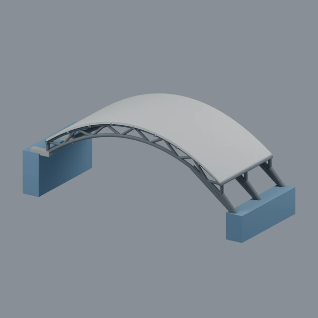
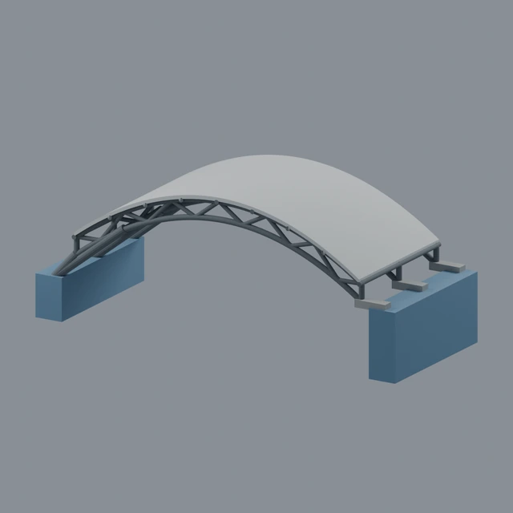
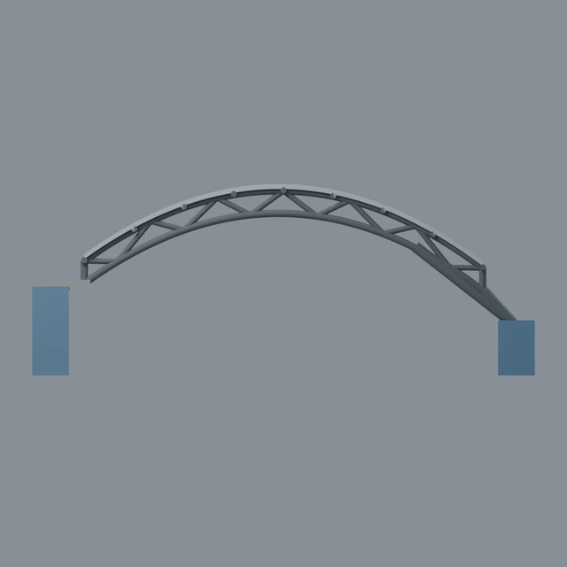
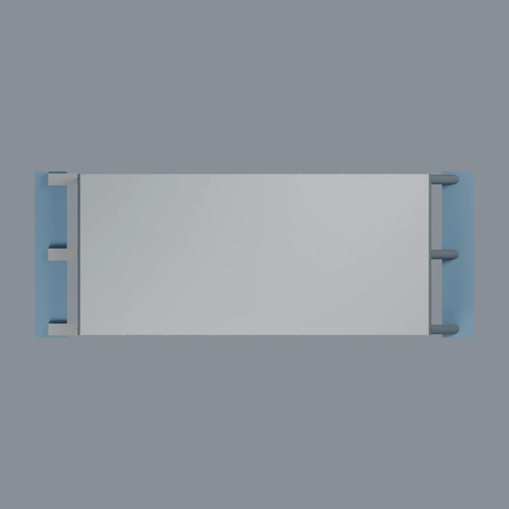
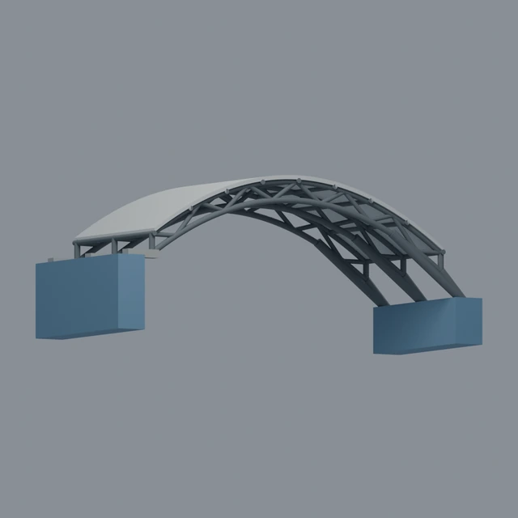

# 國立成功大學｜安南校區｜研究總中心共享中庭弧棚雙跨構架段

## 模型預覽

<a name="五個實際網格視角"></a>

| [](previews/front.webp) | [](previews/rear.webp) | [](previews/elevation.webp) |
| :---: | :---: | :---: |
| 正斜視 | 後斜視 | 正立面 |
| [](previews/top.webp) | [](previews/left_oblique.webp) |  |
| 俯視 | 低角度看開放桁架與檁條 |  |

以設計者官方歷史照片為依據的估算展示模型，**僅取三道橫向桁架／兩跨縱向構架段**，不是完整中庭、第三棟大樓或測繪模型。既有研究總中心高翼、入口低翼模型明確排除此共享弧棚；本件也不重建兩翼、連橋、欄杆、樓梯及室內。

## 下載與編輯
- [STL](model.stl)：單一連通封閉表面，無色。
- [彩色 3MF](model.3mf)：逐面展示材質，不是多料列印配置。
- [可編輯 Blender 場景](scene.blend)：與 STL 相同三角面，四種材質可編輯。
- [參數生成程式](build_model.py)、[實際網格渲染程式](render_model.py)。單位 mm。
- [來源與保留事項](SOURCES.md)、[驗證與列印限制](QA.md)。

## 範圍與辨識
淺弧屋面、開放三角桁架、縱向檁條、左側短支承、右側分叉斜撐。**兩側藍色實心塊是新增展示切端座，不是建築本體、地面基礎或落地柱**。只保留屋頂高度附近的支承意象；隱藏錨固未知。原始照片未放入公開包。

跨度估算 130 mm；整體約 164 × 62 × 62.46 mm。尺度、弧率、桁架深度和支承角度皆由透視照片估算，構件加粗；每榀 12 格腹桿與 9 道檁條是估算簡化，不是來源逐格量測。既有兩翼各自縮放，本件不能宣稱可直接拼裝或同一比例。

屋皮材質／透明度不明，採中性銀灰不透明薄皮；省略密集平行細條、螺栓和不可辨設備。鋼構深灰。藍色展示切端座刻意與建築區分，不宣稱照片中存在藍色構件。照片拍攝日期未知；2003 是作品頁完工年，非照片年份，2018 URL 路徑不是拍攝證據，也不稱為 2026 現況。

## 重建

用 Blender 4.3.2 與 `requirements.txt` 所列套件重建。輸出路徑須在模型目錄外且尚未存在，避免覆寫發布檔案。個別分析入口為 `qa_model.py`、`check_features.py`；`verify_scene.py` 和 `verify_exchange.py` 分別用於場景及交換格式核對。 SDK 交換格式驗證需 lib3mf；可用 `BUILD_PYTHON` 指定含 manifold3d 的 Python。

```bash
python -m pip install -r requirements.txt Pillow==13.0.0
python verify_package.py
blender -b --threads 4 --python-exit-code 19 --python verify_render.py
python rebuild.py --output ../new-clean-rebuild --blender blender --threads 4
```

五張展示圖使用 640 px WebP 縮圖，可點圖開啟全尺寸無失真 WebP。[縮圖校驗](previews/thumbnail-proof.json)。重建只在暫存目錄產生 PNG 中間檔，核對解碼 RGBA 像素及尺寸後輸出並校驗 WebP。原模型和既有 QA 報告不變，原始 PNG 和當時的校驗記錄仍可在固定提交查閱。[現行 WebP 校驗](qa/preview-webp.json) · [原始 PNG 與歷史 QA](https://github.com/hplin50643/taiwan-buildings-3d/tree/336ce1843e6e4435f93ed1a5df7cc26434fb9596/%E5%A4%A7%E5%B0%88%E6%A0%A1%E9%99%A2/%E5%9C%8B%E7%AB%8B%E6%88%90%E5%8A%9F%E5%A4%A7%E5%AD%B8/%E5%AE%89%E5%8D%97%E6%A0%A1%E5%8D%80/buildings/research-center-atrium-canopy-two-bay-segment)。

**沒有實體試印，不保證免支撐或一次列印成功。** 完整拓樸通過不等於所有局部可印；細尖端、曲面頂端以及水平薄屋皮需切片、支撐、方向與試印評估。詳見 QA.md，不把失敗切層排除。
