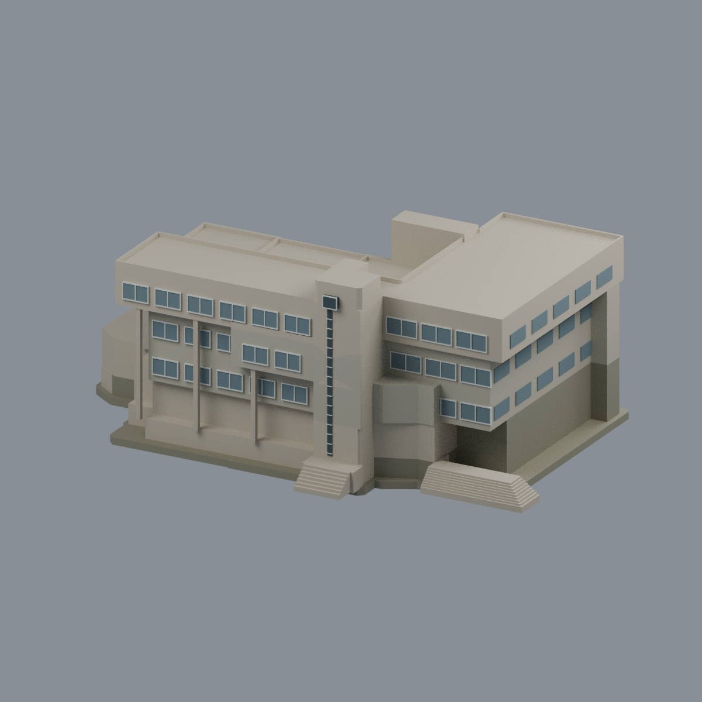
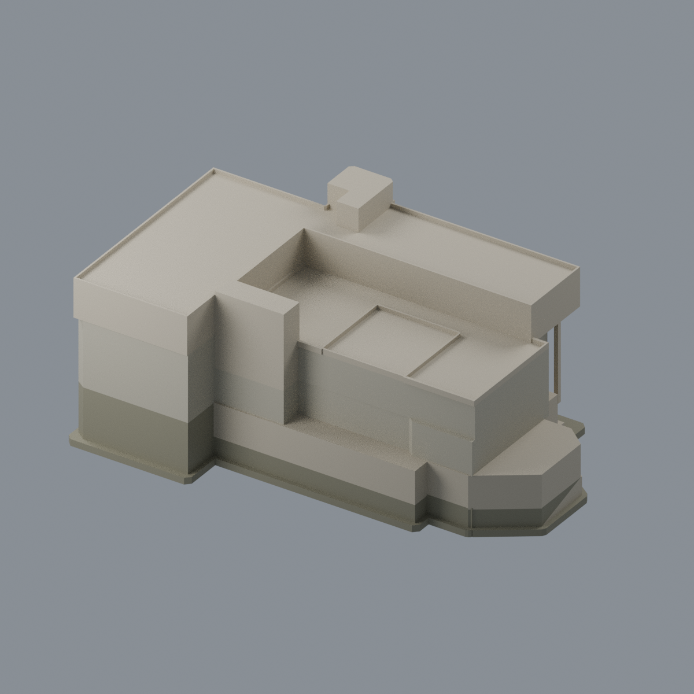
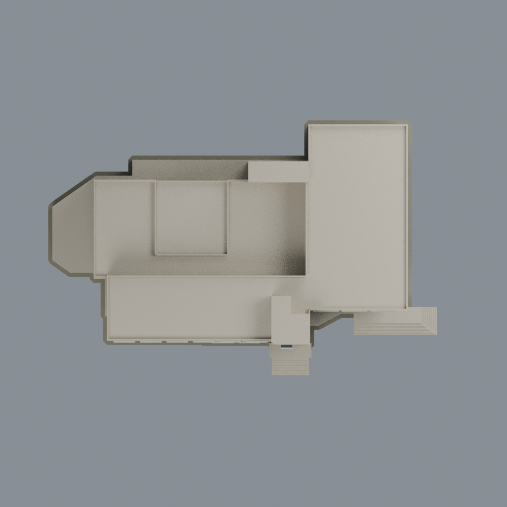

# 國立政治大學｜傳播學院主樓

## 模型預覽

|  |  |  |
| :---: | :---: | :---: |
| 正面 | 背面 | 頂視 |

[山上校區圖鑑](../../README.md) · [政大圖鑑](../../../README.md) · [全部模型](../../../../../README.md)

官方 PDF 所記錄的外觀與平面參考版；照片攝年未知，非已核 2026 現況。不是實測模型，尚未實體試印，不稱可直接列印。

## 完整建築範圍
B1 寬廣左側下部、1–3F 寬廣主體、4F L 形教室翼、3F 低頂、前方共同梯塔、後方共同梯核、主入口平台與附屬階梯、1F 右側 L 轉角外階與局部坡地接觸。保留 4F 局部前挑、下層退縮與柱支承；中央低頂不是通地天井，2/3F 廳堂不挖通。前景獨立大門樓、相鄰紅磚樓、整座山坡及道路不納入本主樓模型。

## 檔案
- `scene.blend`：Blender 4.3.2 原生可編輯網格與多色材質。
- `model.3mf`：毫米制真網格、逐三角材質索引；可編輯頂點和材質。
- `model.stl`：單色幾何交換；STL 不含顏色、材質或透明度。
- `previews/`：實際模型的五張視圖，不是照片紋理或想像圖。
- `build_model.py`、`render_model.py`、`run_all_checks.py`：完整可執行來源與檢驗。

## 重建
使用 `requirements.txt` 的 Python 套件及 Blender 4.3.2。在獨立目錄執行下方完整重建命令；若要執行 `python run_all_checks.py`，請在完整可寫副本內進行。不需來源照片、PDF、網路或工作目錄外的模型檔。乾淨重建比較 STL、3MF、mesh/palette JSON 及五張 WebP，Blend 以語意及真編輯存讀測試驗證，不宣稱容器位元組確定性。

## 解讀與限制
塔頂照片中的小折面凸窗以矩形凸箱粗化代理，並非照片中精確外形。

共同前梯為平面座標原點，圖面 X 向右、Y 向上，無地理方位或鏡射保證以外的羅盤宣稱。高度、地形、隱蔽小窗和屋頂小核高度為明示近似。前方窗帶按可見照片重建，背側細部不作實測宣稱。地形代理僅支承建築自然接地，並非新增地下教室。保留退縮空氣與屋頂凹部，未為單殼而填死必要空間。牆體內部作外觀實心代理，未建可使用室內。

沒有全域最小壁厚、無支撐或製造認證。細框、女兒牆、突出窗和懸挑底面須逐材質、噴嘴與切片支撐評估；截面及取樣薄件警告見 `QA.md`。

## 模型預覽與下載

[可編輯 Blend](scene.blend) · [彩色 3MF](model.3mf) · [單色 STL](model.stl) · [原 QA 重建來源 ZIP（封存）](rebuild-source.zip) · [來源](SOURCES.md) · [數值檢驗及製造限制](QA.md)

### 展示與原始 QA

現行展示共五張無損 WebP：[正面](previews/front.webp)、[背面](previews/rear.webp)、[頂視](previews/top.webp)、[正立面](previews/elevation.webp)、[左斜視](previews/left_oblique.webp)。使用 Blender 4.3.2、Pillow 13.0.0（libwebp 1.6.0）執行 `python export_display_webp.py` 只更新展示圖；`python rebuild.py --output /新的獨立目錄` 在外部重建模型與展示圖。歷史原始 PNG 僅於隔離暫存重渲染供 QA 對照。原 PNG 與 SHA-256 保存在固定版本：[最初 QA 渲染清冊](https://github.com/hplin50643/taiwan-buildings-3d/blob/0026a5ef79b7fbbf6a3e49690ec72721fea6c153/%E5%A4%A7%E5%B0%88%E6%A0%A1%E9%99%A2/%E5%9C%8B%E7%AB%8B%E6%94%BF%E6%B2%BB%E5%A4%A7%E5%AD%B8/%E5%B1%B1%E4%B8%8A%E6%A0%A1%E5%8D%80/buildings/nccu-communication-building/qa/render-manifest.json)及[原始預覽目錄](https://github.com/hplin50643/taiwan-buildings-3d/tree/0026a5ef79b7fbbf6a3e49690ec72721fea6c153/%E5%A4%A7%E5%B0%88%E6%A0%A1%E9%99%A2/%E5%9C%8B%E7%AB%8B%E6%94%BF%E6%B2%BB%E5%A4%A7%E5%AD%B8/%E5%B1%B1%E4%B8%8A%E6%A0%A1%E5%8D%80/buildings/nccu-communication-building/previews)。原 `rebuild-source.zip` 仍按原樣保留供歷史 QA 查證，現行重建以目錄中腳本為準。
