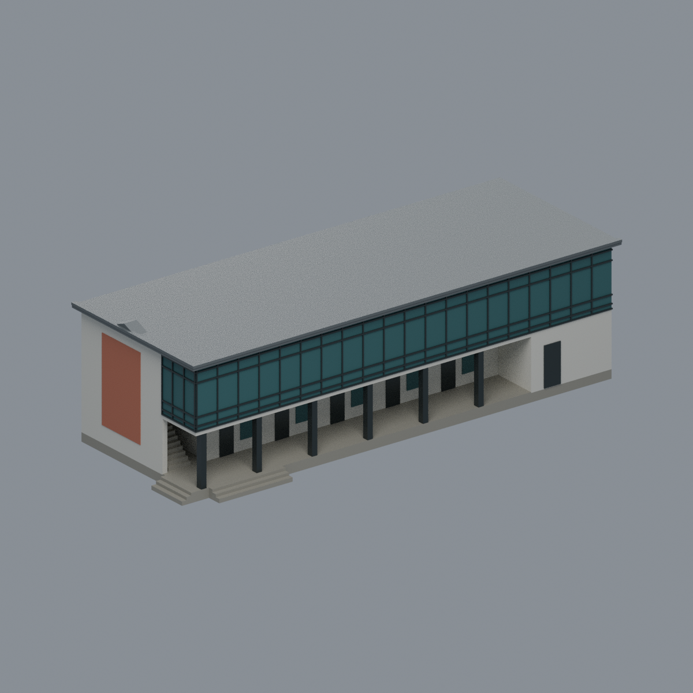
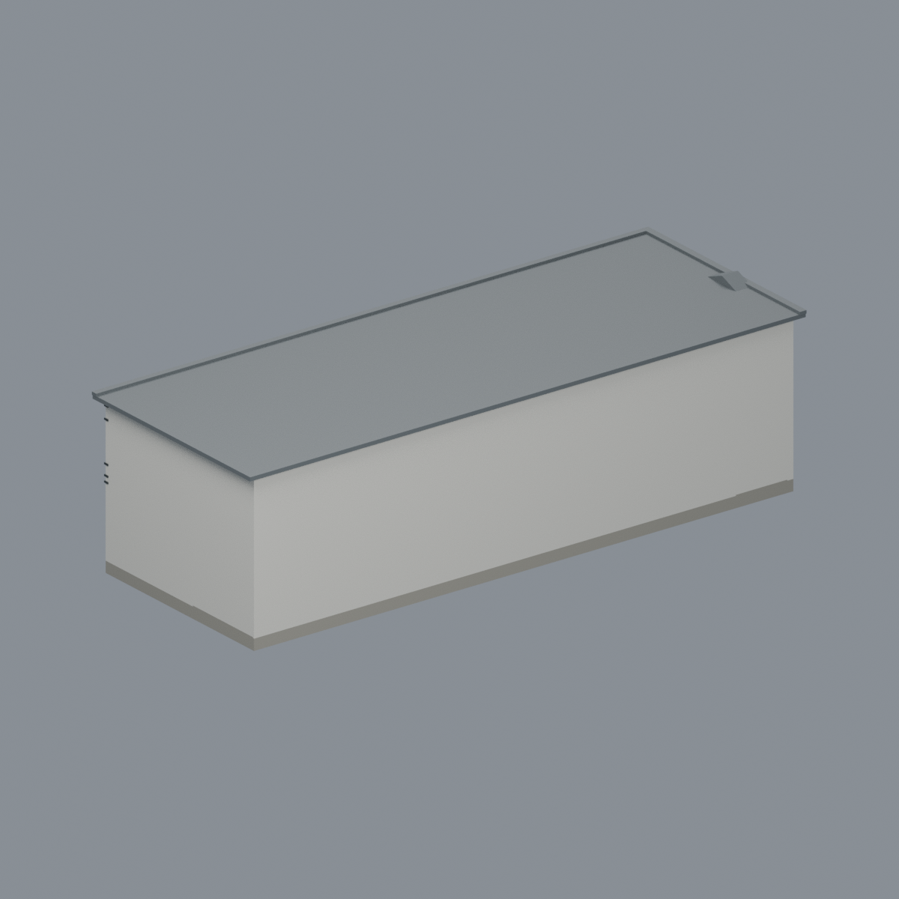

# 國立政治大學第八教室／校友服務中心

## 模型預覽

|  |  |  |
| :---: | :---: | :---: |
| 正面 | 背面 | 頂視 |

[山下校區圖鑑](../../README.md) · [政大圖鑑](../../../README.md) · [全部模型](../../../../../README.md)

官方消防資料第八教室（資產編號60-9）與校圖A11校友服務中心（09）為同一棟建築，位於山下校區。本模型為來源所示完整兩層主樓的近似外觀研究，不是測繪或竣工圖復原。

## 模型內容

- 兩層長矩形主體、首層真正退縮柱廊與實體背牆、右遠端展示實房封閉廊端。
- 二層前廊玻璃面及左短端僅廊深範圍的轉角玻璃；其餘短端保留白牆與橘色矩形飾面。
- 共同左側樓梯空間、左短端與前長側兩個正交短階／平台接口、有限附樓基腳。
- 六色不透明材質。玻璃是有厚度的不透明色彩代理，不是光學透明或原照片紋理。
- 屋頂僅低輪廓封閉包絡、可見灰色簷角與局部短折線代理；**沒有證據確定完整雙坡／四坡、全脊長或背坡**。頂面是保守近似，不代表已證實的平屋頂，也不是完整屋面復原。

不包含前景紀念牌、50雕塑、植栽、圍欄、道路、鄰樓或完整校地。未見的背側保持低細節中性牆，不複製前側玻璃。室內房間以外殼／房體簡化，樓梯與廊道空隙保留。

## 檔案

`scene.blend`：可編輯網格及六材質；`model.3mf`：毫米制逐面材質；`model.stl`：單色三角面交換格式。`previews/`含front、rear、elevation、top、left_oblique五張同網格渲染；`mesh.json`、`palette.json`記錄精確交換網格及配色。Python程式可重新建構；來源程式ZIP不含原照片／圖紙。

模型外包絡約125.80 × 49.32 × 36.20 mm。這是建模尺度，**不是建築實測尺寸**。層高、細窗格數、顏色、階梯級數和局部屋簷細節為有界近似；兩張簡圖使用同一外界與左梯錨點，不按不同圖幅大小製造樓層退縮。

## 來源與年代

依政治大學官方消防資料中的兩張外觀照片與1F／2F簡圖。表列民國48年（1959）、兩層、無地下層、2021-10-01調查；建築設計圖勾選「無」。簡圖不是完整竣工、屋頂或立剖測繪。照片攝年及EXIF時間未恢復；文件日期不等於攝影日期，**不宣稱已核對2026現況**。參見SOURCES.md。

## 製造限制

原始STL水密、繞向、連通性及非相鄰三角形接觸另有數值檢查，但不等於可直接列印。玻璃代理約0.68 mm，細窗框與低折脊尖端可能小於噴嘴能力；逐0.2 mm剖切的薄片警告完整保留。柱廊頂板、二樓空腔及樓梯需要依尺寸、方向與設備決定支撐，不能為求單殼而填死廊道。未做實體試印，不保證免支撐或print-ready。

## 重建

安裝requirements.txt所列Python相依套件及Blender4.3.2。執行下列隔離重建命令可取得新場景及五張 WebP；`python export_display_webp.py` 則只重建展示圖。`python rebuild.py --output /new/empty/path`進行獨立目錄完整建模／渲染並比對四個核心交換檔及五張 WebP精確位元組。QA與交換／原生編輯測試見QA.md。

## 模型預覽與下載

[可編輯 Blend](scene.blend) · [彩色 3MF](model.3mf) · [單色 STL](model.stl) · [原 QA 重建來源 ZIP（封存）](rebuild-source.zip) · [來源](SOURCES.md) · [數值檢驗及製造限制](QA.md)

模型約 125.80 × 49.32 × 36.20 mm；尺寸、細窗及高程為比例近似。

### 展示與原始 QA

現行展示共五張無損 WebP：[正面](previews/front.webp)、[背面](previews/rear.webp)、[頂視](previews/top.webp)、[正立面](previews/elevation.webp)、[左斜視](previews/left_oblique.webp)。使用 Blender 4.3.2、Pillow 13.0.0（libwebp 1.6.0）執行 `python export_display_webp.py` 只更新展示圖；`python rebuild.py --output /新的獨立目錄` 在外部重建模型與展示圖。歷史原始 PNG 僅於隔離暫存重渲染供 QA 對照。原 PNG 與 SHA-256 保存在固定版本：[最初 QA 渲染清冊](https://github.com/hplin50643/taiwan-buildings-3d/blob/427fbb734dd4f91ac3a852d6cae5c5b3f919f934/%E5%A4%A7%E5%B0%88%E6%A0%A1%E9%99%A2/%E5%9C%8B%E7%AB%8B%E6%94%BF%E6%B2%BB%E5%A4%A7%E5%AD%B8/%E5%B1%B1%E4%B8%8B%E6%A0%A1%E5%8D%80/buildings/nccu-eighth-classroom/qa/render-manifest.json)及[原始預覽目錄](https://github.com/hplin50643/taiwan-buildings-3d/tree/427fbb734dd4f91ac3a852d6cae5c5b3f919f934/%E5%A4%A7%E5%B0%88%E6%A0%A1%E9%99%A2/%E5%9C%8B%E7%AB%8B%E6%94%BF%E6%B2%BB%E5%A4%A7%E5%AD%B8/%E5%B1%B1%E4%B8%8B%E6%A0%A1%E5%8D%80/buildings/nccu-eighth-classroom/previews)。原 `rebuild-source.zip` 仍按原樣保留供歷史 QA 查證，現行重建以目錄中腳本為準。
