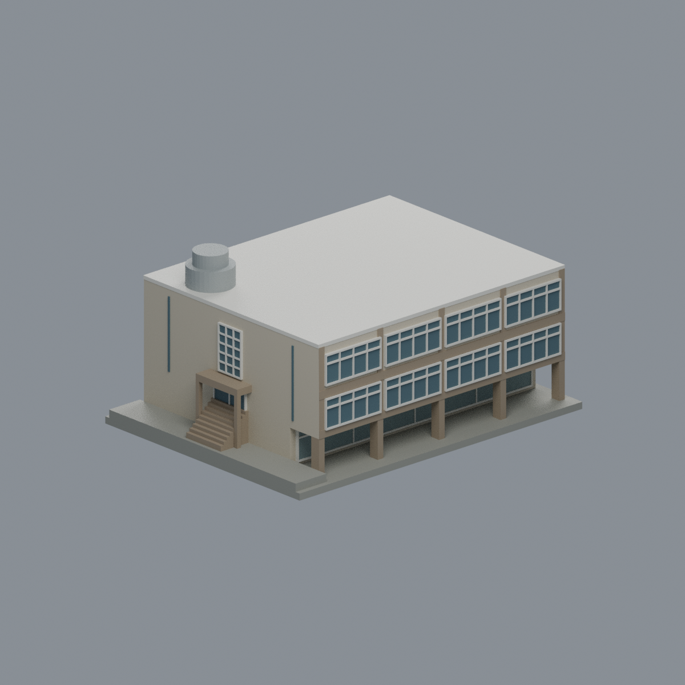
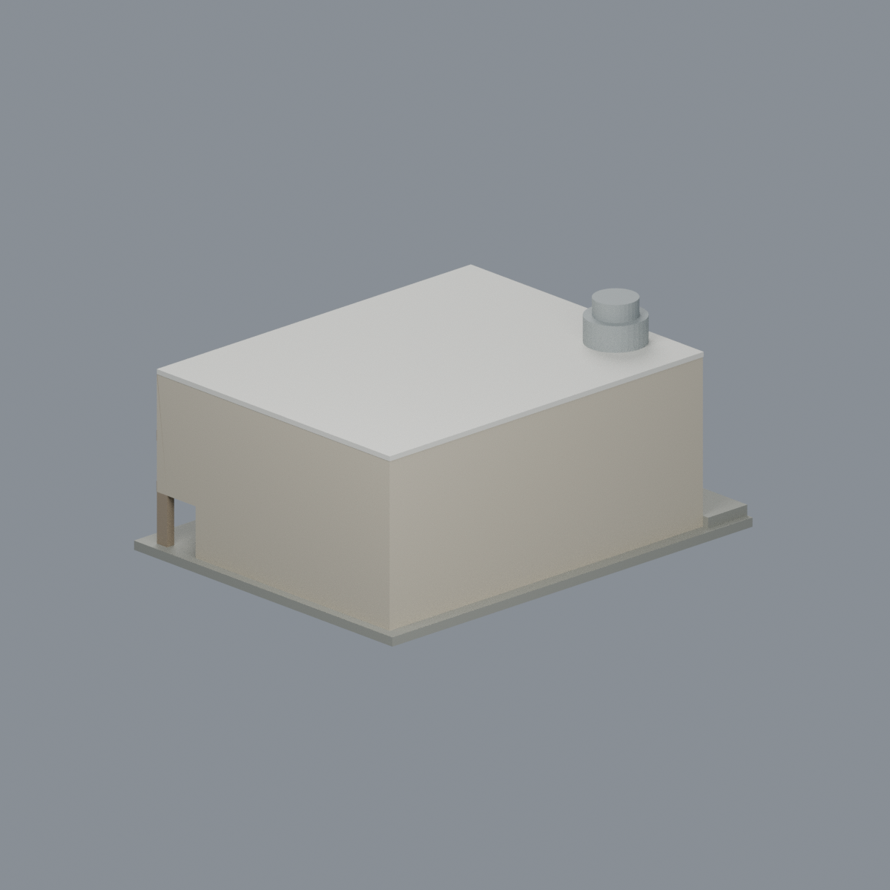
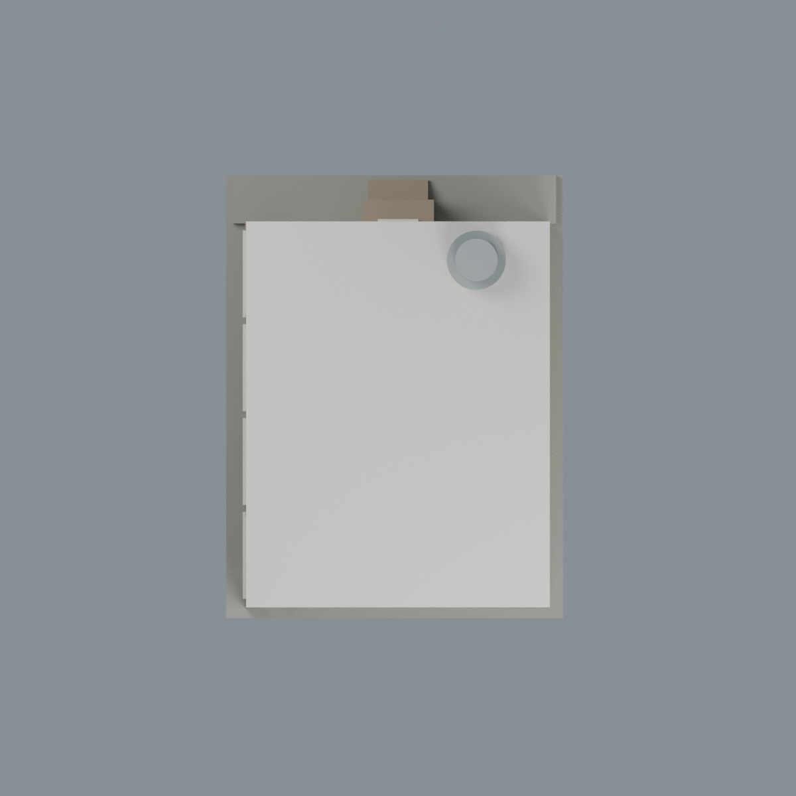

# 國立政治大學風雩樓 — proportional exterior study

## 模型預覽

|  |  |  |
| :---: | :---: | :---: |
| 正面 | 背面 | 頂視 |

[山下校區圖鑑](../../README.md) · [政大圖鑑](../../../README.md) · [全部模型](../../../../../README.md)

完整主矩形、附著入口階梯／門廊與可見圓設備；實體三層對應 B1、1F、2F。不是四維堂，不包含整片歷史庭園、網球場或校園長廊。

本模型為官方完成照所記錄的外觀近似，官史舊照互證主框，不代表2026測繪現況或歷史花園復原。道路短面在 -X、相鄰庭園四跨長面在 -Y，B1 後退鏡牆前保留真空柱廊。v2以歷史近正視照片修正庭園長向40→28（道路向22維持），不以應急圖示異比硬定長寬。兩上層共用矩形；應急圖的異比不當作樓層退縮。未唯一配準的室內梯端不建；未知背窗中性簡化，不複製可見面。

RF 圖缺：屋頂為平頂近似閉合，設備只保留已見粗輪廓，不造塔樓／使用樓層。展示色不是實測 RGB。模型不含原圖、來源紋理或可辨識像素。

## Files and rebuild
- `model.stl`: monochrome print geometry (no material support).
- `model.3mf`: editable seven-material surface with same triangles.
- `scene.blend`: native editable Blender scene, millimetres.
- `previews/`: five actual-mesh views; no generated imagery.
- `build_model.py` + `render_model.py`: deterministic source geometry and previews.

Python dependencies: `requirements.txt`; Blender 4.3.2 used. Use the isolated rebuild for a new model and scene, or `python export_display_webp.py` to rebuild only the display previews. `rebuild.py --output /new/empty/path` checks exact STL/3MF/mesh/palette/five PNG bytes. QA scripts do not repair meshes.

Source rights remain unresolved; public availability does not infer commercial-use permission or a broad model license. Not physically printed; see QA.md for numeric tests and manufacturing limitations.

## 模型預覽與下載

[可編輯 Blend](scene.blend) · [彩色 3MF](model.3mf) · [單色 STL](model.stl) · [原 QA 重建來源 ZIP（封存）](rebuild-source.zip) · [技術與製造限制](QA.md)

`qa/independent/` 收錄獨立技術審核；具體製造限制見 `QA.md`。

### 展示與原始 QA

現行展示共五張無損 WebP：[正面](previews/front.webp)、[背面](previews/rear.webp)、[頂視](previews/top.webp)、[正立面](previews/elevation.webp)、[左斜視](previews/left_oblique.webp)。使用 Blender 4.3.2、Pillow 13.0.0（libwebp 1.6.0）執行 `python export_display_webp.py` 只更新展示圖；`python rebuild.py --output /新的獨立目錄` 在外部重建模型與展示圖。歷史原始 PNG 僅於隔離暫存重渲染供 QA 對照。原 PNG 與 SHA-256 保存在固定版本：[最初 QA 渲染清冊](https://github.com/hplin50643/taiwan-buildings-3d/blob/427fbb734dd4f91ac3a852d6cae5c5b3f919f934/%E5%A4%A7%E5%B0%88%E6%A0%A1%E9%99%A2/%E5%9C%8B%E7%AB%8B%E6%94%BF%E6%B2%BB%E5%A4%A7%E5%AD%B8/%E5%B1%B1%E4%B8%8B%E6%A0%A1%E5%8D%80/buildings/nccu-fengyu/qa/render-manifest.json)及[原始預覽目錄](https://github.com/hplin50643/taiwan-buildings-3d/tree/427fbb734dd4f91ac3a852d6cae5c5b3f919f934/%E5%A4%A7%E5%B0%88%E6%A0%A1%E9%99%A2/%E5%9C%8B%E7%AB%8B%E6%94%BF%E6%B2%BB%E5%A4%A7%E5%AD%B8/%E5%B1%B1%E4%B8%8B%E6%A0%A1%E5%8D%80/buildings/nccu-fengyu/previews)。原 `rebuild-source.zip` 仍按原樣保留供歷史 QA 查證，現行重建以目錄中腳本為準。
