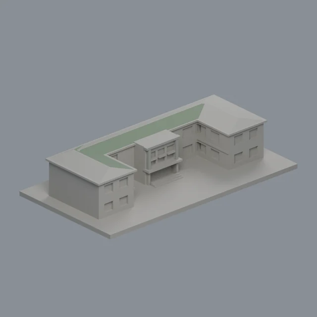
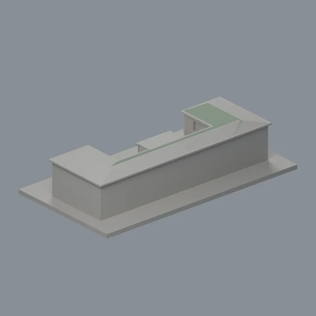
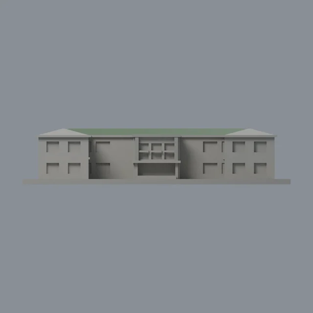
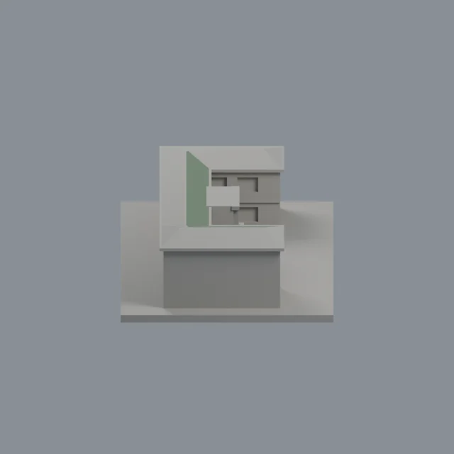
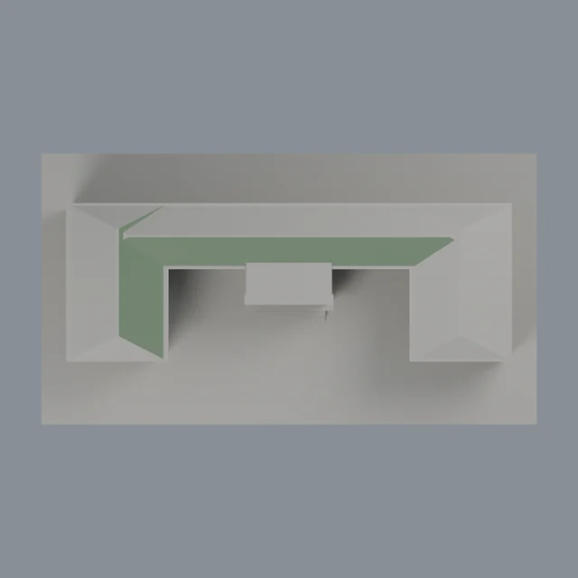

# 政大果夫樓｜現行模型 WebP 預覽

五圖皆以現行三材質模型重新渲染核對，不使用舊單色版。點圖可開啟無損原尺寸 WebP。

| 模型預覽 | 模型預覽 | 模型預覽 |
| :---: | :---: | :---: |
|  前庭斜視 |  背視 |  正立面 |
|  側視 |  頂視 |  |

[模型說明](../README.md) · [限域材質與來源界線](../appearance/README.md) · [表面色 3MF](../appearance/nccu-guofu-appearance.3mf) · [可編輯 Blender](../appearance/scene.blend) · [原 STL](../model.stl) · [展示校驗](SHA256SUMS) · [渲染對照](render-proof.json)

只更新展示，幾何、色材、歷史版本與工程 QA 均未改動。只有既有兩處瓦坡與入口上層構件使用限域配色，其餘中性不代表實物均為灰色；不宣稱現況色值或實體試印。

現行展示只使用最新版模型的 WebP。原彩色 PNG、既有稽核與原校驗表可由[固定歷史版本](https://github.com/hplin50643/taiwan-buildings-3d/tree/5cc13bada423e37355cb7758d738f0b0695a80bf/%E5%A4%A7%E5%B0%88%E6%A0%A1%E9%99%A2/%E5%9C%8B%E7%AB%8B%E6%94%BF%E6%B2%BB%E5%A4%A7%E5%AD%B8/%E5%B1%B1%E4%B8%8B%E6%A0%A1%E5%8D%80/buildings/nccu-guofu)追溯。若要重繪，請在獨立工作目錄使用現行渲染器，將生成的 PNG 與[像素對照表](archive-png.json)比較，不把中間 PNG 放回現行庫。以 `python display/verify_webp.py --replay-root /path/to/replay` 核對五張重繪（需 Pillow）；只查驗交付 WebP 時省略該參數。
