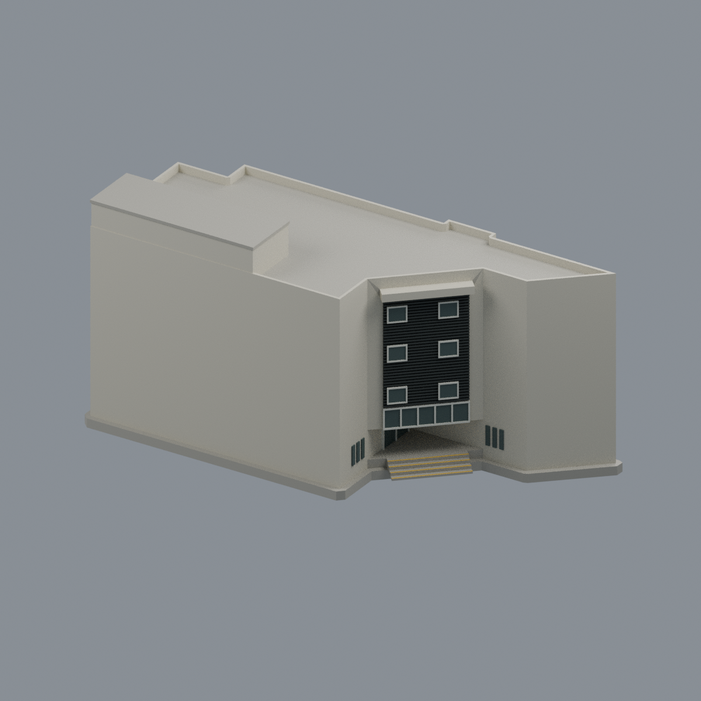
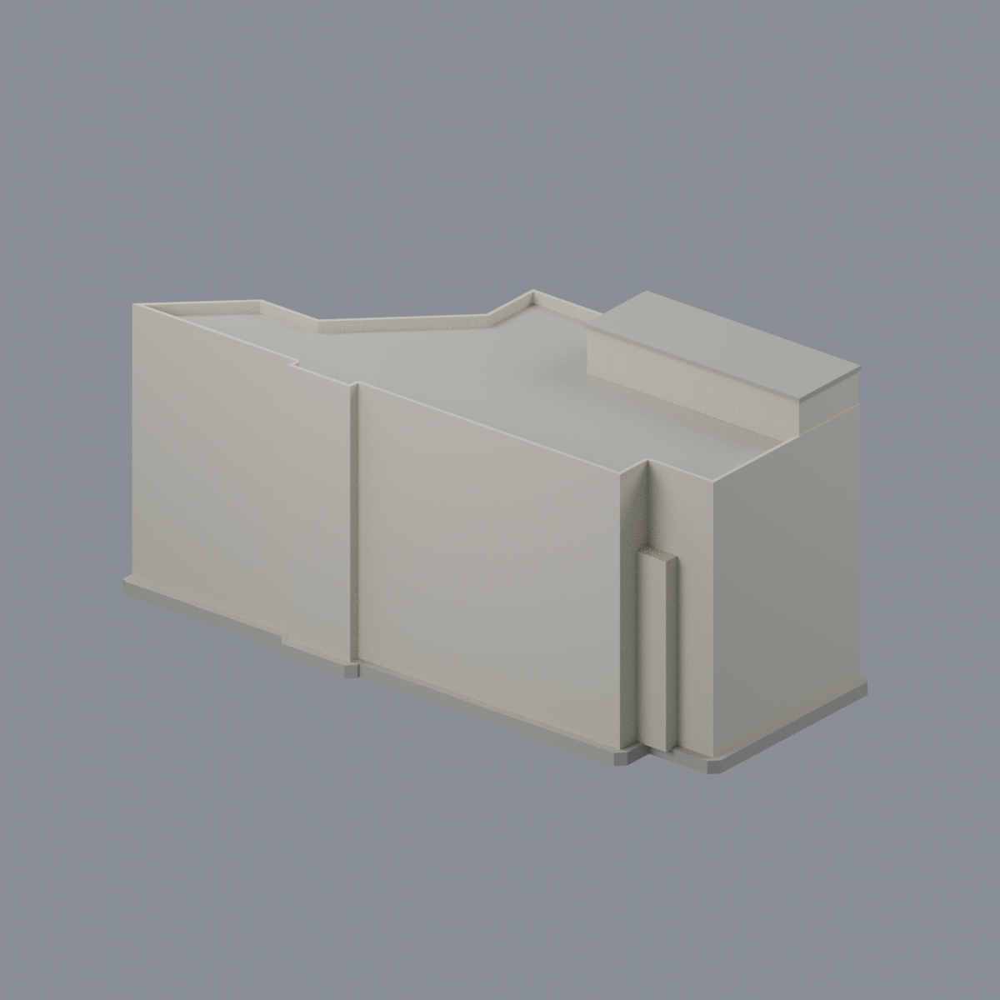
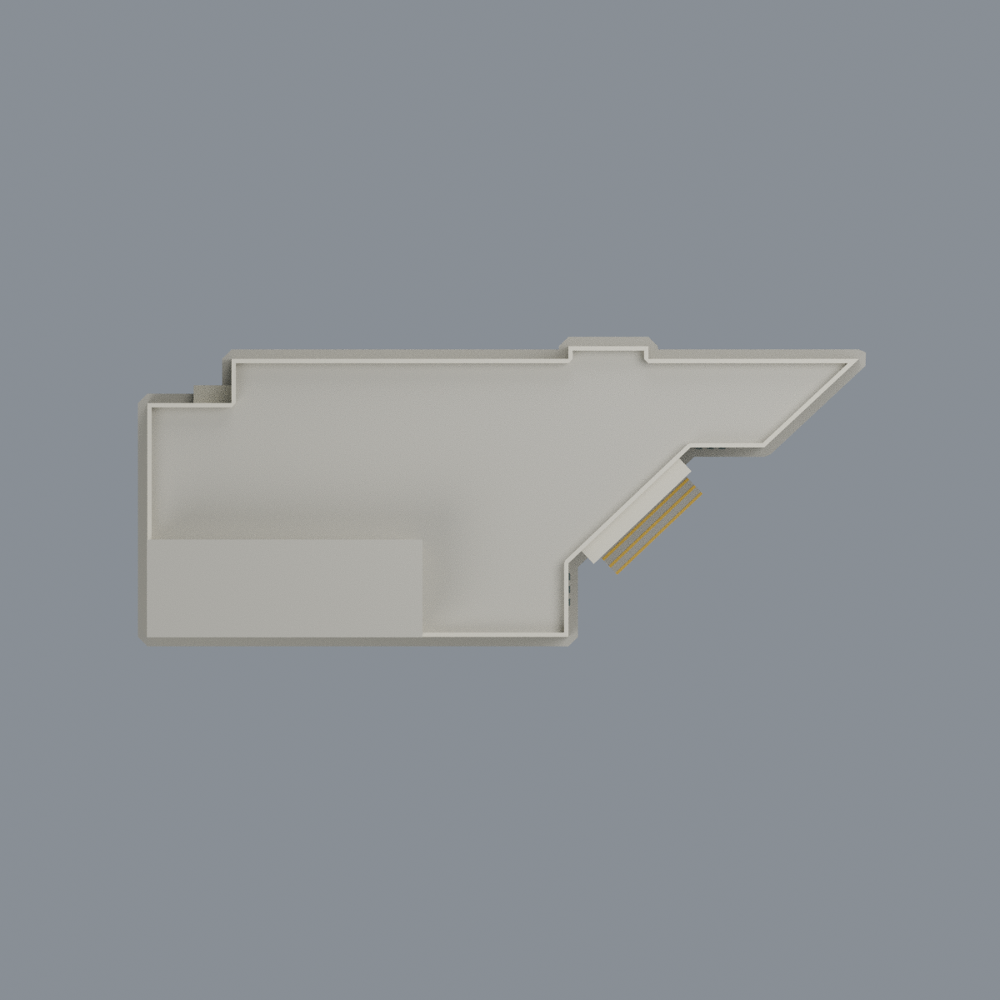

# 國立政治大學 健康中心大樓 — proportional exterior study v5

## 模型預覽

|  |  |  |
| :---: | :---: | :---: |
| 正面 | 背面 | 頂視 |

[山下校區圖鑑](../../README.md) · [政大圖鑑](../../../README.md) · [全部模型](../../../../../README.md)

完整地上1F–4F、R露臺及屋頂梯房條、右側不對稱尖翼與附屬入口階梯的多色比例模型。不是單入口局部；不是量測竣工圖、2026現況調查或可列印保證。新建identity，未替換或發布任何舊模型。

## Files
- `scene.blend`: editable Blender 4.3.2 mesh and six editable opaque materials.
- `model.3mf`: one connected mesh with per-triangle six-material assignments, millimetres.
- `model.stl`: identical raw triangles, monochrome STL (no material or transparency).
- `previews/`: five 1200px actual-mesh views; studio background is not delivered geometry.
- Python generators, validators, `mesh.json`, `palette.json`, QA evidence, source/rights notes.

Main dimensions approximately **138.316 × 58.800 × 68.880 mm** including low outline-following display plinth. Design units were proportionally traced from emergency plans, not verified metres; no claimed real-world scale. 4 mm/design-unit is an output sizing choice.

## Evidence fidelity and bounded simplification
The asymmetric body follows registered 2F–4F/R outlines. The 1F principal rectangular return and horizontal wing edge form a **deep triangular open entrance recess** under the upper diagonal enclosure, not an upper-floor outline extended solidly to ground. A low triangular landing and four coarse attached steps occupy only the floor zone. Door proxies are on the real X=20 return, and the photographed low triple windows at both ends are approximately placed on the corresponding Y=9 wing return and X=20 main return, not floating on a fictitious diagonal ground wall. This prioritizes the plan; exact photo window-to-plan correspondence remains inferred.

The small opposite stair projection exists at 1F–3F and is omitted at 4F/R. The R access/room strip is modeled with approximate height. The small R-sheet inset is **B1**, not an extra roof building. Unexposed basement interior and internal room partitions are omitted; the solid interior exterior proxy is not a claim that the real building lacks rooms. Open terrace and entrance void are preserved.

Only the photographed diagonal entry carries dense black louver relief, two approximate vertical columns of three framed openings, lower glazing, projecting top cap and cream tiled-end proxies. Exact blade/tile counts, floor heights, roof-room height and inaccessible facade fine windows are unknown; back/far faces remain neutral rather than mirror-invented windows. No source image pixels or textures are embedded.

Coordinates: X=(original raster Y−125)/20, Y=(original raster X−125)/20. Accounting for image Y-down this is a proper90° rotation, not a reflection. Axes are not surveyed compass directions. Identity is 健康中心大樓 (photo also 身心健康中心), official inventory60-15. Campus grouping is 山下校區 based on the official prose/map cross-reading documented in SOURCES.md; the full building address remains unverified and photograph117 alone is not a full address. Do not use the historical unverified 指南 label.

## Manufacturing warning
Raw topology and SAT checks are geometric checks, not printer qualification. 345 unrounded horizontal sections include **11 warning layers** with positive thin islands under0.8mm erosion. Small frames/louver relief nominal0.4mm, parapet nominal0.8mm. 512 normal-ray samples have190 below0.8mm and minimum sampled0.399898mm (not exhaustive). Step safety nosings and backed fine relief are small details. Deep entrance soffit and projecting cap need slicer/support review. No physical print, load/strength test, support-free assertion, global minimum-wall certification or machine-specific slicing has been performed.

## Rebuild
Use Python dependencies in `requirements.txt` and Blender4.3.2. `python build_model.py` rebuilds STL/3MF/mesh/palette. `python export_display_webp.py` rebuilds only the five linked WebP previews; use the isolated rebuild to produce the scene. `python qa_model.py`, `python check_features.py`, `python verify_exchange.py`, Blender `verify_scene.py`, and Blender `verify_render.py` run detailed checks. `python rebuild.py --output NEW_EMPTY_DIRECTORY` generates all geometry and five views in a new isolated directory and byte-compares all nine deterministic artifacts. Blend bytes are not claimed deterministic because scene paths/session metadata can differ.

See `LICENSE.txt` and `SOURCES.md`; no broad CC license selected. Publication does not clear third-party rights.

## 模型預覽與下載

[可編輯 Blend](scene.blend) · [彩色 3MF](model.3mf) · [單色 STL](model.stl) · [原 QA 重建來源 ZIP（封存）](rebuild-source.zip) · [技術與製造限制](QA.md)

`qa/independent/` 收錄獨立技術審核；具體製造限制見 `QA.md`。

### 展示與原始 QA

現行展示共五張無損 WebP：[正面](previews/front.webp)、[背面](previews/rear.webp)、[頂視](previews/top.webp)、[正立面](previews/elevation.webp)、[左斜視](previews/left_oblique.webp)。使用 Blender 4.3.2、Pillow 13.0.0（libwebp 1.6.0）執行 `python export_display_webp.py` 只更新展示圖；`python rebuild.py --output /新的獨立目錄` 在外部重建模型與展示圖。歷史原始 PNG 僅於隔離暫存重渲染供 QA 對照。原 PNG 與 SHA-256 保存在固定版本：[最初 QA 渲染清冊](https://github.com/hplin50643/taiwan-buildings-3d/blob/427fbb734dd4f91ac3a852d6cae5c5b3f919f934/%E5%A4%A7%E5%B0%88%E6%A0%A1%E9%99%A2/%E5%9C%8B%E7%AB%8B%E6%94%BF%E6%B2%BB%E5%A4%A7%E5%AD%B8/%E5%B1%B1%E4%B8%8B%E6%A0%A1%E5%8D%80/buildings/nccu-health/qa/render-manifest.json)及[原始預覽目錄](https://github.com/hplin50643/taiwan-buildings-3d/tree/427fbb734dd4f91ac3a852d6cae5c5b3f919f934/%E5%A4%A7%E5%B0%88%E6%A0%A1%E9%99%A2/%E5%9C%8B%E7%AB%8B%E6%94%BF%E6%B2%BB%E5%A4%A7%E5%AD%B8/%E5%B1%B1%E4%B8%8B%E6%A0%A1%E5%8D%80/buildings/nccu-health/previews)。原 `rebuild-source.zip` 仍按原樣保留供歷史 QA 查證，現行重建以目錄中腳本為準。
