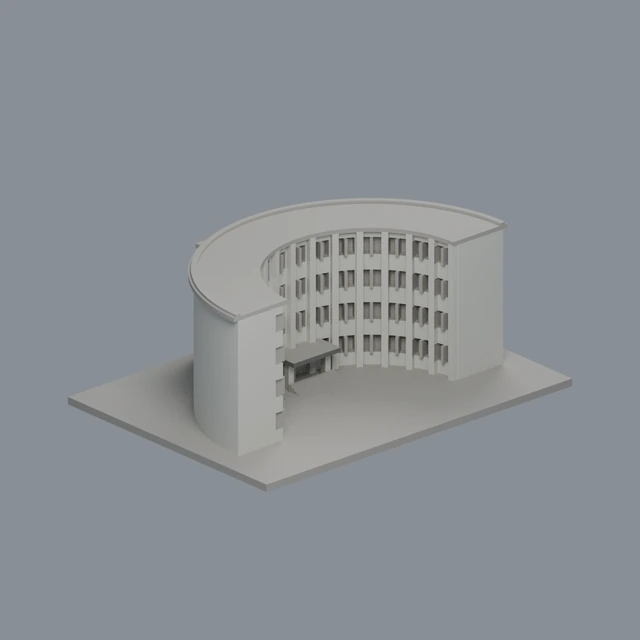
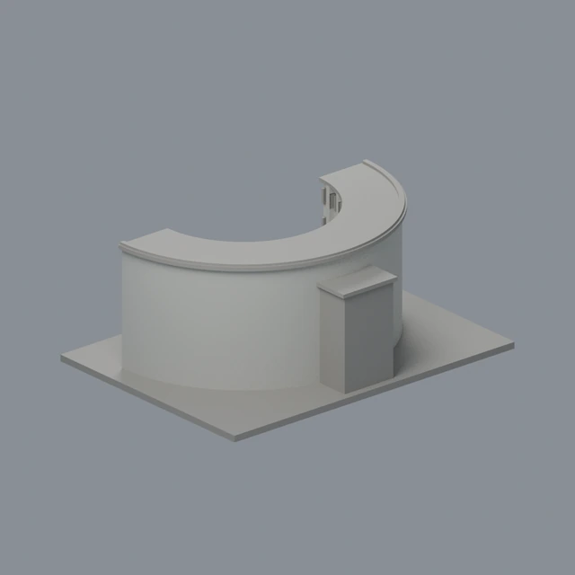
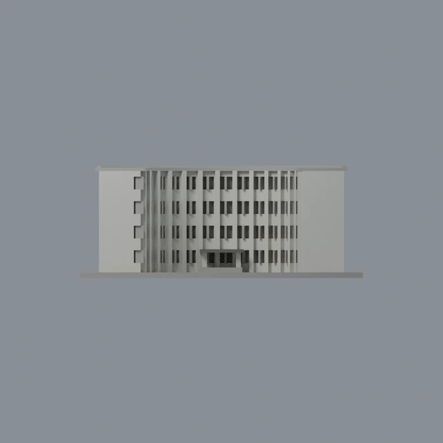
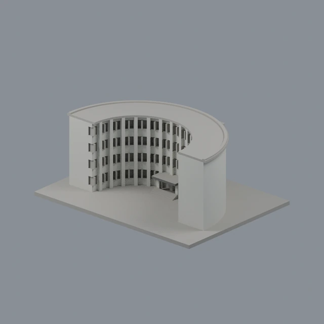
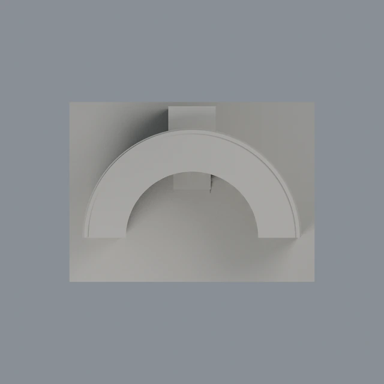

# 國立政治大學｜井塘樓

## 模型預覽

| 模型預覽 | 模型預覽 | 模型預覽 |
| :---: | :---: | :---: |
|  前庭左斜 |  背面 |  正立面 |
|  前庭右斜 |  頂視 |  |

按現行 3MF，白色牆面與柱共 1,588 面、灰色雨棚立邊 9 面、中性 4,579 面。最近一輪延伸至主外弧及端牆的 189 面為材料連續性推估，並非新照片證據。

山下校區。依公開實景與官方平面外輪廓自建的完整建物外觀近似，非测绘、BIM或結構設計。

## 形狀及證據限制

半圓弧四層量體、開放內彎前庭、放射狀立柱及窗格、弧形簷口、中央入口雨遮與後側突出部。曲面以80段取樣，自建外輪廓。

外側後彎立面缺完整近照，保守留白，不補造窗陣。弧半徑、後侧突出部高度與進深皆視覺近似；實際曲線可能非數學等半徑。

官方防災表内日期2021-10-01，PDF編成2026-03-04，两者不可當照片拍攝日。來源網址、頁碼與支持特徵見[sources.json](sources.json)。第三方原圖不隨包散布。

官方地面4層、地下1層。本件只建地上4層：地面入口層一排窗＋其上三排，屋簷不是第五窗層。

## 使用方式

- [model.stl](model.stl)：毫米，150.0 × 110.0 × 59.5 mm；含底座最長150 mm，各館獨立比例
- [scene.blend](scene.blend)：實際STL匯入的可編修網格，已與交付STL幾何比較
- [build_model.py](build_model.py)：獨立參數重建來源；[requirements.txt](requirements.txt)
- [SHA256SUMS](SHA256SUMS)：逐檔雜湊；STL SHA-256為 4321f4114275c766ac743e0adb1bac9d9626368a9fee920ea4734b805032453f

底座朝下。可先以0.2 mm層高、0.4 mm噴嘴作切片檢查起點，按自己的材料、機台及冷卻條件決定支撐；深凹入口、柱廊、雨遮、頂層簷口和凹窗頂尤其需檢視。窗框／柱／天井邊緣已加粗連接，不代表不需要支撐。

## Fail-closed數位QA

Python執行build_model.py；Blender背景執行render_preview.py產生實際STL預覽與scene.blend；再依序執行validate_model.py、check_contour_validity.py、check_thin_features.py，任一步非零退出都必須停止交付。

[validation.json](validation.json)全部checks=true：原始STL法向／繞序／正體積、水密、每邊2面、vertex link單一環、單一連通表面且無內腔殼、尺寸、獨立重建SHA、Blend/STL幾何一致。

[contour-validity-check.json](contour-validity-check.json)：固定z=0.071 mm起、0.2 mm層距，共298層，degree2閉合、每個與組合Polygon均有效，遇invalid不修補。

[thin-feature-check.json](thin-feature-check.json)：canonical邊內插，1 mm取樣，以0.8 mm參考寬度形態opening輔助篩檢；最大面積損失0.12927%，大於1%層數0。不是全面最小壁厚或實際工具路徑。

未做Cura/Prusa实际切片或實體試印，不宣稱保證可印或全校完成。

## 最新版限域外觀層

[三材質3MF、可編輯Blend與五視角預覽](appearance/README.md)。非整樓全彩復原。

現行展示只使用最新版模型的 WebP。原彩色 PNG、既有稽核與原校驗表可由[固定歷史版本](https://github.com/hplin50643/taiwan-buildings-3d/tree/5cc13bada423e37355cb7758d738f0b0695a80bf/%E5%A4%A7%E5%B0%88%E6%A0%A1%E9%99%A2/%E5%9C%8B%E7%AB%8B%E6%94%BF%E6%B2%BB%E5%A4%A7%E5%AD%B8/%E5%B1%B1%E4%B8%8B%E6%A0%A1%E5%8D%80/buildings/nccu-jingtang)追溯。若要重繪，請在獨立工作目錄使用現行渲染器，將生成的 PNG 與[像素對照表](display/archive-png.json)比較，不把中間 PNG 放回現行庫。以 `python display/verify_webp.py --replay-root /path/to/replay` 核對五張重繪（需 Pillow）；只查驗交付 WebP 時省略該參數。
