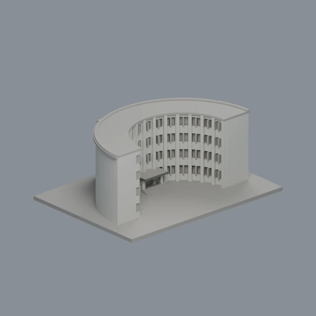
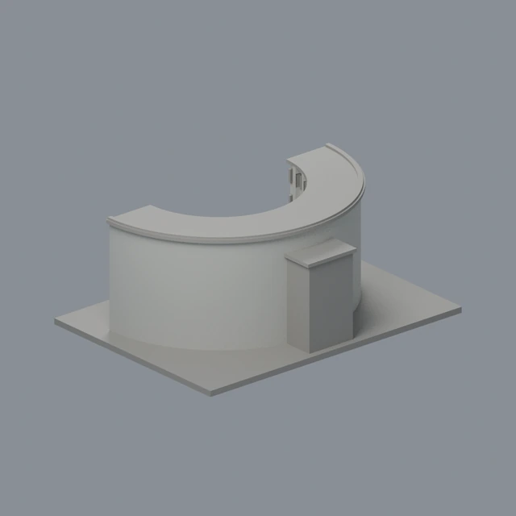
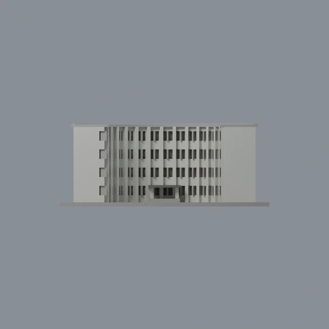
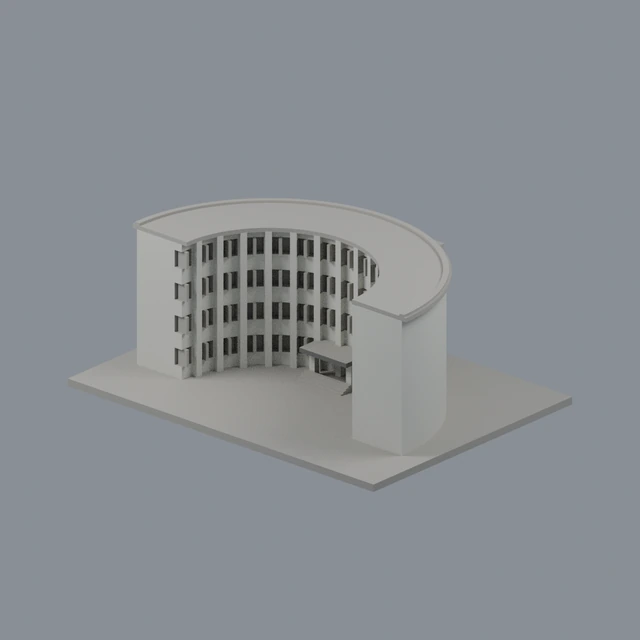
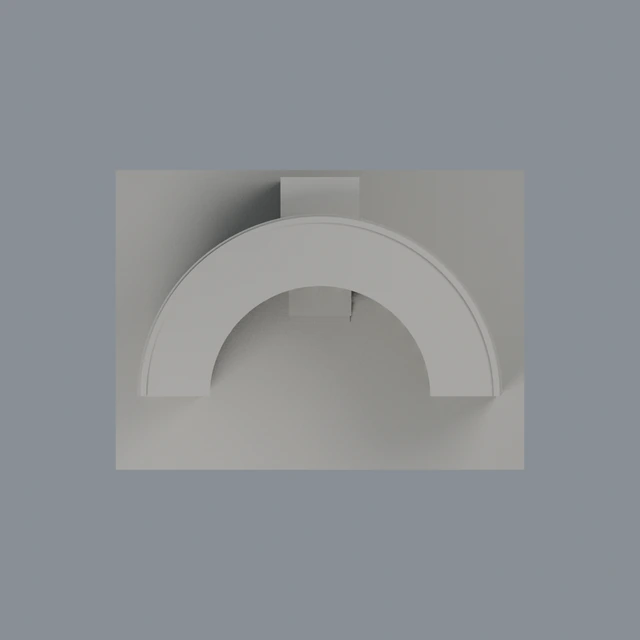

## 本次多面牆補色：主弧外牆與端牆推估

本版把主彎弧量體的 **189 個原中性完整外牆三角面** 延伸既有前庭白色：主外弧 168 面、兩端牆 21 面。所有三頂點必須位於原 80 段弧形精確平面與該段切向界內，或有限端牆平面內，不以面中心猜測、不切分網格。**此為同構件材料連續性推估，未新增背側照片證據，不代表 2026 現況全面確認。** 後側凸附棟、屋頂、冠帶、窗凹與框、雨棚及基座保留；所有原彩面不變。原 6,176 面／2,968 頂點、座標與面序不變，其餘 5,987 面材質保留，沒有實體列印驗證。

現行稽核見 `qa-continuous-walls/`；原 `qa/` 與 `qa-post-continuation/` 為歷史記錄，下方舊版「背／端牆中性」範圍僅對本節列出的 189 面更新。重建：`python appearance/source/build_continuous_walls.py`；驗證：`python appearance/source/verify_continuous_exchange.py`；五視圖及場景：`blender -b --python appearance/source/render_continuous_walls.py`；場景回讀：`blender -b --python appearance/source/verify_continuous_scene.py`。直接執行原分類器會回復歷史配色，請用本節命令。ZIP 不含第三方圖片。

# 政治大學井塘樓：前庭有限白牆／雨棚外觀層

僅1395個完整原面白色內弧瓷磚牆與柱（#D4D4CA）＋9個灰色雨棚立邊原面（#666966），共1404面、7740.38026137 mm²；其餘 4,772 面為補色前的中性面數；現行以本頁開頭的 189 面延伸為準。不是整樓全彩復原、實測色票或2026現況。

[三材質3MF](nccu-jingtang-appearance.3mf) · [可編輯Blend](scene.blend) · [逐面表](face-materials.json) · [色表](palette.json)

| 模型預覽 | 模型預覽 | 模型預覽 |
| :---: | :---: | :---: |
|  前庭左斜 |  背面 |  正立面 |
|  前庭右斜 |  頂視 |  |

五圖均包含完整建物及底座，不用裁切或額外染屋頂強化收益。屋頂與未驗證區域不因同構件延伸而擴染。原幾何窗肚混有簡化白框，不能整片冒稱深玻璃；門窗、窗凹背、框、屋頂、屋簷、未列入本頁開頭的背面／端牆、底座與後突出部維持中性。原雨棚為簡化方板，未補造照片中的弧形。

原STL bytes、6176個三角面順序與所有座標維持不變。80個弧段各自檢查三頂點切向界與平面、柱有限旋轉盒及灰雨棚有限前／側平面，使用actual cross-product normal；不以bbox或centroid整片套色，不切三角、不加厚。native對應原STL使用完整oriented exact triangle bijection。

## 重建／驗證
原model.stl放在appearance上一層；安裝source/requirements.txt，依序執行source/build_appearance.py、source/verify_exchange.py、source/verify_material_boundaries.py。Blender 4.3.2執行source/render_appearance.py與source/verify_scene.py。QA包含strict 3MF讀取、單材質存讀、native材質及頂點編輯存讀、原始交付重開渲染與乾淨重建。此層不代表實體試印、FFF切片或新的製造驗證，不覆寫原幾何歷史QA。原建築一件不增模型數。

[來源](SOURCES.md) · [權利](LICENSE-NOTICE.md)

## 2026-11-13 有限外觀修正｜模型交付版
兩柱前面2完整域4面0→既有白1；6176面幾何及順序不變，其餘6172面及3原材保持。白1399、灰9、中性4768。全三角原凸矩形支承，不新增界；原柱與曲托/雨棚粗代理及日期未知限制保留。不擴側背/棚頂底/階梯/屋頂或外弧。
模型與原生視角圖沿用完成候選的原bytes；不改幾何、不增加分界、不稱全棟精確配色或實體試印通過。公開預覽只含模型，不含新增圖片文字。原來源年代、工程及列印限制仍適用。先前敘述與審核屬其原版本，本段僅更新上述局部範圍。
本次只交付模型、必要重建輸入/腳本、預覽與此說明；完整研究與獨立審核紀錄另行保留，不在本批公開。PUBLIC-MODEL-SHA256SUMS只核本次所列公開產品，舊校驗與QA不代表本次新版。

現行展示只使用最新版模型的 WebP。原彩色 PNG、既有稽核與原校驗表可由[固定歷史版本](https://github.com/hplin50643/taiwan-buildings-3d/tree/5cc13bada423e37355cb7758d738f0b0695a80bf/%E5%A4%A7%E5%B0%88%E6%A0%A1%E9%99%A2/%E5%9C%8B%E7%AB%8B%E6%94%BF%E6%B2%BB%E5%A4%A7%E5%AD%B8/%E5%B1%B1%E4%B8%8B%E6%A0%A1%E5%8D%80/buildings/nccu-jingtang)追溯。若要重繪，請在獨立工作目錄使用現行渲染器，將生成的 PNG 與[像素對照表](../display/archive-png.json)比較，不把中間 PNG 放回現行庫。以 `python display/verify_webp.py --replay-root /path/to/replay` 核對五張重繪（需 Pillow）；只查驗交付 WebP 時省略該參數。
