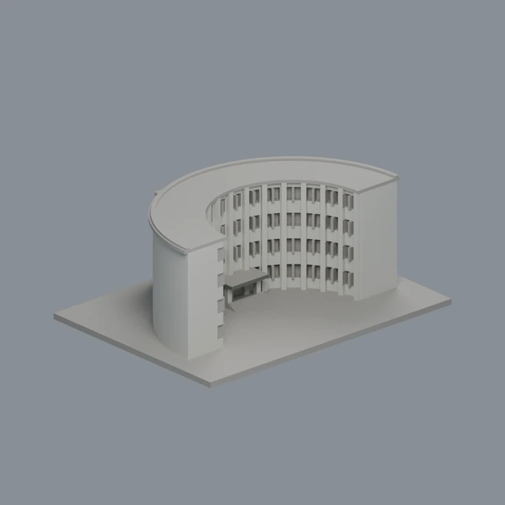
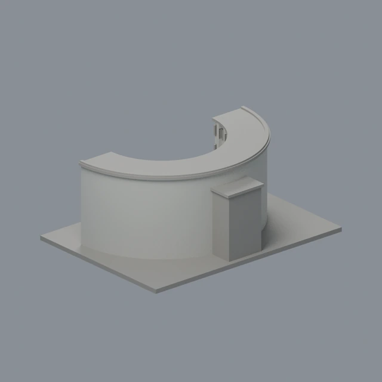
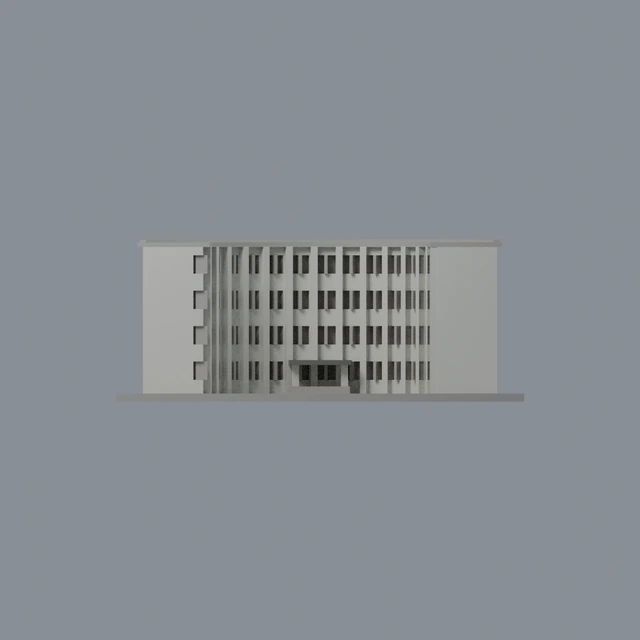
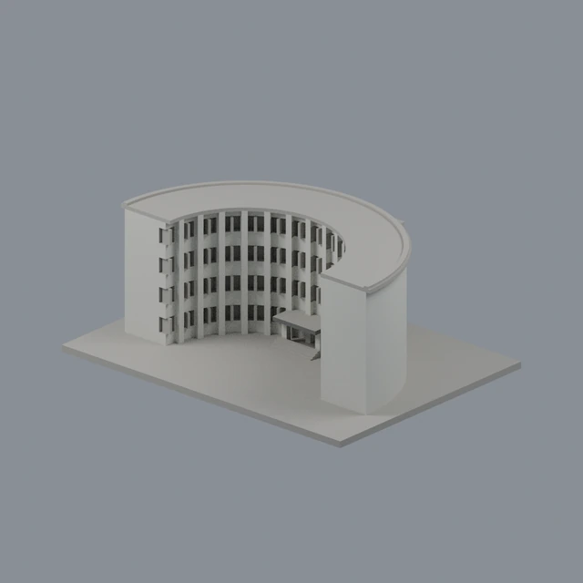
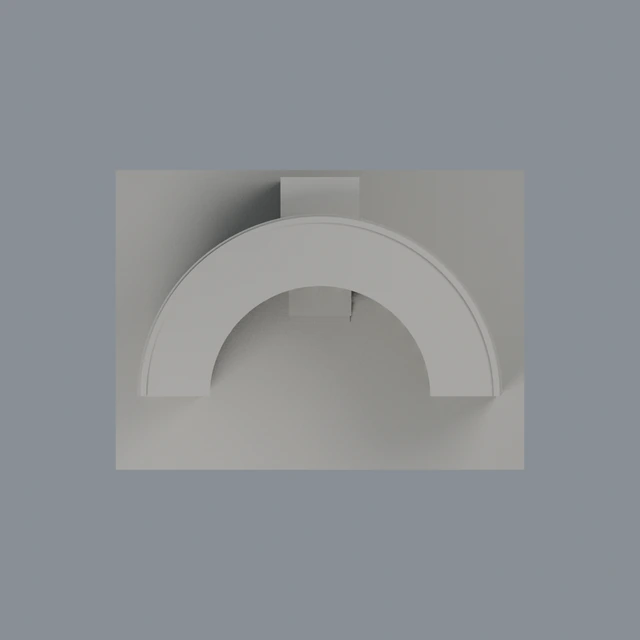

# 政治大學山下校區｜井塘樓｜現行彩色展示

## 模型預覽

| 模型預覽 | 模型預覽 | 模型預覽 |
| :---: | :---: | :---: |
|  前庭左斜 |  背面 |  正立面 |
|  前庭右斜 |  頂視 |  |

五張全尺寸無失真 WebP 已與現行模型重新渲染核對；點縮圖可放大。按現行 3MF，白色牆面與柱共 1,588 面、灰色雨棚立邊 9 面、中性 4,579 面。最近一輪延伸至主外弧及端牆的 189 面為材料連續性推估，並非新照片證據。

[現行彩色 Blender](../appearance/scene.blend) · [彩色 3MF](../appearance/nccu-jingtang-appearance.3mf) · [STL](../model.stl) · [渲染驗證](render-proof.json) · [本頁校驗](SHA256SUMS)

[原模型與限制](../README.md) · [原外觀來源與證據](../appearance/README.md)。原檔在固定歷史版本；幾何及工程資料未改動。未實體試印。

現行展示只使用最新版模型的 WebP。原彩色 PNG、既有稽核與原校驗表可由[固定歷史版本](https://github.com/hplin50643/taiwan-buildings-3d/tree/5cc13bada423e37355cb7758d738f0b0695a80bf/%E5%A4%A7%E5%B0%88%E6%A0%A1%E9%99%A2/%E5%9C%8B%E7%AB%8B%E6%94%BF%E6%B2%BB%E5%A4%A7%E5%AD%B8/%E5%B1%B1%E4%B8%8B%E6%A0%A1%E5%8D%80/buildings/nccu-jingtang)追溯。若要重繪，請在獨立工作目錄使用現行渲染器，將生成的 PNG 與[像素對照表](archive-png.json)比較，不把中間 PNG 放回現行庫。以 `python display/verify_webp.py --replay-root /path/to/replay` 核對五張重繪（需 Pillow）；只查驗交付 WebP 時省略該參數。
