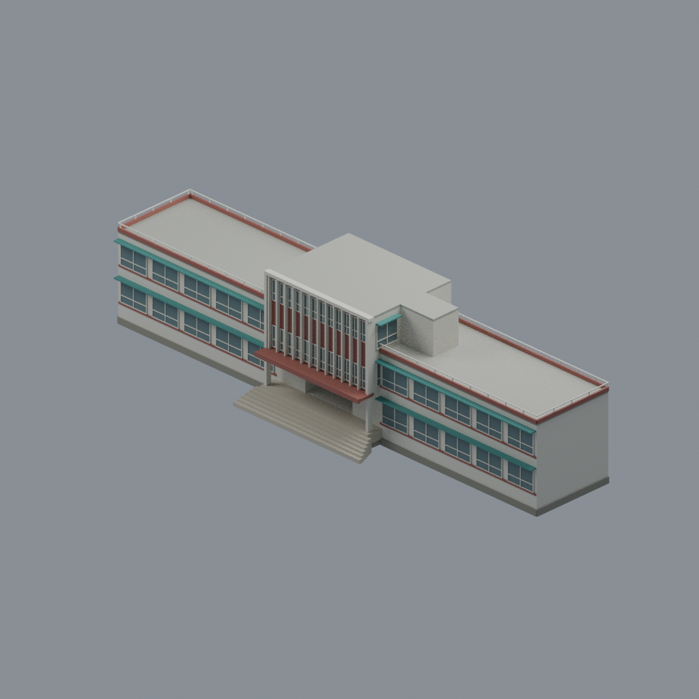
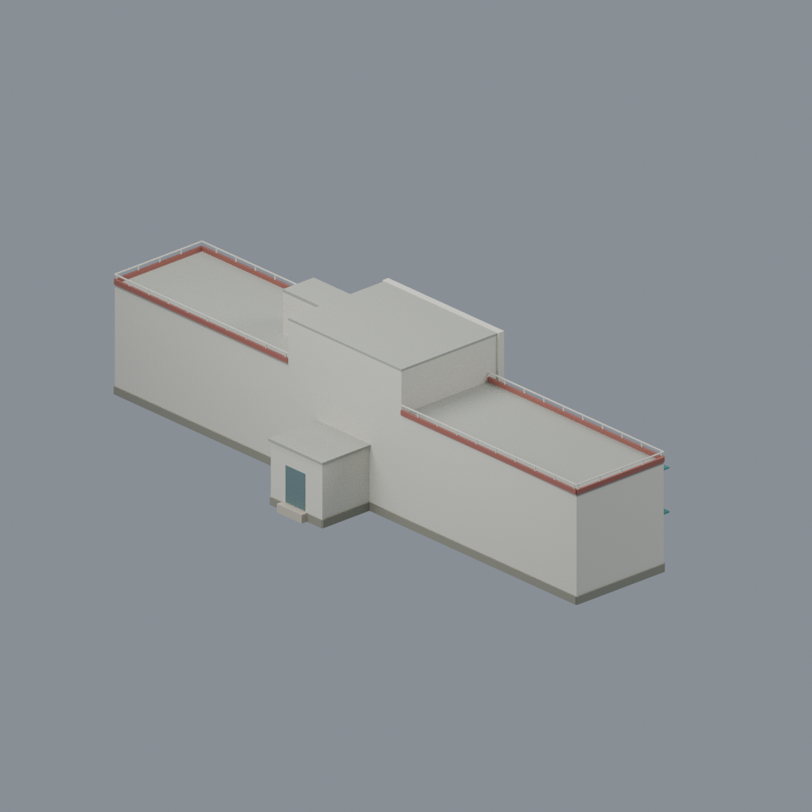
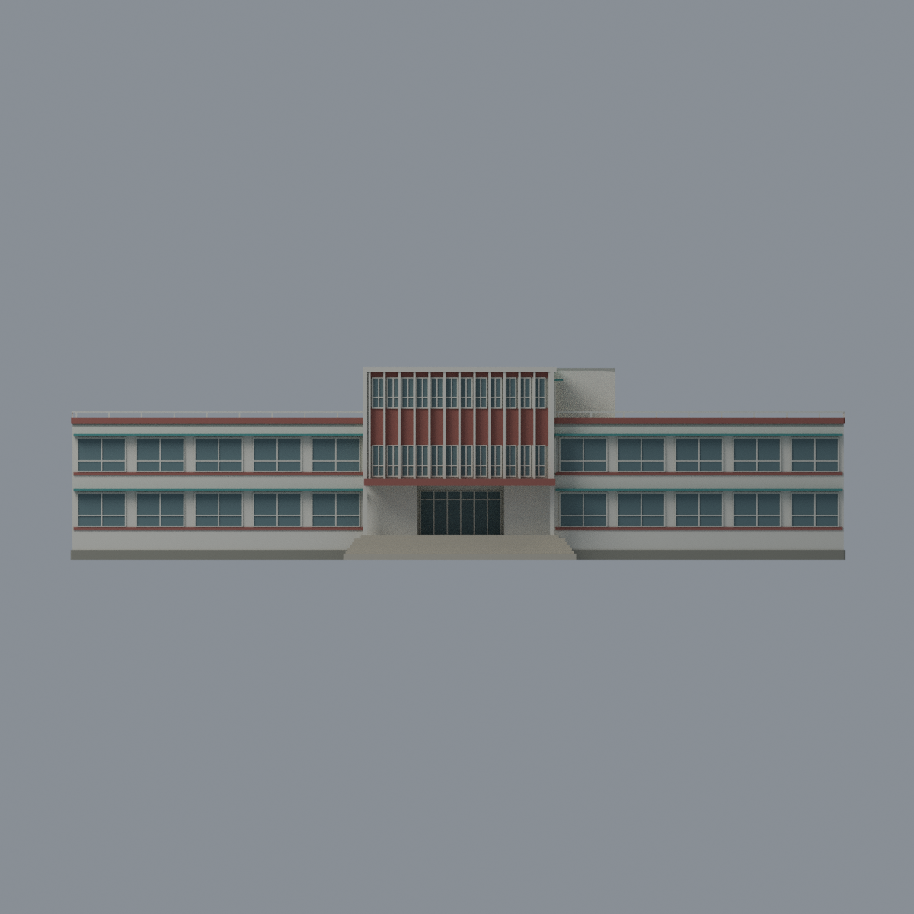
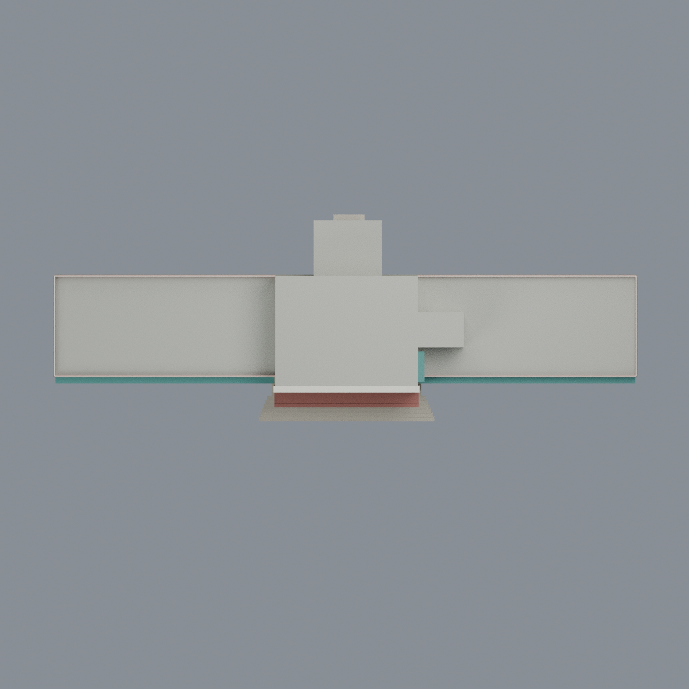
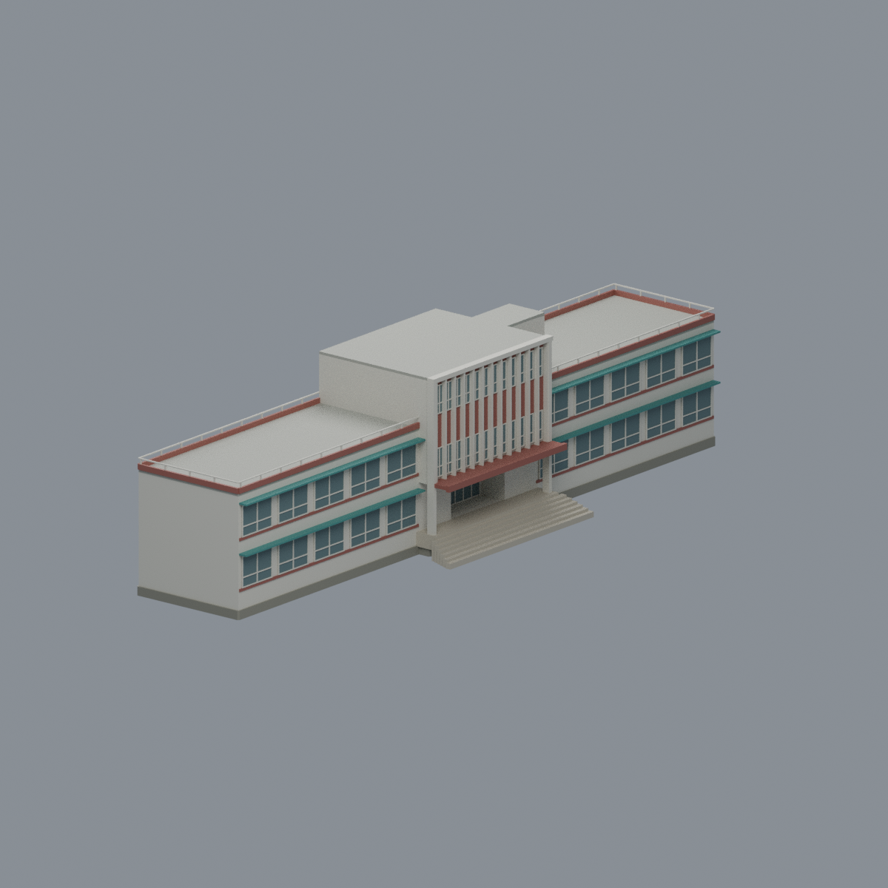

# 國立政治大學 新聞館｜彩色建築外觀模型

## 模型預覽

|  |  |  |
| :---: | :---: | :---: |
| 正面斜視 | 背面斜視 | 正面立視 |
|  |  |  |
| 頂視 | 另一側斜視 |  |

[山下校區圖鑑](../../README.md) · [政大圖鑑](../../../README.md) · [全部模型](../../../../../README.md)

官方消防資料所記錄的外觀及簡易平面參考版，並非已核實的2026年現況或竣工測繪。對象為山下校區新聞館（官方校圖A23；資產表60-18）。

## 模型內容

完整兩層長條左右翼、中央三層實體與側小房、兩翼屋頂露平台、僅一層的後凸門廳，以及正面入口雨簷、凹入門廳與貼樓階梯。保留白色豎框、紅色實腹、灰綠窗代理色與青綠遮陽板；玻璃以不透明表面呈現。背面未見細節採中性處理。沒有整片校園地形、鄰樓、樹木或額外屋頂塔。

- `scene.blend`：可編輯網格與材質，附五視角攝影機設定的主視角。
- `model.3mf`：同一三角網格、七種不透明材質；可供支援3MF基礎材質的軟體編輯。
- `model.stl`：同網格單色格式，STL本身不保存材質。
- `previews/`：由實際交付網格渲染的五張圖。
- `build_model.py`、`render_model.py`、`rebuild.py`：參數化建模及重建程式。


## 幾何與限制

外形約203.5×72.0×50.6毫米，是參考來源比例的展示尺度，不是現場量測比例尺。各層以共同梯核及柱距平移對位，未把不同頁框各自縮放。高度、平頂厚度、窗格間距、色值及局部地面均為近似；668入口簷的圓鈍邊在本模型簡化為厚矩形邊。來源669受樹木遮擋，只作局部側角參考，不宣稱已還原完整背面或唯一端頭。封閉房間以實心外形代理；入口凹空及露平台保留，不宣稱室內復原。

原圖、PDF頁面、平面圖像素與貼圖均不包含。來源權利及版本見[SOURCES.md](SOURCES.md)與[LICENSE.txt](LICENSE.txt)。

## 重建

Python依賴見`requirements.txt`，渲染使用Blender4.3.2 CPU Cycles。

```sh
python rebuild.py --output /新的獨立目錄 --blender blender
```

未實際列印，不能視為可直接列印保證。細框、欄杆等存在小於0.8毫米特徵，雨簷、入口頂與懸挑接合可能需要支撐；縮放、材料、切片與支撐須另行評估。幾何水密不等於列印成功，檢查結果與限制見[QA.md](QA.md)。

## 下載


[可編輯 Blend](scene.blend) · [彩色 3MF](model.3mf) · [單色 STL](model.stl) · [原 QA 重建來源 ZIP（封存）](rebuild-source.zip) · [來源](SOURCES.md) · [數值檢驗及製造限制](QA.md)

模型約 203.53 × 72.00 × 50.60 mm；尺寸、細窗及高程為比例近似。

### 展示與原始 QA

現行展示共五張無損 WebP：[正面](previews/front.webp)、[背面](previews/rear.webp)、[頂視](previews/top.webp)、[正立面](previews/elevation.webp)、[左斜視](previews/left_oblique.webp)。使用 Blender 4.3.2、Pillow 13.0.0（libwebp 1.6.0）執行 `python export_display_webp.py` 只更新展示圖；`python rebuild.py --output /新的獨立目錄` 在外部重建模型與展示圖。歷史原始 PNG 僅於隔離暫存重渲染供 QA 對照。原 PNG 與 SHA-256 保存在固定版本：[最初 QA 渲染清冊](https://github.com/hplin50643/taiwan-buildings-3d/blob/3e362d0479c265ee35cdccca0de393660c705d92/%E5%A4%A7%E5%B0%88%E6%A0%A1%E9%99%A2/%E5%9C%8B%E7%AB%8B%E6%94%BF%E6%B2%BB%E5%A4%A7%E5%AD%B8/%E5%B1%B1%E4%B8%8B%E6%A0%A1%E5%8D%80/buildings/nccu-journalism-hall/qa/render-manifest.json)及[原始預覽目錄](https://github.com/hplin50643/taiwan-buildings-3d/tree/3e362d0479c265ee35cdccca0de393660c705d92/%E5%A4%A7%E5%B0%88%E6%A0%A1%E9%99%A2/%E5%9C%8B%E7%AB%8B%E6%94%BF%E6%B2%BB%E5%A4%A7%E5%AD%B8/%E5%B1%B1%E4%B8%8B%E6%A0%A1%E5%8D%80/buildings/nccu-journalism-hall/previews)。原 `rebuild-source.zip` 仍按原樣保留供歷史 QA 查證，現行重建以目錄中腳本為準。
