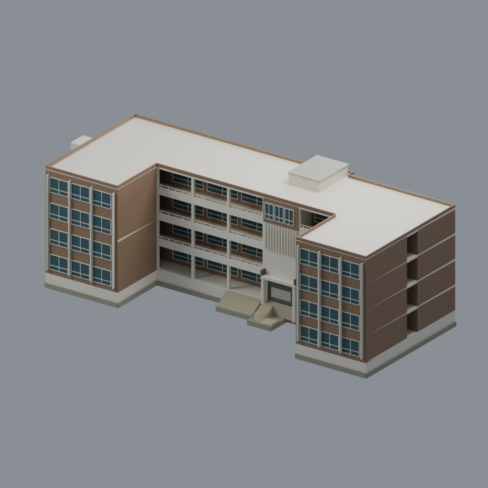
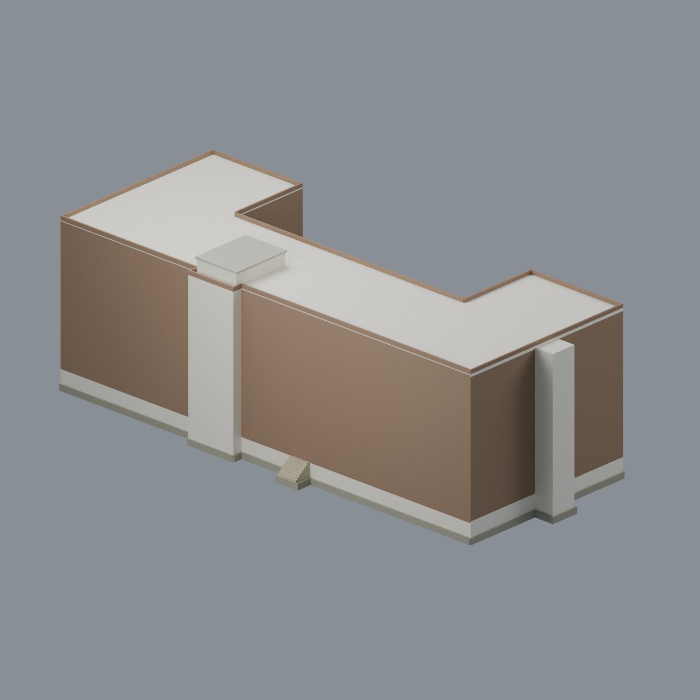
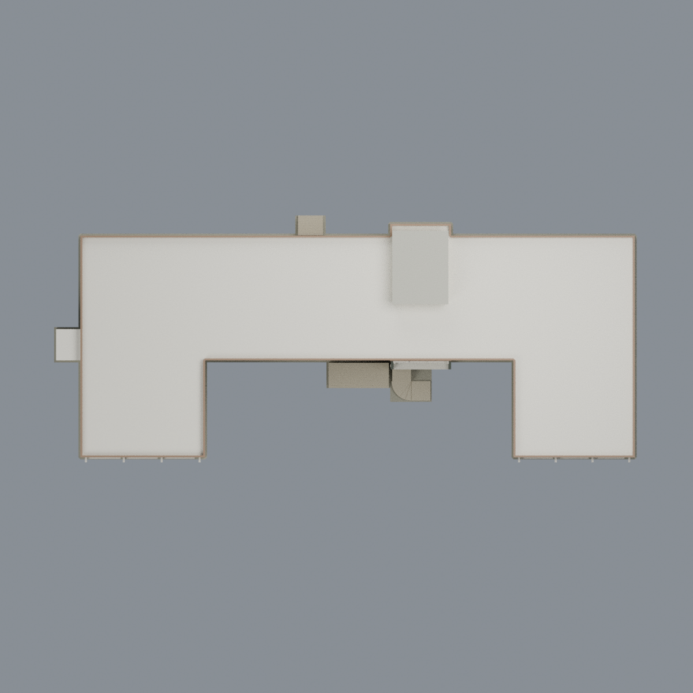

# 國立政治大學｜學思樓

## 模型預覽

|  |  |  |
| :---: | :---: | :---: |
| 學思樓彩色模型 | 背面 | 頂視 |

[山下校區圖鑑](../../README.md) · [政大圖鑑](../../../README.md) · [全部模型](../../../../../README.md)

依官方資料所記錄之外觀與簡易配置圖製作的近似彩色建築模型。參考照片攝影年未知，**不是已核實的 2026 年現況測繪**。


## 範圍

保留完整四層長條主樓、兩端向前突出的教室翼、中央梯核、西端樓梯／電梯區、開放柱廊、實背牆與貼樓入口階梯。中央寬階、旁邊折轉階、東端外階與北側短階分開表現；二樓僅保留貼樓橋接平台及支柱。通往逸仙樓的獨立跨橋、鄰樓與校園道路不納入。

屋頂圖約六跨，四樓圖約九跨；以共同樓梯與柱距註冊，不將局部屋頂圖當成整樓縮尺。兩端四樓實房均以平頂閉合，局部屋頂梯核採有界近似。此處不是完整屋頂實測。

## 檔案與使用

- `scene.blend`：可編輯彩色網格、材質、相機與燈光。
- `model.3mf`：毫米單位、多材質，保留每面材質指派。
- `model.stl`：相同幾何，STL 不承載顏色或透明度。
- `build_model.py` / `render_model.py`：參數化幾何及實網格渲染。
- `previews/`：正面斜視、背面斜視、正立面、頂視與左斜視，共五張。
- `SOURCES.md` / `QA.md`：來源版本、近似範圍與製造風險。

尺寸約 210.22 × 89.00 × 72.92 mm；此為模型尺寸，**不可當作真實建築尺寸**。藍綠窗為不透明浮雕，不使用照片貼圖。

## 重要限制

消防設備簡易配置圖不是測量或竣工圖。層高、細窗、屋頂小構件、基腳及地形皆近似；未見後立面細窗以低細節中性面處理，不鏡射已見立面；沒有虛構地下室內房。來源原圖不包含於模型檔案。

尚未實體試印。0.32 mm 窗框、細欄杆及約 0.72 mm 屋頂邊牆需依比例與材料調整；柱廊／平台底面可能需要支撐。水密與數值檢查不等同無支撐、最小壁厚或可直接列印證明。

## 重建

以 Python 3.12、`requirements.txt` 所列套件與 Blender 4.3.2 執行：

```sh
python rebuild.py --output /新的獨立目錄
```

`rebuild.py --output /新的空目錄 --blender blender` 可重建四個核心資料與五張預覽並逐位元比較。原始照片與大 PDF 不需要下載即可重建。

## 下載


[可編輯 Blend](scene.blend) · [彩色 3MF](model.3mf) · [單色 STL](model.stl) · [原 QA 重建來源 ZIP（封存）](rebuild-source.zip) · [來源](SOURCES.md) · [數值檢驗及製造限制](QA.md)

模型約 210.22 × 89.00 × 72.92 mm；尺寸、細窗及高程為比例近似。

### 展示與原始 QA

現行展示共五張無損 WebP：[正面](previews/front.webp)、[背面](previews/rear.webp)、[頂視](previews/top.webp)、[正立面](previews/elevation.webp)、[左斜視](previews/left_oblique.webp)。使用 Blender 4.3.2、Pillow 13.0.0（libwebp 1.6.0）執行 `python export_display_webp.py` 只更新展示圖；`python rebuild.py --output /新的獨立目錄` 在外部重建模型與展示圖。歷史原始 PNG 僅於隔離暫存重渲染供 QA 對照。原 PNG 與 SHA-256 保存在固定版本：[最初 QA 渲染清冊](https://github.com/hplin50643/taiwan-buildings-3d/blob/3e362d0479c265ee35cdccca0de393660c705d92/%E5%A4%A7%E5%B0%88%E6%A0%A1%E9%99%A2/%E5%9C%8B%E7%AB%8B%E6%94%BF%E6%B2%BB%E5%A4%A7%E5%AD%B8/%E5%B1%B1%E4%B8%8B%E6%A0%A1%E5%8D%80/buildings/nccu-xuesi-hall/qa/render-manifest.json)及[原始預覽目錄](https://github.com/hplin50643/taiwan-buildings-3d/tree/3e362d0479c265ee35cdccca0de393660c705d92/%E5%A4%A7%E5%B0%88%E6%A0%A1%E9%99%A2/%E5%9C%8B%E7%AB%8B%E6%94%BF%E6%B2%BB%E5%A4%A7%E5%AD%B8/%E5%B1%B1%E4%B8%8B%E6%A0%A1%E5%8D%80/buildings/nccu-xuesi-hall/previews)。原 `rebuild-source.zip` 仍按原樣保留供歷史 QA 查證，現行重建以目錄中腳本為準。
