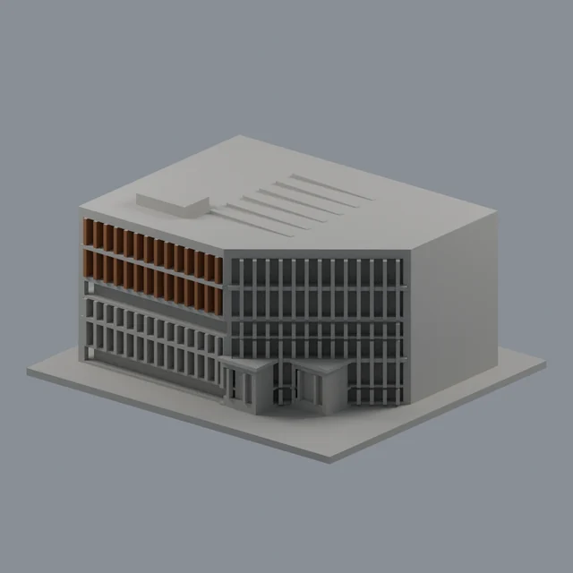
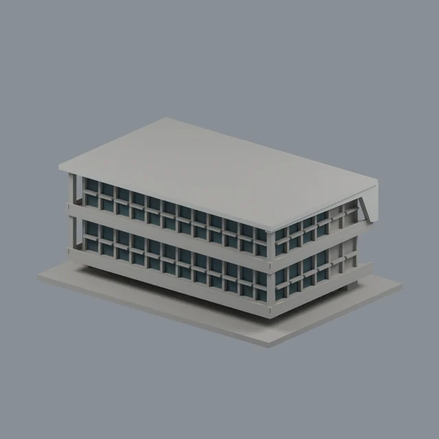

# 指南校區

2件完整建物外觀近似。達賢主棟與湖濱悅讀小屋是有空橋連接的兩座建物，各自成件；空橋與湖水不計入本件模型。全校區尚未完成。

| 建築模型 | 建築模型 | 建築模型 |
|---|---|---|
|    [達賢圖書館主棟](buildings/nccu-seetoo-library/) |    [湖濱悅讀小屋（局部補色）](buildings/nccu-lakeside-reading-house/) | |

各模型有实际STL正背俯視與來源、重建及QA。未實體試印。
