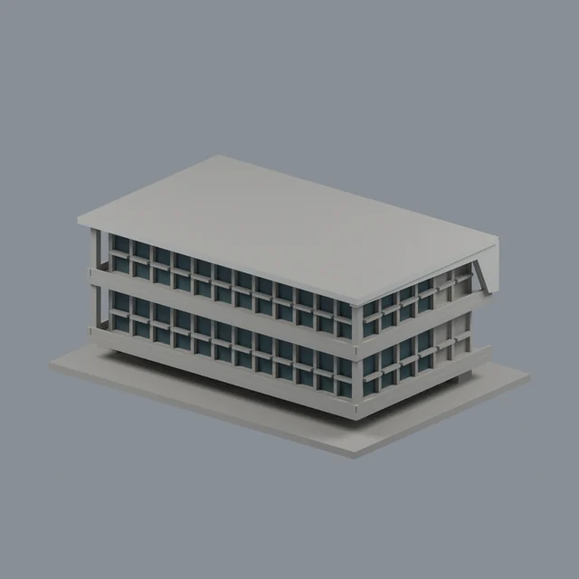
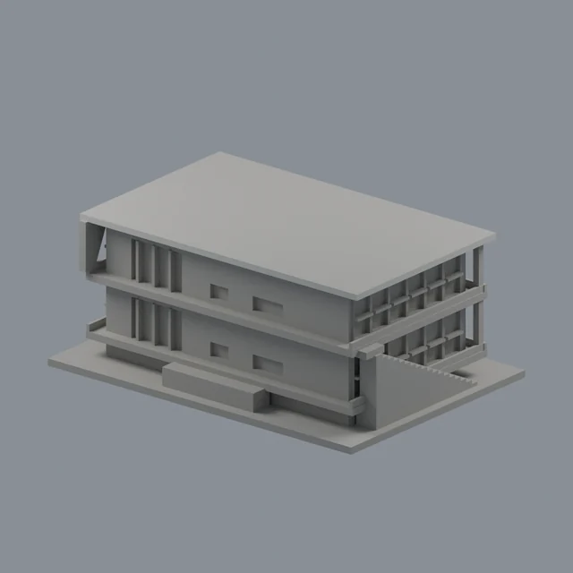
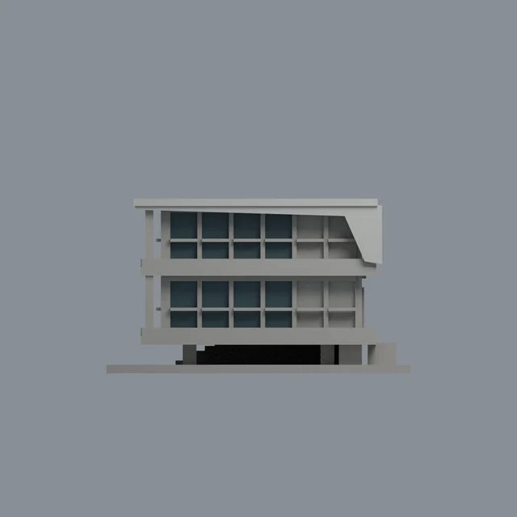
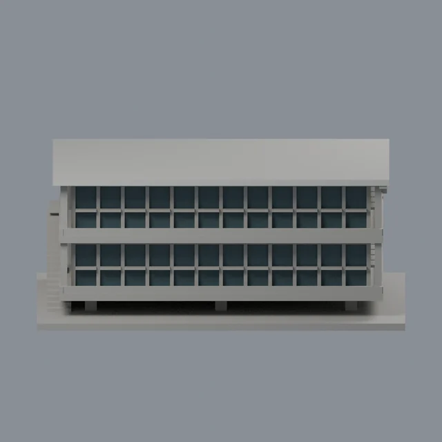
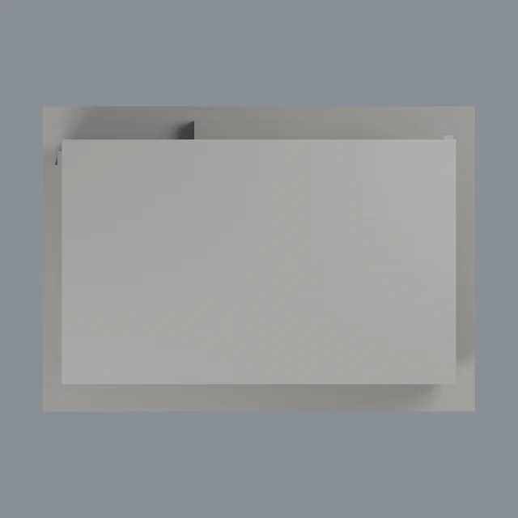

## 本次側端補色（有界構件延伸）

保留原 3,404 面／1,568 頂點及 66 個既有彩面，新增 **16 個完整原三角面**：屋頂薄板左／右／背立邊及右側折板外表面，沿用既有淺灰 `#C5C6BE`。本次重新親看既有[建築師刊載照片](https://www.twarchitect.org.tw/web2015/wp-content/uploads/2022/02/202203a6-3.jpg)，可見小屋右側折板的淺色族；色值仍為近似，左／背立邊僅同構件材料連續性推估，不是新左背照片實證。照片刊於 2022/03，實際攝影日未知，不稱 2026 現況。

僅取完整原垂直平面，未切面、補紋理或新增材界；窗／框／欄杆、屋頂上下面、折板底側、樓梯、後服務牆與基座均保留。沒有切片器或實體試印。`qa-continuous-walls/` 為本版檢查；舊 `qa/`、`qa-fascia-continuation/` 及下方舊說明只代表歷史版本，舊中性範圍僅由本節 16 面更新。

現行重建：`python appearance/source/build_continuous_walls.py`；交換驗證：`python appearance/source/verify_continuous_exchange.py`；五原視角及場景：`blender -b --python appearance/source/render_continuous_walls.py`；回讀：`blender -b --python appearance/source/verify_continuous_scene.py`。原 `build_appearance.py` 僅重建基底色。ZIP 只含模型重建檔，不含第三方參考圖。

# 政大湖濱悅讀小屋：正面及右前窗背限域配色（歷史基底）

獨立二層湖濱小屋，不是司徒達賢圖書館主樓。原3404面中，正面24窗及折板右側前8窗的64個完整背面三角採深灰青 #465C61 不透明玻璃外觀代理，其餘3340面維持中性 #AAA79F。中性意為未確認，不代表所有實物皆灰色；不是全棟材質復原或2026現況。

| 模型預覽 | 模型預覽 | 模型預覽 |
| :---: | :---: | :---: |
|  前右視角 |  後左視角 |  右立面 |
|  正立面 |  頂視 |  |

## 來源和選面界線
親看建築師2022/03刊照片：小屋兩層窗帶深冷灰青反射、淺色框與折板。攝影曝光日期未知，刊載月份不是攝影日。照片未校色；#465C61只是顯示代理，不聲稱實際玻璃RGB、透光率或塗料色。主樓橘色百葉、湖水、綠化、反射與陰影不移植到小屋。

正面所有三頂點 y=-32.2；12個窗中心 x=-55..55 每10mm，寬8.5mm。右前所有三頂點 x=59.2；窗中心 y=-26,-15,-4,7，寬9.4mm。兩層 z=[14.1,32.1]、[38.1,56.1]；各完整窗背2面。以完整三頂點選面、不重心猜測、不切面或重網格。前48面+右16面約5025.6mm²。框、欄杆、窗洞側邊皆中性。左階梯側、右後兩灣 y=18/29、背面、屋頂、底座與架空層不染；右後兩灣不染不是認定其實物不透明。

## 檔案與重建
[彩色3MF](nccu-lakeside-appearance.3mf) · [可編輯Blender](scene.blend) · [面映射](face-materials.json) · [色盤](palette.json) · [來源](SOURCES.md) · [權利](LICENSE-NOTICE.md) · [重建來源ZIP](rebuild-source.zip) · [校驗碼](SHA256SUMS)

保留原STL全部座標、三角面序及拓撲，尺寸150×106×60.8mm。原native場景只有Warm stone preview only單材質；本補充不改寫原件、歷史來源或製造QA。解壓重建來源ZIP後，以Python依source/requirements.txt安裝依賴，依次執行build_appearance.py、verify_exchange.py、verify_material_boundaries.py，再以Blender 4.3.2+執行render_appearance.py、verify_scene.py。相對目錄須為model.stl及appearance/source/。

驗證包含lib3mf strict零警告、實際材質修改/存檔/重開、Blender實際材質修改/存檔/重開與其他材質/幾何不變。乾淨重建3MF、映射、色盤及五PNG逐byte比對；Blend僅語義一致，不宣稱binary決定性。未做切片器、多色FFF或實體試印；模型為目估外觀研究，不供施工。

## 2026-11-13 有限外觀修正｜模型交付版

完整2面前垂直屋簷0→新2淺灰族#C5C6BE/.88。3404面幾何及面序不變，其餘3402面與原2材保持；原玻璃64、中性3338、新簷2。僅原凸矩形整三角，無新增分界；原屋頂厚度/比例為代理，細縫未建、非校準材色。上下與側折板、欄/柱/窗框保持。來源拍年未知，不認證現況。

模型、材質、原生視角圖與必要重建程式沿用完成候選，未改幾何或新切材界，不代表全館精確復色、現況或實體試印通過。原來源年代、工程與列印限制仍適用，舊說明與審核僅屬各自版本，本段更新上述局部範圍。

本次只公開模型、必要重建輸入／腳本、預覽與說明；完整來源、比較及研究審核不隨本批交付。根目錄PUBLIC-MODEL-SHA256SUMS僅校驗所列當前產品，舊表不驗證新版。重建ZIP只含必要重建檔與本說明；歷史來源及QA連結指儲存庫既有文件，非ZIP內的新增審核附件。

[現行展示圖與渲染校驗](../display/README.md) · [原工程檔與舊校驗對應版本](https://github.com/hplin50643/taiwan-buildings-3d/blob/62e4ad666ee428f5eb49d2f92a001438856b201e/%E5%9C%8B%E7%AB%8B%E6%94%BF%E6%B2%BB%E5%A4%A7%E5%AD%B8/%E6%8C%87%E5%8D%97%E6%A0%A1%E5%8D%80/buildings/nccu-lakeside-reading-house/appearance/README.md)

原彩色 PNG、原校驗表及重繪紀錄可從[固定歷史版本](https://github.com/hplin50643/taiwan-buildings-3d/tree/7412402e81df010769f4d6503379882bea076565/%E5%A4%A7%E5%B0%88%E6%A0%A1%E9%99%A2/%E5%9C%8B%E7%AB%8B%E6%94%BF%E6%B2%BB%E5%A4%A7%E5%AD%B8/%E6%8C%87%E5%8D%97%E6%A0%A1%E5%8D%80/buildings/nccu-lakeside-reading-house)追溯。現行大圖以[像素對照表](../display/archive-png.json)校驗；只檢查交付 WebP 時執行 `python display/verify_webp.py`（需 Pillow）。如需重做，在獨立工作目錄執行現行渲染器，再指定 `--replay-root /path/to/replay` 比對尺寸與解碼像素。生成的 PNG 僅是中間檔，不放回現行庫。
