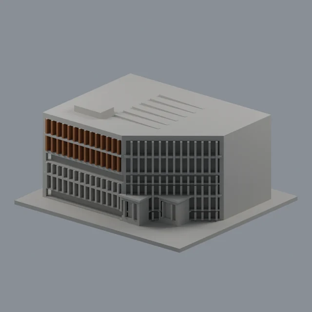
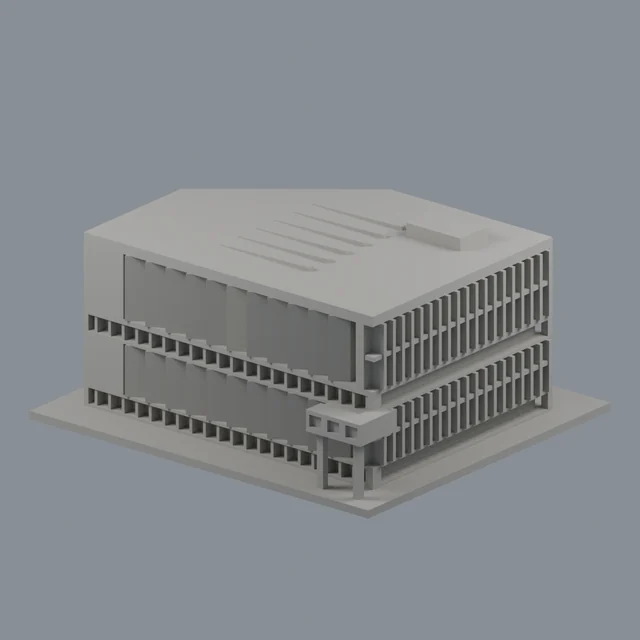
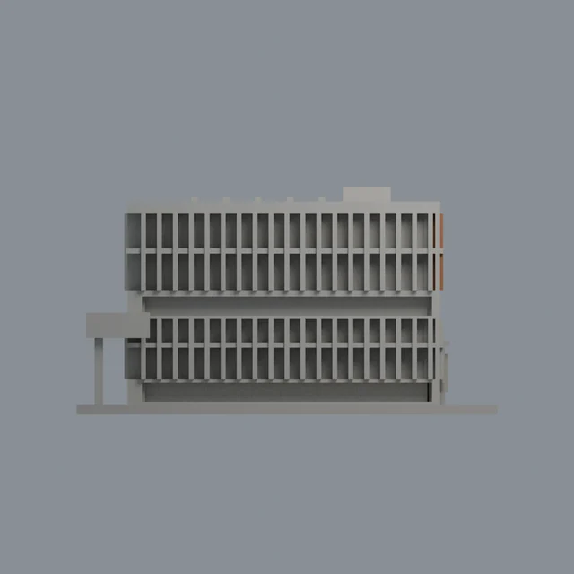
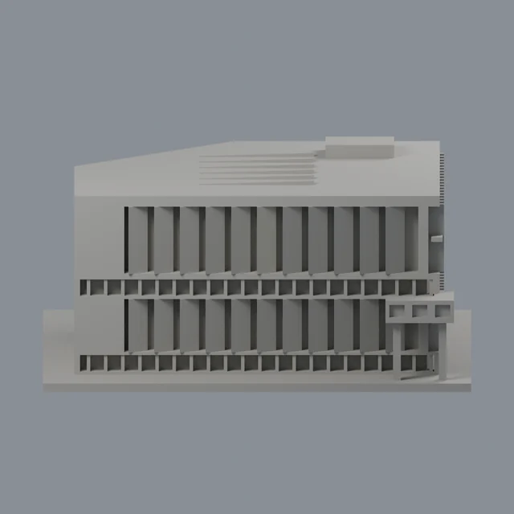
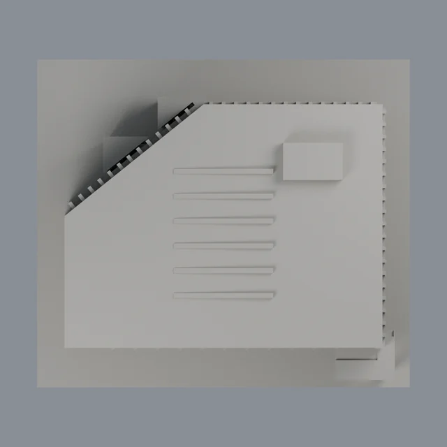

## 本次同構件多面補色

保留原 7,246 面／3,295 頂點與 244 既有彩面，新增 **46 個原完整三角面**：上層湖側直段兩端遮陽板 38 面延用既有棕色 `#98633D`，已上色的中央上層入口斜屏風側返 8 面延用暖灰 `#B4B1A4`。僅限原板件幾何範圍，不新增材界；橫向梁、斜湖面／其他側面的遮陽板、下層、鄰屏、屋頂與基座保留。**新增範圍是同排及同構件材質連續性推估，未取得新增背側照片佐證；不是全館精確配色或 2026 現況核實。**

原圖已辨識為後方達賢主樓，不將前方湖濱小屋的玻璃與淺色板移植。原刊物 2022/03 日期非拍攝日，色值非測色且棕色不等於確認材質成分。未切片器或實體試印。

本版檢查在 `qa-continuous-walls/`；原 `qa/`、`qa-panel-continuation/` 與下方舊說明為歷史資料，舊未染範圍僅由上列 46 面更新。現行重建：`python appearance/source/build_continuous_walls.py`；交換：`python appearance/source/verify_continuous_exchange.py`；五原視角／場景：`blender -b --python appearance/source/render_continuous_walls.py`；場景讀回：`blender -b --python appearance/source/verify_continuous_scene.py`。歷史 `build_appearance.py` 只生成基底色。來源 ZIP 不含第三方照片。

# 政大達賢圖書館主館：湖側上層直段遮陽板限域配色（歷史基底）

本案是主館，不是前方獨立湖濱悅讀小屋。原7246面中，僅湖側直段上層中央12片遮陽板的240個完整三角面採棕色表面代理 #98633D，其餘7006面維持中性 #AAA79F。中性表示未確認，不代表實物均灰色；不是全棟材質復原或2026現況。

| 模型預覽 | 模型預覽 | 模型預覽 |
| :---: | :---: | :---: |
|  湖側與遮陽板 |  入口側 |  右立面 |
|  正立面 |  頂視 |  |

## 來源與選面
親看建築師2022/03刊實拍，主館上層可見棕橘色垂直遮陽板、淺灰橫向梁。曝光日期未報；照片未校色，棕色是外觀代理，不宣稱確為木材、銅、塗料品牌或實測RGB。照片前方小屋不是本模型；入口混凝土屏風不套用棕色。

只取 y約48直段、x中心0至55每5mm的12板；各20完整三角面、合計約3129.6mm²。所有頂點限於各中心±0.75、y44..49、z39..63；取x兩側面，以及y49端面且整面z≤50.5或≥52.1。橫向淺灰梁z50.5..52.1不染；梁後y44..45殘存板側仍屬棕色板。兩端x=-5與60板、下層、斜立面、其他側面、入口、凹背、屋頂與底座全部維持中性。不以重心跨界、不切面、不增加幾何或貼圖。

## 檔案及重建
[彩色3MF](nccu-seetoo-appearance.3mf) · [可編輯Blender](scene.blend) · [面映射](face-materials.json) · [色盤](palette.json) · [來源](SOURCES.md) · [權利](LICENSE-NOTICE.md) · [重建ZIP](rebuild-source.zip) · [校驗碼](SHA256SUMS)

保留原STL全部座標、面序與拓撲，3295頂點7246三角面、尺寸150×132×71.5mm。原native單Warm stone材質，本次additive不改原件或歷史製造QA。

重建目錄為model.stl及appearance/source/；Python依requirements.txt安裝，執行build_appearance.py、verify_exchange.py、verify_material_boundaries.py，再用Blender 4.3.2+執行render_appearance.py、verify_scene.py。包含strict 3MF零警告、真正單材質編輯存檔重開及Blender同項驗證。乾淨重建3MF/映射/色盤/五PNG逐byte相同，Blend僅語義一致，不宣稱binary決定性。未切片器、多色FFF或實體試印；非工程測繪或施工模型。

## 2026-11-13 有限外觀修正｜模型交付版

原上層中央朝入口斜外平面完整4面0→新2暖灰石質族#B4B1A4/.88。7246面幾何/面序不變，其餘7242面及原2材保持；原棕遮陽240、中性7002、新屏4。原解析斜平面與凸矩形全三角支持，不切新界。11屏比例及板縫為粗近似，不認證精確材色/石種。側返/上下/背與鄰屏、屋頂箱體不改。來源拍年未知，不認證現況。

模型、材質、原生視角圖與必要重建程式沿用完成候選，未改幾何或新切材界，不代表全館精確復色、現況或實體試印通過。原來源年代、工程與列印限制仍適用，舊說明與審核僅屬各自版本，本段更新上述局部範圍。

本次只公開模型、必要重建輸入／腳本、預覽與說明；完整來源、比較及研究審核不隨本批交付。根目錄PUBLIC-MODEL-SHA256SUMS僅校驗所列當前產品，舊表不驗證新版。重建ZIP只含必要重建檔與本說明；歷史來源及QA連結指儲存庫既有文件，非ZIP內的新增審核附件。

[現行展示圖與渲染校驗](../display/README.md) · [原工程檔與舊校驗對應版本](https://github.com/hplin50643/taiwan-buildings-3d/blob/43a9876a0b02cd1de15eb1b52cc8a3d332c909f9/%E5%9C%8B%E7%AB%8B%E6%94%BF%E6%B2%BB%E5%A4%A7%E5%AD%B8/%E6%8C%87%E5%8D%97%E6%A0%A1%E5%8D%80/buildings/nccu-seetoo-library/appearance/README.md)

原彩色 PNG、原校驗表及重繪紀錄可從[固定歷史版本](https://github.com/hplin50643/taiwan-buildings-3d/tree/7412402e81df010769f4d6503379882bea076565/%E5%A4%A7%E5%B0%88%E6%A0%A1%E9%99%A2/%E5%9C%8B%E7%AB%8B%E6%94%BF%E6%B2%BB%E5%A4%A7%E5%AD%B8/%E6%8C%87%E5%8D%97%E6%A0%A1%E5%8D%80/buildings/nccu-seetoo-library)追溯。現行大圖以[像素對照表](../display/archive-png.json)校驗；只檢查交付 WebP 時執行 `python display/verify_webp.py`（需 Pillow）。如需重做，在獨立工作目錄執行現行渲染器，再指定 `--replay-root /path/to/replay` 比對尺寸與解碼像素。生成的 PNG 僅是中間檔，不放回現行庫。
