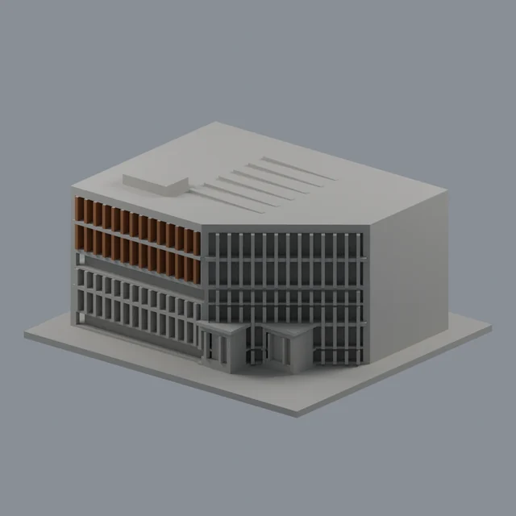
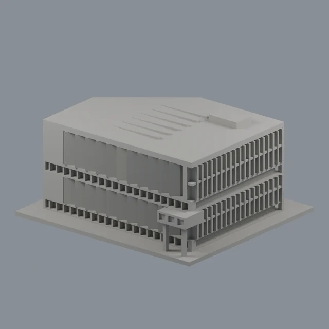
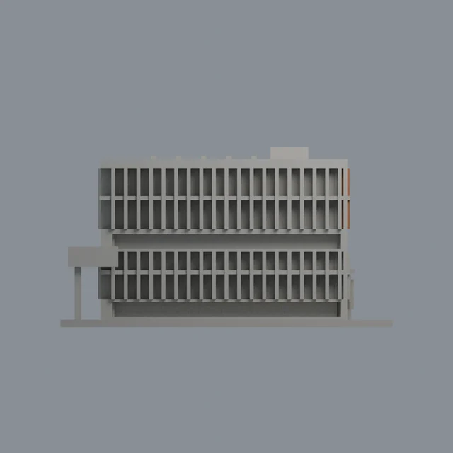
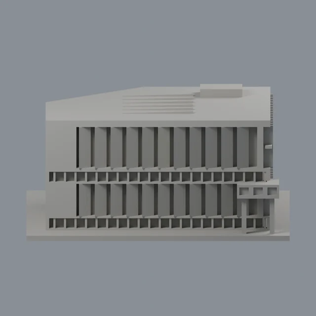
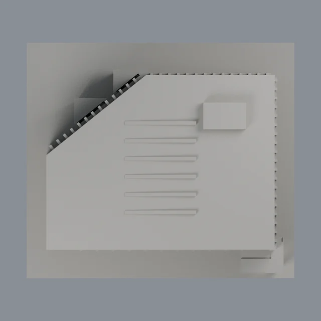

# 政大達賢圖書館主棟｜現行模型 WebP 預覽

五圖皆以現行三材質模型重新渲染核對，不使用舊單色版。點圖可開啟無損原尺寸 WebP。

| 模型預覽 | 模型預覽 | 模型預覽 |
| :---: | :---: | :---: |
|  湖側與遮陽板 |  入口側 |  右立面 |
|  正立面 |  頂視 |  |

[模型說明](../README.md) · [限域材質與來源界線](../appearance/README.md) · [表面色 3MF](../appearance/nccu-seetoo-appearance.3mf) · [可編輯 Blender](../appearance/scene.blend) · [原 STL](../model.stl) · [展示校驗](SHA256SUMS) · [渲染對照](render-proof.json)

只更新展示，幾何、色材與工程 QA 均未改動；原 PNG 可在固定歷史版本查閱。保留既有湖側上層直段遮陽板與入口上層斜屏風限域配色。其他側面、下層、屋頂及基座不新增配色；中性不代表實物為灰色。不宣稱現況色值或實體試印。

原彩色 PNG、原校驗表及重繪紀錄可從[固定歷史版本](https://github.com/hplin50643/taiwan-buildings-3d/tree/7412402e81df010769f4d6503379882bea076565/%E5%A4%A7%E5%B0%88%E6%A0%A1%E9%99%A2/%E5%9C%8B%E7%AB%8B%E6%94%BF%E6%B2%BB%E5%A4%A7%E5%AD%B8/%E6%8C%87%E5%8D%97%E6%A0%A1%E5%8D%80/buildings/nccu-seetoo-library)追溯。現行大圖以[像素對照表](archive-png.json)校驗；只檢查交付 WebP 時執行 `python display/verify_webp.py`（需 Pillow）。如需重做，在獨立工作目錄執行現行渲染器，再指定 `--replay-root /path/to/replay` 比對尺寸與解碼像素。生成的 PNG 僅是中間檔，不放回現行庫。
