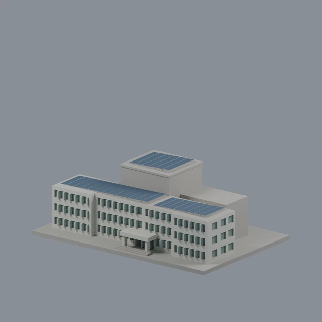
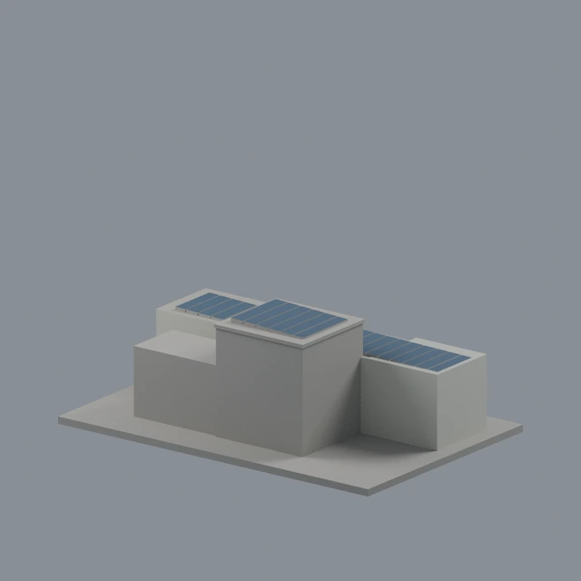
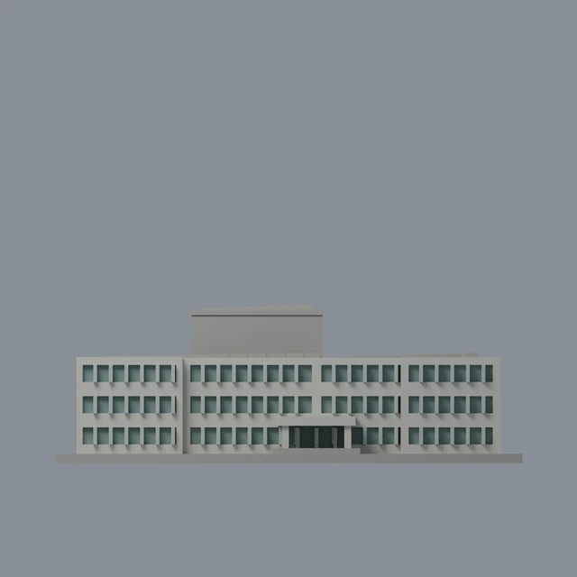
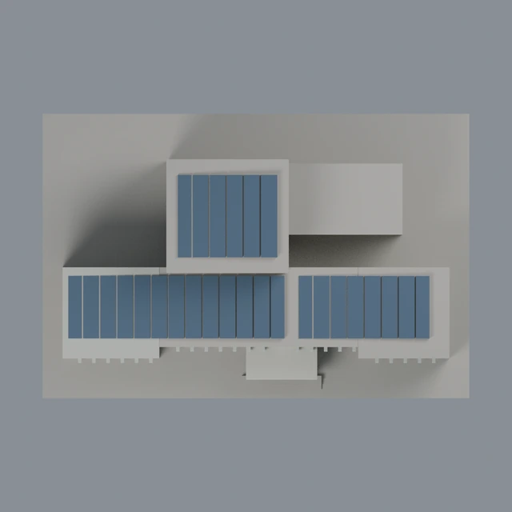

## 本次多面牆補色（同構件推估）

本版將低層正面長條構件的 **20 個原本中性牆面** 延用既有暖象牙白：完整左端 9 面、外露後牆 11 面。**這是同構件材質連續性推估，不是新側背照片實證。** 僅選原完整垂直三角面，未改幾何或新增分界；高後塊的混材牆、獨立後側附棟、屋頂、太陽能板、玻璃、窗框及所有原彩面保留。原 3,112 面／1,416 頂點不變。沒有實體列印驗證。

本版稽核見 `appearance/qa-continuous-walls/`；原 `appearance/qa/`、`appearance/qa-roof-continuation/` 和下方舊說明屬歷史紀錄，不代表本版雜湊。舊版未上色範圍只由本節列出的 20 面更新，其他限制照舊。

現行重建：`python appearance/source/build_continuous_walls.py`；驗證：`python appearance/source/verify_continuous_exchange.py`；四原視角彩圖及可編輯場景：`blender -b --python appearance/source/render_continuous_walls.py`；場景驗證：`blender -b --python appearance/source/verify_continuous_scene.py`。舊 `build_appearance.py` 僅作基底分類，直接執行會回到舊配色。ZIP 不含第三方照片。

# 國立清華大學｜第一綜合大樓（行政大樓）

## 模型預覽


| 模型預覽 | 模型預覽 | 模型預覽 |
| :---: | :---: | :---: |
| [](display/front.webp)<br>正面 | [](display/rear.webp)<br>背面 | [](display/elevation.webp)<br>正立面 |
| [](display/top.webp)<br>頂視 | | |

## 6 材質外觀版與歷史來源


[來源界線與四視角](appearance/README.md) · [表面色 3MF](appearance/nthugeneral-appearance.3mf) · [可編輯場景](appearance/scene.blend)

限定已見白結構、淺銀窗格及灰綠窗背，空拍確認 PV 板斜頂深藍；低層左端與外露後牆另有前述 20 面同構件配色；未分面的後高盒灰嵌板牆與其餘未核實背面保持中性。 原 STL 與歷史 QA 不變；這是外觀改善，不是新增幾何。原單色正面（歷史檔案留存，不作本頁預覽）／原單色背面（歷史檔案留存，不作本頁預覽）


第二批外觀近似建築模型，並非測繪模型。獨立比例、最長150mm含底座；全校尚未完成。

## 交付與尺寸
150.00 × 100.00 × 51.00 mm，原始STL單位為毫米。

- `model.stl`：單一封閉列印實體，沒有預挖內腔。
- `scene.blend`：由實際STL匯入的可編輯三角網格與預覽相機，不是BIM或布林歷史。
- `model.obj`：輔助交換網格。
- `build_model.py`：參數化原始碼，可獨立重建。
- `previews/front.png`、`rear.png`、`elevation.png`：實際STL的正／背／立面渲染，已逐張看像素。正背是顯示方向，不是測量方位。
- `validation.json`：原始法線、流形與乾淨重建等18項驗證。
- `check_layers.py`、`layer-check.json`：0.2mm幾何截面與薄特徵篩查。

## 來源
查閱與像素檢視：2026-10-13。[校方來源頁](https://attractions.site.nthu.edu.tw/p/406-1515-186982,r8697.php?Lang=zh-tw)。

實際檢視官方街景及高視點外觀照片，可見三層水平長棟、前立面進退、中央入口小門廊、後方高起方形量體及屋頂太陽能面板。本模型以分層量體和深窗帶表現，不使用平箱體均勻貼窗。

照片只列URL，未包含在交付或重新發布：
- https://attractions.site.nthu.edu.tw/var/file/515/1515/pictures/940/m/mczh-tw700x700_large38336_672583860243.jpg
- https://attractions.site.nthu.edu.tw/var/file/515/1515/pictures/940/m/mczh-tw700x700_large38337_371090460243.jpg

## 近似範圍
後立面未有完整照片，採素面封閉包絡；後高體高度、深度、側翼相對位置依空拍估計。太陽能板為低厚浮雕與分格線，非電力設備或精確模組配置。窗分格與門廊厚度為可列印而規律化。

僅研究公開訪客可見外觀；沒有室內、地下、安全／進出控制或隱藏系統配置。未擷取官方Unity或其他3D資產；沒有聲稱逐面檢視官方3D場景。

## 列印與支撐
正立、底座朝下。可從0.4mm噴嘴、0.2mm層高、3道外牆、15–20%填充起始評估，但未驗證此設定。

入口門廊檐下最大約13mm延伸，請使用局部支撐或以切片結果判定橋接。太陽能浮雕為實體背襯。

薄特徵人工對照：0.8mm XY形態開運算僅於z=50.50001mm一層標示狹小區，定位在斜置太陽能浮雕的上缘／分格交界；其下方有連續厚板及屋頂，不是獨立薄牆。可能使最後一層尖緣被切片器省略，請檢查該高度的刀路。窗框已加粗至1.2mm，移除原窗端0.5mm薄角。

## 驗證結果與限制
18項原始STL幾何檢查全過：單位法線且與繞向一致、無退化三角面、封閉邊、頂點連結單環、單一連通表面／無分離內腔殼、正體積、z=0平底、150mm最大邊、乾淨目錄重建STL雜湊一致、Blender／STL三角幾何一致。檢查不會修復原STL。

以0.2mm間距抽樣255個高度（首層0.100013mm，微偏移避免與三角面共面），所有截面輪廓閉合。交點採0.0001mm數值容差聚合，不修改STL。0.8mm XY形態開運算篩查標記1層，最大差異面積7.96672mm²；標記解釋如上。

**這不是正式切片，不產生G-code，沒有驗證刀路、擠出或支撐生成；沒有實體試印。** 抽樣截面不涵蓋每個高度，也不能代替全面三維最小壁厚或自相交證明。

## 乾淨重建
Python 3.12、Blender 4.3.2+；檔案只用自身目錄，不依賴製作機器絕對路徑。

```sh
python -m pip install -r requirements.txt
python build_model.py
blender -b -t 2 -P render_preview.py
python validate_model.py
python check_layers.py
```


## 實際STL正背並排

現行大圖用 [WebP 與原圖像素對照](display/archive-png.json) 校驗：在模型資料夾執行 `python display/verify_webp.py`（需 Pillow）。原彩色 PNG、原雜湊與舊說明均保留在[固定歷史版本](https://github.com/hplin50643/taiwan-buildings-3d/tree/832617c8fb635897c279113f45e1e614d36ebc8d/%E5%A4%A7%E5%B0%88%E6%A0%A1%E9%99%A2/%E5%9C%8B%E7%AB%8B%E6%B8%85%E8%8F%AF%E5%A4%A7%E5%AD%B8/%E6%A0%A1%E6%9C%AC%E9%83%A8/buildings/nthu-general-building-i)。重繪請在暫存副本執行 `blender -b -t 3 --python-exit-code 1 -P appearance/source/render_continuous_walls.py`，再加 `--replay-root /path/to/copy` 校對，不必把中間 PNG 放回主分支。
