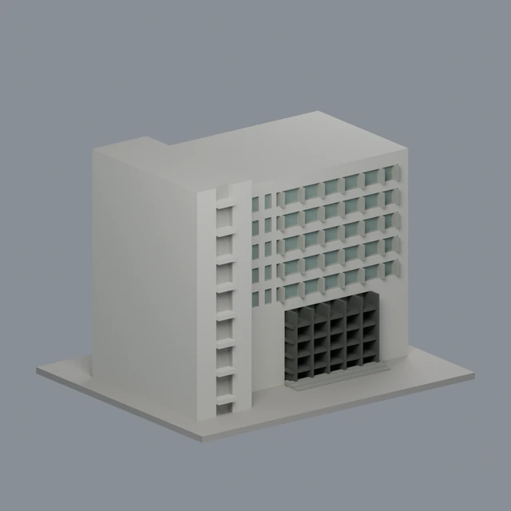
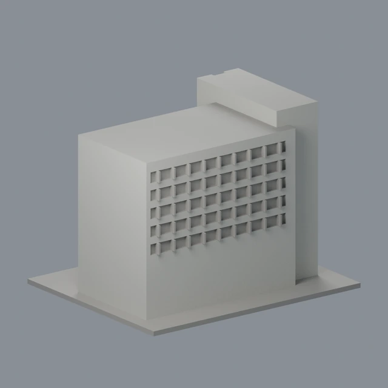
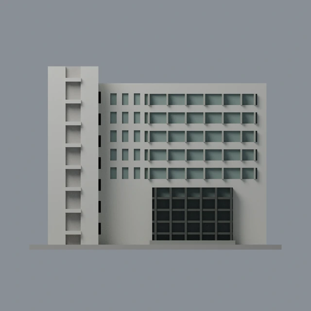
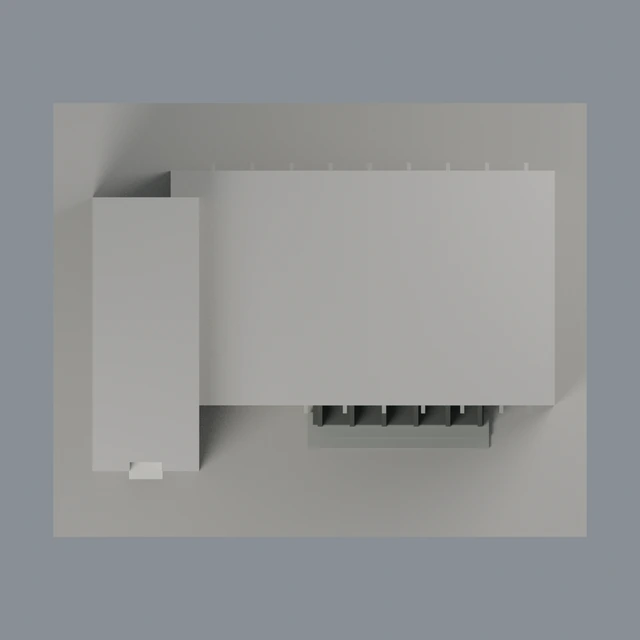

## 本次多面牆補色（同構件推估）

本版將 **240 個原本中性外牆三角面** 沿用正面的象牙白：主體外牆 216 面、塔樓外牆 24 面。僅選主體／塔樓外側完整垂直平面，不延伸凹窗玻璃、窗梃、塔槽混合內容或屋頂。**新增側背色是同構件材質連續性推估，不是新照片定位實證。** 所有原彩面與 3,694 面／1,793 頂點的座標、面序、幾何均保留，未增分界。沒有實體列印驗證。

現行稽核以 `qa-continuous-walls/` 為準；原 `qa/`、`qa-return-continuation/` 與下方舊版說明屬歷史紀錄，不代表本版輸出雜湊或側背範圍。舊說明所指後牆中性範圍已由本節更新；後窗與未知凹槽仍中性。

現行重建：`python appearance/source/build_continuous_walls.py`；驗證：`python appearance/source/verify_continuous_exchange.py`；四原視角彩圖及可編輯場景：`blender -b --python appearance/source/render_continuous_walls.py`；場景驗證：`blender -b --python appearance/source/verify_continuous_scene.py`。舊 `build_appearance.py` 僅作基底分類，單獨執行會回到舊配色。重建 ZIP 無第三方照片。

# 清華第二綜合大樓：六材質外觀版

沿用原 **3,694 三角面／1,793 頂點**，不改原 STL 位元、座標、面序或幾何；這是既有模型外觀改版，不增加模型包數。

| 模型預覽 | 模型預覽 | 模型預覽 |
| :---: | :---: | :---: |
|  正面 |  背面 |  正立面 |
|  頂視 | | |

[表面色 3MF](nthugeneral2-appearance.3mf) · [可編輯 Blender](scene.blend) · [材質色表](palette.json) · [逐面指派與依據](face-materials.json) · [原 STL](../model.stl)

## 來源與配色邊界

親看清華官方第二綜合大樓四張街景／入口／塔樓完整照，對應原網格與生成器。[精確來源、雜湊與日期](qa/source-review.json)。第 4 照 nested EXIF 原始時間自報 2021-02-09 13:22:00，其餘無原始拍攝日；相機時間未獨立認證，不當 2026 現況。原歷史 sources 日期摘要不覆寫，新證據記於本外觀包。照片不入公開檔。

- 僅已註冊主正面及塔正面象牙白牆、上部離散窗背灰綠與淺灰窗梃、入口深灰銅色格框及不透明玻璃代理、入口石階灰色。
- 塔樓連續長槽含走廊／窗／設備等混合內容，凹背整面中性；原跨槽橫桿同白色，不將整槽染成玻璃。
- 四照的街景與草坪視角不足以獨立證明模型相反 y=42 面的定位，不能僅沿原生成器的 opposite street 註釋聲稱已觀察後側。因此不把現行 240 面外牆的同構件推估稱作照片實證；後窗、未知凹槽及屋頂仍中性。
- 不增樹影、空調、旗幟、外部玻璃電梯盒、內部中庭或標字；原簡化窗格與樓層比例不因配色改動。

[原幾何與歷史來源限制](../README.md)

## 初版重建與核驗（歷史）

以下指令僅適用於初版，現行檔案使用頁首的補色版流程。

安裝 [依賴](source/requirements.txt)，Blender 使用 4.3.2。由本資料夾上層提供原 model.stl：

1. `python appearance/source/build_appearance.py`
2. `python appearance/source/verify_exchange.py`
3. `blender -b -t 3 --python-exit-code 1 -P appearance/source/render_appearance.py`
4. `blender -b -t 3 --python-exit-code 1 -P appearance/source/verify_scene.py`

[獨立重建 ZIP](rebuild-source.zip)含原 STL、四支程式及依賴，不含第三方照片；不取代原建模腳本。[現行外觀逐檔 SHA-256](SHA256SUMS)

[交換／拓撲 QA](qa/exchange-validation.json)核對原座標與面序、全部面材質、單連通、有向水密邊、頂點 link 單環、正體積與零退化／重複面；lib3mf 嚴格讀取零警告，實際編輯單材質再存讀，其他材質及面指派不變。SDK 六位小數量化誤差另列。

[Blender 存讀與編輯](qa/scene-validation.json) · [渲染記錄](qa/render-manifest.json) · [獨立重建](qa/rebuild-validation.json)

## 製造限制照舊

尺寸仍為 150 × 122 × 109 mm；原 STL、建模程式、場景及歷史 QA 保留。原層檢與薄特徵檢查本次未重跑，不能由材質 QA 代替。

3MF 是同一網格的表面色，不是各材質各自封閉的分色實體、切片專案、噴頭映射或 G-code。切片 GUI、多材料路徑與實體列印未測；柱頭、屋簷、窗框及薄邊仍須評估材料、支撐及拆除風險，沒有保證可印或免支撐。

## 2026-11-14 有限外觀修正｜模型交付版
僅原735/736/740/741四面，x−53.5及−44.5、y−42.5..−40、z102.2..109的塔槽最上兩完整側返延用既有淺白#D1D0C4/.78，其餘3690面與原6材保持。現版仍共6種顯示材質（含未知中性色），未新增色槽；上方未更新的中性範圍是歷史描述，本節只更新四面。槽背737、下層含窗/設備的返面、屋頂及其他立面不染。2.5mm深與6.8mm高、橫梁位置是粗代理，非精確樓層/相機註冊或同建材認證，不以陰影判異材。主證官圖最上白色槽頰可辨，其餘圖片僅輔證；EXIF不保證現況。未知後端、未建格架/設備及原支撐/厚度限制保留。
模型與原生視角圖沿用完成候選的原bytes；不改幾何、不增加分界、不稱全棟精確配色或實體試印通過。公開預覽只含模型，不含新增圖片文字。原來源年代、工程及列印限制仍適用。先前敘述與審核屬其原版本，本段僅更新上述局部範圍。
本次只交付模型、必要重建輸入/腳本、預覽與此說明；完整研究與獨立審核紀錄另行保留，不在本批公開。PUBLIC-MODEL-SHA256SUMS只核本次所列公開產品，舊校驗與QA不代表本次新版。

現行大圖用 [WebP 與原圖像素對照](../display/archive-png.json) 校驗：在模型資料夾執行 `python display/verify_webp.py`（需 Pillow）。原彩色 PNG、原雜湊與舊說明均保留在[固定歷史版本](https://github.com/hplin50643/taiwan-buildings-3d/tree/832617c8fb635897c279113f45e1e614d36ebc8d/%E5%A4%A7%E5%B0%88%E6%A0%A1%E9%99%A2/%E5%9C%8B%E7%AB%8B%E6%B8%85%E8%8F%AF%E5%A4%A7%E5%AD%B8/%E6%A0%A1%E6%9C%AC%E9%83%A8/buildings/nthu-general-building-ii)。重繪請在暫存副本執行 `blender -b -t 3 --python-exit-code 1 -P appearance/source/render_continuous_walls.py`，再加 `--replay-root /path/to/copy` 校對，不必把中間 PNG 放回主分支。
