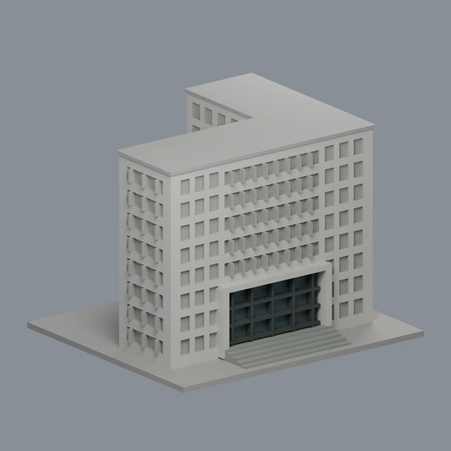
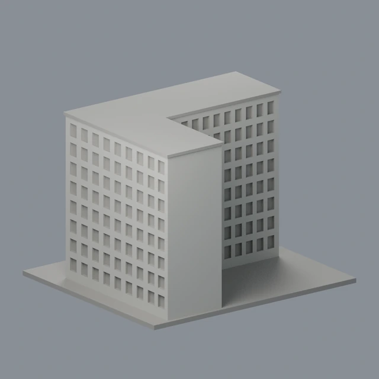
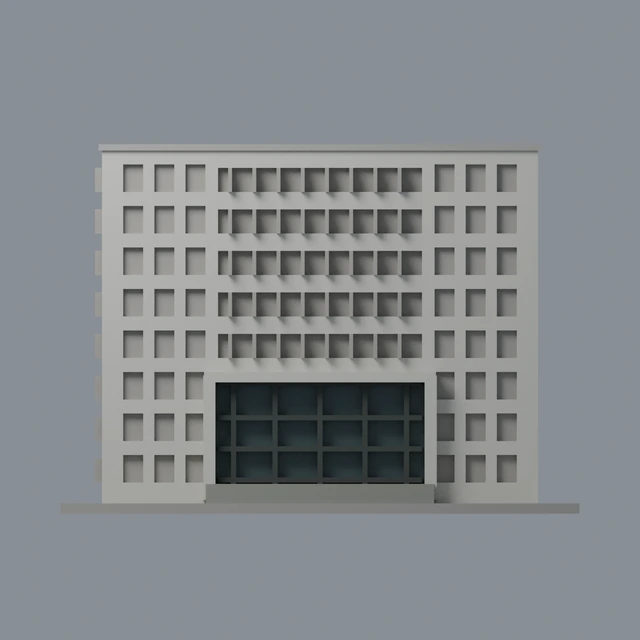
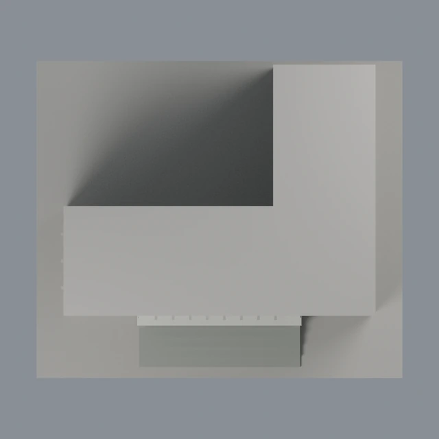

## 本次側背外牆補色（同構件推估）

本版將原 L 型量體 **1,310 個原中性外牆面** 延用既有正面結構象牙白：主翼左側 146 面、主翼後面 482 面、回翼內側 243 面、整體右外側 437 面、回翼末端 2 面。每個原三角的全部頂點均需落在對應精確垂直外牆平面與原量體邊界內，不選混合窗凹背、側框、屋頂或底座，不切面、不新增分界。

**這是同構件材質連續性推估，不是新增側背照片實證或 2026 全棟現況核實。** 既有長窗／窄窗凹背仍混合窗裙與玻璃而無材質分界，維持中性；門廊、入口玻璃與深灰格框、階梯及全部原彩面保留。原 6,344 面／3,170 頂點、座標與面序不變，其餘 5,034 面材質不變；未實體試印。

現版檢查見 `appearance/qa-continuous-walls/`，原 `appearance/qa/` 為歷史紀錄。下方舊版「側背牆中性」敘述只對本節列出的完整平面更新，其他幾何與來源限制保留。現行重建用 `python appearance/source/build_continuous_walls.py`；交換驗證用 `python appearance/source/verify_continuous_exchange.py`；四原視角與場景用 `blender -b --python appearance/source/render_continuous_walls.py`；回讀用 `blender -b --python appearance/source/verify_continuous_scene.py`。直接執行歷史分類器會回復舊配色，請使用本節命令。來源 ZIP 不含第三方照片。

# 國立清華大學｜第三綜合大樓

## 模型預覽


| 模型預覽 | 模型預覽 | 模型預覽 |
| :---: | :---: | :---: |
| [](display/front.webp)<br>正面 | [](display/rear.webp)<br>背面 | [](display/elevation.webp)<br>正立面 |
| [](display/top.webp)<br>頂視 | | |

## 5 材質外觀版與歷史來源


[來源界線與四視角](appearance/README.md) · [表面色 3MF](appearance/nthugeneral3-appearance.3mf) · [可編輯場景](appearance/scene.blend)

照片支持主正面白結構、大型入口深框玻璃及灰階梯；側背外牆只延續前述 1,310 面同構件配色，混合窗裙凹背、其餘未知區域與屋頂維持中性，不當整棟全彩還原。 原 STL 與歷史 QA 不變；這是外觀改善，不是新增幾何。原單色正面（歷史檔案留存，不作本頁預覽）／原單色背面（歷史檔案留存，不作本頁預覽）


第八批公開外觀近似模型，並非測繪成果。每件獨立比例，150.00 × 130.00 × 106.80mm，最長150mm含底座。全校尚未完成。

## 來源與觀察
[官方建築導覽](https://attractions.site.nthu.edu.tw/p/406-1515-187003,r8697.php?Lang=en)；2026-10-13檢視來源實際像素。

已看官方3張正門、湖側轉角與步道外觀。保留L形高樓回翼、正門跨多層的深玻璃凹口、上部中央五段水平凹窗、兩側密列直窗、厚白色直立框以及廣台階。湖側照片提供回翼與密窗格的外觀依據。

來源照片僅列連結，不放入成果、不重新發布：
- https://attractions.site.nthu.edu.tw/var/file/515/1515/pictures/949/m/mcen700x700_large38592_846787736194.jpg
- https://attractions.site.nthu.edu.tw/var/file/515/1515/pictures/949/m/mcen700x700_large38593_474440536194.jpg
- https://attractions.site.nthu.edu.tw/var/file/515/1515/pictures/949/m/mcen700x700_large38594_514170736194.jpg

## 近似與缺口
完整L形平面長寬比例、回翼方向與深度按照片近似，沒有實測平面。窗格適度減量及規律化；樹木遮擋的底層與無完整照片的回翼端面採素面；屋頂僅低實心平蓋，不添加設備。地形整平、台階縮短，水池、樹木、藝術品和坡道細欄杆省略。

僅公開訪客可見外觀，無室內、地下、敏感設備或安全配置。未下載、擷取或反編譯官方Unity或任何原始3D模型。官方3D場景沒有逐面檢視，不能視為未見部位已獲證實。

## 檔案
- `build_model.py`：可攜參數化來源。
- `model.stl` / `model.obj`：單一連通、封閉實體，單位mm；不預挖內腔。
- `scene.blend`：實際STL的可編輯三角網格與相機，不是BIM或保留布林歷史的場景。
- `previews/front.png`、`rear.png`、`elevation.png`：實際STL預覽，已看像素。正背為顯示方向，不是實測方位。
- `validation.json`：原檔法線、邊與頂點流形、正體積、單一表面、重建及Blend/STL一致等16項通過。
- `check_layers.py` / `layer-check.json`：0.2mm幾何截面與0.8mm XY薄特徵篩查。

## 列印起點與支撐
底座向下，保持150mm尺寸。可從0.4mm噴嘴、0.2mm層高、3道外牆、15–20%填充起始，但不是測試完成的參數。

入口大框玻璃凹口深約3.5mm、上部窗凹口約2.5mm，入口梁底/窗口上緣應在切片器檢視局部支撐。玻璃分格為有背襯的厚杆，名義1.1–1.5mm；樓體實心不製作室內。

薄特徵：534個0.2mm截面閉合，0.8mm XY薄篩零警戒，仍不能代替正式切片或三維最小壁厚測試。

## 驗證範圍
16項網格驗證通過；原始STL法線與繞向相符，所有邊連接兩面、頂點環流形、單一連通表面且沒有分離內腔殼，正體積、z=0底面與150mm最大尺寸通過。乾淨暫存目錄重建STL的SHA-256相符，Blender幾何與STL一致；驗證不自動修原檔。

0.2mm間距共534個抽樣高度，所有輪廓閉合。端點數值聚合容差0.0001mm；首層0.100013mm以避共面。0.8mm XY形態開運算標示0層超過0.2mm²警戒，最大差異面積0.00200mm²，含義見薄特徵說明。

**未正式切片、未生成G-code、未實體試印。** 抽樣幾何截面不等於刀路、擠出、支撐或橋接驗證，亦不能證明全面三維壁厚或自相交完全不存在。

## 重建
Python 3.12與Blender 4.3.2+；所有程式從本檔目錄讀寫，不依賴製作端絕對路徑。

```sh
python -m pip install -r requirements.txt
python build_model.py
blender -b -t 2 -P render_preview.py
python validate_model.py
python check_layers.py
```


## 實際STL正背並排

現行大圖用 [WebP 與原圖像素對照](display/archive-png.json) 校驗：在模型資料夾執行 `python display/verify_webp.py`（需 Pillow）。原彩色 PNG、原雜湊與舊說明均保留在[固定歷史版本](https://github.com/hplin50643/taiwan-buildings-3d/tree/832617c8fb635897c279113f45e1e614d36ebc8d/%E5%A4%A7%E5%B0%88%E6%A0%A1%E9%99%A2/%E5%9C%8B%E7%AB%8B%E6%B8%85%E8%8F%AF%E5%A4%A7%E5%AD%B8/%E6%A0%A1%E6%9C%AC%E9%83%A8/buildings/nthu-general-building-iii)。重繪請在暫存副本執行 `blender -b -t 3 --python-exit-code 1 -P appearance/source/render_continuous_walls.py`，再加 `--replay-root /path/to/copy` 校對，不必把中間 PNG 放回主分支。
