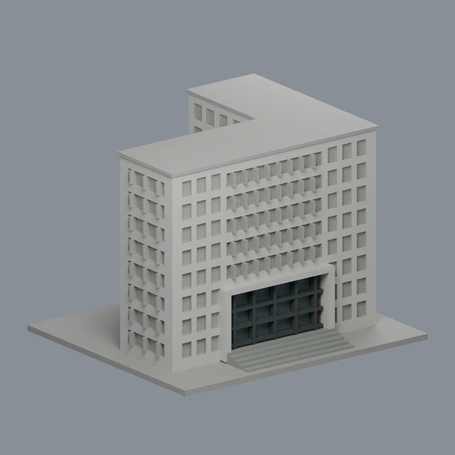
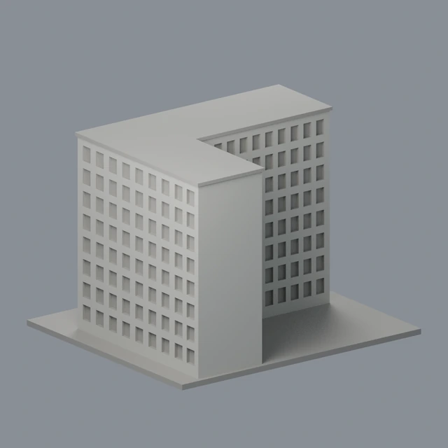
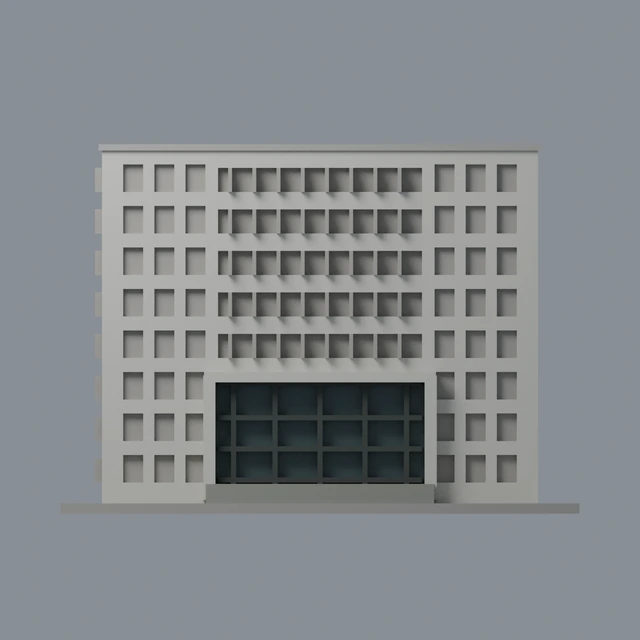
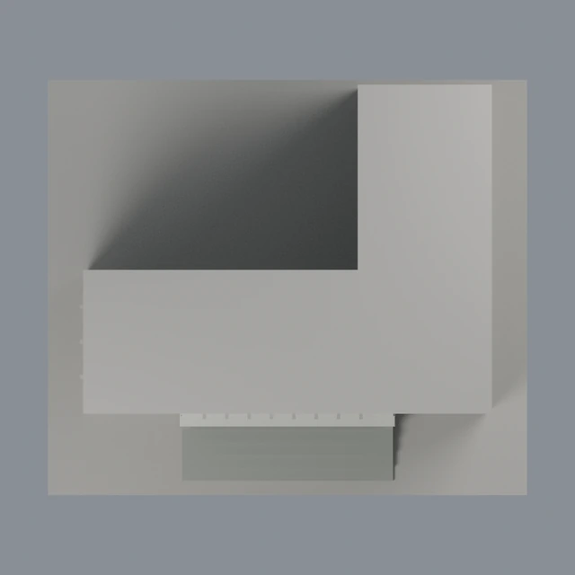

## 本次側背外牆補色（同構件推估）

本版將原 L 型量體 **1,310 個原中性外牆面** 延用既有正面結構象牙白：主翼左側 146 面、主翼後面 482 面、回翼內側 243 面、整體右外側 437 面、回翼末端 2 面。每個原三角的全部頂點均需落在對應精確垂直外牆平面與原量體邊界內，不選混合窗凹背、側框、屋頂或底座，不切面、不新增分界。

**這是同構件材質連續性推估，不是新增側背照片實證或 2026 全棟現況核實。** 既有長窗／窄窗凹背仍混合窗裙與玻璃而無材質分界，維持中性；門廊、入口玻璃與深灰格框、階梯及全部原彩面保留。原 6,344 面／3,170 頂點、座標與面序不變，其餘 5,034 面材質不變；未實體試印。

現版檢查見 `qa-continuous-walls/`，原 `qa/` 為歷史紀錄。下方舊版「側背牆中性」敘述只對本節列出的完整平面更新，其他幾何與來源限制保留。現行重建用 `python appearance/source/build_continuous_walls.py`；交換驗證用 `python appearance/source/verify_continuous_exchange.py`；四原視角與場景用 `blender -b --python appearance/source/render_continuous_walls.py`；回讀用 `blender -b --python appearance/source/verify_continuous_scene.py`。直接執行歷史分類器會回復舊配色，請使用本節命令。來源 ZIP 不含第三方照片。

# 清華第三綜合大樓：五材質外觀版（限域配色）

沿用原 **6,344 三角面／3,170 頂點**，不改原 STL 位元、座標、面序或幾何；這是既有模型外觀改版，不增加模型包數。

| 模型預覽 | 模型預覽 | 模型預覽 |
| :---: | :---: | :---: |
|  正面 |  背面 |  正立面 |
|  頂視 | | |

[表面色 3MF](nthugeneral3-appearance.3mf) · [可編輯 Blender](scene.blend) · [材質色表](palette.json) · [逐面指派與依據](face-materials.json) · [原 STL](../model.stl)

## 來源與配色邊界

原照片支持正門與主正面有限配色；現行另有前述同構件推估，不是整棟實景全彩還原。親看清華官方綜三三張完整外觀照片，核對原單色網格與生成器。[精確 URL、雜湊與日期欄](qa/source-review.json)。nested EXIF 原始日各為 2014-06-27、2011-04-25、2020-07-02，相機自報、時區與日期未獨立認證，不稱 2026 現況；修改欄分列，不以修改日替代原始日。照片只供研究，不入包。

- 主正面已註冊象牙白結構，門廊柱與橫楣同系統白色有限延伸；大型入口的原 76 面完整凹背對應玻璃，採不透明深灰藍代理，原門窗格深灰、短縮階梯灰石色。
- 上部五條長窗凹背及兩側窄窗實景內含實牆窗裙、窗框與玻璃，而原凹背未分界，全部中性，不能整片深玻璃。此差異不靠更換中性色來宣稱已還原。
- 湖畔 L 型視角有照片，但與原簡化回翼各面位置未充分獨立註冊，所以不把現行 1,310 面同構件外牆推估稱為照片實證；側背混合窗凹背不延伸染色；屋頂與底板亦中性。
- 不新增窗簾、空調、招牌橫幅、內部房間、橋廊或植栽。原粗框與樓層節奏均保留，不宣稱玻璃透明度、室內或整棟精確對應。

[原幾何與歷史來源限制](../README.md)

## 初版重建與核驗（歷史）

以下指令僅適用於初版，現行檔案使用頁首的補色版流程。

安裝 [依賴](source/requirements.txt)，Blender 使用 4.3.2。由本資料夾上層提供原 model.stl：

1. `python appearance/source/build_appearance.py`
2. `python appearance/source/verify_exchange.py`
3. `blender -b -t 3 --python-exit-code 1 -P appearance/source/render_appearance.py`
4. `blender -b -t 3 --python-exit-code 1 -P appearance/source/verify_scene.py`

[獨立重建 ZIP](rebuild-source.zip)含原 STL、四支程式及依賴，不含第三方照片；不取代原建模腳本。[現行外觀逐檔 SHA-256](SHA256SUMS)

[交換／拓撲 QA](qa/exchange-validation.json)核對原座標與面序、全部面材質、單連通、有向水密邊、頂點 link 單環、正體積與零退化／重複面；lib3mf 嚴格讀取零警告，實際編輯單材質再存讀，其他材質及面指派不變。SDK 六位小數量化誤差另列。

[Blender 存讀與編輯](qa/scene-validation.json) · [渲染記錄](qa/render-manifest.json) · [獨立重建](qa/rebuild-validation.json)

## 製造限制照舊

尺寸仍為 150 × 130 × 106.8 mm；原 STL、建模程式、場景及歷史 QA 保留。原層檢與薄特徵檢查本次未重跑，不能由材質 QA 代替。

3MF 是同一網格的表面色，不是各材質各自封閉的分色實體、切片專案、噴頭映射或 G-code。切片 GUI、多材料路徑與實體列印未測；柱頭、屋簷、窗框及薄邊仍須評估材料、支撐及拆除風險，沒有保證可印或免支撐。

現行大圖用 [WebP 與原圖像素對照](../display/archive-png.json) 校驗：在模型資料夾執行 `python display/verify_webp.py`（需 Pillow）。原彩色 PNG、原雜湊與舊說明均保留在[固定歷史版本](https://github.com/hplin50643/taiwan-buildings-3d/tree/832617c8fb635897c279113f45e1e614d36ebc8d/%E5%A4%A7%E5%B0%88%E6%A0%A1%E9%99%A2/%E5%9C%8B%E7%AB%8B%E6%B8%85%E8%8F%AF%E5%A4%A7%E5%AD%B8/%E6%A0%A1%E6%9C%AC%E9%83%A8/buildings/nthu-general-building-iii)。重繪請在暫存副本執行 `blender -b -t 3 --python-exit-code 1 -P appearance/source/render_continuous_walls.py`，再加 `--replay-root /path/to/copy` 校對，不必把中間 PNG 放回主分支。
