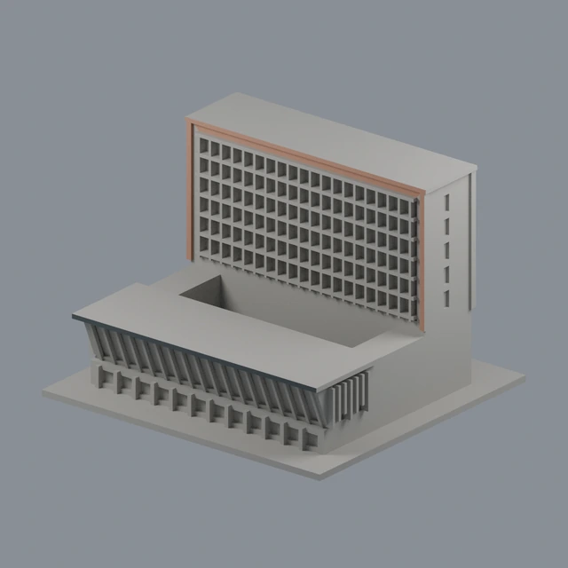
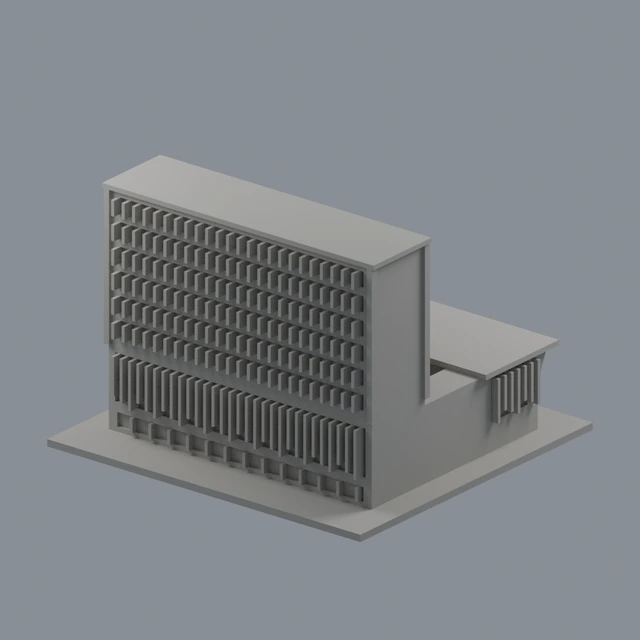
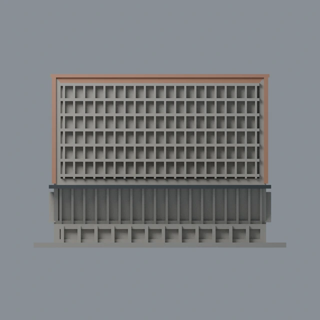
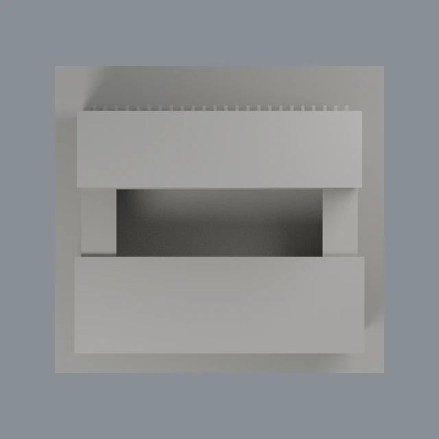
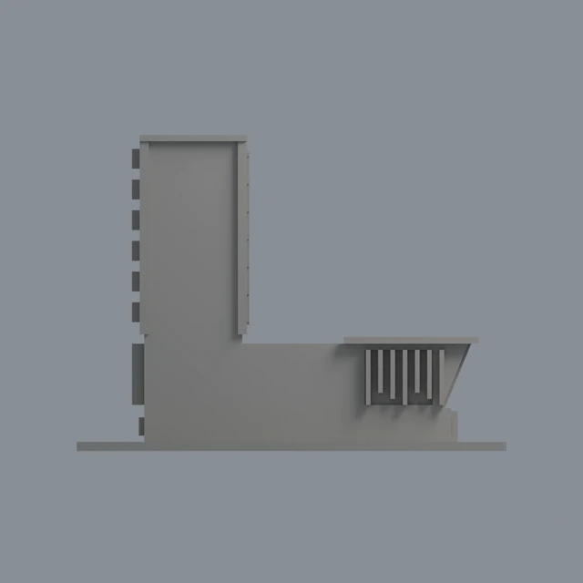

## 本次高棟磚框淺內返補色

本版僅新增4個原中性完整三角：上部左右磚框的淺內返 x=±61.75、y=14.5..16、z=38..101，延用既有磚色 `#B7866D`。重新親看九典官方湖側完整照片，磚框內返屬同一可見磚系統；原模型1.5mm淺深及框比例仍為近似，同構件延伸不代表精密照片註冊或2026現況。拍攝日期仍未知，照片只作私人研究、不收入包。

原8,666面／4,293頂點、座標與面序保持；其餘8,662面材質不變，含原14個前向彩面與後續2個淺簷底磚面。新建置以build_current.py為基底保留這16面，不退回歷史14面。僅淺內返，不延深幕牆、玻璃、彩色葉片、屋頂、低翼或未知側後。未切三角、未加分界，未實體試印。

本版稽核 `qa-continuous-walls/`；舊qa與下方範圍為歷史紀錄，現版20彩面（磚18、低翼灰2）。由模型根目錄執行現行重建 `python appearance/source/build_continuous_walls.py`；交換 `python appearance/source/verify_continuous_exchange.py`；五原視角／場景 `blender -b --python appearance/source/render_continuous_walls.py`；回讀 `blender -b --python appearance/source/verify_continuous_scene.py`。舊build_appearance.py與build_current.py均不是本版重建入口；保留作歷史基底。ZIP無第三方照片。

[原模型與歷史說明](../README.md)

## 原版歷史說明（下方統計為前版；本次只新增四個磚框淺內返面）

# 清華大學創新育成中心 — 限域外觀配色

本層是既有近似模型的附加材質，不是新建築套數、全棟材質復原或現況實測。原 STL、8666 三角與面序完全不變。依九典官方完工作品照片，只選可完整分離的湖側高棟磚框正向面 12 面（973.47537 mm²）與低翼深灰簷板前臉 2 面（290.40009 mm²），合計 1263.87546 mm²。

**磚框配色刻意不完整**：內退角面、內側窄框與其他未確證範圍維持中性，不能把這份配色視為完整磚牆位置圖。玻璃、彩色葉片、草頂、水平簷頂／底、側背及下層未知面全部中性。未補磚紋、細金屬收邊或玻璃透明材質；鄰清華實驗室、台積館及跨棟空橋均不屬本模型。

色票 #B7866D 與 #424A4D 是未經儀器測色的視覺代理，不是施工規範。來源照片拍攝日未知；作品 2011–2016、URL 2024/11 與 XMP toolkit 2012/02/06 皆不是拍攝日期。

既有兩翼深度、低層邊界、梯形斜玻璃、平蓋屋頂與減量加粗遮陽葉片皆為歷史近似；本批不修幾何。未做實體列印或重算歷史製造 QA。

## 檔案與重建
- [彩色 3MF](nthu-innovation-incubation-appearance.3mf)：原三角完整面材質，可編輯。
- [Blender 原生場景](scene.blend)、[色票](palette.json)、[面對照](face-materials.json)。
下方縮圖可點開全尺寸 WebP。
- [來源](SOURCES.md)、[許可說明](LICENSE-NOTICE.md)。

| 模型預覽 | 模型預覽 | 模型預覽 |
| :---: | :---: | :---: |
|  正面 |  背面，未確認的外牆與屋頂維持中性 |  正立面 |
|  頂視 |  側面 | |

**歷史重建流程（非現行配色）**：將原 model.stl 與 appearance 資料夾置於同一父層；Python（numpy、lib3mf）執行 source/build_appearance.py、source/verify_exchange.py、source/verify_material_boundaries.py；Blender 4.3.2 執行 source/render_appearance.py 與 source/verify_scene.py。獨立乾淨重建需驗 3MF、maps、五張 PNG bytes 相同；Blend 驗語義而不宣稱二進位確定性。

## 歷史版本：2026-11-14 淺前簷底有限補色

僅原面8253與8259，由中性改既有磚族1（#B7866D、粗糙度0.78）。完整前側淺簷底z101、x±61.75、y14.5–16，面積185.25mm²；兩側耳部維持各自未修改面域。原8666三角面、座標、順序與幾何不變。現版仍3個顯示材質，指派數8650／14／2；上方舊14個已配色面等敘述及舊QA屬歷史版，本版為16面。

來源為[建築師完成案](https://www.bioarch.com.tw/work/清華大學創新育成中心/)及其完整外觀照片；拍攝日期未知，專案年代、網址日期與軟體metadata不等於拍攝日。既有未校準磚族僅有限近似，原深度與端點為粗代理，不認證磚種或精測色。不延頂面、側後簷、深幕牆、玻璃或低翼；保留原工程、製造、未試印與未知立面限制。照片不隨包散布。

本版由當前公開模型重新建置，不是尋回或恢復已遺失的舊草稿。模型與五個原生視角圖沿用此次完成候選的原bytes，相機與48samples不變。完整研究與獨審留在本地，不新增公開廣泛審核清單。PUBLIC-MODEL-SHA256SUMS僅核所列當前產品，舊checksum與QA不代表新版。

### 2026-11-14 歷史重建

ZIP含原STL、既有build_appearance.py與render_appearance.py、三支明確的現版包裝/驗證程式及本說明。使用NumPy與Blender4.3.2，在解包根目錄執行：

1. `python -B appearance/source/build_current.py`
2. `python -B appearance/source/verify_current.py`
3. `blender -b -t 4 --python-exit-code 1 --python appearance/source/render_current.py`

以上是 16 面歷史版的重建命令；20 面現行版請用本文開頭的 build_continuous_walls.py；直接執行舊builder會重建歷史配色。新程式只使用本地模型，寫出當前材質、3MF、五張僅供暫存校驗的 PNG 及 Blender 場景與本地核驗報告；渲染包裝程式會暫存並還原既有歷史render-manifest，若原不存在則移除該次暫產的歷史檔名報告。不進行網路或憑證操作。

現行大圖用 [WebP 與原圖像素對照](../display/archive-png.json) 校驗：在模型資料夾執行 `python display/verify_webp.py`（需 Pillow）。原彩色 PNG、原雜湊與舊說明均保留在[固定歷史版本](https://github.com/hplin50643/taiwan-buildings-3d/tree/336ce1843e6e4435f93ed1a5df7cc26434fb9596/%E5%A4%A7%E5%B0%88%E6%A0%A1%E9%99%A2/%E5%9C%8B%E7%AB%8B%E6%B8%85%E8%8F%AF%E5%A4%A7%E5%AD%B8/%E6%A0%A1%E6%9C%AC%E9%83%A8/buildings/nthu-innovation-incubation)。重繪請在暫存副本執行 `blender -b -t 3 --python-exit-code 1 -P appearance/source/render_continuous_walls.py`，再加 `--replay-root /path/to/copy` 校對，不必把中間 PNG 放回主分支。
