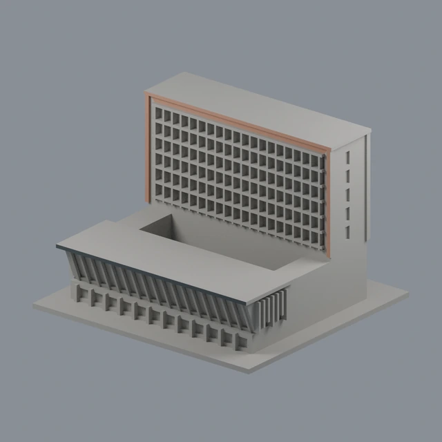
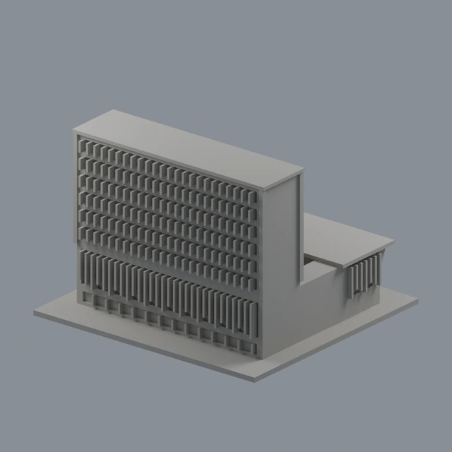
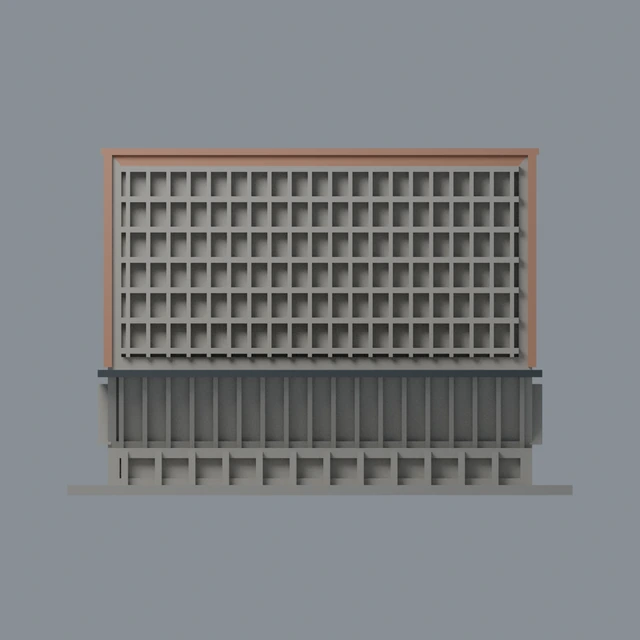
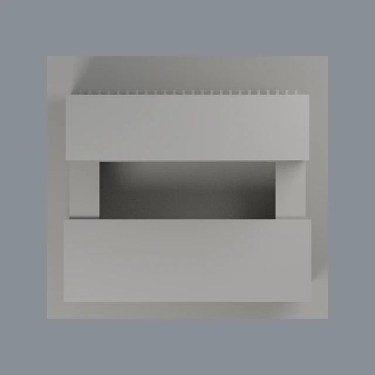
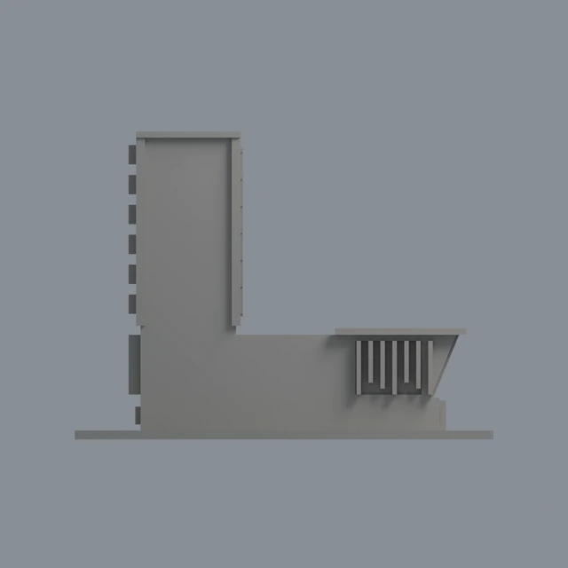

# 清華大學創新育成中心｜磚框與簷面限域配色・現行彩色展示

## 模型預覽

| 模型預覽 | 模型預覽 | 模型預覽 |
| :---: | :---: | :---: |
|  正面 |  背面，未確認的外牆與屋頂維持中性 |  正立面 |
|  頂視 |  側面 | |

五張全尺寸無失真 WebP 由現行三材質 Blender 場景核對重繪，點擊縮圖可放大。保留既有 18 面磚框與 2 面低翼簷前臉材色，包括既有四個磚框淺內返三角。不把未核對的側背、屋頂或玻璃染色。此為限域外觀材色，非整棟上色或現況實測。幾何與配色未變更。

[現行彩色 Blender](../appearance/scene.blend) · [彩色 3MF](../appearance/nthu-innovation-incubation-appearance.3mf) · [STL](../model.stl) · [OBJ](../model.obj) · [渲染驗證](render-proof.json) · [本頁校驗](SHA256SUMS)

[當前模型校驗](../PUBLIC-MODEL-SHA256SUMS) · [原模型與限制](../README.md) · [原外觀來源與證據](../appearance/README.md)。歷史 hash-manifest 的 README 校驗屬前版，現行工程校驗另列；驗證紀錄明列既有差異。現行 README 與展示清冊已更新；模型與歷史 QA 未改。未實體試印。

現行大圖用 [WebP 與原圖像素對照](archive-png.json) 校驗：在模型資料夾執行 `python display/verify_webp.py`（需 Pillow）。原彩色 PNG、原雜湊與舊說明均保留在[固定歷史版本](https://github.com/hplin50643/taiwan-buildings-3d/tree/336ce1843e6e4435f93ed1a5df7cc26434fb9596/%E5%A4%A7%E5%B0%88%E6%A0%A1%E9%99%A2/%E5%9C%8B%E7%AB%8B%E6%B8%85%E8%8F%AF%E5%A4%A7%E5%AD%B8/%E6%A0%A1%E6%9C%AC%E9%83%A8/buildings/nthu-innovation-incubation)。重繪請在暫存副本執行 `blender -b -t 3 --python-exit-code 1 -P appearance/source/render_continuous_walls.py`，再加 `--replay-root /path/to/copy` 校對，不必把中間 PNG 放回主分支。
