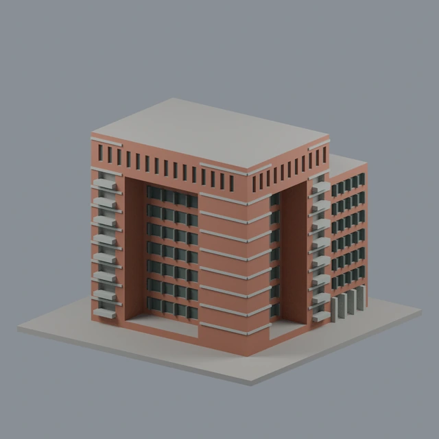
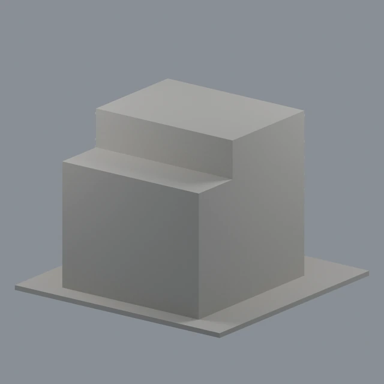
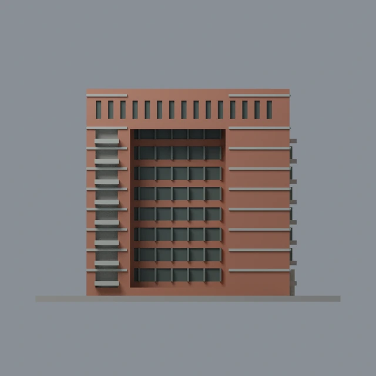
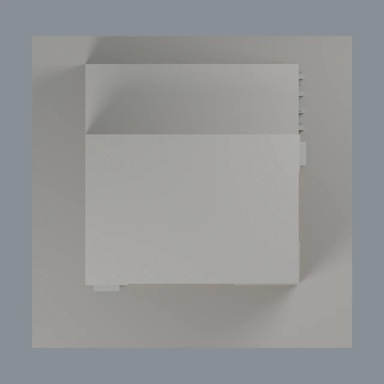

## 本次窄窗垂直窗頰補色

本版新增 **104 個原中性完整面**：正面上部 15 扇窄窗與右面上部 11 扇窄窗，各兩側垂直窗頰沿用既有赭紅磚色 `#AD725C`。重新親看原清華跨領域研究辦公室空拍，磚柱側返可見；模型窗深與比例仍為粗代理，細部屬同構件延伸推估，非精密照片註冊或 2026 現況。原照不收入公開包。

只選 z=90..99 的完整垂直窗頰；窗台、窗頭、玻璃凹背、所有既有彩面不變。背面／左側大牆可能有水平淺帶但原幾何無界線，故本次不整牆染磚；混材陽台凹背、屋頂和底座保持原狀。原 5,334 面／2,549 頂點、座標與面序完整保留，其餘 5,230 面材質不變，不新增分界、不改幾何。未實體試印。

本版稽核在 `appearance/qa-continuous-walls/`，原 `qa/` 與下方說明為歷史紀錄；新範圍以上述 104 面為準。重建使用 `python appearance/source/build_continuous_walls.py`，交換驗證 `python appearance/source/verify_continuous_exchange.py`，四原視角／場景使用 `blender -b --python appearance/source/render_continuous_walls.py`，場景回讀使用 `blender -b --python appearance/source/verify_continuous_scene.py`。歷史 build_appearance.py 不能替代新命令。ZIP 無第三方照片。

# 國立清華大學｜台積館

## 模型預覽


| 模型預覽 | 模型預覽 | 模型預覽 |
| :---: | :---: | :---: |
| [](display/front.webp)<br>正面 | [](display/rear.webp)<br>背面 | [](display/elevation.webp)<br>正立面 |
| [](display/top.webp)<br>頂視 | | |

## 6 材質外觀版與歷史來源


[來源界線與四視角](appearance/README.md) · [表面色 3MF](appearance/nthutsmc-appearance.3mf) · [可編輯場景](appearance/scene.blend)

依官方地面與空拍來源限定前右赭紅磚牆、灰飾帶陽台、奶油廊頂與離散窗；未知屋頂左後側中性，不新增藝術線管。 原 STL 與歷史 QA 不變；這是外觀改善，不是新增幾何。原單色正面（歷史檔案留存，不作本頁預覽）／原單色背面（歷史檔案留存，不作本頁預覽）


第二批外觀近似建築模型，並非測繪模型。獨立比例、最長150mm含底座；全校尚未完成。

## 交付與尺寸
150.00 × 146.00 × 104.80 mm，原始STL單位為毫米。

- `model.stl`：單一封閉列印實體，沒有預挖內腔。
- `scene.blend`：由實際STL匯入的可編輯三角網格與預覽相機，不是BIM或布林歷史。
- `model.obj`：輔助交換網格。
- `build_model.py`：參數化原始碼，可獨立重建。
- `previews/front.png`、`rear.png`、`elevation.png`：實際STL的正／背／立面渲染，已逐張看像素。正背是顯示方向，不是測量方位。
- `validation.json`：原始法線、流形與乾淨重建等18項驗證。
- `check_layers.py`、`layer-check.json`：0.2mm幾何截面與薄特徵篩查。

## 來源
查閱與像素檢視：2026-10-13。[校方來源頁](https://mba.site.nthu.edu.tw/p/404-1370-160569.php?Lang=zh-tw)。

實際檢視MBA官方外觀及跨領域研究辦公室全景空拍：兩面通高深凹廊、粗角柱、頂部連續窄窗梁、兩側陽台槽、後方較矮的長窗翼清楚可見。模型以立體深凹廊和退縮窗面建立識別。

照片只列URL，未包含在交付或重新發布：
- https://mba.site.nthu.edu.tw/var/file/370/1370/img/540/11.jpg
- https://oir.site.nthu.edu.tw/var/file/487/1487/img/DJI_0367.jpg

## 近似範圍
建物尺寸、深凹廊深度及後翼比例依照片估計，沒有室內格局。背立面未見，採素面。懸掛金屬公共藝術、細欄杆、字牌及屋頂設備省略，不以無證據設備位置冒充完整模型。水平飾帶增厚為1.2mm，陽台欄板實體化。

僅研究公開訪客可見外觀；沒有室內、地下、安全／進出控制或隱藏系統配置。未擷取官方Unity或其他3D資產；沒有聲稱逐面檢視官方3D場景。

## 列印與支撐
正立、底座朝下。可從0.4mm噴嘴、0.2mm層高、3道外牆、15–20%填充起始評估，但未驗證此設定。

通高深凹廊約16mm深，頂梁下方和連續陽台板強烈建議在切片器啟用局部支撐並檢查橋接；不可宣稱免支撐。

薄特徵人工對照：0.8mm XY開運算未超過0.2mm²警戒面積。已把跨陽台槽的0.7mm細條增厚至1.2mm；窗格0.9mm、上部窄窗間實牆約3.4mm。仍不能以截面篩查代替全面三維壁厚或實體測試。

## 驗證結果與限制
18項原始STL幾何檢查全過：單位法線且與繞向一致、無退化三角面、封閉邊、頂點連結單環、單一連通表面／無分離內腔殼、正體積、z=0平底、150mm最大邊、乾淨目錄重建STL雜湊一致、Blender／STL三角幾何一致。檢查不會修復原STL。

以0.2mm間距抽樣524個高度（首層0.100013mm，微偏移避免與三角面共面），所有截面輪廓閉合。交點採0.0001mm數值容差聚合，不修改STL。0.8mm XY形態開運算篩查標記0層，最大差異面積0.00000mm²；標記解釋如上。

**這不是正式切片，不產生G-code，沒有驗證刀路、擠出或支撐生成；沒有實體試印。** 抽樣截面不涵蓋每個高度，也不能代替全面三維最小壁厚或自相交證明。

## 乾淨重建
Python 3.12、Blender 4.3.2+；檔案只用自身目錄，不依賴製作機器絕對路徑。

```sh
python -m pip install -r requirements.txt
python build_model.py
blender -b -t 2 -P render_preview.py
python validate_model.py
python check_layers.py
```


## 實際STL正背並排

現行大圖用 [WebP 與原圖像素對照](display/archive-png.json) 校驗：在模型資料夾執行 `python display/verify_webp.py`（需 Pillow）。原彩色 PNG、原雜湊與舊說明均保留在[固定歷史版本](https://github.com/hplin50643/taiwan-buildings-3d/tree/923e375ab10242fee0ecc59d2415382bd72f754f/%E5%A4%A7%E5%B0%88%E6%A0%A1%E9%99%A2/%E5%9C%8B%E7%AB%8B%E6%B8%85%E8%8F%AF%E5%A4%A7%E5%AD%B8/%E6%A0%A1%E6%9C%AC%E9%83%A8/buildings/nthu-tsmc-building)。重繪請在暫存副本執行 `blender -b -t 3 --python-exit-code 1 -P appearance/source/render_continuous_walls.py`，再加 `--replay-root /path/to/copy` 校對，不必把中間 PNG 放回主分支。
