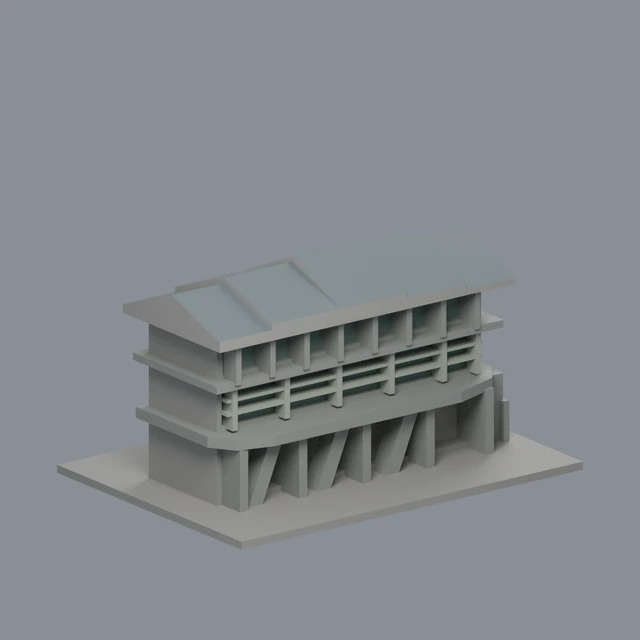
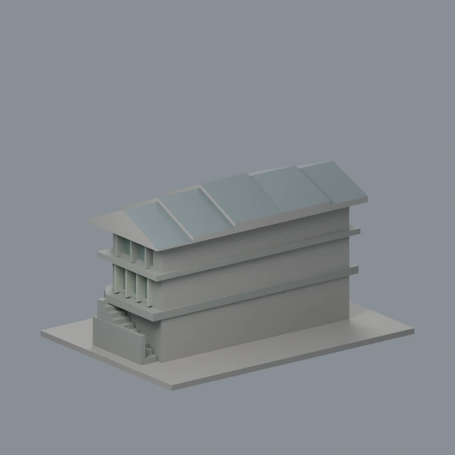
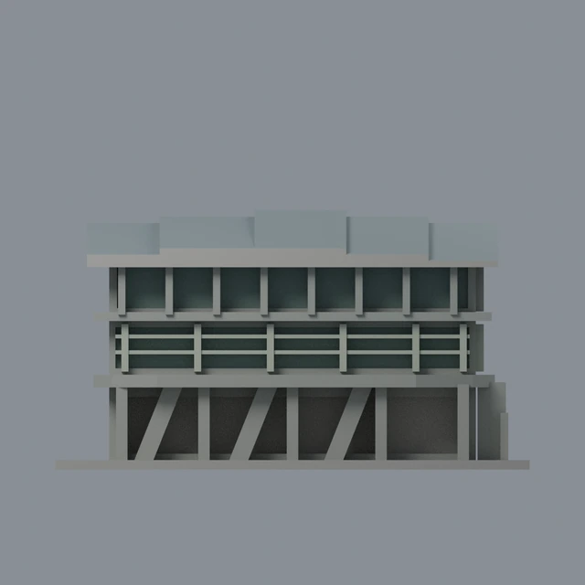
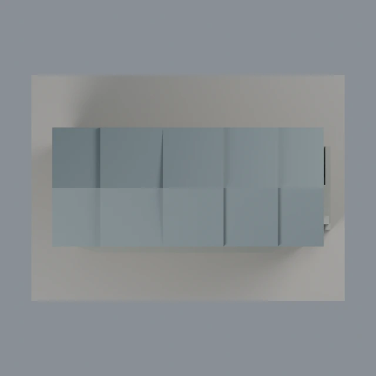

# 清華王默人周安儀文學館：五材質外觀版

沿用原 **1,674 三角面／789 頂點**，不改原 STL 位元、座標、面序或幾何；這是既有模型外觀改版，不增加模型包數。

| 模型預覽 | 模型預覽 | 模型預覽 |
| :---: | :---: | :---: |
|  正面 |  背面，板帶與斜屋面有限延伸，未知後牆維持中性 |  正立面 |
|  頂視 | | |

[表面色 3MF](nthuwang-appearance.3mf) · [可編輯 Blender](scene.blend) · [材質色表](palette.json) · [逐面指派與依據](face-materials.json) · [原 STL](../model.stl)

## 來源與配色邊界

親看清華公開的長立面、下坡端及湖畔遠照，對應原模型與生成器。[逐照 URL、雜湊與完整解碼](qa/source-review.json)；[校方介紹](https://www.nthu.edu.tw/future/content_m3)。本次所用皆為白天照片，**不沿用原歷史 sources.json 把端景誤稱夜景的文字**；保留該歷史檔而在此限定更正。前兩張無 EXIF 原始拍攝欄；湖畔照 EXIF 原始時間記 2024-06-24 18:23:04，僅相機自報且時區未核定。檔案修改日或完工年不是拍攝日，不稱 2026 現況。照片只供私有研究，不入包。

- 原前柱、斜扶壁、深遮陽肋及連續陽台／樓板帶暖灰混凝土代理；連續板帶側背同材有界延伸，不宣稱所有背牆有來源。
- 中上部已有離散窗背灰綠，原窗格淡橄欖銀灰；上部深肋是灰構件不是玻璃。下層大凹背同時包含通道與實牆，整片保持中性，不塗全玻璃。
- 原五段簡化斜屋頂的上向坡面灰石板色，端景支持兩坡同系統有界延伸；不是新增金屬瓦紋、假 PV 或精確測量屋形。厚化下緣／山牆填面保守中性。
- 原地形已整平，樓梯與坡度簡化保持；未知後牆、遮蔽部分中性，沒有增門字、植栽、欄杆或內部房間。

[原幾何與歷史來源限制](../README.md)

## 重建與核驗

安裝 [依賴](source/requirements.txt)，Blender 使用 4.3.2。由本資料夾上層提供原 model.stl：

1. `python appearance/source/build_appearance.py`
2. `python appearance/source/verify_exchange.py`
3. `blender -b -t 3 --python-exit-code 1 -P appearance/source/render_appearance.py`
4. `blender -b -t 3 --python-exit-code 1 -P appearance/source/verify_scene.py`

[獨立重建 ZIP](rebuild-source.zip)含原 STL、四支程式及依賴，不含第三方照片；不取代原建模腳本。[現行外觀逐檔 SHA-256](SHA256SUMS)

[交換／拓撲 QA](qa/exchange-validation.json)核對原座標與面序、全部面材質、單連通、有向水密邊、頂點 link 單環、正體積與零退化／重複面；lib3mf 嚴格讀取零警告，實際編輯單材質再存讀，其他材質及面指派不變。SDK 六位小數量化誤差另列。

[Blender 存讀與編輯](qa/scene-validation.json) · [渲染記錄](qa/render-manifest.json) · [獨立重建](qa/rebuild-validation.json)

## 製造限制照舊

尺寸仍為 150 × 108 × 82 mm；原 STL、建模程式、場景及歷史 QA 保留。原層檢與薄特徵檢查本次未重跑，不能由材質 QA 代替。

3MF 是同一網格的表面色，不是各材質各自封閉的分色實體、切片專案、噴頭映射或 G-code。切片 GUI、多材料路徑與實體列印未測；柱頭、屋簷、窗框及薄邊仍須評估材料、支撐及拆除風險，沒有保證可印或免支撐。

現行大圖用 [WebP 與原圖像素對照](../display/archive-png.json) 校驗：在模型資料夾執行 `python display/verify_webp.py`（需 Pillow）。原彩色 PNG、原雜湊與舊說明均保留在[固定歷史版本](https://github.com/hplin50643/taiwan-buildings-3d/tree/9255d846ccecc0dc55f8820bdfb781a0a0e0cafa/%E5%A4%A7%E5%B0%88%E6%A0%A1%E9%99%A2/%E5%9C%8B%E7%AB%8B%E6%B8%85%E8%8F%AF%E5%A4%A7%E5%AD%B8/%E6%A0%A1%E6%9C%AC%E9%83%A8/buildings/nthu-wang-chou-literature)。重繪請在暫存副本執行 `blender -b -t 3 --python-exit-code 1 -P appearance/source/render_appearance.py`，再加 `--replay-root /path/to/copy` 校對，不必把中間 PNG 放回主分支。
