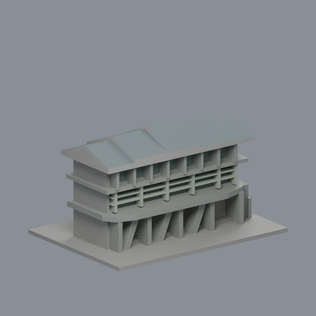
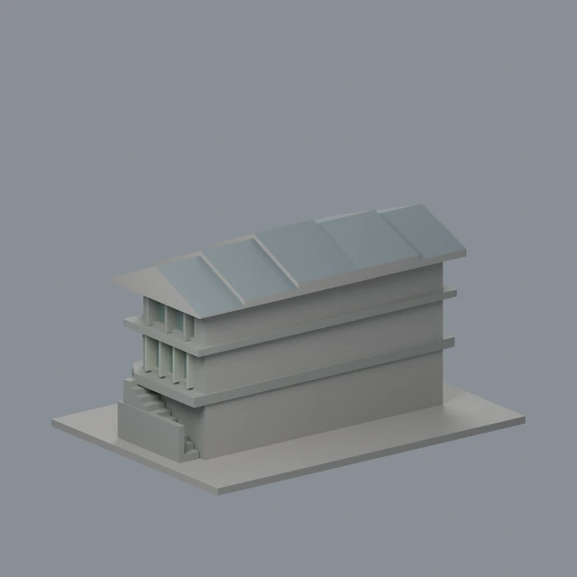
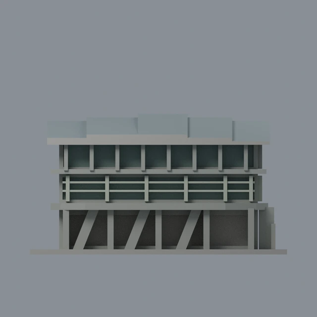
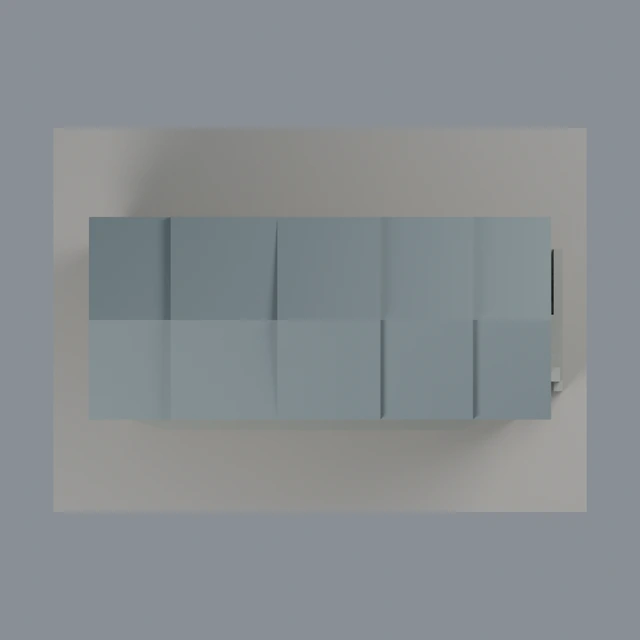

# 清華大學王默人周安儀文學館｜現行彩色展示

## 模型預覽

| 模型預覽 | 模型預覽 | 模型預覽 |
| :---: | :---: | :---: |
|  正面 |  背面，板帶與斜屋面有限延伸，未知後牆維持中性 |  正立面 |
|  頂視 | | |

四張全尺寸無失真 WebP 由現行彩色 Blender 場景核對重繪，點擊縮圖可放大。保留已有外觀材色，包括來源支持的暖灰混凝土、灰綠窗背、斜屋面與有界板帶延伸。大凹背、山牆填面及未知後牆保持中性；中性面不代表實景材色。這次不擴大補色。幾何與配色未變更。

[現行彩色 Blender](../appearance/scene.blend) · [彩色 3MF](../appearance/nthuwang-appearance.3mf) · [STL](../model.stl) · [OBJ](../model.obj) · [渲染驗證](render-proof.json) · [本頁校驗](SHA256SUMS)

[原模型與限制](../README.md) · [原外觀來源與證據](../appearance/README.md)。歷史圖、原 README 與工程資料均未改動。未實體試印。

現行大圖用 [WebP 與原圖像素對照](archive-png.json) 校驗：在模型資料夾執行 `python display/verify_webp.py`（需 Pillow）。原彩色 PNG、原雜湊與舊說明均保留在[固定歷史版本](https://github.com/hplin50643/taiwan-buildings-3d/tree/9255d846ccecc0dc55f8820bdfb781a0a0e0cafa/%E5%A4%A7%E5%B0%88%E6%A0%A1%E9%99%A2/%E5%9C%8B%E7%AB%8B%E6%B8%85%E8%8F%AF%E5%A4%A7%E5%AD%B8/%E6%A0%A1%E6%9C%AC%E9%83%A8/buildings/nthu-wang-chou-literature)。重繪請在暫存副本執行 `blender -b -t 3 --python-exit-code 1 -P appearance/source/render_appearance.py`，再加 `--replay-root /path/to/copy` 校對，不必把中間 PNG 放回主分支。
