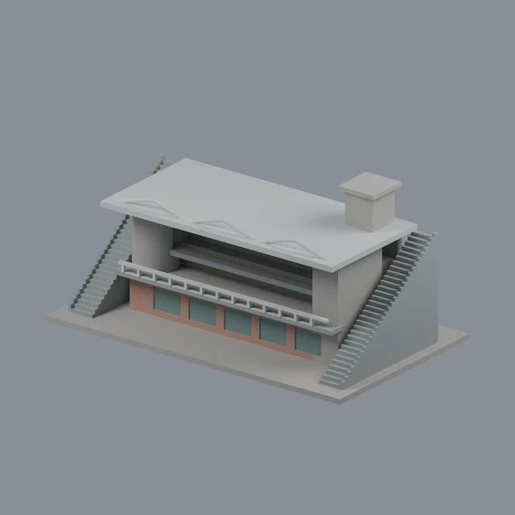
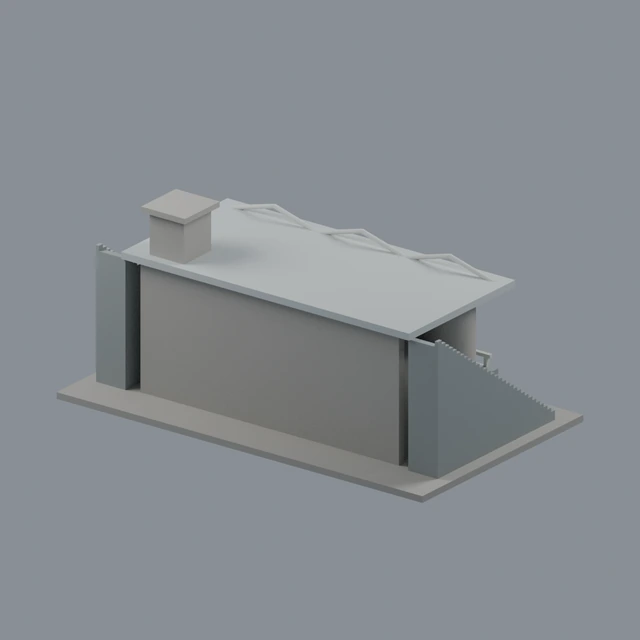
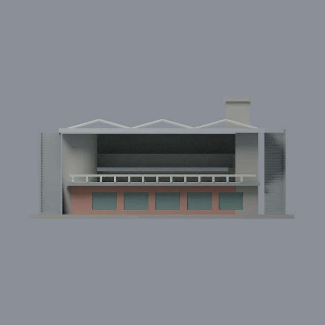
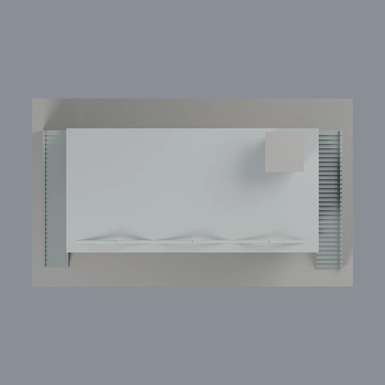

# 國立聯合大學 八甲田徑運動場司令台

## 模型預覽

|  |  |  |
| :---: | :---: | :---: |
| 正面與來源支持區域 | 背面，背牆中性、棚背為同材料推估 | 正立面 |
|  |  |  |
| 頂視 |  |  |

## 現行外觀版（六種顯示材質）

[來源界線與四視角](appearance/README.md) · [表面色 3MF](appearance/nuustand-appearance.3mf) · [可編輯場景](appearance/scene.blend)

依官方完整兩照限定下層桃紅磚牆、窗凹背、銀灰棚與灰混凝土階梯；原模型無紅椅與玻璃欄面，故不染台階假裝椅子，未分色帶的圓／方核心保守中性。 原 STL 與歷史 QA 不變；這是外觀改善，不是新增幾何。原單色正面（歷史檔案留存，不作本頁預覽）／原單色背面（歷史檔案留存，不作本頁預覽）

依官方外觀照片製作的近似列印模型。最長邊獨立設定150 mm，並非全校統一縮尺或實測模型。正面朝-Y。只建外觀，不建內部配置。

## 外形與來源
兩側長直外梯、左圓柱形端核、低層房舍、露天看台層級、懸挑頂棚、三組淺三角上弦與右後塔。

官方相簿：https://secretary.nuu.edu.tw/p/132-1003-1093.php?Lang=zh-tw

完整照片標題與原圖來源見evidence.json。照片只用於研究，未收入交付檔。預覽直接渲染實際STL；顏色為材質，STL無顏色。

## 證據限制
以田徑場相簿正面與斜俯視為據，後立面及座席細節未完整見到；後方實牆簡化。只含司令台建物，不含跑道及運動場。
所有長寬高、深度與樓層比例均為照片估計，未見部分不視為可靠復原；相簿發布／拍攝年代不等於2026現況。

## 列印
屋頂跨度約100 mm必須支撐；側梯實心底部便於列印。欄杆1.2 mm、斜撐1.6 mm、頂棚2.5 mm。
建議0.4 mm噴嘴、0.16–0.20 mm層高、底座平放、先在切片器檢查支撐與橋接。布林合併為單一封閉連通實體，保留外露孔洞／廊道。不含封閉內腔殼。未做實際列印或切片驗證。

## 內容與重建
- build_model.py：原創參數化外觀來源，Python 3.11+
- model.stl：毫米單位可列印網格
- scene.blend：與STL一致的可編輯網格場景（另含攝影棚地面）
- previews/front.png、rear.png：實際STL全幅前後視圖
- validate_model.py、validation.json：原始法線、邊、頂點連結、連通與尺寸檢查
- rebuild-check.json、blender-stl-agreement.json、SHA256SUMS：重建與交付核對

安裝requirements.txt後執行python build_model.py；再執行python validate_model.py model.stl --longest-edge 150 --output validation.json。Blender 4.3.2執行blender -b -t 2 -P render_preview.py可重建預覽與場景。

## 實際模型尺寸
150.0 × 88.0 × 68.8 mm（X × Y × Z，含底座）。

現行大圖用 [WebP 與原圖像素對照](display/archive-png.json) 校驗：在模型資料夾執行 `python display/verify_webp.py`（需 Pillow）。原彩色 PNG、原雜湊與舊說明均保留在[固定歷史版本](https://github.com/hplin50643/taiwan-buildings-3d/tree/336ce1843e6e4435f93ed1a5df7cc26434fb9596/%E5%A4%A7%E5%B0%88%E6%A0%A1%E9%99%A2/%E5%9C%8B%E7%AB%8B%E8%81%AF%E5%90%88%E5%A4%A7%E5%AD%B8/buildings/bajia-athletics-grandstand)。重繪請在暫存副本執行 `blender -b -t 3 --python-exit-code 1 -P appearance/source/render_appearance.py`，再加 `--replay-root /path/to/copy` 校對，不必把中間 PNG 放回主分支。
