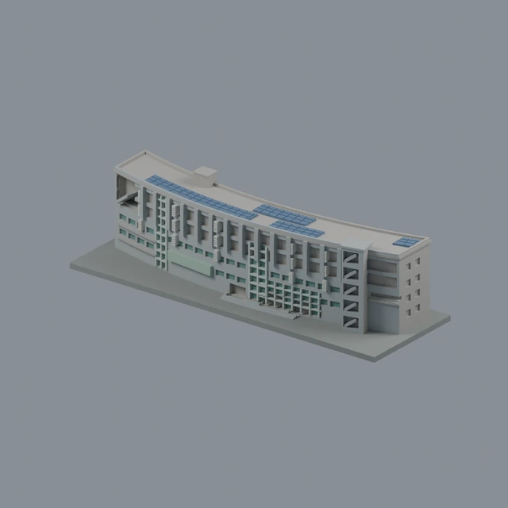
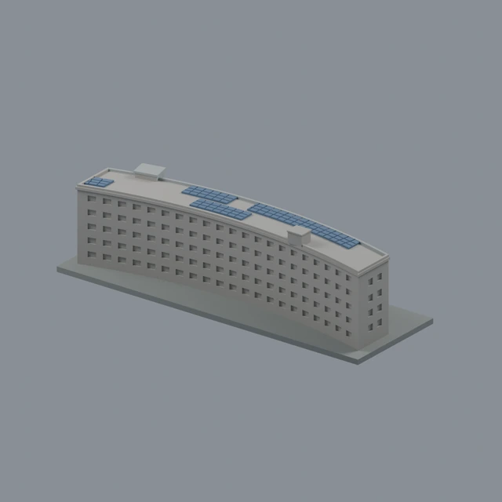
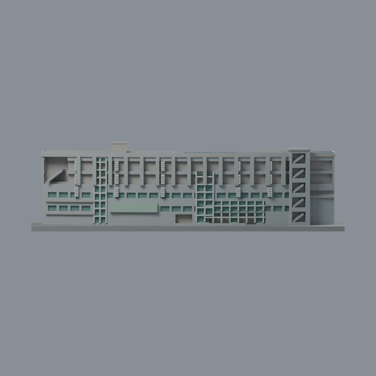
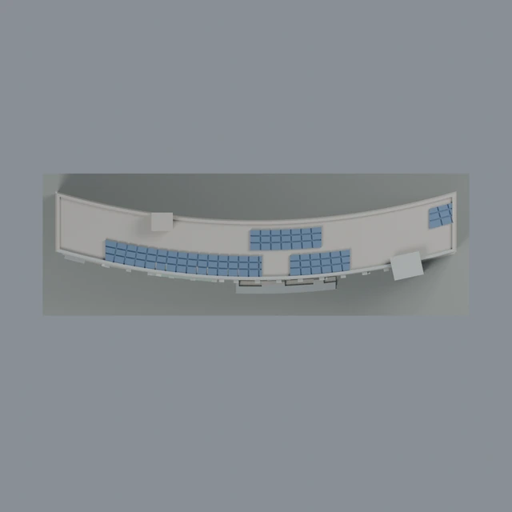

# 國立聯合大學八甲校區 B2 電子工程館｜3D 列印模型

## 模型預覽


| 模型預覽 | 模型預覽 | 模型預覽 |
| :---: | :---: | :---: |
| [](display/front.webp)<br>正面 | [](display/rear.webp)<br>背面，未確認的外牆與屋頂維持中性 | [](display/elevation.webp)<br>正立面 |
| [](display/top.webp)<br>頂視 |  |  |

## 八材質外觀版（2026-10-20）


[來源界線與四視角](appearance/README.md) · [表面色 3MF](appearance/nuub2-appearance.3mf) · [可編輯場景](appearance/scene.blend)

依官方照片 22 登錄曲面正面灰結構、淺百葉、銀框、明確灰綠窗背、淺綠空白牌與原光伏板。上層連續槽混合黃色牆和窗，因原網格未分區而保持中性，不整條染成玻璃或假造黃色分段；未知背面及短端中性。 原 STL 與歷史 QA 不變；這是外觀改善，不是新增幾何。原單色正面（歷史檔案留存，不作本頁預覽）／原單色背面（歷史檔案留存，不作本頁預覽）


以國立聯合大學官方校園地圖及建築照片製作的外觀近似模型。辨識依據是長弧形建築、正面「電子工程學系」招牌，以及教學單位圖上的 B2 位置。B1 電機工程館、B3 光電工程館及 B4 電機資訊學院／資訊工程館是不同建物。

彩色預覽由現行外觀場景渲染，並非實景照片；單色 STL 的玻璃、太陽能板與格柵仍是同一網格的凹凸表面。


## 保留的辨識特徵

- 狹長、淺弧形的主體與連續平屋頂
- 正面上層連續窗帶、強烈的垂直柱列及局部百葉紋理
- 左側細長玻璃窗帶、中央偏右的寬直向玻璃窗帶及低樓層大片格窗
- 左端上層樓梯凹口、右側突出且高於屋頂的樓梯塔
- 正面偏左招牌板、入口凹口與階梯
- 屋頂太陽能板分區、女兒牆與偏左設備量體

模型以外觀辨識及單件 FDM 列印為目的，不是建築測繪、BIM 或工程施工圖。未取得實測長寬高及竣工圖，曲率、比例、窗格及設備位置是依照片估計；背面缺乏近距離證據，以簡化窗列及連續曲面表現。樓梯採依附牆面的階梯浮雕，玻璃採實心凹槽，細欄杆與空調設備省略。招牌保留板面但不刻極小文字。

## 列印建議

- 外框尺寸：150 × 50 × 41.5 mm，含 2.4 mm 底板
- 單位：mm；STL 本身不存單位，匯入切片器時請選毫米
- 本件以最長邊 150 mm 製作，和其他校園單件模型不是共同縮尺
- 底板朝下，建議 0.4 mm 噴嘴、0.16–0.20 mm 層高、3 圈外牆、10–15% 填充
- 格窗細桿約 0.65–0.75 mm，屋頂刻線約 0.5 mm；不建議直接大幅縮小
- 大部分窗戶為淺凹槽；左側樓梯凹口、右側樓梯塔凹口和入口局部可能需要支撐。請先查看切片預覽，再決定局部支撐
- 未做實體試印；是否成功仍受材料、機器、冷卻、切片與支撐設定影響

## 檔案

- model.stl：列印用二進位 STL，單一封閉連通體
- model.obj：相同幾何的通用網格
- scene.blend：Blender 可編輯網格及預覽場景；名為 Studio floor 的地面是渲染背景，不屬於列印模型
- build_model.py：以布林實體生成模型的可重建來源
- render_preview.py：從 STL 生成兩張預覽及 Blender 場景
- validate_model.py、validation.json：驗證工具與本次結果
- requirements.txt：Python 套件版本
- manifest.json、SHA256SUMS：識別資料與檔案校驗

## 重建與檢查

需要 Python 3.11 或更新版本及 Blender 4.x。於此目錄執行：

```sh
python -m pip install -r requirements.txt
python build_model.py
python validate_model.py model.stl --longest-edge 150 --output validation.json
blender -b -t 6 -P render_preview.py
```

本次數位網格驗證通過：35,546 個三角面、單一連通體、水密、法向繞序一致、每邊連接兩面、頂點鄰域為單一環、正體積、平坦底面位於 Z=0、最大邊為 150 mm。這些檢查不等於實體試印，也不獨立證明所有自交皆不存在；最小特徵、懸空及支撐仍須切片檢查。

## 建築辨識與參考來源

參考資料查閱日期：2026-10-11。套件不附原始照片；以下連結供核對建物身份與外觀。

- [官方八甲校區地圖](https://www.nuu.edu.tw/p/426-1000-9.php?Lang=zh-tw)
- [官方八甲校區教學單位原圖：B2 為電子工程學系](https://www.nuu.edu.tw/var/file/0/1000/img/40/163985962.jpg)
- [官方電機資訊學院建築照片集](https://secretary.nuu.edu.tw/p/132-1003-1098.php?Lang=zh-tw)
- [照片 (2)：正面近景、招牌與太陽能板](https://secretary.nuu.edu.tw/var/file/3/1003/gallery/98/1098/gallery_1098_9151770_26274.jpg)
- [照片 (22)：完整正面、弧形主體及兩端樓梯](https://secretary.nuu.edu.tw/var/file/3/1003/gallery/98/1098/gallery_1098_6009736_26274.jpg)
- [照片 (23)：斜側正面、柱列與玻璃窗帶](https://secretary.nuu.edu.tw/var/file/3/1003/gallery/98/1098/gallery_1098_4661850_26274.jpg)

原建築與參考照片之權利歸各權利人；此模型不是校方官方數位建築資料。

現行大圖用 [WebP 與原圖像素對照](display/archive-png.json) 校驗：在模型資料夾執行 `python display/verify_webp.py`（需 Pillow）。原彩色 PNG、原雜湊與舊說明均保留在[固定歷史版本](https://github.com/hplin50643/taiwan-buildings-3d/tree/336ce1843e6e4435f93ed1a5df7cc26434fb9596/%E5%A4%A7%E5%B0%88%E6%A0%A1%E9%99%A2/%E5%9C%8B%E7%AB%8B%E8%81%AF%E5%90%88%E5%A4%A7%E5%AD%B8/buildings/bajia-b2-electronics-engineering)。重繪請在暫存副本執行 `blender -b -t 3 --python-exit-code 1 -P appearance/source/render_appearance.py`，再加 `--replay-root /path/to/copy` 校對，不必把中間 PNG 放回主分支。
