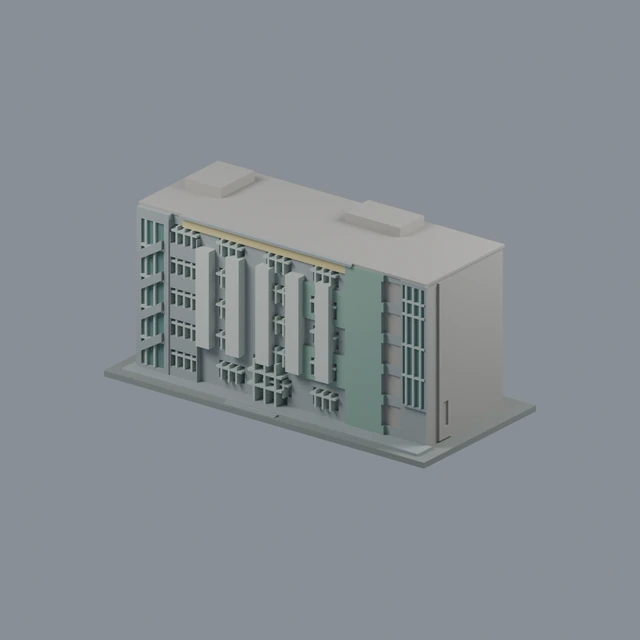
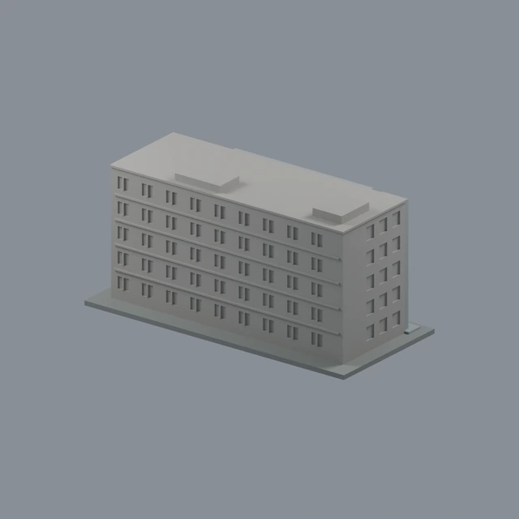
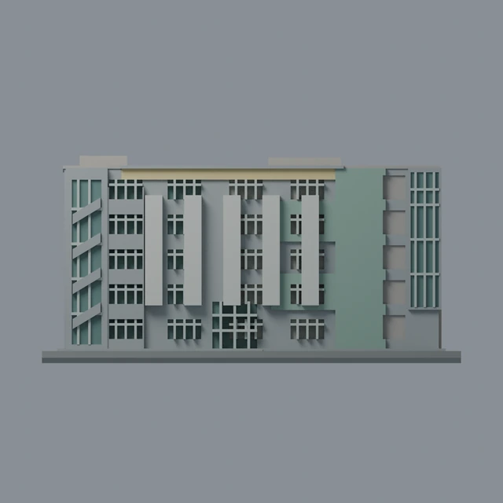
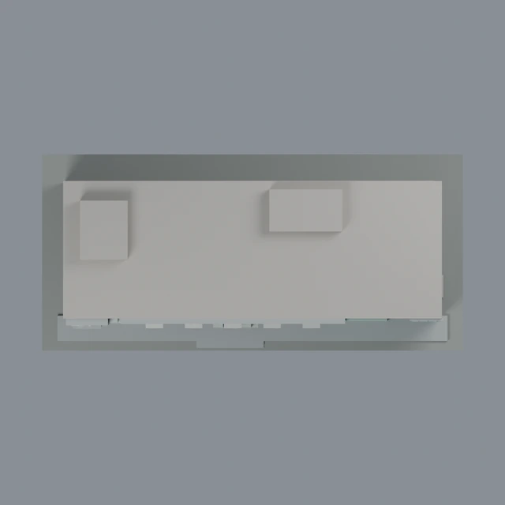

# 八甲校區 B4｜資訊工程館

## 模型預覽

| 模型預覽 | 模型預覽 | 模型預覽 |
| :---: | :---: | :---: |
|  正面斜視 |  背面斜視，未確認的外牆與平屋頂維持中性 |  正立面 |
|  頂視 |  |  |

## 八材質外觀版（2026-10-20）

[來源界線與四視角](appearance/README.md) · [表面色 3MF](appearance/nuub4-appearance.3mf) · [可編輯場景](appearance/scene.blend)

先以官方照片 3／8 校正原誤引的 B3 照片 12／13／15，再登錄灰色結構、白凸板、綠 H 浮凸、淡黃上帶及明確窗背；混合廊口和未知短端／背面／屋頂中性。不為照片新增光伏板、設備或文字。根 README、manifest 及兩者雜湊為明列更正。 原 STL 與歷史 QA 不變；這是外觀改善，不是新增幾何。原單色正面（歷史檔案留存，不作本頁預覽）／原單色背面（歷史檔案留存，不作本頁預覽）

依國立聯合大學官方校園地圖與外觀照片製作的近似建築模型。B4 設有資訊工程學系與電機資訊學院院辦；本作不是測繪模型，尚未實體試印。

## 外觀依據

保留五層長方形主體、正面交錯直立壁柱、上層黄色立面帶的淺浮雕輪廓、中央雙層入口、右端高玻璃窗格、左端斜向樓梯帶與右側大面實牆。原建築的綠色／白色壁面以低浮雕表達；STL 為單色幾何，不含色彩。未以顏色差異虛構深凹槽。

- [官方電機資訊學院建築相簿](https://secretary.nuu.edu.tw/p/132-1003-1098.php?Lang=zh-tw)
- [官方八甲校區地圖](https://www.nuu.edu.tw/p/426-1000-9.php?Lang=zh-tw)
- 來源登錄更正（2026-10-20）：官方照片 3 的正面與照片 8 的左斜俯視可確認資訊工程學系及原模型的白直片、綠色 H 區、右前窗格與左斜梯帶；精確連結見 `manifest.json`。原列照片 12／13／15 實際是 B3 光電館，已撤除錯引；本次只更正來源文件，原幾何並未因此改建。

照片未隨檔案散布；公開瀏覽不代表取得照片重製授權。上方圖片均從實際 STL 網格渲染。

## 檔案與列印

- `model.stl`：毫米單位、單一連通實體
- `model.obj`：相同幾何的交換格式
- `build_model.py`、`requirements.txt`：參數化生成程式及依賴
- `scene.blend`、`render_preview.py`：預覽場景與渲染程式；地板及燈光不屬於列印模型
- `validation.json`、`validate_model.py`：幾何檢查結果與重驗工具

含底板約 150 × 70 × 73.2 mm；底板厚 2.4 mm。每棟獨立設定最長邊 150 mm，並非全校統一比例。底板朝下，0.4 mm 噴嘴、0.16–0.20 mm 層高、3 道外牆、10–15% 填充可作為起始參數。凹窗窗格約 0.85–0.95 mm，樓梯斜帶與挑簷已加厚並連接主體。屋簷與凹窗上緣仍需在切片器檢查局部橋接／支撐。數位檢查不代替實體試印。

## 重建與重驗

安裝 `requirements.txt` 後執行 `python build_model.py`，再執行 `python validate_model.py model.stl --output validation.json`。Blender 4.3 可用 `blender -b -t 4 -P render_preview.py` 重建實際網格預覽。生成程式已重跑並比較 STL 雜湊。

## 精度限制

未取得可量測平面圖或實際尺寸。建築長寬、深度與屋高按照片近似，背面未有足夠清楚的同棟視角，採明確簡化的規律窗位，不宣稱為實際配置。屋頂僅保留低量體；機電設備、文字、欄杆、空調、外部逃生梯與細小線纜省略。窗與走廊採淺凹槽及實心背板，並未重建室內空間；正面斜樓梯帶為貼壁浮雕。

驗證包含水密、法向一致、正體積、單一連通實體、每邊兩面、頂點連結、平整接地及尺寸。未做實體列印、承載測試或建築工程驗證。

現行大圖用 [WebP 與原圖像素對照](display/archive-png.json) 校驗：在模型資料夾執行 `python display/verify_webp.py`（需 Pillow）。原彩色 PNG、原雜湊與舊說明均保留在[固定歷史版本](https://github.com/hplin50643/taiwan-buildings-3d/tree/538fc32bd569a7b3c1405434137f99b954669def/%E5%A4%A7%E5%B0%88%E6%A0%A1%E9%99%A2/%E5%9C%8B%E7%AB%8B%E8%81%AF%E5%90%88%E5%A4%A7%E5%AD%B8/buildings/bajia-b4-computer-science)。重繪請在暫存副本執行 `blender -b -t 3 --python-exit-code 1 -P appearance/source/render_appearance.py`，再加 `--replay-root /path/to/copy` 校對，不必把中間 PNG 放回主分支。
