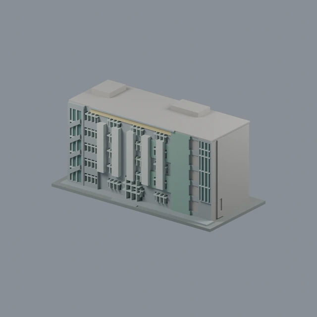
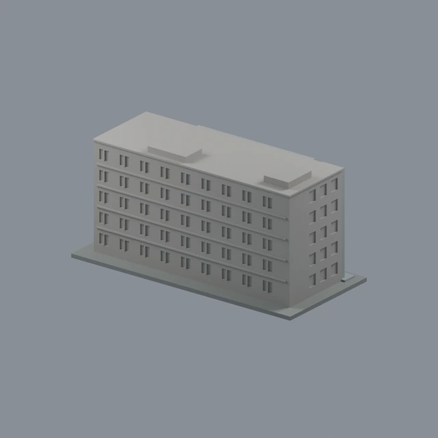
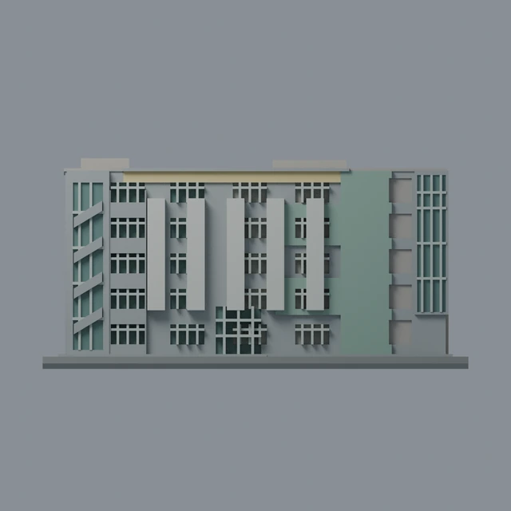
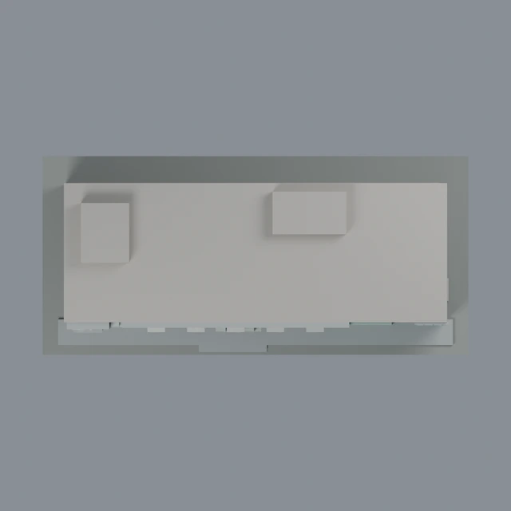

# 八甲 B4 資訊工程館｜現行彩色展示

## 模型預覽

| 模型預覽 | 模型預覽 | 模型預覽 |
| :---: | :---: | :---: |
|  正面斜視 |  背面斜視，未確認的外牆與平屋頂維持中性 |  正立面 |
|  頂視 |  |  |

四張無失真展示圖由同一份八材質 Blender 場景重繪。大小較小的縮圖可點擊放大；模型及材色不變。

[可編輯 Blender](../appearance/scene.blend) · [彩色 3MF](../appearance/nuub4-appearance.3mf) · [STL](../model.stl) · [同幾何 OBJ](../model.obj) · [渲染驗證](render-proof.json)

[原模型與來源勘誤](../README.md)及[原外觀、來源與限制](../appearance/README.md)保留原始預覽與校驗。原 PNG 和技術檔未移除或覆寫。B4 使用的官方來源並非鄰近 B3 光電館。

現行大圖用 [WebP 與原圖像素對照](archive-png.json) 校驗：在模型資料夾執行 `python display/verify_webp.py`（需 Pillow）。原彩色 PNG、原雜湊與舊說明均保留在[固定歷史版本](https://github.com/hplin50643/taiwan-buildings-3d/tree/538fc32bd569a7b3c1405434137f99b954669def/%E5%A4%A7%E5%B0%88%E6%A0%A1%E9%99%A2/%E5%9C%8B%E7%AB%8B%E8%81%AF%E5%90%88%E5%A4%A7%E5%AD%B8/buildings/bajia-b4-computer-science)。重繪請在暫存副本執行 `blender -b -t 3 --python-exit-code 1 -P appearance/source/render_appearance.py`，再加 `--replay-root /path/to/copy` 校對，不必把中間 PNG 放回主分支。
